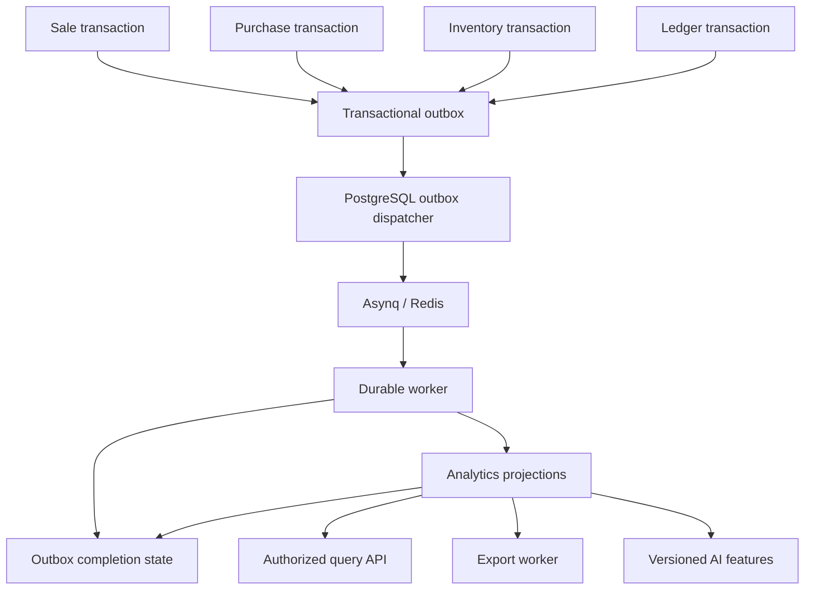

# Pharmaciano:ERP — Analytics Module Contract

> **Module:** `analytics` | **API:** `/api/v1` | **Architecture:** Go modular monolith
> **Storage:** PostgreSQL (authoritative for source outbox events, Analytics projections, delivery state and job state); Redis/Asynq (delivery transport and optional cache, never event/projection/job authority)
> **Consistency:** Source business facts are strongly consistent; Analytics projections are eventually consistent and disclose freshness.
> **Status:** Architecture contract. Inspect the pinned repository commit and migrations before implementation.

## 0. Contract authority and implementation gates

This contract follows the existing Pharmaciano architecture: handler → service → repository; constructor injection; PostgreSQL/pgx; transaction-aware database access (existing `db.WithTx`, `FromCtx`, `ReadFromCtx` patterns); existing Auth/Principal, tenant/branch scope, RBAC, rate limiting, idempotency, Audit and error patterns; and typed cross-module ports. The repository now has a PostgreSQL transactional outbox schema/API plus an Asynq dispatcher/worker runtime. The runtime remains disabled by default and has no domain handlers or source-module producers yet. Analytics event contracts, projections and API behavior are still unimplemented.

This is not evidence that every capability is already implemented. Before coding, inspect the pinned repository commit and deployed migration state, transaction and outbox interfaces, worker/job lifecycle, read-replica routing, rate-policy registry, Audit API and source-module event contracts. Reuse actual project names and interfaces. If a capability is missing, implement the smallest shared platform contract first. Do not create a parallel foundation.

### 0.1 Repository baseline and readiness

The following is the observed repository baseline, not a claim that the target design is already operational:

| Area | Observed baseline | Contract consequence |
|---|---|---|
| Analytics module | `internal/modules/analytics/` source files contain only the package declaration; there are no implemented handlers, services, repositories, routes or behavior tests. | This document is a target contract. Do not treat its endpoint list or projections as implemented. |
| Database/migrations | PostgreSQL uses pgx and SQL migrations. Migration `000028` adds the shared outbox table; no Analytics-owned projection, checkpoint or reconciliation tables exist. | Inspect the deployed migration version before rollout. Do not infer the deployed state from the checked-in maximum alone. |
| Outbox/events | A tenant-scoped PostgreSQL outbox table, transaction-only append API, aggregate ordering, claim leases and retry/quarantine state now exist. No source module inserts events and no Analytics event contracts exist yet. | A source transaction must call the outbox append API in that same transaction. Define each source event, aggregate version and privacy-safe payload before connecting a producer. |
| Worker/broker | The worker now initializes PostgreSQL, health/metrics endpoints and an optional bounded outbox dispatcher/Asynq server. It is disabled by default; no domain handlers are registered. PostgreSQL leases and event state remain authoritative if Redis loses queued tasks. | Register a finite handler for each event type before enabling the worker. Handler projection writes and marking the event complete must share one PostgreSQL transaction. |
| Outbox operations | Retention/archival, audited operator replay and resolution of failed events are not implemented. A failed earlier aggregate event blocks later versions to preserve ordering. | Define retention, replay authorization/audit, and failed-event resolution before production producers are enabled. Never delete or skip an event silently. |
| Export lifecycle | `/reports/generate` and report job status/download are described in the API catalog, but the Report package is also currently a placeholder. | Select one lifecycle owner before export implementation. Do not build parallel Analytics and Report job/artifact systems. |
| Audit | The current technical audit sink can log and swallow PostgreSQL insert errors; it is not a durable mandatory business-audit port. | Export/rebuild audit evidence requires a durable Audit contract or a transactionally persisted event. Do not claim an action was audited merely because the best-effort sink was called. |
| Authorization | `analytics:view` and `analytics:export` are in the permission catalog; configured rate policies use keys such as `auth_read` and `export`. Optional Analytics admin/cross-branch and customer-analytics permissions are not cataloged. | Reuse exact `module:action` permissions and registered rate keys. Add any new permission to the catalog and role policy in the same change; do not assume an optional permission exists. |
| Money | The current platform uses a shared `Money` string alias, but the current Ledger and Inventory contracts/schema are BDT-only; there is no general shared currency arithmetic/FX contract. | Initial Analytics financial values are BDT-only and must preserve integer minor units. Do not claim multi-currency conversion or invent a new shared money type in this module. |
| API compatibility | The API catalog lists a broad Analytics surface, but the module has no routes and OpenAPI has no Analytics paths. The Report catalog also describes endpoints whose package is currently a placeholder. | Treat these as unimplemented proposals. Contract and implement only the gated sales-first scope below; add OpenAPI paths when response DTOs and shared response conventions are frozen. Creating an export job must not be a `GET`. |

These are blocking readiness gaps, not reasons to substitute direct operational-table joins, best-effort publication, or an in-memory implementation.

### Binding rules

1. Analytics is read-only with respect to operational business facts. It does not own or mutate sales, purchase, stock, batches, movements, adjustments, valuation, payments, customers, journals or chart of accounts.
2. Source modules append durable outbox events in the same transaction as their committed facts.
3. Analytics consumes events asynchronously and updates only Analytics-owned tables.
4. Dashboard aggregation, export generation and projection work never run inside or block checkout, goods receipt, inventory adjustment, journal posting or payment finalization.
5. Ledger owns accounting semantics. Official financial statements and profitability must use Ledger-approved posted-fact/read contracts.
6. Inventory owns balances, batches, movements, stock conditions, reservations and valuation. Analytics must not reconstruct authoritative stock from incomplete sale events.
7. At-least-once delivery is expected. For the initial single-handler path, the outbox event's completion state is the durable acknowledgement and commits with projection writes. Unique contribution identities still prevent duplicate effects during replay/rebuild.
8. Every projection has a grain, schema version, source identity, ordering rule, watermark, rebuild strategy and reconciliation rule.
9. Tenant, branch and warehouse scope are enforced at request time, worker execution and download time.
10. Money uses source-owned integer minor units and currency code with exact arithmetic. The initial system is BDT-only; never use `float32` or `float64` for money. Quantities use canonical Inventory/Medicine base-unit precision.
11. Redis is never the authority for authorization, projections, event receipts, job status or financial values.
12. Projection drift is detected and corrected by replay/rebuild from authoritative source contracts. Analytics never repairs source facts.

### Out of scope

- Posting journals or computing official P&L, balance sheet, tax or cash flow independently.
- Creating/changing sales, purchase, inventory, batch, payment or customer records.
- Arbitrary SQL, unrestricted query builders or client-defined formulas.
- Full event sourcing, Kafka, a separate warehouse or microservice split for the initial modular monolith.
- Autonomous AI purchasing or stock mutation.
- Replacing the Report module's artifact/job lifecycle if Report already owns it.

---

## 1. Purpose and ownership

Analytics converts committed business facts into fast, scoped operational insight:

- Today dashboard.
- Sales overview and breakdowns by branch, category, medicine, cashier and hour.
- Inventory turnover, valuation and batch aging.
- Top customers/products and slow-moving products.
- Ledger-backed profitability.
- Bounded asynchronous CSV/XLSX exports.
- Freshness, projection health and reconciliation.
- Versioned, reproducible feature datasets for future AI consumers.

### 1.1 Source-of-truth matrix

| Fact | Authoritative owner | Analytics behavior |
|---|---|---|
| Completed sale, line, discount, tax, return, void | Sale | Aggregate immutable posted facts |
| Cashier at sale time | Sale/Auth identity snapshot | Group by immutable actor ID |
| Branch/warehouse ownership | Organization/Branch/Warehouse | Validate scope and preserve historical dimension |
| Medicine/category/brand identity | Medicine/MasterData/Brand | Use stable IDs and effective labels |
| Stock balance, reservation, batch, expiry, condition | Inventory | Consume Inventory read contract/snapshot |
| Stock movements and adjustments | Inventory | Aggregate immutable movement identities |
| Acquisition cost and cost layers | Inventory valuation | Use Inventory valuation outputs |
| Revenue, COGS, tax, receivables, cash, journals | Ledger | Use posted Ledger facts/read contracts |
| PO, receipt and supplier invoice lifecycle | Purchase | Aggregate operational procurement facts |
| Customer profile/PII | Customer | Use minimum necessary pseudonymous identity |
| User activity | Audit | Use approved redacted Audit read interface |
| Export artifact lifecycle | Report/platform if present | Reuse it; do not duplicate |

No Analytics repository writes another module's tables. Cross-module reads use documented ports, versioned events or explicitly approved read-only contracts. Analytics must not import concrete source repositories. Source modules must not import Analytics services.

### 1.2 Dependency direction

| Dependency | Type |
|---|---|
| Auth, session, Principal, effective scope | Hard request-time |
| RBAC/authorization resolver | Hard request-time and job-time |
| Sale/Purchase/Inventory | Read contracts + versioned events |
| Ledger | Hard read contract for financial measures |
| Medicine/MasterData/Customer | Read contracts + dimension events |
| Outbox/worker infrastructure | Hard infrastructure dependency |
| PostgreSQL | Hard |
| Redis/Asynq | Delivery transport when the outbox worker is enabled; never authoritative |
| Report | Conditional shared export lifecycle |
| AI | Downstream consumer only |

Analytics defines narrow consumer interfaces; the composition root wires implementations. No cyclic dependency and no generic cross-module god-repository.

---

## 2. Request lifecycle, middleware and authorization

All routes are registered through the existing versioned router. Use existing middleware and conventions; exact names/order must match the pinned repository.

```text
HTTPS / reverse proxy
 → request ID / correlation context
 → CORS, security headers, CSRF policy where applicable
 → authentication + session validation
 → trusted Principal
 → effective organization + branch scope
 → current authorization resolution
 → route rate policy
 → permission enforcement
 → handler DTO validation
 → Analytics service
 → tenant/scope-constrained repository
 → PostgreSQL projection
 → response with freshness metadata
```

### 2.1 Principal and scope rules

- `organization_id` comes only from trusted Principal/context, never request body/query.
- Client-supplied `branch_id` is a filter selector, not authority. Intersect it with effective authorized branch scope.
- Omitted `branch_id` means only the scope defined by the existing Principal contract: single branch, authorized subset or organization-wide only when explicitly allowed. Never default to unrestricted.
- `SUPER_ADMIN` cross-branch access remains organization-scoped; it is not a cross-tenant bypass.
- Warehouse filters must resolve warehouse → branch → organization and be intersected with the caller's scope.
- Do not trust `user_id`, `cashier_id`, role, permission or branch scope supplied by clients.
- Apply tenant predicates in repository SQL as defense-in-depth, not just handler checks.
- Historical rows must remain explainable after a product/branch is deactivated; do not apply active-only filters to historical aggregates.

### 2.2 Permission catalog

Use the exact canonical spelling already present in RBAC. The endpoint brief uses colon notation; map it to the existing convention rather than introducing a second policy system.

| Permission | Meaning |
|---|---|
| `analytics:view` | Read Analytics datasets inside authorized organization/branch scope |
| `analytics:export` | Request exports only for datasets the principal is permitted to view |
| `analytics:cross_branch_view` (not currently cataloged) | Separate grant only if policy requires cross-branch comparison beyond the caller's effective scope |
| `analytics:admin` (not currently cataloged) | Projection health/rebuild/reconciliation administration, if exposed through an API |

`analytics:view` is not blanket permission to reveal every field. Apply field-level source permissions and data minimization.

Do not hard-code role names such as `SUPER_ADMIN` as the authorization rule for cross-branch access. Enforce current organization and effective branch scope; if a separate cross-branch grant is required, add it to the permission catalog and role policy before exposing the endpoint. Update the API catalog, OpenAPI and route tests to match.

### 2.3 Export authorization is re-evaluated

1. Validate current permission and scope at job request.
2. Persist requester, tenant, requested scope, dataset, normalized filters and schema/policy version.
3. At execution, resolve current user/session/account and permissions again.
4. Intersect requested scope with current scope. If no longer authorized, fail or require a new narrower job; never silently widen.
5. Reauthorize status and download. A guessed job UUID is not access.
6. A schedule/job owner losing privileges does not retain prior access.

---

## 3. Data architecture: outbox → projections

Use transactional outbox + asynchronous projections inside the modular monolith. Do not implement full event sourcing.



Source facts and their outbox events commit atomically. Analytics consumes after commit in its own short transaction. A projection failure never rolls back the source sale/receipt/journal.

### 3.1 Event envelope

Every event needs:
- Unique `event_id`, `event_type`, `schema_version`.
- `occurred_at` and source commit/recorded timestamp.
- `organization_id`, applicable `branch_id`.
- `source_module`, `aggregate_type`, `aggregate_id`, `aggregate_version` or ordered source cursor.
- Stable source operation/document identity.
- Correlation, causation and trace/request IDs where available.
- Minimal immutable committed facts or stable references plus a read contract.

Never include passwords, tokens, payment credentials, bank secrets, prescription details or unnecessary PII. Events describe committed facts, not requested intentions. Draft carts and pending payment attempts are not completed sales.

The source transaction must append the immutable event to PostgreSQL in the same transaction as the committed fact. The dispatcher claims rows with `FOR UPDATE SKIP LOCKED`, a bounded lease and a fencing token, then enqueues an Asynq task containing only event ID and lease token. The worker validates the token; handler effects and marking the event complete commit in the same PostgreSQL transaction. An expired lease, lost Redis task or rolled-back handler is safely redriven. The status row is the delivery acknowledgement for the single registered handler chain. If independent consumers are introduced, add per-consumer delivery/receipt state before allowing one consumer to acknowledge or block another. Retain events until the approved replay/retention policy permits archival; Redis and task IDs are not authoritative.

The current outbox enforces one event for each `(organization_id, aggregate_type, aggregate_id, aggregate_version)`. A source must emit one canonical event per aggregate version; if it needs multiple events for one version, extend the schema with an explicit event sequence before adding producers.

Define how an operator can replay an event range and how a new consumer bootstraps from source snapshots plus a watermark. Never acknowledge or retire the only durable copy before the consumer's projection transaction commits.

### 3.2 Required semantic event families

Exact event names must align with existing event registry. These are semantic requirements, not instructions to duplicate events.

| Source | Fact/event | Analytics use |
|---|---|---|
| Sale | Completed/posted sale | Sales, quantity, cashier, branch, category, medicine |
| Sale | Return/credit | Net sales correction and return quantities |
| Sale | Void/reversal | Reverse original contribution correctly |
| Sale | Tender/refund status | Operational payment breakdown only |
| Purchase | PO ordered/cancelled | Procurement pipeline |
| Purchase | Goods receipt posted/partial | Received quantity trends |
| Purchase | Supplier invoice posted/credited | Operational invoice trend; financial value from Ledger |
| Inventory | Receive/consume/return | Movement throughput |
| Inventory | Adjust/write-off | Adjustment and shrinkage |
| Inventory | Transfer dispatch/receive/loss | Internal movement/in-transit insight |
| Inventory | Recall/block/expiry | Sellable availability and risk |
| Inventory | Reservation/release/expiry | Reserved vs available trend |
| Inventory | Valuation snapshot | Inventory carrying value |
| Ledger | Journal posted/reversed | Financial projection/reconciliation |
| Medicine/MasterData | Product/category changed/deactivated | Dimension snapshots |
| Branch/Warehouse | Scope/location changed | Dimension validity |

### 3.3 Ordering, duplicates and corrections

- At-least-once delivery is expected.
- The outbox event ID is stable and unique; handler effects and its `completed` status commit together. If delivery is later split among independent consumers, deduplicate with unique `(consumer_name,event_id)` in the same transaction as each projection change.
- On a duplicate event ID, compare the stored envelope/payload hash; an ID reused for different content is an integrity failure to quarantine, not a successful duplicate.
- For state-replacement events, use aggregate version/sequence to reject stale overwrites.
- For additive facts, use immutable source event/operation identity and unique contribution keys; do not rely on delivery order.
- Corrections must reference original contribution and be explicit reversal/correction events.
- Do not use `occurred_at` alone as ordering key; clocks drift and timestamps collide.
- If source has no version, require source-owned ordered change feed or periodic authoritative reconciliation. Do not invent ordering.
- Exactly one handler chain is registered per event type in this foundation. If independent consumers are needed, model separate deliveries rather than sharing one completion status.

---

## 4. Analytics-owned logical schema

These are proposed tables, not claims about current migrations. Inspect migration history first. Use existing UUID, timestamps, BaseModel, migration and SQL conventions. Every tenant projection has `organization_id NOT NULL`; branch projections include `branch_id` where meaningful. Use composite tenant-safe foreign keys for stored dimension references. Preserve historical labels/snapshots.

### 4.1 Reliability tables

The shared `outbox_events` row provides status, handler retry count, dispatch count, next retry time, lease token/expiry and bounded error class. Handler retry count advances only when a handler attempt is reserved; broker dispatch failures update dispatch count and must not consume the handler retry budget. For this single-handler path, its `completed` state is the durable receipt and is updated in the projection transaction. Do not add a second receipt table with weaker transaction semantics. If independent consumer fan-out is approved, add a separate per-consumer delivery table and replay contract first.

**`analytics_projection_checkpoints`**
- consumer/projection, source cursor or sequence, schema version, watermark, updated time.
- Only use if source ordering semantics support it. Checkpoint is an optimization, never a reason to skip an unprocessed event.

**`analytics_projection_failures`**
- event ID, consumer, error class, attempts, first/last failure, next retry and sanitized diagnostic.
- Do not store raw sensitive payload in failure logs.

Receipt and projection update commit together. A failed update rolls back the receipt so retry is possible.

### 4.2 Suggested projections

- `analytics_sales_daily`
- `analytics_sales_hourly`
- `analytics_sales_branch_daily`
- `analytics_sales_category_daily`
- `analytics_sales_medicine_daily`
- `analytics_sales_cashier_daily`
- `analytics_customer_activity_daily` (only if privacy policy approves)
- `analytics_purchase_daily`
- `analytics_inventory_movement_daily`
- `analytics_inventory_turnover_period`
- `analytics_inventory_aging_snapshot`
- `analytics_inventory_valuation_snapshot`
- `analytics_product_velocity_daily`
- `analytics_dimension_snapshots`
- `analytics_projection_runs`
- `analytics_reconciliation_runs`

Every projection defines:
- Tenant and grain key.
- Business date/timezone.
- Currency and base-unit identity.
- Additive measures vs derived ratios.
- Source contribution identity/recomputation method.
- Source watermark and projection version.
- Unique grain constraint and query indexes.
- Rebuild/reconciliation strategy.

Persist source contributions (or an equivalent immutable, deduplicated source identity ledger) whenever aggregate updates cannot be reconstructed safely from retained source data. Define retention for receipts, contributions, source outbox rows and archived events together: deleting deduplication evidence sooner than the maximum replay horizon can silently double-count. A projection rebuild must be possible from an authoritative source snapshot plus a documented event watermark, or the projection must be explicitly classified as non-rebuildable and not promised as reconciled.

### 4.3 Grain and aggregation examples

| Projection | Grain | Additive measures | Derived measures |
|---|---|---|---|
| Sales daily | org + branch + business date + currency | count, gross, discount, tax, net, returns, quantity | AOV, margin ratio |
| Sales hourly | org + branch + date + hour + currency | count, net sales, units | daily share |
| Category daily | org + branch + date + category snapshot + currency | units, net sales, returns | category share |
| Medicine daily | org + branch + date + medicine/variant + base unit + currency | units, net sales, count | velocity |
| Cashier daily | org + branch + date + cashier ID + currency | count, net sales, refunds | average basket |
| Movement daily | org + warehouse + date + movement type + product/batch as needed | signed base quantity, count | net movement |
| Inventory aging | org + warehouse + batch + snapshot date | on-hand quantity, carrying value | age bucket |
| Valuation | org + warehouse + valuation date + currency | carrying value | valuation change |
| Turnover | org + branch/warehouse + period + product/category + currency | COGS, average inventory value inputs | turnover, days on hand |

Never sum unlike currencies. Never sum quantities across incompatible base units. Normalize through canonical Medicine/Inventory conversion contracts and retain base-unit identity/scale.

### 4.4 Projection write strategy

For simple immutable additive facts, apply signed contributions with unique contribution identity. For corrections and complex measures, persist contributions and recompute affected buckets. Do not decrement aggregates based only on an untrusted or duplicate event.

Transaction:
1. Lock and verify the claimed outbox event and fencing token.
2. Insert immutable contribution or apply idempotent update.
3. Upsert affected projection grain using exact arithmetic.
4. Update watermark/freshness.
5. Mark the outbox event completed.
6. Commit all effects together.

---

## 5. Metric definitions and business semantics

Each metric has a documented formula, source, grain, time basis, exclusions and owner. Names must not conceal differing semantics.

### 5.1 Sales

| Metric | Definition |
|---|---|
| Gross sales | Completed sale line gross before discounts/returns, from Sale snapshots |
| Discounts | Posted line/document discounts using Sale's allocation semantics |
| Tax | Sale snapshot for operational sales; official liability from Ledger |
| Net sales | Gross less discounts and posted returns/credits under Sale's canonical definition; do not subtract voids twice |
| Completed count | Completed/posted sales only; exclude drafts, failed checkouts, voided docs |
| AOV | Net sales / eligible completed count; define treatment of fully returned sales |
| Units sold | Completed base quantity less returned base quantity, grouped by base-unit identity |
| Refunds | Operational refund facts; actual settlement/reversal from payment/Ledger source |
| Peak hour | Business timezone, DST-aware, explicit hour bucket |
| Cashier | Immutable cashier/actor ID on committed sale |
| Branch | Sale's branch snapshot; cross-branch access explicitly authorized |

Do not recompute historical discounts/tax using today's rules. Do not count tender attempts as sales. If Sale has no stable canonical net amount/return semantics, block implementation until its contract is frozen.

### 5.2 Inventory turnover

Preferred formula:

`Inventory turnover = period COGS / average inventory carrying value`

`Days inventory on hand = days in period / inventory turnover`

- COGS comes from Ledger posted facts/read contract.
- Average carrying value comes from Inventory valuation snapshots. Freeze opening/closing average vs daily weighted average and version the method.
- Never use current stock × latest purchase price for historical valuation.
- Quarantined, recalled, expired, damaged and non-sellable stock are not sellable inventory; show separate condition buckets.
- In-transit stock is separate and must not be double-counted in source and destination.
- Reserved is not consumed. Report on-hand, reserved, available and sellable separately.
- Return-to-quarantine stock is not immediately sellable.
- Same currency and valuation policy required.

### 5.3 Inventory valuation

- Inventory owns valuation method, cost layers, landed cost and valuation adjustments.
- Analytics displays Inventory's valuation output with `as_of`, policy and source watermark.
- Do not multiply on-hand by current medicine purchase cost.
- Distinguish physical, sellable, reserved, quarantined, expired and in-transit.
- Ledger inventory control account is the financial counterpart. Differences are reconciliation exceptions, not silently patched.

### 5.4 Batch aging and expiry

Use Inventory's canonical stock-entry/age date, not an assumed manufacture date. Separate:
- Stock age: days since stock entered warehouse/stock state.
- Expiry horizon: days until expiry.
- Expired: according to Inventory's canonical expiry rule/business date.
- Near expiry: configured, versioned policy window.
- Age buckets: non-overlapping/exhaustive; exact thresholds are a policy decision.

Read batch quantity from Inventory balances by warehouse, batch and condition. Never infer it from sale allocations.

### 5.5 Slow-moving products

- Define observation window and minimum data sufficiency.
- Use completed sales net of returns, normalized to base unit.
- Incorporate sellable on-hand and stockout periods. Zero sales while out of stock is not necessarily low demand.
- Distinguish `no_demand`, `insufficient_history`, `stockout_censored`, `slow_moving`, `inactive`.
- New products without sufficient history are not automatically slow-moving.
- Thresholds are versioned configuration.
- Recommendations are informational; Analytics cannot alter reorder settings or create purchases.

### 5.6 Profitability

- Gross/contribution margin derives from posted revenue and posted COGS using Ledger-approved read contract.
- Include returns, discounts, tax and COGS reversals consistently.
- Tax collected for authorities is not revenue unless Ledger policy explicitly says so.
- Branch/product profitability requires Ledger journal dimensions or verified allocation contract.
- Do not allocate organization overhead by arbitrary ratios. Unallocated overhead stays explicitly unallocated.
- If required Ledger dimensions are missing, return unavailable/unsupported rather than approximate values.
- Official statements remain Ledger/Report responsibilities.

### 5.7 Top customers

- Tenant-scoped identity; anonymous/walk-in is a separate bucket.
- Apply Customer privacy and field-level access.
- Prefer pseudonymous IDs in projections; resolve display names via Customer read port when permitted.
- Apply canonical merge rules.
- A pseudonymous ID is still linkable personal data while it can be resolved. Define retention, merge, anonymization/deletion propagation and legal-retention behavior before persisting customer-level contributions.
- Do not expose customer rankings, identifiable purchase aggregates or drill-down purchase history under generic `analytics:view` alone. Require an explicitly approved permission/privacy policy with seeded grants, or omit the customer endpoint.
- Never expose prescription evidence or sensitive purchase history to generic analytics roles.

---

## 6. Inventory consistency: balances, movements, batches and adjustments

This is a critical ownership boundary.

| Inventory fact | Authority | Analytics rule |
|---|---|---|
| Current balance | Inventory | Read only via approved read port/projection feed |
| Batch identity/expiry | Inventory | Never recreate/edit |
| Warehouse stock | Inventory | Validate warehouse → branch → organization |
| Reservation | Inventory | Separate reserved from available |
| Movement | Inventory immutable movement ledger | Preserve movement identity and sign |
| Adjustment | Inventory adjustment workflow | Include only posted/approved |
| Transfer | Inventory dispatch/receipt lifecycle | Separate in-transit, receipt, loss, reversal |
| Cost layer | Inventory valuation | Consume valuation outputs only |
| Valuation | Inventory snapshot/read contract | Never derive from latest purchase price |
| Recall/quarantine/expiry | Inventory condition state | Exclude from sellable availability |

### 6.1 Movement semantics

Preserve movement type/sign. Distinguish:
- Purchase receipt / accepted goods receipt.
- Sale consumption.
- Customer return and disposition.
- Supplier return.
- Manual increase/decrease adjustment.
- Damage, expiry and write-off.
- Transfer dispatch, receipt and loss.
- Opening stock.
- Reservation/release (not physical movement).
- Revaluation (value change, not quantity movement).

Retain source movement ID, type, source operation, warehouse, batch, product/variant, base unit, signed quantity, effective timestamp and source version. Transfer dispatch and receipt are two legs of one internal movement, not two new organization-wide stock additions.

### 6.2 Reconciliation and rebuild

Periodically compare projection to Inventory authoritative snapshot:
- org/warehouse/product/variant/base unit.
- batch and stock condition.
- on-hand, reserved, available and sellable separately.
- valuation by currency and policy.
- movement count/watermark/source version.

Differences create exceptions with source/projected values, scope, time, severity and correlation IDs. Analytics does not repair Inventory.

Safe rebuild:
1. Obtain consistent Inventory snapshot + watermark.
2. Record snapshot version/watermark.
3. Build shadow projection.
4. Replay events after watermark.
5. Reconcile counts and totals.
6. Atomically switch active projection.
7. Retain prior version for bounded rollback.
8. Audit operator, reason and outcome.

If Inventory cannot provide a consistent snapshot + watermark, do not claim exact replay. Freeze a source-owned snapshot contract first.

---

## 7. Ledger consistency and financial analytics

Analytics does not post journals, alter balances or infer journal lines.

### 7.1 Financial source hierarchy

| Output | Source |
|---|---|
| Revenue, COGS, tax, receivables, cash/bank, payables | Ledger posted journal/read model |
| Sales counts/units | Sale |
| Stock quantity | Inventory |
| Carrying value | Inventory valuation; reconcile to Ledger control account |
| Profitability | Ledger-approved profitability read contract |
| Receipt quantity | Purchase; recognized financial value from Ledger |
| Tender attempts/provider status | Sale/payment operational facts |
| Settled money/reversals | Ledger/payment settlement contract |

### 7.2 Journal processing

- Consume only committed `JournalPosted` / `JournalReversed` semantic facts or Ledger read contract.
- Draft, pending, rejected or unposted journals are not financial truth.
- Deduplicate by journal/source posting identity and event ID.
- Reversal references original journal and follows Ledger correction semantics.
- Do not count both a journal event and a source-domain event for the same financial fact.
- Sale `paid_amount`, Purchase `paid_amount` and tender status are not general-ledger balances.
- Fiscal close/reopen is Ledger-owned. Respect period and as-of semantics.
- Preserve currency and rounding rules.

Official trial balance, P&L, balance sheet, cash flow and statutory reports belong to Ledger/Report. Analytics may display Ledger-provided output, not an approximation under an official label.

### 7.3 No shared source transaction

Analytics consumer has its own short transaction:
- receipt insert;
- projection contribution/update;
- checkpoint/freshness update;
- commit.

It never joins the original Sale/Purchase/Inventory/Ledger transaction. Source transaction has already committed. Analytics failure cannot roll it back.

---

## 8. API contract

All paths are relative to `/api/v1`. Existing response envelope, OpenAPI, errors and pagination conventions take precedence.

| Method & Path | Rate | Permission | Description |
|---|---|---|---|
| `GET /analytics/dashboard` | `rate_auth_read` | `analytics:view` | Today snapshot; optional `branch_id` |
| `GET /analytics/sales/overview` | `rate_auth_read` | `analytics:view` | `from`, `to`, `group_by=day\|week\|month`, optional branch |
| `GET /analytics/sales/by-branch` | `rate_auth_read` | `analytics:view` + effective scope; optional separately seeded cross-branch grant | Comparison only across currently authorized branches |
| `GET /analytics/sales/by-category` | `rate_auth_read` | `analytics:view` | Category performance |
| `GET /analytics/sales/by-medicine` | `rate_auth_read` | `analytics:view` | Top-N; limit default 20, bounded |
| `GET /analytics/sales/by-cashier` | `rate_auth_read` | `analytics:view` | Cashier performance |
| `GET /analytics/sales/by-hour` | `rate_auth_read` | `analytics:view` | Peak hours in business timezone |
| `GET /analytics/inventory/turnover` | `rate_auth_read` | `analytics:view` | Ledger COGS + Inventory valuation |
| `GET /analytics/inventory/valuation` | `rate_auth_read` | `analytics:view` | Inventory valuation snapshot |
| `GET /analytics/inventory/aging` | `rate_auth_read` | `analytics:view` | Batch age/expiry buckets |
| `GET /analytics/customers/top` | `rate_auth_read` | `analytics:view` + explicitly approved customer-analytics permission | Disabled until privacy/retention policy and permission are approved |
| `GET /analytics/products/top` | `rate_auth_read` | `analytics:view` | Top products |
| `GET /analytics/products/slow-moving` | `rate_auth_read` | `analytics:view` | Slow-moving classification |
| `GET /analytics/profitability` | `rate_auth_read` | `analytics:view` | Ledger-backed product/branch margin |

Analytics does not expose a `GET` that creates an export job. Use the existing Report contract/API shape, `POST /reports/generate`, for an allow-listed Analytics dataset when the Report lifecycle is implemented. Analytics remains the dataset provider; Report/platform owns job status, download, artifact storage and cleanup. Creation must require the current `analytics:view` and `analytics:export` grants and the Report API's `reports:export` authorization.

The dataset key and normalized filter schema are allow-listed, never a path, SQL fragment or table name. Update the API catalog/OpenAPI to remove the mutating GET row and document the chosen Report integration and permission intersection. Job status and download continue to use the Report-owned endpoints and must reauthorize against Analytics dataset scope. If Report remains unavailable, block export release and choose exactly one job/artifact owner before implementation; do not create a second Analytics export subsystem.

### 8.1 Validation

- `from` inclusive, `to` exclusive; require valid range and `from < to`.
- Enforce maximum interactive date range; larger ranges use export.
- Use organization business timezone from trusted settings, not browser locale.
- `group_by` allow-list only: day/week/month.
- `limit` default 20, max 100 unless measured/product-approved.
- Branch/warehouse IDs are UUIDs and authorized.
- Initial release accepts BDT only; reject other currencies and never silently convert.
- Sort fields and filters are typed allow-lists.
- Parameterize values; never concatenate client values into SQL identifiers.
- Reject unsupported filter combinations rather than ignoring them.
- Set and document an explicit upper bound for interactive ranges and result cardinality before enabling each endpoint. Larger or unbounded queries must use the authorized async export path.
- Use deterministic ordering with a unique tie-breaker for every ranked/list result; define cursor fields and reject cursors whose normalized filter/scope hash does not match the request.
- Define the output representation and overflow behavior for aggregated counts, quantities and monetary sums. Never silently narrow PostgreSQL `NUMERIC`/`BIGINT` results or convert money to JSON floating point.

### 8.2 Freshness metadata

Every response includes (in standard envelope/meta):
- `generated_at`;
- `data_as_of` and/or per-source watermark;
- `freshness_lag_seconds` when meaningful;
- `projection_version`;
- `source_status` (`current`, `delayed`, `rebuilding`, `degraded`);
- timezone;
- currency and base-unit metadata where applicable.

Do not call data “real-time” unless it is a direct source read with a documented consistency guarantee. If a dashboard combines source watermarks, disclose each; do not pretend there is one timestamp.

Empty result is valid. Missing projection is not zero: mark unavailable/degraded.

For multi-source responses, include source-specific watermark/as-of and status, since sale, inventory and ledger projections cannot share an atomic snapshot. Define stable response DTOs in OpenAPI; do not expose database rows or make consumers infer whether a missing/null measure means zero, unsupported, delayed or unavailable.

---

## 9. Export jobs and artifact security

Exports are asynchronous and resource-bounded. Reuse Report's job/artifact system if it owns this lifecycle.

```text
authorized request
 → validate dataset/filters/scope/range/format
 → durable job + operation identity
 → 202 Accepted + job ID
 → worker claims lease/fencing generation
 → reauthorize current user/scope
 → bounded consistent projection read
 → render CSV/XLSX safely
 → private object storage
 → persist checksum/metadata/expiry
 → ready
 → reauthorize download and issue short-lived access
 → cleanup after retention
```

### 9.1 Job fields

Job ID, org, requested branch/warehouse scope, requester, dataset/schema version, normalized filters/request hash, format, locale/timezone/currency, status (`queued`, `running`, `ready`, `failed`, `cancelled`, `expired`), attempts, lease owner/expiry/fencing generation, timestamps, row count, byte size, checksum, opaque storage key, failure class and retention expiry.

PostgreSQL unique durable operation identity is authoritative. Redis idempotency middleware is only an optimization. Same key + same hash returns same job; same key + different hash returns idempotency conflict.

### 9.2 Worker behavior

- Claim jobs with PostgreSQL row locks and `FOR UPDATE SKIP LOCKED` where appropriate for independent job claims.
- `SKIP LOCKED` is for queue claims, not correctness-sensitive report snapshots.
- Persist job state in PostgreSQL. Create the durable job and its dispatch intent atomically, or use a recoverable database-polling dispatcher; never rely on a one-time best-effort enqueue.
- PostgreSQL is the source of truth. Handler effects and state transitions commit transactionally; retries and lease recovery handle worker crashes.
- Use lease + fencing generation so stale worker cannot publish after reclaim.
- Bounded exponential retry with jitter; permanent errors go to terminal/manual path.
- Do not hold DB transaction during workbook rendering or upload.
- Crash after upload but before state commit must be safe through deterministic job/generation artifact identity, checksum verification and orphan cleanup.
- Per-tenant/user concurrency, row, byte, runtime and memory limits.

### 9.3 File security

- Private bucket/container; no public ACL.
- Random opaque storage keys; never derive path from user input.
- Short-lived signed URL (for example 1–5 minutes) or authenticated streaming; reauthorize before issuing.
- Treat URL issuance as the auditable action unless the storage layer provides verified download events; a signed URL can be shared until expiry and cannot be revoked merely by changing application permissions.
- Never log signed URLs, auth headers or export rows.
- CSV formula injection: neutralize cells beginning (after whitespace/control normalization) with `=`, `+`, `-`, `@`, tab or carriage return; correct quoting/escaping.
- XLSX untrusted strings are text, never formulas; no external links.
- Verify generated MIME/extension; cap rows/sheets/cells.
- Include generation time, timezone, scope and freshness metadata.
- No prescription details, tokens, secrets or unnecessary PII.
- On expiry, mark expired, delete object asynchronously/idempotently, retain minimal job/audit metadata per policy. Honor explicit legal hold if supported.

---

## 10. Transactions and idempotency

### 10.1 Projection consumer transaction

| Step | Work | Atomic |
|---|---|---|
| 1 | Validate envelope/schema/tenant/source | Before or inside transaction boundary |
| 2 | Begin short PostgreSQL transaction | Yes |
| 3 | Insert `(consumer,event_id)` receipt with unique constraint | Yes |
| 4 | Duplicate receipt → no-op | Yes |
| 5 | Insert contribution or apply idempotent projection update | Yes |
| 6 | Advance safe watermark/checkpoint | Yes |
| 7 | Record sanitized outcome | Yes |
| 8 | Commit | Yes |

If projection fails, receipt rolls back and event retries. Never mark processed before projection mutation commits.

### 10.2 Durable source identity

Use immutable source movement ID, sale/return/void operation ID, purchase receipt/invoice ID, Ledger journal/posting ID. An HTTP idempotency key is not a contribution identity; it may be absent, expire or be scoped differently.

One event can update several projections. Receipts must be consumer-specific or track projection set transactionally.

### 10.3 Isolation and locking

- `READ COMMITTED` for most projection updates with unique constraints/targeted locks.
- Deterministic lock order when updating multiple grains.
- `REPEATABLE READ` only for bounded multi-query snapshot when justified.
- Avoid long transactions for large exports; use stable projection version/cutoff.
- Never hold source-domain locks while Analytics computes.

---

## 11. Redis and caching

Allowed: short-TTL dashboard/query cache, freshness metadata cache, existing rate-limit support.

Not allowed: source of truth for projections, receipts, export jobs, authorization, stock or financial values; sole deduplication; correctness locks; cache keys without tenant/scope.

Cache key must include:
`organization_id + effective_scope_fingerprint + dataset + normalized_filters + timezone + currency + projection_version`.

Use bounded TTL/versioning. Redis outage must not bypass authorization or fabricate zeros. Query PostgreSQL within budget or return controlled temporary failure. Authorization cache follows existing authz-version invalidation contract.

---

## 12. Query performance and scale

- Query projections, not source tables through large ad hoc joins.
- Always constrain organization and effective branch/warehouse scope in SQL.
- Parameterized SQL; allow-listed dimensions/sorts.
- Keyset pagination for large lists where applicable.
- Avoid N+1; batch dimension resolution.
- Pre-aggregate daily/hourly grains.
- Partition only after measured growth/retention need.
- Use `EXPLAIN (ANALYZE, BUFFERS)` with realistic tenant skew.
- Avoid unbounded dashboard `COUNT(*)` over contribution history.
- Index actual filter/order/join patterns, not every column.
- Query timeouts, pool limits and connection use follow platform budgets.

### Primary vs replica

- Auth resolution/security-sensitive scope checks use primary as required by Auth contract.
- Projection queries may use replica only through safe platform routing and with replica lag included in freshness.
- Projection worker/checkpoint writes use primary.
- Reconciliation/export snapshots/job transitions use primary unless consistency design proves otherwise.
- Never label replica-stale data current.

Define configurable budgets for interactive date range, rows, query timeout, export concurrency, export size/runtime, worker batch and queue lag. Set SLOs from load-test baselines, not invented throughput promises.

---

## 13. Security and privacy threat model

| Threat | Mitigation |
|---|---|
| Cross-tenant leak | Mandatory org predicate, composite tenant constraints, tenant-aware cache, negative tests |
| Cross-branch/warehouse leak | Current scope intersection at handler/service/repository |
| Export IDOR | Reauthorize job/status/download; requester/delegation checks |
| Stale privilege | Existing authz-version invalidation; re-resolve execution/download |
| PII leakage | Data minimization, field-level permissions, privacy-safe dimensions |
| Prescription sensitivity | Exclude prescription evidence/details from generic Analytics |
| SQL injection | Parameterized values, allow-listed identifiers/filters |
| Resource exhaustion | Rate limits, date bounds, query/worker/export budgets |
| Spreadsheet formula injection | CSV neutralization and XLSX text-only writes |
| Artifact disclosure | Private storage, opaque keys, short-lived URL |
| Event spoof/replay | Trusted outbox source, schema/tenant validation, durable receipts |
| Poison event | Bounded retries, quarantine/dead-letter, sanitized diagnostics |
| Cache poisoning | Server-generated keys, tenant/scope/version separation |
| Sensitive logs/traces | Redact PII, tokens, payment data, prescription data, signed URLs |
| Insider misuse | Least privilege, audit exports/downloads/rebuilds |
| Aggregate inference | Minimum cohort threshold/suppression where sensitive |
| Retention violation | Configured retention and verified cleanup |

Do not copy full customer profiles. Do not store prescription, diagnosis, prescriber notes or patient identifiers in projections. Generic exports exclude phone/address/email by default. Audit content is accessed only through approved redacted Audit interface. Avoid high-cardinality metric labels containing tenant/user/customer/sale IDs.

---

## 14. Audit and observability

Use existing Audit append/read interfaces. Record:
- Export requested, started, completed, failed, cancelled, expired.
- Download URL issued/artifact downloaded where supported.
- Projection rebuild/replay and reconciliation initiated/resolved.
- Admin policy/threshold/retention changes.

Audit actor, organization, effective scope, action, resource/job ID, correlation ID, timestamp and bounded reason. Never log export content.

Structured logs include request/trace/correlation IDs, org/scope fingerprint, consumer/event/source, projection/version, job/attempt/fencing generation, duration, rows/bytes and sanitized error class.

Suggested metrics (follow existing naming):
- `analytics_projection_events_total{consumer,result}`
- `analytics_projection_lag_seconds{consumer}`
- `analytics_projection_failures_total{consumer,error_class}`
- `analytics_query_duration_seconds{endpoint,result}`
- `analytics_cache_hits_total{dataset}`
- `analytics_export_jobs_total{dataset,status}`
- `analytics_export_duration_seconds{dataset}`
- `analytics_export_bytes_total`
- `analytics_reconciliation_mismatches_total{source,dimension,severity}`
- `analytics_worker_queue_depth{queue}`

No user/customer/sale/org IDs in Prometheus labels. Propagate trace context from source outbox to consumer and export request to worker; source and consumer are separate spans, not one synchronous operation.

---

## 15. Background workers and failure handling

Workers run through existing `cmd/worker` composition and graceful shutdown.

Required jobs:
- Outbox consumption and projection updates.
- Transient failure retries and poison-event quarantine.
- Projection freshness/checkpoints.
- Inventory snapshot reconciliation.
- Ledger financial reconciliation.
- Shadow rebuild/backfill.
- Export generation and artifact cleanup.
- Stale lease recovery.
- Dimension snapshot synchronization.

Rules: bounded batches, cancellation, leases/fencing, at-least-once/idempotent effects, exponential backoff with jitter, max attempts, per-tenant fairness, bounded goroutines/payloads. Rebuild/export concurrency is isolated from low-latency event consumers.

| Failure | Behavior |
|---|---|
| Redis unavailable | Source transactions remain available; PostgreSQL outbox retains work and retries dispatch after recovery |
| Outbox backlog/worker down | Source operations continue; show delayed freshness and alert |
| Duplicate event | Durable receipt makes no-op |
| Out-of-order event | Version/contribution strategy prevents stale overwrite |
| Poison/schema-invalid event | Quarantine and alert; no infinite retry |
| PostgreSQL unavailable | No state mutation; retry safely |
| Export worker crash | Lease recovery and idempotent artifact handling |
| Storage unavailable | Retry/fail job; never expose partial artifact |
| Permission revoked | Pending job rechecks; download denied |
| Projection corrupted | Shadow rebuild + reconcile before switch |
| Inventory snapshot unavailable | Mark metric degraded; do not claim exactness |
| Ledger contract unavailable | Financial metric unavailable; never substitute sale totals |
| Valuation unavailable | Valuation/turnover unavailable; never use current cost approximation |

---

## 16. Reconciliation and data quality

Analytics is not trusted solely because event processing succeeded.

| Projection | Reconcile against | Compare |
|---|---|---|
| Sales daily | Sale completed/return facts | count, gross, discounts, net, quantity by currency/unit |
| Branch/category/cashier | Sale facts + historical dimensions | grouped totals equal parent totals |
| Inventory balances | Inventory snapshot | on-hand/reserved/available/sellable by warehouse/product/batch/condition |
| Movements | Inventory movement history | count and signed quantities by type/source |
| Valuation | Inventory valuation snapshot | value by currency, warehouse, policy |
| COGS/revenue/profitability | Ledger read contract | posted journals, reversals, period and dimensions |
| Purchase receipt | Purchase receipt facts | quantities; financial value separately Ledger-owned |
| Export | Projection version | row count/control totals match snapshot |

Each reconciliation run records scope, source watermark/as-of, projection version, counts/totals, mismatch details and severity. Do not auto-edit source. Projection-only mismatch can trigger replay/rebuild; source-vs-Ledger mismatch is escalated to owner. Operator resolution is audited.

---

## 17. Testing and acceptance criteria

Mocks alone cannot prove PostgreSQL constraints, transaction behavior, concurrency or tenant isolation.

### Unit tests
- Metric formulas, rounding and currency grouping.
- Business timezone and day/week/month boundaries.
- Returns, voids, corrections.
- Base-unit normalization.
- Batch age/expiry boundaries.
- Slow-moving and stockout classification.
- CSV/XLSX sanitization.
- Filter allow-list/date-range validation.
- Event schema/version validation.

### Integration tests
- Receipt + projection mutation atomicity.
- Duplicate event delivered N times yields one contribution.
- Concurrent duplicate delivery yields one effect.
- Out-of-order versions cannot overwrite newer state.
- Reversal/correction does not double subtract.
- Failed projection update rolls back receipt.
- Composite tenant constraints reject cross-org references.
- Branch/warehouse scope prevents unauthorized access.
- Export request durable/idempotent.
- Worker crash/reclaim fencing prevents stale publish.
- Download reauthorization after permission revocation.
- Redis failure cannot bypass auth or duplicate work.
- Formula injection payloads neutralized.
- Private artifact inaccessible by guessed UUID/expired URL.
- Inventory projections reconcile to Inventory snapshot.
- Financial projections reconcile to posted Ledger contract.
- Historical dimensions remain explainable after deactivation.

### Property/concurrency tests
- Duplicate/replayed event sequences converge to same projection as one valid delivery per event.
- Supported event reordering converges after replay/reconciliation.
- Correction + reversal nets to original amount.
- Branch/category/cashier totals reconcile to parent totals at exact currency precision.
- Different base units are never summed.
- Concurrent same-key export retries create one job.
- Stale worker fencing cannot publish.
- Manipulating tenant, branch, warehouse, customer, cashier, date, sort, cursor or export filters never broadens access.

### Load tests
Dashboard p50/p95/p99, maximum interactive range, top-N, projection throughput/backlog recovery, export memory/CPU/DB pressure, Redis outage behavior, realistic query plans and tenant fairness. Establish budgets from measured baseline.

### Definition of done
- OpenAPI contract validated by existing pipeline.
- Existing auth/RBAC/rate/error conventions reused.
- Every query is tenant/branch/warehouse scoped.
- Financial metrics Ledger-backed; Inventory metrics Inventory-backed.
- Source events transactionally emitted by owners.
- Outbox completion and projection changes atomic and idempotent.
- Freshness disclosed.
- Reconciliation/rebuild tested.
- Exports async/private/bounded/reauthorized.
- Privacy/formula-injection tests pass.
- Lag degrades explicitly; source operations unaffected.
- Observability, alerts and runbooks exist.
- Migration rollout reviewed.
- Analytics writes no source-domain table.

---

## 18. Migration and rollout

Do not create migrations before inspecting current migration history and deployed schema. Avoid migration version collisions; never rewrite deployed migrations.

1. Pin repository commit and inspect router/middleware/worker/outbox/db abstractions.
2. Freeze source read/event contracts for Sale, Purchase, Inventory, Ledger, Medicine/MasterData and Customer. The outbox row must commit with its source fact.
3. Confirm timezone, currency/base currency, base-unit conversion, sale net/return semantics, valuation policy and Ledger profitability dimensions.
4. Add Analytics contribution, checkpoint and reconciliation tables only after the event semantics are frozen; the shared outbox already supplies delivery state.
5. Implement one daily-sales projection and prove event replay/idempotency.
6. Add Inventory movement/balance/valuation only after snapshot + watermark contract exists.
7. Add profitability/turnover only after Ledger read contract is frozen.
8. Add endpoints progressively; freshness from first release.
9. Reuse Report export lifecycle if available.
10. Shadow-reconcile against source before exposing dashboards.
11. Enable endpoints behind permissions/feature flags.
12. Monitor lag, mismatches, query latency and backlog.
13. Enable export after security/resource tests.
14. Document rollback: disable consumer/routes, preserve source facts, rebuild projection. Never roll back source transactions to fix Analytics.

The first production release should expose only a sales-only dashboard/overview backed by the verified daily-sales projection. Keep Inventory, valuation, profitability, customer rankings and exports disabled until their respective owner contracts, authorization, reconciliation and operational gates pass; listing an endpoint in this target API table does not make it an MVP commitment. The API remains unavailable by default through `features.analytics_read_api` / `FEATURES_ANALYTICS_READ_API`; enabling the flag is not a substitute for implementing the route or completing these gates.

---

## 19. Proposed package structure

Follow actual existing module layout; avoid empty boilerplate.

```text
internal/modules/analytics/
├── routes.go
├── handler.go
├── dto.go
├── mapper.go                 # only if mapping is genuinely needed
├── service.go
├── repository.go
├── model.go                  # Analytics-owned models only
├── query/                    # typed query specs if useful
├── metrics/                  # pure metric definitions
├── consumers/                # event consumers/schema adapters
├── projections/              # projection application/rebuild
└── jobs/                     # reconciliation/export/rebuild handlers
```

Use `analytics_*` table namespace and repository migration conventions. Do not add a new auth package, Redis client, transaction manager, generic event bus or Report artifact system. Do not create empty domain/events/mapper/jobs folders without behavior.

---

## 20. Required cross-module contracts (blockers)

| Contract | Owner | Guarantee |
|---|---|---|
| Transactional outbox | Platform/source modules | Event commits atomically with source facts |
| Versioned event envelope | Platform | Stable event ID, schema, tenant/scope and source identity |
| Consumer receipt semantics | Platform/Analytics | Outbox completion and projection mutation commit atomically; add per-consumer deliveries only if fan-out is required |
| Sale read/event contract | Sale | Completed, returned, voided facts and snapshots |
| Purchase read/event contract | Purchase | PO/receipt/invoice lifecycle and quantities |
| Inventory snapshot | Inventory | Consistent balance/batch/condition snapshot + watermark |
| Inventory movement feed | Inventory | Immutable movement ID, signed base quantity, source identity/order |
| Inventory valuation feed | Inventory | Valuation snapshots and policy/version |
| Ledger financial read contract | Ledger | Posted journal-derived revenue, COGS, tax and dimensions |
| Dimension feed | Medicine/MasterData | Stable IDs and effective/historical labels |
| Privacy-safe customer read | Customer | Pseudonymous key and approved display fields |
| Authorization recheck | Auth/RBAC | Current Principal/scope at execution/download |
| Export lifecycle | Report/platform | Private storage, leases, expiry, secure download |
| Audit append | Audit | Mandatory export/rebuild/admin evidence |
| Observability | Platform | Logs, metrics, tracing and alerts |

Do not start by querying every operational table directly to build a dashboard. Read-only direct SQL can still create hidden coupling, bypass business semantics and produce inconsistent values.

---

## 21. Unresolved policy decisions

These must be frozen by the responsible domain before metric implementation:

| Decision | Owner |
|---|---|
| Organization business timezone | Settings/Organization |
| Future multi-currency and FX translation | Ledger/Organization |
| Net sales definition (discount/return/void/tax) | Sale + Ledger |
| AOV denominator and fully returned treatment | Sale/Product |
| Week start day | Organization settings |
| Turnover method (opening/closing vs daily weighted) | Inventory + Ledger |
| Valuation snapshot cadence | Inventory |
| Stock age date basis | Inventory |
| Near-expiry buckets | Inventory/Settings |
| Slow-moving threshold/window | Product/Inventory |
| Stockout-adjusted demand semantics | Inventory + Analytics |
| Profitability allocation dimensions | Ledger |
| Customer ranking privacy/cohort threshold | Customer/Security |
| Customer-level analytics permission and sensitive-medicine suppression policy | Customer/Security |
| Customer erasure/merge propagation and retention for derived projections | Customer/Security/Legal |
| Export retention/limits | Settings/Report |
| Report job/artifact lifecycle, storage and retention availability | Report/Platform |
| Projection freshness SLO | Operations/Product |

No code should silently choose these business policies.

---

## 22. Non-negotiable invariants

1. Analytics never mutates source business facts.
2. Analytics never blocks or joins a source Sale/Purchase/Inventory/Ledger transaction.
3. Source outbox event commits with source facts.
4. Outbox completion and projection update commit together.
5. Duplicate delivery cannot double-count.
6. Corrections/reversals are explicit and traceable.
7. Inventory owns balances, batches, movements, adjustments and valuation.
8. Ledger owns revenue, COGS, tax and profitability semantics.
9. No cross-currency or incompatible-unit aggregation.
10. Every request/job is authorized against current tenant and scope.
11. Redis is never authority for permissions, projections, events or export jobs.
12. Dashboard/export discloses freshness and projection version.
13. Reconciliation detects drift; Analytics never repairs source facts.
14. Exports are private, bounded, audited and reauthorized at download.
15. AI consumes versioned reproducible datasets and cannot mutate stock or finance.

**Implementation sequence:** freeze event/read contracts → wire source transactions to the outbox → daily sales projection and idempotent handler → reconciliation/rebuild → Inventory projections → Ledger-backed financial measures → APIs → secure export. This produces trustworthy analytics incrementally rather than a fast dashboard built on ambiguous source data.
