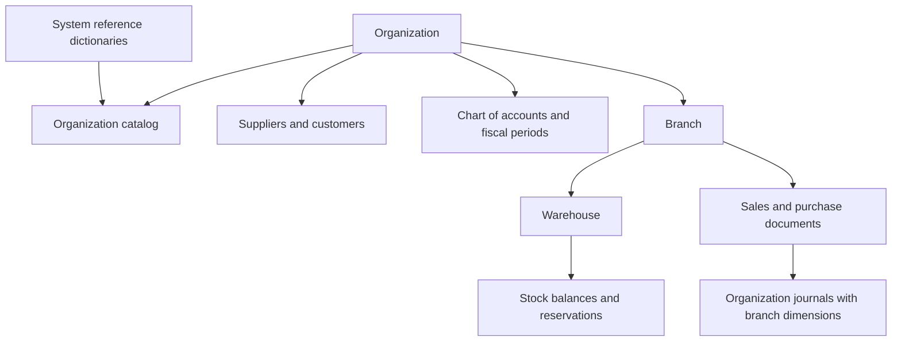
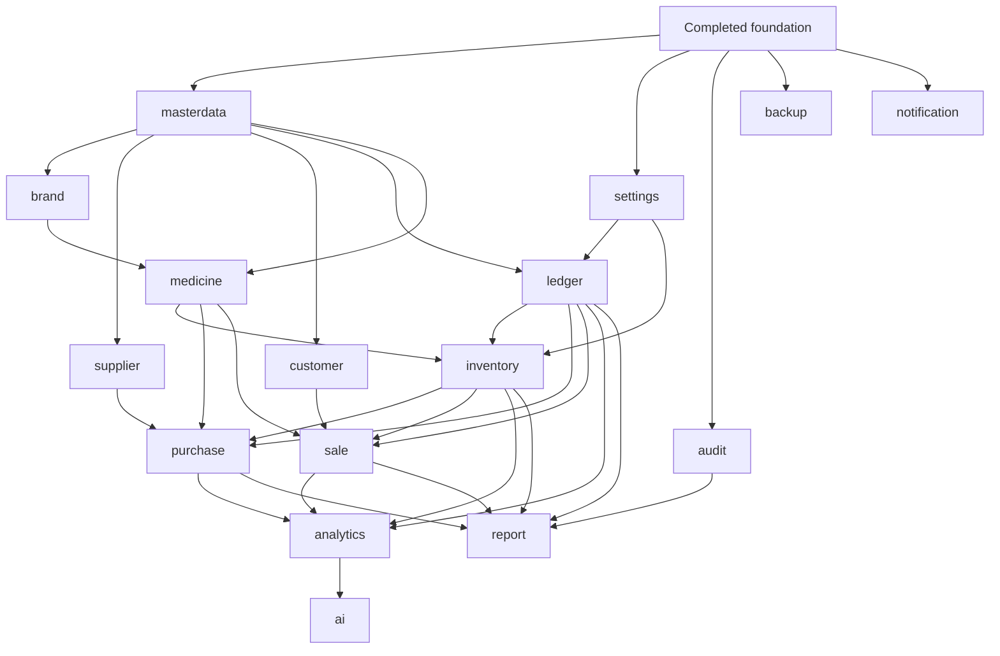
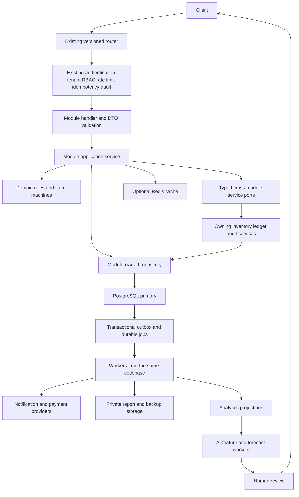

I’ll treat **Medicore and Pharmaciano as the same project**. I’ll inspect the repository and uploaded documents first, then build the blueprint around the existing foundation, with particular attention to module ownership and stock/financial transaction boundaries.

The inspected code supports the integration approach you described: warehouse services use `db.WithTx`, repositories use transaction-aware database access, and routes apply `Protected`, `Idempotency`, and `Audit`. The medicine service file is currently a scaffold.

There is documentation drift: the older plan and README describe Casbin and asynchronous ledger posting, while the newer auth document describes native RBAC. I’ll follow the inspected code and your stated foundation. For the remaining modules, I recommend committing stock changes and their financial postings in the same PostgreSQL transaction; notifications and analytics can run asynchronously afterward.

# Pharmaciano ERP — Remaining Modules Master Architecture and Implementation Blueprint

**Medicore and Pharmaciano refer to the same project throughout this specification.**

## 1. Direct answer: the safest way forward

> **Build the remaining modules as a dependency-ordered modular monolith, preserve the completed foundation, and make each business operation—not each module—the PostgreSQL transaction boundary.**

The critical distinction is:

**Module ownership determines who may write a table. Transaction ownership determines which related writes must commit together.**

A sale may therefore update sale-owned, inventory-owned, ledger-owned, and audit-owned records in **one existing `db.WithTx` transaction**, while each module writes only its own tables through its public transactional service interface.

The safest implementation starts with **cross-module contracts, scoped reference data, typed settings, durable business audit, and the ledger posting kernel**. Inventory follows those contracts. Purchase and sale then orchestrate the already-tested stock and financial primitives.

Do **not** build sale first and “add accounting later.” Do **not** make inventory deduction, financial posting, or mandatory business evidence depend on eventual event delivery.

### Architectural decisions

| Decision | Recommendation | Reason |
|---|---|---|
| Deployment architecture | Keep the modular monolith | Local calls and shared PostgreSQL transactions are appropriate |
| Completed foundation | Consume it unchanged by default | Avoid unnecessary regression risk |
| Tenant ownership | Organization scope for commercial business data | Prevents accidental cross-tenant sharing |
| Central medicine catalog | Centrally managed **within an organization** initially | “Central” must not silently mean globally writable across tenants |
| System dictionaries | Explicit global, read-only reference access | Countries and units are not tenant transactions |
| Inventory authority | PostgreSQL balances plus immutable movements | Redis cannot guarantee durable stock correctness |
| Financial authority | Posted journals and journal lines | Balances and dashboards are derived |
| Critical workflows | Synchronous database transaction | Stock and financial truth must agree |
| Side effects | Transactional outbox and retryable workers | Notifications and analytics must not delay checkout |
| Payments | Internal payment subdomains within sale and purchase | Avoid inventing a premature seventeenth module |
| External payment calls | Outside database transactions | A provider cannot participate in PostgreSQL atomic commit |
| Cross-module communication | Typed services/read ports and versioned events | Prevents table ownership violations and circular imports |
| AI | Read-only recommendations with explicit human action | AI must not create financial or stock truth |
| Recovery | Start operational backup work early | Recoverability is a production prerequisite, not a final feature |

---

## 2. Evidence reviewed and limits of this assessment

I inspected selected live repository files and the uploaded documentation. This is an **architecture review**, not a complete repository audit or a claim that tests passed.

**Repository retrieval date: 22 September 2026.** Reads used `main`, not a pinned release commit; implementation should pin the reviewed commit before opening development work.

### Verified observations

| Source | Observation | Architectural consequence |
|---|---|---|
| [`warehouse/service.go`](https://github.com/ShowravKormokar/pharmaciano-backend-go/blob/main/backend/internal/modules/warehouse/service.go) | Uses `appctx.OrgID`, `BranchScope`, `enforceBranchScope`, and `db.WithTx` | New modules should follow these integration seams |
| [`warehouse/repository.go`](https://github.com/ShowravKormokar/pharmaciano-backend-go/blob/main/backend/internal/modules/warehouse/repository.go) | Uses `FromCtx` for transaction-aware access and `ReadFromCtx` for reads | Critical reads must deliberately select primary/transaction access |
| [`warehouse/routes.go`](https://github.com/ShowravKormokar/pharmaciano-backend-go/blob/main/backend/internal/modules/warehouse/routes.go) | Uses existing rate policies, `Protected`, `Idempotency`, and `Audit` | Reuse route registration conventions |
| [`platform/db/transaction.go`](https://github.com/ShowravKormokar/pharmaciano-backend-go/blob/main/backend/internal/platform/db/transaction.go) | Supports transaction options and nested savepoints | Cross-module atomic work does not require a new transaction framework |
| [`middleware/idempotency.go`](https://github.com/ShowravKormokar/pharmaciano-backend-go/blob/main/backend/internal/middleware/idempotency.go) | Redis-backed request replay; key optional; Redis failure permits execution | Durable domain deduplication is still required for money and stock |
| [`errors/codes.go`](https://github.com/ShowravKormokar/pharmaciano-backend-go/blob/main/backend/internal/errors/codes.go) | Already defines stock, payment, state-transition, ledger, and AI error codes | Extend the existing error taxonomy only where necessary |
| [`router/v1.go`](https://github.com/ShowravKormokar/pharmaciano-backend-go/blob/main/backend/internal/router/v1.go) | Registers supplied module registrars under a versioned group | Add modules without restructuring the router |
| [`medicine/service.go`](https://github.com/ShowravKormokar/pharmaciano-backend-go/blob/main/backend/internal/modules/medicine/service.go) | Contains a package scaffold | No implemented medicine behavior was established from this file |
| Uploaded `AUTH_DOCS.md`, pages 1–2 | Describes native RBAC, not Casbin | Older Casbin references should not drive implementation |
| Uploaded `API.md`, pages 1–4 | Contains extensive proposed routes and older infrastructure assumptions | Preserve useful route vocabulary, not unsafe draft behavior |
| Uploaded `README.md`, pages 1–2 | Mixes implemented foundation and aspirational features | Do not treat every README feature as verified |
| Uploaded folder document, page 1 | Establishes module-local files and proposed ownership | Preserve file conventions; refine remaining-domain ownership explicitly |
| Uploaded 62-page Medicore plan, sampled pages 1, 2, and 10 | Earlier plan, terminology, and role assumptions | Background context, not proof of current implementation |

Some file-key page reads failed; source-based full-page reads recovered the pages cited above. **I did not read all 62 pages of the PDF.**

### Important documentation corrections

| Earlier proposal | Recommended interpretation |
|---|---|
| Asynchronous `ledger_post` on the critical queue | Core financial posting belongs in the originating transaction |
| Editable purchase payments on the same day | Posted payments are immutable; correct with reversal and replacement |
| Editable completed sales on the same day | Only non-financial annotations may change; financial facts do not |
| Cancellation after partial purchase receipt | Cancel the remaining commitment, not already-received history |
| Batch selling price as inventory-owned data | Selling-price policy belongs to sale; inventory owns acquisition cost and stock |
| Global central medicine catalog | Organization-central catalog unless a true shared-reference requirement is approved |
| Redis idempotency guarantees at-most-once business execution | Request replay is useful, but durable database deduplication establishes business correctness |
| Restore production database through a routine ERP endpoint | Restore through an isolated, privileged operational workflow |

---

# 3. Common contracts binding every remaining module

The following defaults are **normative** for all module sections. They avoid repeating the same rules hundreds of times.

## 3.1 Ownership and scope

| Scope | Meaning | Access rule |
|---|---|---|
| Global/system | Non-tenant reference data or privileged infrastructure metadata | Separate explicitly named system interface; never `orgID=nil` as a bypass |
| Organization | Shared commercial data inside one tenant | Mandatory `orgID` in repository methods |
| Branch | Operational document or branch-specific configuration | Tenant predicate plus effective branch scope |
| Warehouse | Physical stock location | Resolve warehouse → branch → organization and enforce all boundaries |
| Hybrid | Parent and child entities have different legitimate scopes | Declare each entity’s scope, not merely the module’s scope |
| User-owned | Personal preferences or inbox within an organization | Mandatory organization and recipient/user ownership checks |

**No customer, supplier, prescription, price agreement, stock balance, journal, or sale becomes global.**

## 3.2 Common schema notation

The table designs below are conceptual migration specifications, not existing table claims.

| Notation | Definition |
|---|---|
| `T` | `id uuid PK`, `organization_id uuid NOT NULL`, `created_at timestamptz NOT NULL`; `UNIQUE(organization_id,id)` for tenant-safe composite references |
| `M` | Mutable metadata: `updated_at timestamptz NOT NULL`, `version bigint NOT NULL CHECK(version>0)` |
| `B` | `branch_id uuid NOT NULL`, proven to belong to `organization_id` |
| `W` | `warehouse_id uuid NOT NULL`, proven to belong to the stated branch and organization |
| `G` | Global row: `id uuid PK`; no nullable tenant column masquerading as shared ownership |
| `?` | Nullable field |
| `Q` | `numeric(20,6)` quantity; finite, within declared bounds |
| `Money` | `numeric(20,6)` internal calculation amount; quantized to currency precision at posting |
| `Rate` | Bounded finite `numeric`, not floating point |
| `U(...)` | Unique constraint |
| `I(...)` | B-tree index unless specified otherwise |
| `PI(...) WHERE ...` | Partial index |
| `Immutable` | No normal update/delete after posting; corrections are new records |
| `Archive` | Deactivate or soft-delete; retain foreign-key target and historical snapshots |

All listed fields are `NOT NULL` unless marked `?` or described as lifecycle-dependent. Status values receive explicit `CHECK` constraints. JSONB is used for bounded metadata, schema-validated settings, and snapshots—not as a substitute for core relational fields.

### Foreign-key and deletion defaults

| Rule | Requirement |
|---|---|
| Tenant child → tenant parent | Composite FK using `(organization_id,parent_id)` |
| Warehouse ownership | Composite ownership FK where existing keys support it; otherwise transactional validation and a narrowly scoped additive key migration |
| Foreign-key deletes | `RESTRICT`/`NO ACTION` for historical and financial references |
| Cascade deletes | Only private, disposable draft/staging children |
| IDs | Follow the existing UUID policy; do not introduce a new identifier scheme |
| Parent indexes | PK/unique target exists |
| Child indexes | Add for observed joins, parent deletion checks, and selective queries—not automatically every column |
| Status checks | Constrain allowed values |
| Quantity checks | Nonnegative balances, positive line quantities, nonzero movements |
| Financial checks | Finite amounts, valid currency, nonnegative debit/credit |
| Cross-row invariants | Transactional locking plus database posting guards; ordinary `CHECK` cannot validate arbitrary other rows |
| Historical reads | Must still resolve deactivated references; do not apply “active only” filters to invoice rendering |

PostgreSQL explicitly distinguishes row-level checks from constraints requiring other rows; see its [constraint documentation](https://www.postgresql.org/docs/16/ddl-constraints.html).

## 3.3 Transaction ownership and import direction

| Contract | Rule |
|---|---|
| Top-level workflow | Opens the outer transaction |
| Participating service | Receives the same `context.Context`; uses existing transaction-aware database access |
| Repository | Never independently commits a business substep |
| Inventory posting port | Writes only inventory-owned tables; returns movement IDs, allocations, and valuation |
| Ledger posting port | Writes only ledger-owned tables; accepts validated accounting facts |
| Audit append port | Appends mandatory business evidence in the same transaction |
| Outbox append | Uses the same transaction as the business commit |
| External provider | Never called while stock/accounting locks are held |
| Go dependency direction | Consumer defines narrow required interfaces; composition root supplies implementations |
| Cross-module SQL | No writes; analytical reads only through approved read contracts/views |
| Nested transaction | Not a substitute for a new atomic boundary; avoid unnecessary savepoints |

**Recommended posting ownership:** purchase posts receipt/invoice/payment journals; sale posts checkout/return/refund journals; inventory posts manual adjustment, opening-stock, write-off, and transfer journals when financially applicable.

An inventory primitive called by purchase or sale must **not also post the same journal**.

## 3.4 Standard API contract

All proposed paths are relative to `/api/v1`.

| Aspect | Contract |
|---|---|
| Handler | Bind, validate transport shape, call service, map response through existing helpers |
| Service | State transitions, scope, business validation, transaction orchestration |
| Repository | Tenant-scoped persistence, query construction, locking, raw database errors |
| Request organization | Never accepted as authority from the body |
| Requested branch | A selector, not authorization; validate against context and referenced resources |
| Pagination | Existing offset convention for small lists; cursor for large histories |
| List limit | Default 20, maximum 100 unless an existing endpoint has a documented exception |
| Cursor | Bound to tenant, effective scope, filters, sort, and stable tie-breaker |
| Dates | `from` inclusive, `to` exclusive; UTC instants and explicit business timezone |
| Sorting | Allow-listed fields plus ID tie-breaker |
| Mutation version | `version` or `If-Match` for mutable aggregates |
| Idempotency | Existing middleware plus mandatory durable domain command identity for stock/money |
| Response DTO | Explicit fields; no repository model dumping |
| Async response | `202`, job ID, status URL; no false completed status |
| Sensitive responses | Field-level redaction and permission checks |
| Error mapping | Existing `/errors`; no new parallel framework |
| Route wildcard names | Preserve Gin’s established `:id` naming at shared path positions |

Every API operation described below inherits these conventions.

## 3.5 Durable command and event contracts

Use existing infrastructure where implemented. Add only missing contracts and tables through the existing platform and migration structure.

| Record | Required conceptual fields and constraints |
|---|---|
| Business command | Tenant, command UUID/key, operation type, authorized scope, normalized request hash, result resource ID, committed outcome; unique command identity |
| Outbox event | Event UUID, tenant, aggregate type/ID/version, event type/version, occurred time, branch scope, correlation/causation IDs, bounded payload |
| Consumer receipt | Tenant, consumer name, event UUID; unique combination |
| Worker execution | Job ID, lease/fencing generation, attempts, next attempt, status, last error class |
| Provider operation | Stable internal operation ID, provider/account identity, provider idempotency key, external reference, state |
| Source journal identity | Tenant, source type, source operation ID, posting kind; unique combination |

Prefer module-owned command records where the aggregate already captures the command identity. A shared command registry must be a narrowly defined technical primitive, not a generic domain repository.

**Delivery guarantee:** at least once with idempotent effects—not “exactly once.”

---

# 4. Module specifications

## MODULE: masterdata

### A. Purpose

Provide bounded, stable reference vocabularies. It is **not** a storage area for anything that lacks an obvious owner.

### B. Scope / Ownership

Hybrid: system reference dictionaries and organization-specific classifications. Global records contain no tenant secrets or commercial activity.

### C. Dependencies

| Direction | Dependency |
|---|---|
| Depends on | Existing foundation |
| Used by | Brand, medicine, supplier, customer, ledger, purchase, sale |
| Database dependencies | Existing organizations for tenant classifications |
| Infrastructure dependencies | PostgreSQL; optional reference cache |

### D. Domain Model

| Entity | Purpose | Scope | Lifecycle/audit |
|---|---|---|---|
| Unit | Measurement dimension and precision | Global | Version/deactivate; catalog audit |
| Dosage form | Tablet, solution, capsule vocabulary | Global | Deactivate, never rewrite meaning |
| Administration route | Reference classification | Global | Deactivate |
| Medicine type | Reference classification | Global | Deactivate |
| Package type | Bottle, strip, box vocabulary | Global | Deactivate |
| Country | Stable country reference | Global | Versioned seed |
| Currency | Currency code and accounting precision | Global | Versioned seed |
| Product category | Organization classification tree | Organization | Archive; audit moves |
| Tax category | Tax-treatment classification | Organization | Archive |
| Tax rule version | Effective-dated tax calculation facts | Organization/jurisdiction | Immutable once used |
| Payment method | Accepted tender configuration | Organization | Deactivate |
| Expense category | Operational expense classification | Organization | Archive; ledger owns account mapping |

### E. Database Design

| Table | Columns and keys | Constraints/indexes/delete behavior |
|---|---|---|
| `ref_units` | G; `code text`, `name text`, `dimension text`, `scale smallint`, `active bool` | U(code); scale bounded; no generic mass↔volume conversion |
| `ref_dosage_forms` | G; code, name, active | U(code); restricted deletion |
| `ref_routes` | G; code, name, active | U(code) |
| `ref_medicine_types` | G; code, name, active | U(code) |
| `ref_package_types` | G; code, name, active | U(code) |
| `ref_countries` | G; code, name, active | U(code) |
| `ref_currencies` | G; code, minor_units smallint, active | U(code); precision bounded |
| `product_categories` | T+M; code, name, `parent_id?`, active | Tenant self-FK; U(org,code); I(org,parent_id); cycle prevention in service |
| `tax_categories` | T+M; code, name, active | U(org,code) |
| `tax_rule_versions` | T; category FK, jurisdiction, `valid_from date`, `valid_to date?`, rate, calculation_basis | Valid interval/rate checks; prevent overlapping applicable rules |
| `payment_methods` | T+M; code, kind, active, settlement_required bool | U(org,code); kind allow-list |
| `expense_categories` | T+M; code, name, active | U(org,code); no mutable financial balances |

### F. Business Rules

A unit conversion requires compatible dimensions. Product-specific pack conversion belongs to medicine. Generic ingredients belong to medicine. Manufacturer identity belongs to brand. Accounts belong to ledger. Business settings belong to settings.

Tax rates are effective-dated. Historical documents retain the applied version and calculated amounts.

### G. API Design

| Operation | Endpoint | Permission | DTO and validation | Errors/idempotency |
|---|---|---|---|---|
| Read dictionary | `GET /master/{allowed-kind}` | `masterdata.view` | `ReferenceQuery → ReferencePage`; kind allow-list | Invalid query |
| Create tenant reference | `POST /master/{allowed-kind}` | `masterdata.create` | `CreateReference → Reference`; typed schema | Duplicate; idempotent |
| Update label/status | `PATCH /master/{kind}/{id}` | `masterdata.update` | `ReferencePatch(version)` | Version conflict |
| Archive reference | `DELETE /master/{kind}/{id}` | `masterdata.delete` | Archive, never remove used semantics | In-use |
| Add tax version | `POST /master/tax-rates` | `masterdata.update` | `TaxRuleVersion → TaxRule` | Overlap; idempotent |

Global writes are operationally controlled seeds/admin operations, not exposed through tenant CRUD.

### H. Service Layer

Validate dictionary-specific schemas and tenant ownership. Transactions cover tax-version replacement and category moves. Reject references that would create cycles.

### I. Repository Layer

Typed methods such as `ListUnits`, `GetTaxRule`, and `CreateCategory`; tenant methods require `orgID`. Explicit global methods are separate. Small lists use offset pagination.

### J. Tenant / Branch / Warehouse Integration

No branch filtering for shared references. A cashier may read organization tax categories, but that does not grant tax-edit permission. No warehouse ownership.

### K. Middleware Integration

Existing `Protected`, read/write rate policies, `Audit`, and mutation idempotency. No local authentication.

### L. Transaction & Concurrency Strategy

Read committed; optimistic versions for labels. Lock the tax-category parent while changing its effective rules, or use an exclusion constraint. No routine serializable transactions.

### M. Redis

Optional versioned dictionary cache. PostgreSQL fallback. Never use cached tax configuration without recording the applied version.

### N. Events

Optional `ReferenceChanged.v1` for cache invalidation. No financial events. Outbox only when a durable consumer needs the change.

### O. Background Jobs

Optional validated bulk import; no mandatory scheduler.

### P. Security

Prevent dynamic table-name injection, unauthorized global edits, tax manipulation, and arbitrary JSON configuration.

### Q. Auditability

Audit reference creation, deactivation, category moves, and every tax-rule revision. No secrets in metadata.

### R. Performance

Read-heavy. Cache only stable dictionaries; category and tax indexes follow actual lookup patterns.

### S. Observability

Reference lookup latency, cache misses, invalid conversions, overlapping tax-rule attempts.

### T. Testing Strategy

Unit conversion tests; tax boundary tests; repository constraints; tenant isolation; category cycles; stale-version conflicts; API schemas.

### U. Failure Scenarios

Database failure rejects changes. Redis failure falls back. Import retries use row identities and resumable batches; invalid rows never partially replace active tax rules.

### V. Implementation Checklist

| Order | Work |
|---|---|
| 1 | Freeze strict ownership and reference codes |
| 2 | Add typed schemas, constraints, seeds |
| 3 | Implement scoped services and APIs |
| 4 | Verify tax-version and tenant tests |

---

## MODULE: settings

### A. Purpose

Resolve typed, versioned business configuration without embedding rules in handlers or unrestricted JSON blobs.

### B. Scope / Ownership

Hybrid: system defaults, organization settings, branch overrides, and user preferences. **Not every setting supports every scope.**

### C. Dependencies

| Direction | Dependency |
|---|---|
| Depends on | Existing foundation |
| Used by | All remaining domains as needed |
| Database dependencies | Organization, branch, user |
| Infrastructure dependencies | PostgreSQL; optional cache |

### D. Domain Model

| Entity | Purpose | Scope | Lifecycle/audit |
|---|---|---|---|
| Setting definition | Type, allowed scopes, default, validator identifier | System | Code/seed versioned |
| System value | Platform business default | System | Restricted versioned change |
| Organization value | Tenant business configuration | Organization | Mutable with revision history |
| Branch value | Permitted branch override | Branch | Mutable with revision history |
| User preference | Presentation preference | User | Mutable |
| Setting revision | Old/new value and actor | Matching scope | Immutable |
| Feature definition/value | Controlled feature availability | System/organization/branch | Versioned; cannot bypass permissions |

### E. Database Design

| Table | Columns and keys | Constraints/indexes |
|---|---|---|
| `setting_definitions` | `key text PK`, value_type, schema_version int, default_value jsonb, allowed_scopes, secret_reference_only bool | Typed registry; bounded JSON |
| `system_setting_values` | key FK PK, value jsonb, version bigint, updated_at | Restricted system interface |
| `organization_setting_values` | organization_id, key FK, value, version | PK(org,key) |
| `branch_setting_values` | organization_id, branch_id, key FK, value, version | PK(org,branch,key); branch ownership FK |
| `user_preference_values` | organization_id, user_id, key FK, value, version | PK(org,user,key) |
| `setting_revisions` | T; key, scope_type, scope_id, old_value?, new_value?, actor_id, reason, revision | Immutable; I(org,key,created_at,id) |
| `feature_definitions` | key PK, description, allowed_scopes, default_enabled | System registry |
| `feature_values` | T+M; key FK, `branch_id?`, enabled, effective_at | Separate partial uniqueness for org and branch rows |

### F. Business Rules

| Setting family | Resolution |
|---|---|
| Date/number display | System → organization → user where allowed |
| Branch operating policy | System → organization → branch |
| Stock valuation method | Organization only; not casually changeable after posting |
| Currency | Organization accounting policy; no user override |
| Prescription enforcement | Domain/jurisdiction baseline; branch/user cannot weaken |
| Tax policy | Typed references to masterdata rules |
| Secrets | Environment/secret store references, never readable secret values |
| Feature flags | Availability only; never authorization |

### G. API Design

| Operation | Endpoint | Permission | DTO/validation | Idempotency |
|---|---|---|---|---|
| Resolve settings | `GET /settings` | `settings.view` | `EffectiveSettingsQuery → ResolvedSettings` including provenance | No |
| Update setting | `PUT /settings/{key}` | `settings.update` | Scope, value, version, reason; allowed scope/type | Natural + middleware |
| Atomic bulk update | `POST /settings/bulk` | `settings.update` | Typed entries; all validate before commit | Required |
| Read flags | `GET /feature-flags` | `feature_flags.view` | Authorized scope only | No |
| Toggle flag | `PATCH /feature-flags/{key}` | `feature_flags.toggle` | Enabled, scope, version | Required |
| Update own preference | `PUT /settings/preferences/{key}` | Authenticated self | Presentation-only allow-list | Natural |

### H. Service Layer

Resolve inheritance; return value plus source/version. Domain-owned validators are registered at composition time to avoid settings importing every domain.

### I. Repository Layer

Explicit scope-specific methods. No generic `scope_id` query that can cross organizations. Primary reads for critical effective configuration.

### J. Tenant / Branch / Warehouse Integration

Branch overrides require `enforceBranchScope`. User preferences require self-ownership. Warehouse settings remain inventory-owned policies unless a true cross-domain setting exists.

### K. Middleware Integration

Existing `Protected`, `Audit`, rate limiting, and mutation idempotency.

### L. Transaction & Concurrency Strategy

Optimistic versions. Bulk update and revisions commit atomically. Critical documents snapshot the applied policy version.

### M. Redis

Optional resolved-value cache keyed by tenant, branch, user when applicable, and configuration version.

### N. Events

`SettingsChanged.v1` and `FeatureChanged.v1` only for needed invalidation. Publish after commit through outbox.

### O. Background Jobs

Optional scheduled flag activation. No generic background dependency for reads.

### P. Security

Reject unknown keys, forbidden scopes, secret extraction, mass assignment, and user-level weakening of business rules.

### Q. Auditability

Immutable setting revisions; security audit for feature/security-sensitive changes.

### R. Performance

Read-heavy. Resolve once per business operation; avoid one settings query per sale item.

### S. Observability

Resolution latency, stale cache detections, rejected overrides, configuration revision usage.

### T. Testing Strategy

Inheritance matrices, missing overrides, explicit false/zero values, optimistic conflicts, tenant/branch/self isolation.

### U. Failure Scenarios

Redis failure uses PostgreSQL. Invalid configuration fails closed for critical operations. Do not silently replace missing tax/valuation policy with guessed defaults.

### V. Implementation Checklist

| Order | Work |
|---|---|
| 1 | Define typed registry and override matrix |
| 2 | Add scoped value/revision tables |
| 3 | Implement resolution and bulk atomic updates |
| 4 | Test policy snapshots and forbidden overrides |

---

## MODULE: audit

### A. Purpose

Provide authorized investigation and immutable business evidence while **reusing the existing technical/security audit pipeline**.

### B. Scope / Ownership

Hybrid. Tenant business audit is organization-scoped with branch/resource dimensions. Platform security records may have no tenant and require a separate system access path.

### C. Dependencies

| Direction | Dependency |
|---|---|
| Depends on | Existing audit sink, foundation |
| Used by | Every mutating domain; report |
| Database dependencies | Existing audit schema, to be inspected before migration |
| Infrastructure dependencies | PostgreSQL; archival storage later |

### D. Domain Model

| Entity | Purpose | Scope | Lifecycle/audit |
|---|---|---|---|
| Existing technical/security event | Request and security evidence | Existing scope | Preserve current ownership/pipeline |
| Business event | Committed domain action evidence | Organization/branch | Append-only |
| Business event branch link | Multiple branches affected by transfer | Branch relation | Immutable |
| Export request | Controlled evidence extraction | Organization/user | Retained metadata |
| Retention policy | Approved retention/hold classification | System/organization | Restricted versioned |
| Legal hold | Prevent eligible evidence destruction | Organization/resource/time range | Audited activation/release |

### E. Database Design

| Table | Columns and keys | Constraints/indexes |
|---|---|---|
| Existing `audit_logs` | Inspect and reuse; do not duplicate auth evidence | Preserve existing partition and sink contract |
| `business_audit_events` | T; operation_id, actor_id?, actor_type, action, entity_type, entity_id, outcome, occurred_at, redacted_before?, redacted_after?, reason?, correlation_id | Immutable; U(org,operation_id,action,entity_type,entity_id); I(org,occurred_at,id) |
| `business_audit_event_branches` | organization_id, event_id, branch_id | Composite PK/FKs; enables scoped multi-branch evidence |
| `audit_export_requests` | T+M; requested_by, filters jsonb, status, artifact_reference? | I(org,requested_by,created_at) |
| `audit_retention_policies` | T+M; record_class, retention_days?, hold_required bool | U(org,record_class) |
| `audit_legal_holds` | T; scope jsonb, reason, opened_by, released_at?, released_by? | Immutable actions; active-hold lookup index |

If partitioning is used, design partition-compatible primary/unique keys; PostgreSQL does not provide arbitrary global uniqueness across partitions.

### F. Business Rules

Middleware audit proves a request occurred; it does **not** prove that a multi-module transaction committed.

Business evidence commits with the business transaction. Ledger journals remain financial truth, not audit-log reconstructions. Sensitive before/after payloads are allow-listed and redacted.

### G. API Design

| Operation | Endpoint | Permission | DTO/validation | Idempotency |
|---|---|---|---|---|
| Search evidence | `GET /audit-logs` | `audit.view` | `AuditQuery → AuditPage`; bounded date range, cursor | No |
| Get event | `GET /audit-logs/{id}` | `audit.view` | Scoped detail | No |
| Export | `POST /audit-logs/exports` | `audit.export` | Filters, purpose, format → job | Required |
| Place/release hold | `POST /audit-logs/holds` | `audit.manage-retention` | Explicit scope and reason | Required |

Existing draft export paths can remain adapters if already published.

### H. Service Layer

Separate append and query interfaces. No HTTP handler may invent successful business events after a failed commit.

### I. Repository Layer

Append-only business methods require `orgID` and transaction context. Query predicates constrain tenant, branch visibility, event class, and date.

### J. Tenant / Branch / Warehouse Integration

A branch auditor cannot retrieve an organization-wide export by guessing its ID. Transfer audit visibility can expose the authorized branch’s operational portion without leaking unrelated counterparty details.

### K. Middleware Integration

Reuse existing generic Audit. Audit queries and exports themselves produce security access evidence.

### L. Transaction & Concurrency Strategy

Business append is part of the domain transaction. High-volume query projections may be eventual. No ordinary update/delete API.

### M. Redis

Not required for audit durability. Never make Redis the sole evidence store.

### N. Events

`BusinessAuditRecorded.v1` only if downstream indexing requires it. Existing domain events can produce optional investigative projections, not replace mandatory evidence.

### O. Background Jobs

Partition maintenance where applicable, archival, retention execution, export generation, hold verification.

### P. Security

Log injection, secret leakage, audit tampering, broad search, and unauthorized exports. Restricted database privileges and external immutable archives improve tamper resistance.

### Q. Auditability

Technical, security, business, data-change, and financial references are distinct categories. Hash chains alone do not protect against a privileged attacker rewriting the chain.

### R. Performance

Write-heavy append stream; bounded keyset reads. Index tenant/time and selective entity/time paths; avoid indexing full JSON payloads by default.

### S. Observability

Append failures, evidence lag, archive failures, retention deletions, hold violations, export volume.

### T. Testing Strategy

Atomic evidence rollback, redaction, branch filters, restricted writes, partition rollover, hold protection, duplicate event handling.

### U. Failure Scenarios

Mandatory business-audit insert failure rolls back the business operation. Optional external archival failure retries and alerts without rewriting committed business history.

### V. Implementation Checklist

| Order | Work |
|---|---|
| 1 | Inspect current audit tables/sink |
| 2 | Define minimal transactional business append port |
| 3 | Add authorized querying and redaction tests |
| 4 | Add export, retention, and archival after core evidence works |

---

## MODULE: backup

### A. Purpose

Expose safe recovery status and controlled operational requests. It must not become an application-level replacement for database backup infrastructure.

### B. Scope / Ownership

Hybrid: physical backup metadata is system-scoped; tenant logical exports are organization-scoped.

### C. Dependencies

| Direction | Dependency |
|---|---|
| Depends on | Existing deployments, PostgreSQL operations, audit |
| Used by | Operators and authorized tenant export users |
| Database dependencies | Metadata only |
| Infrastructure dependencies | Backup tooling, encrypted object storage, key management |

### D. Domain Model

| Entity | Purpose | Scope | Lifecycle/audit |
|---|---|---|---|
| Backup run | Physical backup execution metadata | System | Immutable outcome |
| Backup verification | Integrity and restore evidence | System | Immutable |
| Restore drill | Isolated recovery exercise | System | Immutable |
| Tenant export | Logical scoped extraction | Organization | Expiring artifact, retained audit |

### E. Database Design

| Table | Columns and keys | Constraints/indexes |
|---|---|---|
| `system_backup_runs` | G; type, started_at, finished_at?, status, storage_ref?, checksum?, tool_version, timeline?, start_lsn?, end_lsn?, encryption_key_ref? | Status checks; I(started_at,id); no credentials |
| `system_backup_verifications` | G; backup_id FK, verified_at, checksum_ok, restore_ok, details_ref? | Immutable |
| `system_restore_drills` | G; backup_id FK, target_environment, target_time?, started_at, finished_at?, result, measured_rpo?, measured_rto? | Target must be approved isolated environment |
| `tenant_export_jobs` | T+M; requested_by, scope jsonb, status, artifact_ref?, expires_at | Scoped queries; no physical backup link |

### F. Business Rules

| Concern | Requirement |
|---|---|
| Physical recovery | Base backup plus continuous WAL archive for PITR |
| Logical export | Not a substitute for whole-database recovery |
| Tenant restore | Never restore a physical cluster backup directly over one tenant |
| Verification | Successful upload is not successful recoverability |
| Encryption | In transit and at rest; recovery keys available independently |
| Off-site copy | Separate failure domain/account where practical |
| Retention | Preserve a complete recoverable backup/WAL chain |
| RPO/RTO | Business-approved targets, measured in restore drills |
| Proposed initial objectives | RPO ≤5 minutes and RTO ≤2 hours, subject to infrastructure validation—not a guarantee |

### G. API Design

| Operation | Endpoint | Permission | DTO/validation | Idempotency |
|---|---|---|---|---|
| View status | `GET /backups` | `backup.view` | System operator only for physical runs | No |
| Request backup | `POST /backups/run` | `backup.run` | Approved backup type → operation | Required |
| Request isolated drill | `POST /backups/{id}/restore-tests` | `backup.restore-test` | Approved target, reason, confirmation | Required |
| Tenant export | `POST /backups/tenant-exports` | `backup.export` | Current tenant only → job | Required |

Do not expose a routine production `/restore` action in the tenant API.

### H. Service Layer

Authorize requests and record metadata; call an operational adapter. Database credentials, shell commands, and paths are never user-controlled.

### I. Repository Layer

Separate system and tenant repositories. Tenant export methods require `orgID`; physical metadata methods require explicit operator capability.

### J. Tenant / Branch / Warehouse Integration

Branch-limited exports contain only authorized rows and references. A physical backup contains multiple tenants and must never be downloadable by a tenant administrator.

### K. Middleware Integration

Existing protected routes, audit, strict rate policy, and available step-up authentication for privileged requests.

### L. Transaction & Concurrency Strategy

Short metadata transactions. External backup execution happens outside transactions. Operation IDs and leases prevent duplicate orchestration.

### M. Redis

Not required. If the current worker infrastructure uses Redis, persist run state independently and reconcile after queue loss.

### N. Events

`BackupCompleted`, `BackupFailed`, `RestoreDrillCompleted`; operational events contain no database content.

### O. Background Jobs

Backup schedule, WAL archive monitoring, verification, restore drills, retention cleanup, orphan artifact reconciliation.

### P. Security

Credential leakage, command injection, arbitrary restore target, multi-tenant data exposure, ransomware deletion, key loss.

### Q. Auditability

Every request, download authorization, retention deletion, verification, and restore action.

### R. Performance

Throttle backup/export I/O. Avoid competing with POS on the same constrained host. Measure WAL and disk growth.

### S. Observability

Last recoverable time, WAL archive lag, backup age, verification age, restore duration, missing WAL segments.

### T. Testing Strategy

Corrupt backup, missing WAL, inaccessible keys, isolated restore, application reconciliation after restore, tenant export scope.

### U. Failure Scenarios

Backup failure alerts and retries without affecting sales. Missing WAL marks the recovery window incomplete. Worker loss resumes from durable run metadata.

### V. Implementation Checklist

| Order | Work |
|---|---|
| 1 | Define RPO/RTO and operational ownership |
| 2 | Verify physical backup and WAL configuration |
| 3 | Complete an isolated restore drill |
| 4 | Add safe status and tenant-export APIs |

PostgreSQL’s [continuous archiving and PITR documentation](https://www.postgresql.org/docs/current/continuous-archiving.html) is the primary recovery reference; use the deployed PostgreSQL version’s procedures.

---

## MODULE: brand

### A. Purpose

Own commercial brand and manufacturer identity used by the medicine catalog.

### B. Scope / Ownership

Organization-scoped initially. This is shared across branches, not global commercial data.

### C. Dependencies

| Direction | Dependency |
|---|---|
| Depends on | Masterdata country references |
| Used by | Medicine |
| Database dependencies | Organization and country |
| Infrastructure dependencies | PostgreSQL |

### D. Domain Model

| Entity | Purpose | Scope | Lifecycle/audit |
|---|---|---|---|
| Manufacturer | Legal manufacturer identity | Organization | Archive; audit identity changes |
| Brand | Commercial brand identity | Organization | Archive |
| Brand alias | Search/migration identity | Organization | Retained alias history |

Manufacturer lives inside brand as an internal subdomain. Do not also create a manufacturer table in masterdata.

### E. Database Design

| Table | Columns and keys | Constraints/indexes |
|---|---|---|
| `manufacturers` | T+M; code, legal_name, country_id FK?, registration_no?, active | U(org,code); optional jurisdiction-qualified registration uniqueness |
| `brands` | T+M; code, name, manufacturer_id FK?, active | U(org,code); I(org,manufacturer_id); normalized-name duplicate warnings |
| `brand_aliases` | T; brand_id FK, alias, normalized_alias | U(org,brand_id,normalized_alias); search index only if needed |

### F. Business Rules

A manufacturer is not a supplier. One organization may purchase the same manufacturer’s product through many suppliers. Name similarity is a duplicate warning, not definitive identity.

### G. API Design

| Operation | Endpoint | Permission | DTO/validation | Idempotency |
|---|---|---|---|---|
| List/detail brands | `GET /brands` and `GET /brands/{id}` | `brands.view` | Search, active, manufacturer filters → Brand DTO | No |
| Create brand | `POST /brands` | `brands.create` | Code, name, manufacturer reference | Required |
| Update brand | `PATCH /brands/{id}` | `brands.update` | Mutable labels, version | Natural |
| Archive brand | `DELETE /brands/{id}` | `brands.delete` | Archive only | Natural |
| Manufacturer reads | `GET /manufacturers` and detail | `manufacturers.view` | Scoped Manufacturer DTO | No |
| Manufacturer creation | `POST /manufacturers` | `manufacturers.create` | Legal identity | Required |
| Manufacturer update | `PATCH /manufacturers/{id}` | `manufacturers.update` | Versioned patch | Natural |
| Manufacturer archive | `DELETE /manufacturers/{id}` | `manufacturers.delete` | Archive | Natural |

### H. Service Layer

Validate manufacturer ownership and normalize identifiers. Brand identity changes never rewrite historical medicine/invoice snapshots.

### I. Repository Layer

Mandatory `orgID`; indexed code lookup; offset lists; optimistic updates.

### J. Tenant / Branch / Warehouse Integration

No branch filter on catalog identity. Branch-limited users still require catalog permission.

### K. Middleware Integration

Existing protected/read/write/audit/idempotency conventions.

### L. Transaction & Concurrency Strategy

Read committed and uniqueness constraints; optimistic versions. Alias insertion and brand creation may share one transaction.

### M. Redis

Not initially required.

### N. Events

Optional `BrandChanged` for catalog search invalidation.

### O. Background Jobs

Optional import and duplicate-review queue.

### P. Security

Cross-tenant manufacturer references, mass assignment, malicious imported text.

### Q. Auditability

Identity changes, archive/reactivate, alias consolidation.

### R. Performance

Read-heavy; batch-load manufacturer details to avoid N+1.

### S. Observability

Duplicate conflicts, search latency, invalid references.

### T. Testing Strategy

Tenant FKs, uniqueness, archive history, concurrent edits, scoped APIs.

### U. Failure Scenarios

Database failure rolls back. Import retries do not duplicate codes. No external provider dependency.

### V. Implementation Checklist

| Order | Work |
|---|---|
| 1 | Freeze manufacturer ownership |
| 2 | Create identity/alias schema |
| 3 | Implement catalog APIs |
| 4 | Verify history and tenant constraints |

---

## MODULE: medicine

### A. Purpose

Own medicinal product identity, formulation, sellable/stockable packaging, identifiers, and regulatory catalog facts.

It does **not** own stock, acquisition cost, selling-price policy, or reorder thresholds.

### B. Scope / Ownership

Organization-central catalog. All branches reference the same organization medicine identities.

### C. Dependencies

| Direction | Dependency |
|---|---|
| Depends on | Masterdata and brand |
| Used by | Inventory, purchase, sale; analytical read models |
| Database dependencies | Units, dosage forms, routes, categories, tax categories, manufacturer/brand |
| Infrastructure dependencies | PostgreSQL; optional import worker/search cache |

### D. Domain Model

| Entity | Purpose | Scope | Lifecycle/audit |
|---|---|---|---|
| Ingredient | Generic active ingredient identity | Organization | Deactivate; identity protected after use |
| Medicine | Stable formulation and product identity | Organization | Archive |
| Medicine ingredient | Composition and normalized strength | Organization | Versioned with formulation |
| Variant | Stockable/sellable package configuration | Organization | New version/variant for semantic changes |
| Barcode | Identifier for one package/variant | Organization | Deactivate, do not silently reassign |
| Category mapping | Medicine classification | Organization | Mutable audited association |
| Regulatory profile | Prescription/controlled status and evidence | Organization/jurisdiction | Versioned |
| Catalog revision | Historical formulation/catalog snapshot | Organization | Immutable |
| Import job | Validated bulk onboarding | Organization/user | Retained outcome |

### E. Database Design

| Table | Columns and keys | Constraints/indexes |
|---|---|---|
| `medicine_ingredients` | T+M; code, generic_name, active | U(org,code); normalized-name search |
| `medicines` | T+M; code, name, dosage_form_id FK, route_id FK?, brand_id FK?, manufacturer_id FK?, medicine_type_id FK?, active | U(org,code); I(org,brand_id); search index if measured |
| `medicine_compositions` | T; medicine_id FK, ingredient_id FK, numerator Q, numerator_unit_id FK, denominator Q?, denominator_unit_id FK? | Positive values; paired denominator nullability; U(org,medicine,ingredient,unit composition identity) |
| `medicine_variants` | T+M; medicine_id FK, sku, package_type_id FK, base_unit_id FK, units_per_package Q, divisible bool, active | U(org,sku); positive factor; prevent semantic mutation after movement |
| `medicine_barcodes` | T; variant_id FK, barcode text, symbology, active | U(org,barcode); indexed exact lookup |
| `medicine_category_mappings` | org, medicine_id FK, category_id FK | Composite PK; reverse category index |
| `medicine_regulatory_profiles` | T; medicine_id FK, jurisdiction, requires_prescription, controlled, restriction_code?, effective_from, effective_to?, evidence_ref? | Valid interval; overlapping active profile prevention |
| `medicine_revisions` | T; medicine_id FK, revision bigint, snapshot jsonb, reason, actor_id | U(org,medicine_id,revision); immutable |
| `medicine_import_jobs` | T+M; requested_by, file_ref, checksum, status, valid_rows, rejected_rows | U(org,checksum,import_mode) where appropriate |

### F. Business Rules

| Concern | Rule and owner |
|---|---|
| Generic versus brand | Ingredient/formulation identifies the medicine; brand is a commercial reference |
| Combination products | Multiple ingredient rows, not one free-text strength |
| Strength | Numerator/denominator with dimensions; never parse a display string during checkout |
| Product identity | Ingredient/form, route, and package semantics are explicit |
| SKU | Tenant-unique operational identifier |
| Barcode | Exact tenant lookup; package-specific |
| Pack breaking | Convert into canonical base units using a snapshotted factor |
| Batch/expiry | Inventory-owned |
| Purchase price | Purchase facts; inventory valuation layers |
| Selling price | Sale price books and line snapshots |
| Tax | Masterdata rule; medicine tax classification can be versioned |
| Reorder | Inventory location policy |
| Prescription status | Catalog/regulatory fact; sale verifies required evidence |
| Controlled medicine | Explicit restricted workflow; no automatic substitutions |
| Formulation changes | New revision or identity, never reinterpret already-stocked product |

Add a medicine-to-tax-category reference/version if required; it remains medicine-owned classification, not a price.

### G. API Design

| Operation | Endpoint | Permission | DTO/validation | Idempotency/errors |
|---|---|---|---|---|
| List/detail | `GET /medicines` and detail | `medicines.view` | Catalog query → Medicine DTO; category/brand/ingredient/active filters | Not found |
| Search | `GET /medicines/search` | `medicines.view` | Bounded query → search page | Invalid query |
| Exact lookup | `POST /medicines/lookup` | `medicines.view` | Exactly one barcode/SKU → Variant DTO | Ambiguous/not found |
| Create | `POST /medicines` | `medicines.create` | Formulation, references, variants | Required; duplicate/invalid composition |
| Update | `PATCH /medicines/{id}` | `medicines.update` | Versioned permitted fields | Semantic change denied |
| Archive | `DELETE /medicines/{id}` | `medicines.delete` | Deactivate/soft-delete | Historical references retained |
| Add variant | `POST /medicines/{id}/variants` | `medicines.update` | Package/base-unit conversion | Required |
| Add barcode | `POST /medicines/{id}/barcodes` | `medicines.update` | Variant and barcode | Required; duplicate |
| Import | `POST /medicines/import` | `medicines.import` | Staged file → import job | Required |
| Export | `POST /medicines/exports` | `medicines.export` | Scoped filters → job | Required |

A legacy price-history route should delegate to the sale pricing read interface, not create medicine-owned price tables.

### H. Service Layer

Validate composition, compatible units, ownership, and regulatory versions. Publish immutable catalog revisions. Import in staged, validated batches.

### I. Repository Layer

`GetVariant`, `GetVariants`, `LookupBarcode`, `ListMedicines`, `CreateAggregate`, `UpdateVersion`. All organization methods require `orgID`. Batch joins prevent N+1.

### J. Tenant / Branch / Warehouse Integration

Catalog is not branch-filtered. Purchase/sale still validate that the chosen variant belongs to their organization. Warehouse identity is irrelevant to product identity.

### K. Middleware Integration

Existing protected catalog actions, search/import rate policies, audit, mutation idempotency.

### L. Transaction & Concurrency Strategy

Medicine, composition, initial variants, and revision commit together. Optimistic edits. Restrict semantic changes once referenced by inventory.

### M. Redis

Optional catalog lookup cache keyed by tenant and catalog version. Safety-critical status must be revalidated during stock allocation.

### N. Events

`MedicineChanged`, `MedicineDeactivated`, `RegulatoryProfileChanged`. Durable consumers use outbox; safety does not wait for cache invalidation.

### O. Background Jobs

Imports, exports, optional search refresh and duplicate review.

### P. Security

Cross-tenant reference injection, malicious import files, unsafe controlled-status changes, barcode reassignment, mass assignment.

### Q. Auditability

Composition, identifiers, regulatory changes, deactivation, import actor and source.

### R. Performance

Read-heavy POS lookup. Exact barcode/SKU indexes first; trigram search only for text search workloads. No stock joins on every general catalog list.

### S. Observability

Lookup latency, ambiguous barcode counts, import rejection rates, regulatory changes, stale-version conflicts.

### T. Testing Strategy

Combination formulations, fractional packs, dimension errors, barcode uniqueness, tenant leakage, historical rendering, import replay.

### U. Failure Scenarios

Partial imports remain staged. Redis failure falls back. Unknown catalog status blocks dispensing rather than guessing. Retried create returns the original identity.

### V. Implementation Checklist

| Order | Work |
|---|---|
| 1 | Freeze formulation and base-unit semantics |
| 2 | Implement schema and revisions |
| 3 | Implement exact lookup before fuzzy search |
| 4 | Add imports and regulatory tests |

---

## MODULE: supplier

### A. Purpose

Own supplier identity, contacts, commercial onboarding, and purchasing eligibility.

### B. Scope / Ownership

Organization-scoped with optional branch eligibility. Supplier balances belong to ledger, not supplier.

### C. Dependencies

| Direction | Dependency |
|---|---|
| Depends on | Masterdata; foundation |
| Used by | Purchase |
| Database dependencies | Organization, optional branch links |
| Infrastructure dependencies | PostgreSQL; encrypted sensitive fields |

### D. Domain Model

| Entity | Purpose | Scope | Lifecycle/audit |
|---|---|---|---|
| Supplier | Trading counterparty | Organization | Archive |
| Contact | Supplier contact channels | Organization | Mutable/redacted |
| Branch eligibility | Branches allowed to purchase | Organization/branch | Audited |
| Bank detail | Payment destination reference | Organization | Versioned; sensitive audit |
| Qualification | License/approval evidence | Organization | Effective-dated |

### E. Database Design

| Table | Columns and keys | Constraints/indexes |
|---|---|---|
| `suppliers` | T+M; code, legal_name, tax_identifier?, country_id?, active, payment_terms_days int | U(org,code); terms ≥0 |
| `supplier_contacts` | T+M; supplier_id FK, name, email?, phone? | I(org,supplier_id); at least one contact channel if required |
| `supplier_branch_eligibility` | org, supplier_id FK, branch_id FK | Composite PK |
| `supplier_bank_details` | T; supplier_id FK, encrypted_details bytea, key_ref, verification_status, valid_from, valid_to? | No public plaintext projection |
| `supplier_qualifications` | T; supplier_id FK, type, reference, issued_on?, expires_on?, verified_by?, evidence_ref? | Valid date ranges; expiry lookup |

### F. Business Rules

Supplier is distinct from manufacturer. Bank changes require verification and separation of duties where available. Block new orders for inactive/unqualified suppliers; retain settlement access to existing obligations.

### G. API Design

| Operation | Endpoint | Permission | DTO/validation | Idempotency |
|---|---|---|---|---|
| List/detail | `GET /suppliers` and detail | `suppliers.view` | Search/active filters → redacted Supplier DTO | No |
| Create | `POST /suppliers` | `suppliers.create` | Identity and terms | Required |
| Update | `PATCH /suppliers/{id}` | `suppliers.update` | Versioned commercial fields | Natural |
| Archive | `DELETE /suppliers/{id}` | `suppliers.delete` | Archive only | Natural |
| Change bank details | `POST /suppliers/{id}/bank-details` | `suppliers.manage-banking` | Verified destination evidence | Required |
| Purchase history | `GET /suppliers/{id}/purchases` | `purchases.view` | Delegated scoped read | No |
| Payables | `GET /suppliers/{id}/ledger` | `ledger.view` | Delegated ledger read | No |

### H. Service Layer

Identity validation and eligibility. No direct journal writes. Nested history endpoints delegate to owning read services.

### I. Repository Layer

Mandatory tenant scope; branch eligibility joins only when required. Optimistic edits.

### J. Tenant / Branch / Warehouse Integration

Identity may be visible organization-wide, while purchase history remains branch-restricted. Banking requires separate permission.

### K. Middleware Integration

Existing protected actions, audit, idempotency, stricter banking rate policy.

### L. Transaction & Concurrency Strategy

Supplier and initial contacts atomic. Versioned bank replacement and verification. No locking supplier rows for ordinary purchases unless eligibility race requires it.

### M. Redis

Not required.

### N. Events

Optional `SupplierEligibilityChanged`; no authoritative payable events.

### O. Background Jobs

Qualification-expiry reminders; optional imports.

### P. Security

Payment redirection fraud, bank detail leakage, false supplier onboarding, cross-tenant links.

### Q. Auditability

Banking, qualification, terms, activation, and branch eligibility.

### R. Performance

Read-heavy, modest writes; indexed code/search and bulk contact reads.

### S. Observability

Qualification blocks, bank-change attempts, lookup latency.

### T. Testing Strategy

Sensitive projections, tenant FKs, eligibility, stale edits, deactivated supplier settlement behavior.

### U. Failure Scenarios

Database failure blocks updates. Unverified bank change cannot be used for payment. Notification failure does not activate a supplier.

### V. Implementation Checklist

| Order | Work |
|---|---|
| 1 | Identity and eligibility schema |
| 2 | Redacted APIs |
| 3 | Qualification and banking workflows |
| 4 | Purchase/ledger delegated read tests |

---

## MODULE: customer

### A. Purpose

Own customer identity, communication consent, and controlled visibility. It is not a medical-record system.

### B. Scope / Ownership

Organization-owned identity with branch visibility links. Walk-in sales may have `customer_id=NULL`.

### C. Dependencies

| Direction | Dependency |
|---|---|
| Depends on | Foundation; optional country references |
| Used by | Sale and notification |
| Database dependencies | Organization, branch |
| Infrastructure dependencies | PostgreSQL; encryption for sensitive fields |

### D. Domain Model

| Entity | Purpose | Scope | Lifecycle/audit |
|---|---|---|---|
| Customer | Minimal counterparty identity | Organization | Archive/anonymize under retention policy |
| Branch visibility | Authorized branch relationship | Branch | Audited |
| Consent | Channel/purpose permission history | Organization/customer | Append-only evidence |
| Contact identity | Normalized contact and verification | Organization | Mutable with history where needed |

### E. Database Design

| Table | Columns and keys | Constraints/indexes |
|---|---|---|
| `customers` | T+M; code, display_name, active, birth_date?, encrypted_notes? | U(org,code); avoid clinical notes by default |
| `customer_contacts` | T+M; customer_id FK, type, encrypted_value, lookup_hash?, verified_at? | I(org,lookup_hash); shared family phone is not automatically unique |
| `customer_branch_visibility` | org, customer_id FK, branch_id FK | Composite PK; scoped searches |
| `customer_consents` | T; customer_id FK, purpose, channel, granted bool, recorded_at, evidence_ref?, actor_id | Immutable; I(org,customer,purpose,recorded_at) |

### F. Business Rules

Collect minimal PII. Do not require a customer for ordinary walk-in sales unless a regulated workflow does. Customer credit limits/exposure belong to ledger’s subledger controls. Sale history belongs to sale.

### G. API Design

| Operation | Endpoint | Permission | DTO/validation | Idempotency |
|---|---|---|---|---|
| List/detail | `GET /customers` and detail | `customers.view` | Scoped query → redacted DTO | No |
| Create | `POST /customers` | `customers.create` | Minimal identity/contact | Required |
| Update | `PATCH /customers/{id}` | `customers.update` | Versioned patch | Natural |
| Archive | `DELETE /customers/{id}` | `customers.delete` | No removal of posted references | Natural |
| Record consent | `POST /customers/{id}/consents` | `customers.update` | Purpose/channel/evidence | Required |
| Sales history | `GET /customers/{id}/sales` | `sales.view` | Sale-owned scoped read | No |
| Receivable statement | `GET /customers/{id}/ledger` | `ledger.view` | Ledger-owned scoped read | No |
| Export | `POST /customers/exports` | `customers.export` | Purpose and authorized filters | Required |

### H. Service Layer

Enforce identity visibility and consent policy. Do not import sale or ledger repositories; compose delegated read handlers/services.

### I. Repository Layer

Mandatory `orgID`; branch-visibility joins for identity search; primary reads for consent changes.

### J. Tenant / Branch / Warehouse Integration

Customer A’s existence does not grant a branch access to their purchases in branch B. Explicit organization-wide customer access requires an appropriate grant.

### K. Middleware Integration

Existing protected routes, audit, export rate limits, idempotency.

### L. Transaction & Concurrency Strategy

Customer plus initial visibility atomic. Optimistic updates. Consent evidence is append-only.

### M. Redis

Avoid PII caching initially.

### N. Events

`CustomerConsentChanged` when notification delivery requires invalidation; delivery rechecks consent before sending.

### O. Background Jobs

Retention/anonymization review, consent exports, optional deduplication review.

### P. Security

PII enumeration, cross-branch medical inference, bulk export abuse, consent bypass.

### Q. Auditability

Sensitive reads/exports, identity changes, consent, anonymization.

### R. Performance

Indexed contact lookup hashes; bounded search. No unbounded history joins in customer lists.

### S. Observability

Search latency, denied PII access, consent suppression, export volume.

### T. Testing Strategy

Walk-in sales, shared contact numbers, visibility matrices, consent revocation races, redaction and history retention.

### U. Failure Scenarios

Consent lookup failure suppresses optional communication. Customer service failure must not corrupt an already-posted sale.

### V. Implementation Checklist

| Order | Work |
|---|---|
| 1 | Minimal identity and visibility model |
| 2 | Consent and privacy constraints |
| 3 | Scoped APIs |
| 4 | Sale/notification integration tests |

---

## MODULE: ledger

### A. Purpose

Own double-entry accounting, fiscal control, immutable financial postings, subledger exposure, and authoritative financial read models.

### B. Scope / Ownership

Organization-owned chart and periods. Journals have organization ownership; lines carry branch dimensions where applicable.

### C. Dependencies

| Direction | Dependency |
|---|---|
| Depends on | Masterdata currency; settings; audit port |
| Used by | Inventory, purchase, sale, report, analytics |
| Database dependencies | Organization and branch |
| Infrastructure dependencies | PostgreSQL; optional reconciliation jobs |

Ledger must **not import purchase, sale, or inventory implementations**.

### D. Domain Model

| Entity | Purpose | Scope | Lifecycle/audit |
|---|---|---|---|
| Account | Chart of accounts | Organization | Deactivate after use |
| Fiscal period | Posting window | Organization | Controlled close/reopen |
| Journal | Balanced accounting document | Organization | Draft mutable; posted immutable |
| Journal line | Debit/credit fact | Organization/branch | Immutable when posted |
| Source posting | Durable source-operation deduplication | Organization | Immutable |
| Subledger account | Customer/supplier exposure identity | Organization | Controlled |
| Subledger balance | Transactional credit exposure projection | Organization | Rebuildable but strongly maintained |
| Balance snapshot | Accelerated reporting | Organization/branch/period | Derived, versioned |
| Posting rule version | Business fact → account mapping | Organization | Versioned |
| Reconciliation run | Cross-domain consistency evidence | Organization | Immutable result |

### E. Database Design

| Table | Columns and keys | Constraints/indexes |
|---|---|---|
| `ledger_accounts` | T+M; code, name, account_type, parent_id?, normal_side, active, control_account bool | U(org,code); self-FK; cycle validation |
| `ledger_periods` | T+M; start_date, end_date, status, closed_at?, closed_by? | Nonoverlapping periods; start < end |
| `ledger_journals` | T+M while draft; period_id FK, posting_date, currency_id FK, status, description, posted_at?, reversal_of_id?, source_operation_id? | Posted-state field checks; I(org,posting_date,id) |
| `ledger_lines` | T; journal_id FK, line_no int, account_id FK, branch_id?, debit Money, credit Money, counterparty_type?, counterparty_id?, memo? | U(org,journal,line_no); exactly one positive side; finite values |
| `ledger_source_postings` | T; source_type, source_operation_id, posting_kind, journal_id FK | U(org,source_type,source_operation_id,posting_kind) |
| `ledger_subledger_accounts` | T+M; party_type, party_id, currency_id, credit_limit?, status | U(org,party_type,party_id,currency_id); party validated by originating workflow |
| `ledger_subledger_balances` | org, subledger_id FK, outstanding Money, reserved_credit Money, version | PK(org,subledger_id); credit exposure checks |
| `ledger_balance_snapshots` | T; account_id FK, branch_id?, period_id FK, debit_total, credit_total, as_of, generation | Unique dimensional key with explicit null handling |
| `ledger_posting_rule_versions` | T; rule_code, version, account_mapping jsonb, effective_from | U(org,rule_code,version); referenced accounts validated |
| `ledger_reconciliation_runs` | T; kind, window_start, window_end, status, mismatch_count, evidence_ref? | I(org,created_at,id) |

### F. Business Rules

For every posted journal:

\[
\sum \text{debit}=\sum \text{credit}
\]

| Invariant | Enforcement |
|---|---|
| Balanced journal | Service calculation plus database deferred posting guard/constraint trigger |
| At least two valid lines | Posting guard |
| Closed period | Lock/check period before posting |
| Posted immutability | Database trigger/privilege protection plus no mutating service path |
| Source uniqueness | Unique source-posting key |
| Reversal | New journal referencing original |
| Branch dimensions | Every referenced branch belongs to the organization |
| Account activity | Active for new posting; historical reads remain valid |
| Currency | Initial release uses one functional currency per organization |
| Multi-currency | Explicit future design with FX source, rates, realized/unrealized gain accounts |
| Account balance | Derived from posted lines; never a freely editable amount |
| Credit sales | Lock subledger exposure so concurrent checkouts cannot both consume the same limit |
| Manual journals | Reason and approval policy; no automatic privileged posting from arbitrary callers |

A row `CHECK` cannot balance all journal lines. Use a controlled posting transition and a database guard that evaluates the journal aggregate at transaction completion.

### G. API Design

| Operation | Endpoint | Permission | DTO/validation | Idempotency/errors |
|---|---|---|---|---|
| Accounts read | `GET /ledger/accounts` | `ledger.view` | Account tree/page | No |
| Manage accounts | `POST /ledger/accounts` / `PATCH /ledger/accounts/{id}` | `ledger.manage-accounts` | Typed account; version | Required for create |
| Create draft journal | `POST /ledger/journals` | `ledger.create` | Lines, date, reason → DraftJournal | Required |
| Post journal | `POST /ledger/journals/{id}/post` | `ledger.post` | Expected version | Required; unbalanced/closed |
| Reverse journal | `POST /ledger/journals/{id}/reverse` | `ledger.reverse` | Reversal date/reason | Required |
| Read journals | `GET /ledger/journals` and detail | `ledger.view` | Cursor; account/source/date filters | No |
| Close period | `POST /ledger/periods/{id}/close` | `ledger.close-period` | Reconciliation evidence/version | Required |
| Reopen period | `POST /ledger/periods/{id}/reopen` | `ledger.reopen-period` | Exceptional approval/reason | Required |
| Financial report data | `GET /ledger/reports/{allowed-report}` | `ledger.view` | Period/as-of/authorized branch | No |
| Export | `POST /ledger/exports` | `ledger.export` | Report definition → job | Required |

### H. Service Layer

Own account mappings, posting validation, rounding, period checks, source deduplication, reversal, and subledger exposure. Accept typed source facts—not arbitrary SQL or unchecked account IDs from sale handlers.

### I. Repository Layer

`LockPeriodForPosting`, `InsertJournal`, `InsertLines`, `FindSourcePosting`, `LockSubledger`, `ReadTrialBalance`. Mandatory `orgID`; exact primary reads for authority.

### J. Tenant / Branch / Warehouse Integration

Organization accountant may view consolidated totals. Branch users receive only permitted branch dimensions. Organization-level lines must not be misrepresented as branch totals.

### K. Middleware Integration

Existing Protected, Audit, idempotency, strict posting/closing policies. Domain audit supplements middleware.

### L. Transaction & Concurrency Strategy

Read committed plus explicit locks is sufficient for defined posting invariants. Posting holds a compatible shared period lock; closing takes an exclusive lock and rechecks all prerequisites. Lock credit subledger rows for credit decisions.

Use serializable only where a predicate invariant lacks an explicit locking strategy.

### M. Redis

Never authoritative for balances, periods, or credit limits. Optional non-authoritative report cache only.

### N. Events

`JournalPosted`, `JournalReversed`, `PeriodClosed`. Outbox after atomic posting. Events update analytical projections; they do not create the original journal asynchronously.

### O. Background Jobs

Trial-balance checks, stock-to-GL reconciliation, AP/AR reconciliation, snapshot generation.

### P. Security

Unbalanced posting, backdating, closed-period bypass, cross-branch journals, unauthorized accounts, reversal fraud.

### Q. Auditability

Financial journals are immutable evidence. Audit posting, approval, reversal, period changes, mapping versions, and exports.

### R. Performance

Write-heavy append lines; read-heavy reports. Avoid updating every account’s global balance on every sale. Maintain only projections requiring strong decisions, such as credit exposure.

### S. Observability

Unbalanced attempts, source duplicates, period-lock waits, reconciliation differences, posting latency.

### T. Testing Strategy

Property-based double-entry tests; rounding; concurrent close/post; credit-limit race; duplicate source posting; reversal chains; rollback across stock and journal.

### U. Failure Scenarios

Any journal failure rolls back the originating stock/document transaction. Timeout after commit is resolved by source identity, not reposting. Reconciliation raises exceptions; never auto-edits history.

### V. Implementation Checklist

| Order | Work |
|---|---|
| 1 | Freeze currency, rounding, account mappings |
| 2 | Implement posting constraints and immutability |
| 3 | Test source deduplication and period locks |
| 4 | Add subledger and reconciliation reads |

---

## MODULE: inventory

### A. Purpose

Own physical stock, batch identity, location balances, reservations, movements, transfers, stock condition, and valuation evidence.

### B. Scope / Ownership

Hybrid. Batch identity is organization-owned; balances and reservations are warehouse-scoped; transfers span two warehouses/branches.

### C. Dependencies

| Direction | Dependency |
|---|---|
| Depends on | Medicine, settings, ledger for inventory-originated financial operations, audit |
| Used by | Purchase and sale |
| Database dependencies | Organization, branch, warehouse, medicine variants |
| Infrastructure dependencies | PostgreSQL; workers for expiry/reconciliation |

### D. Domain Model

| Entity | Purpose | Scope | Lifecycle/audit |
|---|---|---|---|
| Batch | Manufacturer lot and expiry identity | Organization | Identity protected after use |
| Stock balance | Quantity by location, batch, condition | Warehouse | Strongly maintained projection |
| Stock movement | Signed quantity/value change | Warehouse | Immutable |
| Reservation | Claim on sellable stock | Warehouse/operation | State-controlled |
| Reservation line | Batch allocation | Warehouse | State-controlled |
| Cost layer | Acquisition valuation | Warehouse/batch | Immutable origin; tracked remainder |
| Cost allocation | Consumption of valuation layer | Warehouse/source | Immutable |
| Adjustment | Approved count/damage/opening correction | Branch/warehouse | Posted immutable |
| Transfer | Physical relocation workflow | Cross-warehouse | Posted transitions immutable |
| Transfer line | Quantity and batch in transit | Cross-warehouse | Controlled |
| Reorder policy | Min/max/lead-time configuration | Warehouse/variant | Versioned |
| Recall | Blocked lot/product evidence | Organization | Audited lifecycle |
| Stock count | Count session and observations | Warehouse | Approved result immutable |

### E. Database Design

| Table | Columns and keys | Constraints/indexes |
|---|---|---|
| `inventory_batches` | T; variant_id FK, normalized_lot_no, manufacturer_id?, manufactured_on?, expires_on date, expiry_precision, recall_status | U(org,variant,normalized_lot_no); conflicting lot metadata quarantined |
| `inventory_balances` | T+B+W; batch_id FK, condition, on_hand Q, reserved Q, version | U(org,warehouse,batch,condition); `on_hand≥0`, `reserved≥0`, `reserved≤on_hand`; non-sellable reserved=0 |
| `inventory_movements` | T+B+W; batch_id FK, condition, quantity_delta Q, value_delta Money, operation_id, line_no, movement_kind, occurred_at, reversal_of_id? | Nonzero quantity except explicit value-only adjustment type; U(org,operation_id,line_no,kind); I(org,warehouse,occurred_at,id) |
| `inventory_reservations` | T+B+W+M; operation_id, owner_type, status, expires_at, consumed_at? | U(org,operation_id); PI(expires_at,id) WHERE active |
| `inventory_reservation_lines` | T; reservation_id FK, balance_id FK, quantity Q | Positive; U(org,reservation,balance) |
| `inventory_cost_layers` | T+B+W; batch_id FK, receipt_operation_id, original_qty Q, remaining_qty Q, unit_cost Money, currency_id | `0≤remaining≤original`; I(org,warehouse,batch,created_at,id) |
| `inventory_cost_allocations` | T; layer_id FK, movement_id FK, quantity Q, cost Money | Positive quantity; unique allocation identity |
| `inventory_adjustments` | T+B+W+M; kind, status, reason, requested_by, approved_by?, posted_operation_id? | Approval/state checks |
| `inventory_adjustment_lines` | T; adjustment_id FK, batch_id FK, condition, quantity_delta Q, valuation_basis | Unique line number; bounded nonzero change |
| `inventory_transfers` | T+M; source_warehouse_id FK, destination_warehouse_id FK, status, dispatched_at?, received_at? | Source≠destination; ownership validated |
| `inventory_transfer_lines` | T; transfer_id FK, batch_id FK, requested_qty, dispatched_qty, received_qty, lost_qty | Nonnegative; received+lost≤dispatched≤requested |
| `inventory_reorder_policies` | T+W+M; variant_id FK, min_qty, target_qty, lead_days, safety_qty | U(org,warehouse,variant); target≥min≥0 |
| `inventory_recalls` | T+M; variant_id FK, batch_id?, reason, source_ref?, status, effective_at | Batch must match variant |
| `inventory_stock_counts` | T+B+W+M; status, count_cutoff?, opened_by, approved_by? | Controlled state |
| `inventory_stock_count_lines` | T; count_id FK, balance_id FK, observed_qty, observed_at, expected_version | Nonnegative observed; unique count/balance |

### F. Business Rules

\[
\text{available}=\text{sellable on-hand}-\text{active reserved}
\]

| Concern | Rule |
|---|---|
| Negative stock | Disallowed by guarded updates and database checks |
| FEFO | Eligible batches ordered by expiry, then stable tie-breaker |
| Expiry | Check using branch business date; do not rely only on nightly jobs |
| Month-only expiry | Preserve source precision and apply an approved interpretation policy |
| Reservation | Consumed or released once; expiration competes under the same lock |
| Damaged/quarantined/recalled | Not sellable and not reservable |
| Batch identity | Same lot cannot silently acquire conflicting expiry |
| Opening balance | Audited stock operation with approved valuation and matching journal |
| Valuation | Recommend receipt-layer cost allocation tied to actual batch consumption |
| Transfer | Preserve batch identity and cost provenance |
| Return | Default quarantine; only verified eligible returns become sellable |
| Stock count | Account for movements during counting; never overwrite live stock blindly |
| Recall | Block new allocation immediately; invalidate/recheck existing reservations |

### G. API Design

| Operation | Endpoint | Permission | DTO/validation | Idempotency/errors |
|---|---|---|---|---|
| Stock/batches | `GET /inventory/batches` | `inventory.view` | Warehouse/variant/expiry/condition query | Scoped cursor |
| Movement history | `GET /inventory/stock-movements` | `inventory.view` | Date/source/batch filters | Scoped cursor |
| Summary | `GET /inventory/stock-summary` | `inventory.view` | Authorized warehouses | No |
| Adjustment draft | `POST /inventory/adjust` | `inventory.adjust` | Reason, lines, count evidence | Required |
| Approve adjustment | `POST /inventory/adjustments/{id}/approve` | `inventory.approve-adjustment` | Version/approval | Required |
| Transfer draft | `POST /inventory/transfers` | `inventory.transfer` | Source/destination/lines | Required |
| Dispatch | `POST /inventory/transfers/{id}/dispatch` | `inventory.transfer` | Quantity/batches/version | Required; insufficient stock |
| Receive | `POST /inventory/transfers/{id}/receive` | `inventory.receive-transfer` | Received/lost evidence | Required |
| Recall | `POST /inventory/recalls` | `inventory.recall` | Product/lot/reason | Required |
| Count session | `POST /inventory/counts` | `inventory.count` | Warehouse/scope | Required |
| Reorder configuration | `PUT /inventory/reorder-policies/{id}` | `inventory.configure` | Thresholds/version | Natural |
| Export | `POST /inventory/exports` | `inventory.export` | Authorized bounded scope | Required |

Reservation APIs should initially be internal service ports, not broad public stock-locking endpoints.

### H. Service Layer

Own allocation, stock eligibility, conversions, cost consumption, reservations, and movement creation. Top-level adjustment/transfer services post their own ledger facts; purchase/sale orchestration handles theirs.

### I. Repository Layer

Mandatory `orgID`. `LockEligibleBalances`, `Reserve`, `ConsumeReservation`, `AppendMovement`, `ConsumeCostLayers`, `FindOperation`. All critical reads use primary and the existing transaction context.

### J. Tenant / Branch / Warehouse Integration

Resolve warehouses server-side. Dispatch requires source authorization; receipt requires destination authorization. Creating a transfer must validate both endpoints and destination acceptance policy.

A user authorized only for the destination must not dispatch source stock.

### K. Middleware Integration

Existing Protected, Audit, idempotency, mutation rate policies. No client-provided organization or trusted warehouse ownership.

### L. Transaction & Concurrency Strategy

Read committed plus deterministic row locks and conditional updates. Lock balances in a canonical warehouse/variant/batch order.

`SKIP LOCKED` is appropriate for worker claims, not strict FEFO checkout: skipping a locked earliest-expiry batch changes allocation semantics.

Creating a previously absent balance uses unique-key insertion/upsert followed by locking; locking a nonexistent row is insufficient.

### M. Redis

No stock locks or balances in Redis. Optional non-authoritative availability cache for browsing, clearly distinguished from checkout availability.

### N. Events

`StockReceived`, `StockConsumed`, `StockAdjusted`, `TransferDispatched`, `TransferReceived`, `RecallActivated`, `ReservationExpired`. Outbox payloads carry IDs and committed quantities/versions.

### O. Background Jobs

Reservation expiry, expiry-risk scans, low-stock detection, stock/cost reconciliation, count exception processing.

### P. Security

Overselling, stock theft through adjustments, transfer fraud, lot substitution, stale reservations, cross-warehouse access.

### Q. Auditability

Every movement, adjustment reason/approval, recall, count variance, transfer transition, valuation correction.

### R. Performance

Write-heavy hot balances; append-heavy movement history. Index tenant/warehouse/batch and expiry lookup paths. Avoid organization-wide locks and stock totals recomputed per line.

### S. Observability

Negative-stock attempts, reservation age, lock wait, allocation latency, movement/balance mismatch, cost-layer mismatch, in-transit aging.

### T. Testing Strategy

Concurrent last-unit sales; duplicate receipt; FEFO ties; expired batch; recall versus checkout; reserve/expire race; opposite transfers; stock-count drift; rollback with ledger.

### U. Failure Scenarios

Database failure means no committed stock change. Deadlock retries rerun the whole safe transaction. Worker crash leaves durable reservation/transfer state. Redis failure cannot cause overselling.

### V. Implementation Checklist

| Order | Work |
|---|---|
| 1 | Freeze quantity, batch, condition, and valuation rules |
| 2 | Implement balances, movements, and database checks |
| 3 | Implement reservations and cost allocation |
| 4 | Implement adjustments/transfers/recalls |
| 5 | Pass concurrency and stock-to-ledger reconciliation tests |

---

## MODULE: purchase

### A. Purpose

Own procurement commitments, approvals, goods receipts, supplier invoices, payment obligations, and supplier returns.

### B. Scope / Ownership

Organization-owned supplier relationship; purchase orders and receiving documents are branch-scoped. Receipt lines target warehouses.

### C. Dependencies

| Direction | Dependency |
|---|---|
| Depends on | Supplier, medicine, inventory, ledger, settings, audit |
| Used by | Report, analytics; notification through events |
| Database dependencies | Organization, branch, supplier, variant references |
| Infrastructure dependencies | PostgreSQL; optional payment/provider workers |

### D. Domain Model

| Entity | Purpose | Scope | Lifecycle/audit |
|---|---|---|---|
| Purchase order | Commercial commitment | Branch | Draft mutable; approved revisions controlled |
| Order line | Ordered quantity and agreed price | Branch | Snapshotted |
| Approval | Decision and policy evidence | Branch | Immutable |
| Goods receipt | Accepted delivery event | Branch/warehouse | Posted immutable |
| Receipt line | Received lot and quantity | Warehouse | Immutable |
| Supplier invoice | Payable claim | Branch | Posted immutable |
| Invoice match | PO/receipt/invoice allocation | Branch | Immutable when posted |
| Purchase payment | Outgoing settlement fact | Branch/organization account | Posted immutable |
| Payment allocation | Payment against invoice | Branch | Immutable |
| Supplier return | Returned received goods | Warehouse | Posted immutable |
| Purchase transition | Workflow evidence | Branch | Immutable |

### E. Database Design

| Table | Columns and keys | Constraints/indexes |
|---|---|---|
| `purchase_orders` | T+B+M; supplier_id FK, number, order_status, receipt_status, invoice_status, closure_status, currency_id, ordered_at?, closed_at? | U(org,branch,number); I(org,branch,created_at,id) |
| `purchase_order_lines` | T; order_id FK, line_no, variant_id FK, ordered_qty Q, unit_price Money, tax_snapshot jsonb, unit_snapshot jsonb | U(org,order,line_no); positive qty |
| `purchase_approvals` | T; order_id FK, revision, actor_id, decision, reason?, decided_at | Immutable; unique approval stage/revision |
| `purchase_receipts` | T+B+W; order_id FK, receipt_number, operation_id, status, received_at, received_by | U(org,operation_id); U(org,receipt_number) |
| `purchase_receipt_lines` | T; receipt_id FK, order_line_id FK, batch_id FK, accepted_qty Q, rejected_qty Q, provisional_unit_cost Money | Positive accepted or rejected; line ownership checks |
| `purchase_invoices` | T+B+M; supplier_id FK, supplier_invoice_no, currency_id, invoice_date, status, net, tax, total, due_date | U(org,supplier,normalized_invoice_no); totals checked |
| `purchase_invoice_matches` | T; invoice_id FK, invoice_line_no, receipt_line_id FK?, order_line_id FK?, quantity, amount | Quantity/amount bounds; no duplicate allocation |
| `purchase_payments` | T+B+M; operation_id, supplier_id, currency_id, amount, method_id, state, external_ref?, reversal_of_id? | U(org,operation_id); positive amount |
| `purchase_payment_allocations` | T; payment_id FK, invoice_id FK, amount | Positive; locked invoice outstanding prevents over-allocation |
| `purchase_returns` | T+B+W+M; supplier_id, original_receipt_id, status, reason, operation_id | U(org,operation_id) |
| `purchase_return_lines` | T; return_id FK, receipt_line_id FK, batch_id, quantity, cost | Positive; cumulative return bound |
| `purchase_transitions` | T; order_id, old_state, new_state, actor_id, reason?, operation_id | Immutable |

### F. Business Rules

Do not force all procurement facts into one status enum.

| State dimension | Values/meaning |
|---|---|
| Order | Draft → submitted → approved → ordered; rejected/cancelled where allowed |
| Receipt | None → partial → complete |
| Invoice | None → partial → complete/disputed |
| Closure | Open → closed |
| Payment | Unpaid → partial → settled; separate from receipt |
| Cancellation | Cancels unfulfilled remainder; never erases receipts/payables |

PO approval creates no journal. Goods receipt posts inventory against goods-received-not-invoiced. Supplier invoice recognizes payable/tax and clears accrual; price variance follows the approved accounting policy.

Three-way matching checks ordered, received, and invoiced quantities/prices. Overreceipt requires explicit tolerance or approval. Invoice-before-receipt is either explicitly modeled or rejected in the initial release.

### G. API Design

| Operation | Endpoint | Permission | DTO/validation | Idempotency/errors |
|---|---|---|---|---|
| Create draft | `POST /purchases` | `purchases.create` | Supplier, branch, lines → PO | Required |
| Read | `GET /purchases` and detail | `purchases.view` | State/supplier/date filters | Cursor |
| Edit draft | `PATCH /purchases/{id}` | `purchases.update` | Versioned lines/header | Invalid state |
| Archive draft | `DELETE /purchases/{id}` | `purchases.delete` | Draft only | Natural |
| Submit | `POST /purchases/{id}/submit` | `purchases.submit` | Version | Required |
| Approve/reject | `POST /purchases/{id}/approve` or `/reject` | `purchases.approve` | Decision/reason/version | Required |
| Record order | `POST /purchases/{id}/order` | `purchases.order` | Supplier reference/version | Required |
| Receive | `POST /purchases/{id}/receive` | `purchases.receive` | Warehouse, lot, expiry, accepted/rejected lines | Required |
| Record invoice | `POST /purchases/{id}/invoices` | `purchases.invoice` | Supplier invoice and matches | Required |
| Cancel remainder | `POST /purchases/{id}/cancel` | `purchases.cancel` | Reason/unfulfilled quantities | Required |
| Close | `POST /purchases/{id}/close` | `purchases.close` | Reconciliation/version | Required |
| Pay | `POST /purchases/{id}/payments` | `purchase_payments.create` | Amount/method/allocations | Required |
| Reverse payment | `POST /purchase-payments/{id}/reverse` | `purchase_payments.reverse` | Reason/date | Required |
| Supplier return | `POST /purchases/{id}/returns` | `purchases.return` | Original receipt allocations | Required |
| Export | `POST /purchases/exports` | `purchases.export` | Scoped filters | Required |

### H. Service Layer

Own workflow orchestration. Receive transaction invokes inventory receipt primitive, ledger receipt posting, audit append, and outbox. Supplier payment uses a separate settlement transaction.

### I. Repository Layer

Lock order lines for cumulative receipt bounds; invoice rows for payment allocation; original receipt lines for cumulative supplier returns. All methods require `orgID`.

### J. Tenant / Branch / Warehouse Integration

Receipt warehouse must belong to the receiving branch and organization. Supplier identity being organization-wide does not authorize branch-wide procurement.

### K. Middleware Integration

Existing Protected, Audit, idempotency. Approval is permission-based; preserve existing role policy rather than hardcoding role names in services.

### L. Transaction & Concurrency Strategy

Receipt, stock increase, cost layer, journal, audit, and outbox are atomic. Payment provider calls are separate durable state machines. Lock parent/line rows in canonical order.

### M. Redis

Not required for purchase correctness. Existing queue use is optional delivery infrastructure.

### N. Events

`PurchaseSubmitted`, `PurchaseApproved`, `GoodsReceived`, `SupplierInvoicePosted`, `PurchasePaymentSettled`, `SupplierReturnPosted`.

### O. Background Jobs

Approval reminders, overdue payables, provider reconciliation, invoice-match exceptions.

### P. Security

Duplicate supplier invoices, unauthorized approvals, overreceipt, fictitious goods, payment redirection, self-approval.

### Q. Auditability

Approval policy/version, supplier identity snapshot, receipt evidence, match exceptions, payment/reversal, closure.

### R. Performance

Moderate transactional writes; receipt contention concentrated on order lines. List endpoints must not load all receipts/payments per PO.

### S. Observability

Receipt latency, match variance, overreceipt rejection, unpaid aging, duplicate invoice attempts.

### T. Testing Strategy

Parallel partial receipts, duplicate receive, invoice duplicates, partial cancellation, price variance, payment retries, supplier return limits, cross-branch warehouse injection.

### U. Failure Scenarios

Receipt failure rolls back stock and journal. Provider ambiguity becomes `pending_reconciliation`, not a second payment. Notification failure leaves approval committed.

### V. Implementation Checklist

| Order | Work |
|---|---|
| 1 | Implement independent state dimensions |
| 2 | Implement draft/approval contracts |
| 3 | Implement atomic receipt and GRNI posting |
| 4 | Implement invoice matching and settlement |
| 5 | Implement supplier returns and closure |

---

## MODULE: sale

### A. Purpose

Own POS checkout, pricing, discounts, tenders, invoices, customer credit sale orchestration, returns, refunds, and cashier sessions.

### B. Scope / Ownership

Branch-scoped sale documents; lines allocate warehouse stock. Price books may be organization-wide with branch overrides.

### C. Dependencies

| Direction | Dependency |
|---|---|
| Depends on | Medicine, customer, inventory, ledger, masterdata, settings, audit |
| Used by | Analytics, report, AI through analytical datasets |
| Database dependencies | Branch, warehouse, customer, variants |
| Infrastructure dependencies | PostgreSQL; optional payment providers and workers |

### D. Domain Model

| Entity | Purpose | Scope | Lifecycle/audit |
|---|---|---|---|
| Cart | Optional saved draft | User/branch | Disposable |
| Sale | Completed commercial transaction | Branch | Posted immutable |
| Sale item | Product, tax, price, quantity snapshot | Branch | Immutable |
| Stock allocation | Link sold quantity to inventory movement/batch | Warehouse | Immutable |
| Tender/payment intent | Internal/external payment state | Branch | Controlled; settlement facts immutable |
| Payment event | Provider/cash settlement evidence | Branch | Append-only |
| Invoice | Number and immutable rendering facts | Branch | Immutable |
| Return | Approved commercial return | Branch | Posted immutable |
| Return item | Original sold allocation being returned | Branch/warehouse | Immutable |
| Refund | Money returned or payable to customer | Branch | State-controlled |
| Prescription evidence | Minimal dispensing authorization evidence | Branch | Restricted immutable evidence |
| Price book/price version | Selling-price policy | Organization/branch | Effective-dated |
| Promotion/redemption | Discount policy and consumption | Organization/branch | Redemption immutable |
| Cash session | Cashier drawer accountability | Branch | Closed immutable |

### E. Database Design

| Table | Columns and keys | Constraints/indexes |
|---|---|---|
| `sale_carts` | T+B+M; owner_user_id, expires_at, content jsonb | Draft only; bounded content |
| `sales` | T+B; customer_id?, cashier_id, cash_session_id?, operation_id, invoice_id?, status, currency_id, subtotal, discount, tax, total, sold_at, policy_snapshot | U(org,operation_id); I(org,branch,sold_at,id); totals finite/nonnegative |
| `sale_items` | T; sale_id FK, line_no, variant_id FK, quantity Q, unit_price, discount, tax, total, product_snapshot, unit_snapshot, tax_snapshot | U(org,sale,line_no); positive quantity; valid totals |
| `sale_stock_allocations` | T; sale_item_id FK, warehouse_id, batch_id, movement_id FK, quantity, cost | Positive; unique movement allocation |
| `sale_payment_intents` | T+B+M; operation_id, sale_id?, provider?, provider_account?, amount, currency, state, provider_key?, external_ref? | U(org,operation_id); provider-ref uniqueness at merchant/account scope |
| `sale_payment_events` | T; intent_id FK, external_event_id?, kind, amount, occurred_at, sanitized_payload? | Deduplicate provider/account/event; immutable |
| `sale_invoices` | T+B; series, fiscal_key, number bigint, sale_id FK, issued_at, snapshot jsonb | U(org,branch,series,fiscal_key,number); U(org,sale_id) |
| `sale_invoice_counters` | org, branch, series, fiscal_key, next_number bigint | Composite PK; short row lock |
| `sale_returns` | T+B+M; original_sale_id, operation_id, status, reason, approved_by?, total_credit | U(org,operation_id) |
| `sale_return_items` | T; return_id FK, original_item_id FK, original_allocation_id FK, quantity, disposition, credit_amount, original_cost | Positive; cumulative bound enforced under original-line lock |
| `sale_refunds` | T+B+M; operation_id, return_id?, sale_id, original_payment_id?, amount, state, external_ref? | U(org,operation_id); cumulative refund limit |
| `sale_prescription_evidence` | T+B; sale_id FK, reviewer_id, reviewed_at, prescription_ref, prescriber_ref?, evidence_ref?, policy_version | Restricted projection; no unnecessary clinical text |
| `sale_price_books` | T+M; name, branch_id?, currency_id, active | Explicit org/branch uniqueness |
| `sale_price_versions` | T; book_id FK, variant_id FK, price, valid_from, valid_to?, version | Nonoverlap per book/variant; positive price unless authorized zero-price policy |
| `sale_promotions` | T+M; code, kind, limits jsonb, valid_from, valid_to, active | U(org,code); typed bounded rules |
| `sale_promotion_redemptions` | T; promotion_id FK, sale_id FK, customer_id?, quantity, discount | U(org,promotion,sale); quota locked |
| `sale_cash_sessions` | T+B+M; cashier_id, opened_at, opening_cash, closed_at?, counted_cash?, expected_cash?, variance? | One active session per configured drawer/cashier policy |

### F. Business Rules

| Concern | Rule |
|---|---|
| Cart | Not a promise of stock or final price |
| Checkout totals | Server recomputes from approved policies |
| FEFO | Inventory selects eligible batches |
| Discount | Bound by policy; override needs permission and reason |
| Tax | Snapshot rule version and rounded amounts |
| Prescription | Validate evidence before dispensing |
| Controlled medicine | Require authorized reviewer and jurisdiction-specific controls |
| Payment | Cash/offline recognized tenders can complete atomically; remote gateway cannot |
| Credit sale | Customer required; ledger locks credit exposure |
| Return | Quantity cannot exceed original sold quantity minus prior accepted returns |
| Refund | Cannot exceed refundable settled amount |
| Restocking | Default quarantine, not automatic sellable stock |
| Invoice | Assigned only at legal issuance/completion point |
| Completed sale | No price/tax/quantity edits; correction through return/credit/reversal |
| COGS | Use recorded inventory allocation cost, not current purchase price |

### G. API Design

| Operation | Endpoint | Permission | DTO/validation | Idempotency/errors |
|---|---|---|---|---|
| Calculate | `POST /sales/pos/calculate` | `sales.create` | Cart → Quote with policy versions | Preview, no stock promise |
| Lookup | `POST /sales/pos/lookup` | `medicines.view` | Barcode/SKU → eligible product projection | No |
| Checkout | `POST /sales/pos/checkout` | `sales.create` | Branch, lines, tender, customer?, command ID | Required; stock/payment/prescription errors |
| Read | `GET /sales` and detail | `sales.view` | Cursor/date/cashier/customer filters | No |
| Price management | `POST /sales/price-books/{id}/prices` | `sales.manage-prices` | Effective-dated prices | Required |
| Discount override | Checkout field with explicit authorization | `sales.override-discount` | Reason/approved bound | Same checkout key |
| Return request | `POST /sales/{id}/returns` | `sales_returns.create` | Original allocations/quantity/reason | Required |
| Return approve | `POST /sales-returns/{id}/approve` | `sales_returns.approve` | Disposition/reviewer | Required |
| Return reject | `POST /sales-returns/{id}/reject` | `sales_returns.approve` | Reason | Required |
| Refund | `POST /sales/{id}/refund` | `sales.refund` | Original tender/amount/reason | Required |
| Void | `POST /sales/{id}/void` | `sales.void` | Allowed compensating workflow | Required |
| Add settlement | `POST /sales/{id}/payments` | `sales.collect-payment` | Amount/method | Required |
| Invoice | `GET /sales/{id}/invoice` | `sales.view` | Immutable invoice DTO | No |
| Cash close | `POST /sales/cash-sessions/{id}/close` | `sales.close-cash` | Count/evidence/version | Required |
| Export | `POST /sales/exports` | `sales.export` | Scoped filters | Required |

### H. Service Layer

Checkout orchestrates stock allocation, price/tax calculation, credit/tender validation, sale facts, invoice number, journals, audit, and outbox.

Do not call notification, PDF rendering, or payment gateways while holding stock locks.

### I. Repository Layer

Mandatory tenant scope. Lock original sale allocations for returns, original settlements for refunds, promotion quotas for redemption, and invoice counter at issuance.

### J. Tenant / Branch / Warehouse Integration

Cashier comes from context. Warehouse must belong to the authorized selling branch unless a separately approved cross-branch fulfillment workflow exists. Customer visibility does not bypass sale history scope.

### K. Middleware Integration

Existing Protected, POS rate limit, Idempotency, Audit. Service/domain command IDs remain mandatory even when Redis is unavailable.

### L. Transaction & Concurrency Strategy

For cash/offline tender: one transaction commits sale, stock, cost, tender fact, invoice, journal, business audit, and outbox.

For online payment: durable intent → reservation → provider call outside transaction → verified outcome → finalization transaction. Late success after reservation expiry requires controlled reconciliation/refund, not forced negative stock.

### M. Redis

Optional saved-cart cache, never sole saved-cart authority if persistence is promised. No authoritative stock, tender, invoice counter, or price override state.

### N. Events

`SaleCompleted`, `ReturnPosted`, `RefundSettled`, `InvoiceIssued`, `CashSessionClosed`. Outbox consumers handle receipts, analytics, and notifications.

### O. Background Jobs

Payment reconciliation, reservation timeout, receipt rendering, abandoned cart cleanup, cash discrepancy review.

### P. Security

Price tampering, coupon races, duplicate checkout, false gateway callbacks, refund fraud, cross-branch fulfillment, prescription leakage.

### Q. Auditability

Cashier, reviewer, policy versions, discount overrides, payment facts, batch allocations, returns, refunds, invoice issuance.

### R. Performance

Highest latency-sensitive path. Bulk-load catalog/policies; deterministic locking; short transactions; no per-item remote calls; keyset history.

### S. Observability

Checkout p50/p95/p99, stock conflicts, payment ambiguity, duplicate command count, refund ratio, invoice failures, cash variance.

### T. Testing Strategy

Last-unit contention, duplicate checkout after Redis loss, commit-timeout replay, gateway late success, partial tenders, tax rounding, partial returns, concurrent refunds, prescription enforcement.

### U. Failure Scenarios

Database rollback leaves no sale/stock/journal partial state. Gateway uncertainty remains pending. Printer/PDF failure does not undo a sale. Worker retries do not create second invoices or refunds.

### V. Implementation Checklist

| Order | Work |
|---|---|
| 1 | Implement deterministic pricing and cash checkout |
| 2 | Prove stock/journal atomicity and durable replay |
| 3 | Add returns/refunds/cash reconciliation |
| 4 | Add external payments only after intent recovery tests |

---

## MODULE: notification

### A. Purpose

Deliver durable in-app messages and optional external communication without affecting core transaction correctness.

### B. Scope / Ownership

Organization/user-owned inbox; branch-aware content. Templates may have system defaults and tenant overrides.

### C. Dependencies

| Direction | Dependency |
|---|---|
| Depends on | Foundation, outbox delivery, customer consent when relevant |
| Used by | Domains through events; not synchronous checkout calls |
| Database dependencies | User/customer references |
| Infrastructure dependencies | PostgreSQL; existing workers; optional Redis fan-out/providers |

### D. Domain Model

| Entity | Purpose | Scope | Lifecycle/audit |
|---|---|---|---|
| Notification | Durable message intent | Organization | Retained/expiring |
| Recipient | Inbox ownership and read state | User | Mutable read/dismiss timestamps |
| Delivery | Per-channel execution state | Organization/recipient | Controlled |
| Delivery attempt | Provider outcome evidence | Organization | Append-only |
| Template version | Approved content schema | System/organization | Versioned |
| Preference | Channel/purpose preference | User/customer | Mutable |

### E. Database Design

| Table | Columns and keys | Constraints/indexes |
|---|---|---|
| `notifications` | T; event_id?, type, template_version_id?, payload jsonb, branch_id?, created_by?, expires_at? | Bounded/redacted payload |
| `notification_recipients` | T; notification_id FK, user_id FK, read_at?, dismissed_at? | U(org,notification,user); PI(org,user,created_at,id) WHERE read_at IS NULL |
| `notification_deliveries` | T+M; notification_id, recipient_kind, recipient_id, channel, status, next_attempt_at?, provider_ref? | Unique event/recipient/channel/template identity |
| `notification_delivery_attempts` | T; delivery_id FK, attempt_no, started_at, outcome, provider_code?, error_class? | U(org,delivery,attempt_no); immutable |
| `notification_template_versions` | T; code, version, channel, subject?, body, variable_schema jsonb, approved_by? | U(org,code,version,channel) |
| `notification_preferences` | org, recipient_kind, recipient_id, purpose, channel, enabled | Composite PK |

### F. Business Rules

Start with in-app. Add email next if needed; SMS/push only with confirmed business requirements. Security/transactional notices and marketing consent are different policies. Never place prescription details in SMS/push previews.

### G. API Design

| Operation | Endpoint | Permission | DTO/validation | Idempotency |
|---|---|---|---|---|
| Inbox | `GET /notifications` | `notifications.view` | Self-owned cursor page | No |
| Mark read | `POST /notifications/{id}/read` | `notifications.read` | Recipient ownership | Natural |
| Dismiss | `DELETE /notifications/{id}` | `notifications.dismiss` | Self-owned soft dismissal | Natural |
| Broadcast | `POST /notifications/broadcast` | `notifications.broadcast` | Allowed audience/template → job | Required |
| Preferences | `PUT /notifications/preferences` | `notifications.read` | Self and allowed purposes | Natural |
| Template management | `POST /notifications/templates` | `notifications.manage-templates` | Approved schema/content | Required |

### H. Service Layer

Resolve permitted recipients, preferences, consent, template version, and deduplication. Provider abstraction exposes send and status-query capabilities.

### I. Repository Layer

Tenant plus recipient predicates. Workers claim bounded due deliveries using row leases/`SKIP LOCKED`.

### J. Tenant / Branch / Warehouse Integration

Recipient still needs access to linked content at open time. WebSocket subscriptions derive from authenticated principal; clients cannot choose another tenant’s room.

### K. Middleware Integration

Existing Protected, broadcast limits, Audit, idempotency. No new authentication in WebSocket business logic.

### L. Transaction & Concurrency Strategy

Event receipt and inbox creation atomic. Provider send outside transaction. Delivery state uses optimistic/lease ownership.

### M. Redis

Useful for cross-instance WebSocket fan-out if needed. Pub/sub is ephemeral; missed messages are recovered from the durable inbox.

### N. Events

Consumes domain events; produces optional `NotificationDelivered/Failed`. Consumer receipts prevent duplicate inbox entries.

### O. Background Jobs

Delivery retries, callback processing, stale delivery reconciliation, expiration cleanup.

### P. Security

Recipient injection, template injection, malicious action URLs, provider callback forgery, PII leakage, broadcast abuse.

### Q. Auditability

Broadcast author/audience, template revision, delivery outcome, suppression reason. Avoid storing complete provider payloads with secrets.

### R. Performance

Burst-heavy fan-out. Chunk recipients; no million-recipient transaction. Separate provider/channel concurrency limits.

### S. Observability

Queue lag, delivery latency, retry rate, bounce/failure rate, provider quota, consent suppression.

### T. Testing Strategy

Duplicate events, recipient isolation, revoked access, provider timeout, callback replay, template variable escaping.

### U. Failure Scenarios

Provider outage retries with backoff and dead-letter review. Unknown send outcome may require provider lookup; external duplicate delivery cannot always be eliminated.

### V. Implementation Checklist

| Order | Work |
|---|---|
| 1 | Durable in-app inbox |
| 2 | Event consumer deduplication |
| 3 | Provider abstraction and email |
| 4 | Optional WebSocket/SMS/push |

---

## MODULE: analytics

### A. Purpose

Provide operational KPIs, historical aggregates, and validated datasets for forecasting—not financial authority.

### B. Scope / Ownership

Organization/branch/warehouse dimensional read models.

### C. Dependencies

| Direction | Dependency |
|---|---|
| Depends on | Published sale, purchase, inventory, and ledger data contracts |
| Used by | Dashboards, AI, optional reports |
| Database dependencies | Owned projections; approved read views |
| Infrastructure dependencies | PostgreSQL and workers; optional cache |

### D. Domain Model

| Entity | Purpose | Scope | Lifecycle/audit |
|---|---|---|---|
| Daily sales fact | Net operational sales dimensions | Branch/variant/day | Rebuildable |
| Inventory snapshot | Historical availability/value | Warehouse/day | Versioned derived data |
| Aggregate checkpoint | Processing watermark | Organization/consumer | Mutable |
| Aggregate run | Rebuild evidence | Organization | Immutable result |
| Business target | Non-accounting performance target | Organization/branch | Versioned |

### E. Database Design

| Table | Columns and keys | Constraints/indexes |
|---|---|---|
| `analytics_daily_sales` | org, branch, business_date, variant_id, currency_id, sold_qty, returned_qty, net_sales, tax, cogs, generation | Composite dimensional PK; date-range indexes |
| `analytics_inventory_snapshots` | org, warehouse, snapshot_date, variant_id, condition, quantity, value, generation | Composite PK; not live stock authority |
| `analytics_checkpoints` | org, consumer_name, partition_key, last_event_id?, watermark, generation | Composite PK |
| `analytics_runs` | T; kind, range_start, range_end, generation, status, rows_written, source_watermark | Immutable outcome |
| `analytics_targets` | T+M; metric_code, branch_id?, start_date, end_date, target_value, currency_id? | Nonoverlap policy; positive/bounded value |

### F. Business Rules

Define gross sales, net sales, returns, tax, COGS, gross margin, and business day explicitly. Refund timing and return timing are not automatically identical. Preserve late events and corrections.

Financial P&L comes from ledger; product margin is an analytical view based on allocations.

### G. API Design

| Operation | Endpoint | Permission | DTO/validation | Idempotency |
|---|---|---|---|---|
| Dashboard | `GET /analytics/dashboard` | `analytics.view` | Authorized scope → KPIs with `as_of` | No |
| Sales overview | `GET /analytics/sales/overview` | `analytics.view` | Date/grouping bounds | No |
| Inventory analytics | `GET /analytics/inventory/{allowed-metric}` | `analytics.view` | Warehouse/date dimensions | No |
| Profitability | `GET /analytics/profitability` | `analytics.view-financial` | Cost-sensitive projection | No |
| Rebuild | `POST /analytics/rebuilds` | `analytics.rebuild` | Bounded window → job | Required |
| Targets | `POST /targets` / `PATCH /targets/{id}` | `targets.create` / `targets.update` | Metric/scope/period | Required/create |
| Target read/archive | `GET /targets` / `DELETE /targets/{id}` | `targets.view` / `targets.delete` | Scoped target | Natural/archive |
| Export | `POST /analytics/exports` | `analytics.export` | Approved metric query | Required |

### H. Service Layer

Choose live operational query versus aggregate. Return freshness and completeness. Never silently combine incompatible generations.

### I. Repository Layer

Tenant and branch predicates on all aggregates. Approved source views avoid unrestricted cross-module repository access.

### J. Tenant / Branch / Warehouse Integration

Aggregate after filtering permitted dimensions. Do not fetch organization totals and hide labels afterward.

### K. Middleware Integration

Existing Protected, read/export limits, rebuild audit/idempotency.

### L. Transaction & Concurrency Strategy

Consumer receipt and aggregate update atomic. Rebuild into a new generation, validate, then switch active generation atomically.

### M. Redis

Optional short-lived KPI cache keyed by tenant, scope, filters, metric version, and generation.

### N. Events

Consumes completed/reversed business events. Produces `AnalyticsDatasetReady` if AI/report needs notification.

### O. Background Jobs

Daily aggregation, late-event correction, reconciliation, generation rebuild, snapshots.

### P. Security

Cross-tenant totals, branch inference, unauthorized cost exposure, arbitrary grouping/SQL.

### Q. Auditability

Metric definition version, source watermark, rebuild actor, sensitive exports.

### R. Performance

Read-heavy and batch-write. Start with indexed PostgreSQL queries; pre-aggregate repeated expensive metrics. Materialized views only when refresh cost and uniqueness are understood.

### S. Observability

Freshness lag, rows processed, rebuild duration, source/projection mismatch, query latency.

### T. Testing Strategy

Duplicate/out-of-order events, return corrections, timezone/DST boundaries, scope filters, generation swaps, ledger comparisons.

### U. Failure Scenarios

Worker outage makes analytics stale, not stock incorrect. Display freshness. Failed rebuild leaves previous valid generation active.

### V. Implementation Checklist

| Order | Work |
|---|---|
| 1 | Define metric semantics |
| 2 | Implement bounded live reads |
| 3 | Add projections after measured need |
| 4 | Prove rebuild and reconciliation |

---

## MODULE: report

### A. Purpose

Produce reproducible, authorized report artifacts from owning-domain read contracts.

### B. Scope / Ownership

Organization/user-owned report jobs with immutable authorized branch/warehouse filters.

### C. Dependencies

| Direction | Dependency |
|---|---|
| Depends on | Ledger, sale, purchase, inventory, audit read ports |
| Used by | Users and notification |
| Database dependencies | Report metadata only; approved source views |
| Infrastructure dependencies | Workers, renderer, private object storage |

### D. Domain Model

| Entity | Purpose | Scope | Lifecycle/audit |
|---|---|---|---|
| Report definition | Allowed report/parameter schema | System/organization | Versioned |
| Report job | Execution and authorization snapshot | Organization/user | Controlled |
| Report artifact | File metadata and integrity | Organization | Immutable file, expiring access |
| Report schedule | Recurring authorized request | Organization/user/branch | Mutable |
| Report run provenance | Data cutoff and definitions | Organization | Immutable |

### E. Database Design

| Table | Columns and keys | Constraints/indexes |
|---|---|---|
| `report_definitions` | T or explicit system table; code, version, parameter_schema, required_permissions | U(scope,code,version) using separate scope tables if needed |
| `report_jobs` | T+M; requested_by, definition_code, definition_version, filters jsonb, scope_snapshot, status, as_of?, source_watermark?, lease_until? | I(org,requested_by,created_at,id); job dedupe key |
| `report_artifacts` | T; job_id FK, storage_ref, format, checksum, size_bytes, expires_at | U(org,job,format); nonnegative size |
| `report_schedules` | T+M; owner_user_id, definition_code, filters, timezone, recurrence, next_run_at, active | Due-schedule index |
| `report_run_provenance` | T; job_id FK, source_versions jsonb, generated_at, row_count, completeness | U(org,job); immutable |

### F. Business Rules

| Report | Authoritative source |
|---|---|
| Financial statements | Posted ledger |
| Sales | Sale facts and returns |
| Inventory/expiry | Inventory balances/movements/batches |
| Purchase | Purchase commitments/receipts/invoices |
| Profit/loss | Ledger, not a dashboard approximation |
| Branch comparison | Authorized branch dimensions only |
| User activity | Redacted audit read interface |

Authorization is checked at request, execution, and download. A schedule does not retain privileges after its owner loses access.

### G. API Design

| Operation | Endpoint | Permission | DTO/validation | Idempotency |
|---|---|---|---|---|
| Generate | `POST /reports/generate` | `reports.export` plus source permission | Type, filters, format → job | Required |
| Status | `GET /reports/jobs/{id}` | `reports.view` | Owner/delegated access | No |
| Download | `GET /reports/jobs/{id}/download` | `reports.view` plus source permission | Reauthorize; short-lived access | No |
| Schedule | `POST /reports/schedule` | `reports.schedule` | Recurrence/timezone/filters | Required |
| Cancel schedule | `DELETE /reports/scheduled/{id}` | `reports.schedule` | Owner/admin | Natural |

### H. Service Layer

Validate report type, source permissions, scope, bounds, and format. Rendering is separate from data extraction.

### I. Repository Layer

Tenant-scoped jobs/artifacts. Source repositories remain owned by their domains. No arbitrary SQL report builder initially.

### J. Tenant / Branch / Warehouse Integration

Store requested scope; intersect with current authorization at execution. If scope changed, fail or explicitly regenerate narrower output—never silently deliver the original broader file.

### K. Middleware Integration

Existing Protected, export rate limits, Audit, idempotency. Downloads are sensitive access events.

### L. Transaction & Concurrency Strategy

Short job transactions. Bounded repeatable-read snapshots where justified. Very large exports use stable as-of datasets or generation snapshots to avoid long-lived MVCC pressure.

### M. Redis

Optional queue/cache only. Job truth remains PostgreSQL.

### N. Events

`ReportReady`, `ReportFailed`; outbox after metadata commit.

### O. Background Jobs

Generation, scheduling, artifact cleanup, abandoned-job recovery.

### P. Security

CSV formula injection, renderer SSRF, path traversal, public object URLs, unauthorized report download.

### Q. Auditability

Requester, filters, scope, data cutoff, definition version, artifact checksum, download actor.

### R. Performance

Expensive read-heavy workloads. Stream rows; bound memory; separate worker concurrency and database pool budget.

### S. Observability

Queue time, run time, rows/bytes, cancellation, storage errors, source-query latency.

### T. Testing Strategy

Golden report totals, scope revocation, artifact integrity, CSV injection, renderer network denial, crash recovery.

### U. Failure Scenarios

Upload-success/DB-failure creates a reconcilable orphan, not a public file. Job retry uses deterministic output identity. Source failure marks report incomplete/failed.

### V. Implementation Checklist

| Order | Work |
|---|---|
| 1 | Report registry and source contracts |
| 2 | Durable job/artifact lifecycle |
| 3 | Financial and inventory golden reports |
| 4 | Scheduling and retention |

---

## MODULE: ai

### A. Purpose

Generate validated decision support for demand, reorder, expiry risk, anomalies, and constrained natural-language analytics.

### B. Scope / Ownership

Organization-owned runs and recommendations, with branch/warehouse dimensions inherited from authorized datasets.

### C. Dependencies

| Direction | Dependency |
|---|---|
| Depends on | Analytics datasets, settings, audit |
| Used by | Human planners; purchase UI through explicit user action |
| Database dependencies | AI-owned run/output history |
| Infrastructure dependencies | Workers; optional external model provider |

### D. Domain Model

| Entity | Purpose | Scope | Lifecycle/audit |
|---|---|---|---|
| Model definition | Version and capability metadata | System/organization | Versioned |
| Feature snapshot | Reproducible input dataset | Organization/branch | Immutable |
| Forecast run | Execution and cost evidence | Organization | Controlled |
| Forecast output | Prediction and interval | Branch/warehouse/variant | Immutable |
| Recommendation | Human-reviewable proposed action | Branch/warehouse | Reviewed, never self-executing |
| Review decision | Acceptance/rejection rationale | Organization/user | Immutable |
| Budget usage | Provider usage accounting | Organization | Strongly bounded |
| NL analytics request | Validated semantic query and response provenance | Organization/user | Retained/redacted |

### E. Database Design

| Table | Columns and keys | Constraints/indexes |
|---|---|---|
| `ai_model_definitions` | G or tenant table; code, version, capability, provider_ref?, input_schema_version, output_schema_version | Unique model/version |
| `ai_feature_snapshots` | T; dataset_version, scope, cutoff, checksum, artifact_ref, feature_schema_version | U(org,checksum,feature_schema_version) |
| `ai_runs` | T+M; model_ref, feature_snapshot_id FK, operation_id, status, started_at?, finished_at?, cost_estimate, actual_cost?, error_class? | U(org,operation_id); I(org,created_at,id) |
| `ai_forecasts` | T; run_id FK, branch_id, warehouse_id?, variant_id, forecast_date, estimate, lower_bound?, upper_bound?, confidence_method | Bounds ordered; unique run/dimension/date |
| `ai_recommendations` | T+M; run_id FK, kind, target_ref, proposed_qty?, rationale, confidence_class, expires_at, status | No executable SQL/commands |
| `ai_review_decisions` | T; recommendation_id FK, reviewer_id, decision, reason?, decided_at | Immutable |
| `ai_budget_usage` | org, budget_period, reserved_cost, spent_cost, limit_cost, version | Composite PK; nonnegative; atomic reservation |
| `ai_nl_queries` | T; requester_id, semantic_query jsonb, authorized_scope, dataset_version, response_ref?, model_ref? | Bounded, redacted |

### F. Business Rules

| Capability | Recommendation |
|---|---|
| Demand forecast | Start with statistical baselines and backtesting |
| Reorder | Combine forecast with lead time, safety stock, stock on hand, open orders |
| Expiry risk | Use lot expiry and expected sell-through |
| Anomaly detection | Flag for review; do not auto-accuse staff or reverse records |
| Natural language | Translate into an allow-listed semantic query, not unrestricted SQL |
| Confidence | Calibrated intervals/quality labels, not invented percentages |
| Sparse history | Explicit insufficient-history response or baseline fallback |
| Human action | Recommendation acceptance does not bypass purchase approval |
| Critical mutations | AI has no stock, payment, posting, or approval capability |

### G. API Design

| Operation | Endpoint | Permission | DTO/validation | Idempotency |
|---|---|---|---|---|
| Demand forecast | `POST /ai/forecast/demand` | `ai.forecast` | Scope/history/horizon/model policy → run | Required |
| Reorder forecast | `POST /ai/forecast/restock` | `ai.forecast` | Authorized warehouses → run | Required |
| Read forecasts | `GET /ai/forecasts` and detail | `ai.view` | Scoped history | No |
| Review recommendation | `POST /ai/recommendations/{id}/reviews` | `ai.review` | Decision/reason/version | Required |
| NL analytics | `POST /ai/analytics/query` | `ai.query` plus underlying data permissions | Question → validated query/result | Required for billed request |
| Budget configuration | `PUT /ai/budget` | `ai.manage-budget` | Period limit/version | Natural |

### H. Service Layer

Validate dataset sufficiency, reserve cost budget, select approved model, enforce privacy, validate outputs, and record provenance. Purchase creation remains a user-authorized purchase command.

### I. Repository Layer

Tenant/scope filters on runs and outputs. Atomic budget reservation. No access to unscoped transactional tables.

### J. Tenant / Branch / Warehouse Integration

A forecast’s authorized scope is immutable. Cache keys include tenant and scope. A user cannot request organization-wide features merely by omitting branch filters.

### K. Middleware Integration

Existing Protected, AI rate limits, Audit, idempotency. Underlying financial permissions still apply.

### L. Transaction & Concurrency Strategy

Short run/budget transactions; provider execution outside transaction. Lease generation prevents stale workers from overwriting a newer completed result.

### M. Redis

Optional result cache keyed by dataset/model/schema/scope/horizon. PostgreSQL remains run and budget authority.

### N. Events

Consumes `AnalyticsDatasetReady`; produces `ForecastCompleted` and `RecommendationReady`. No mutation events consumed as instructions to auto-purchase.

### O. Background Jobs

Feature preparation, forecasts, backtests, drift evaluation, cost reconciliation, expired recommendation cleanup.

### P. Security

Prompt injection, data exfiltration, unrestricted SQL, cross-tenant caches, model output injection, runaway cost, provider retention.

### Q. Auditability

Input checksum, model/version, prompt/template version if used, output validation, confidence method, cost, reviewer decision.

### R. Performance

Batch/cost-heavy. Aggregate before inference. Do not send raw customer or prescription records for inventory forecasting.

### S. Observability

Forecast error, bias, interval coverage, fallback rate, drift, token/cost usage, provider latency, invalid outputs.

### T. Testing Strategy

Backtesting without future leakage, stockout-censored demand, sparse data, adversarial prompts, output schema rejection, budget races, tenant cache isolation.

### U. Failure Scenarios

Provider failure returns pending/failed with baseline fallback if approved. AI outage never blocks checkout. Invalid output is rejected, not “best effort” applied.

### V. Implementation Checklist

| Order | Work |
|---|---|
| 1 | Define useful decisions and baseline metrics |
| 2 | Build reproducible feature snapshots |
| 3 | Add validated forecasts and human review |
| 4 | Add optional LLM explanation/NL analytics last |

---

# 5. Internal module structure

Keep the existing file-oriented style for small modules. Introduce internal subpackages only when they reduce complexity.

| Module | Recommended structure | Reason |
|---|---|---|
| masterdata | Existing model/DTO/service/repository/handler/routes; typed validators | Small bounded reference services |
| settings | Existing structure plus definition registry/resolver | Typed inheritance needs a dedicated resolver |
| audit | Append service, query service, repository, DTO, jobs | Write and investigative read concerns differ |
| backup | Service, operational adapter, metadata repository, jobs | No need for a rich business aggregate framework |
| brand | Existing flat module plus manufacturer files | Closely related identity responsibility |
| medicine | Domain composition/variant rules, service, repository, imports | Product semantics justify isolated domain logic |
| supplier | Existing structure plus banking/qualification files | Avoid a large generic party abstraction |
| customer | Existing structure plus consent/privacy files | Explicit privacy boundary |
| ledger | Domain, posting service, repository, mappings, reconciliation | Highest financial invariant density |
| inventory | Domain, allocation, valuation, reservations, transfers, repositories | High concurrency and separate stock concepts |
| purchase | Domain state machines, receiving, invoicing, settlement | Multiple independent lifecycle dimensions |
| sale | Pricing, checkout, payments, returns, invoices, cash sessions | POS complexity requires focused services |
| notification | Inbox, delivery, templates, provider adapters, jobs | Durable delivery differs from transport |
| analytics | Metric definitions, query service, projections, jobs | Read-model module |
| report | Registry, data adapters, renderer adapters, jobs | Artifact generation boundary |
| ai | Features, models/providers, validation, reviews, jobs | Reproducibility and safety boundaries |

**Do not force empty `domain`, `mapper`, `events`, or `jobs` directories into every module.** Mappers are useful where persistence and public DTOs differ; events/jobs exist only where actual behavior requires them.

---

# 6. Dependency graph and dependency types

## 6.1 Core synchronous dependency graph

Arrows mean **prerequisite → consumer**.

Audit append and outbox infrastructure are shared ports consumed by critical workflows; omitted repeated graph edges do not mean they are optional.

## 6.2 Dependency classification

| Relationship | Type | Meaning |
|---|---|---|
| Medicine → masterdata/brand | Hard data/runtime | Product references must validate |
| Inventory → medicine | Hard data/runtime | Variant and base-unit identity |
| Inventory top-level adjustment → ledger | Hard runtime transaction | Financially valued stock adjustment |
| Purchase → inventory/ledger | Hard runtime transaction | Receipt/return correctness |
| Sale → inventory/ledger | Hard runtime transaction | Checkout/return correctness |
| Sale → customer | Conditional hard runtime | Required for identified/credit/regulated transaction |
| Domain → audit append | Hard runtime for mandatory evidence | Commits atomically |
| Domain → notification | Soft event | Business commit survives delivery failure |
| Domain → analytics | Event/read-contract | Eventual projection |
| Report → ledger | Hard read contract for financial reports | Ledger owns calculation semantics |
| Report → analytics | Optional data dependency | Useful for trend reports, not required for official financial truth |
| AI → analytics | Hard data dependency | Reproducible features |
| AI → purchase | No direct mutation dependency | Human creates a normal purchase command |
| Backup → database infrastructure | Operational | Not a request-time business dependency |

---

# 7. Corrected cross-module workflows

## 7.1 Purchase → inventory → ledger

| Step | Owner | Transaction/effect |
|---|---|---|
| Create and submit PO | Purchase | Draft/approval data only |
| Approve and order | Purchase | Commitment; normally no GL entry |
| Validate receipt | Purchase | Lock ordered quantities; validate supplier/warehouse/lot |
| Accept stock | Inventory | Increase balance; append movement and cost layer |
| Recognize receipt value | Ledger | Debit inventory; credit GRNI/accrued receipts |
| Record business evidence | Audit | Same transaction |
| Persist events | Outbox | Same transaction |
| Commit receipt | Purchase orchestrator | All above succeed or none |
| Notify and aggregate | Workers | Eventual |
| Record supplier invoice | Purchase + ledger | Clear GRNI; recognize payable/tax/variance |
| Settle invoice | Purchase + ledger | Separate payment transaction |

## 7.2 Sale → inventory → ledger

| Step | Owner | Transaction/effect |
|---|---|---|
| Resolve authorized branch and command | Sale | Primary validation |
| Price and validate regulated dispensing | Sale | Server-owned totals/policy |
| Lock/allocate FEFO stock | Inventory | Revalidate stock condition and expiry |
| Validate cash/credit/tender | Sale + ledger | Credit exposure locked where needed |
| Consume stock/cost | Inventory | Immutable movements and allocations |
| Persist sale/invoice/tender | Sale | Immutable commercial facts |
| Post revenue/tax and COGS | Ledger | Balanced journals |
| Append audit/outbox | Audit/platform | Same transaction |
| Commit | Sale | Atomic |
| Render receipt/send notification | Workers | Retryable; cannot reverse sale |

## 7.3 Online payment exception

| Stage | Required behavior |
|---|---|
| Intent creation | Persist operation and requested amount |
| Reservation | Durable stock reservation with expiry |
| Provider call | Outside transaction using stable provider key |
| Callback/poll | Authenticate provider and deduplicate event |
| Finalization | Lock intent/reservation; revalidate; commit sale/stock/journal |
| Late success without fulfillable stock | Refund or manual resolution; never force stock deduction |
| Unknown outcome | Query provider/reconcile; do not issue a new charge blindly |

## 7.4 Sale return

| Step | Required behavior |
|---|---|
| Identify original sale allocation | Tenant and branch-scoped |
| Lock original line/allocation | Prevent cumulative over-return |
| Validate eligibility | Window, product, lot, evidence, quantity |
| Decide stock disposition | Quarantine by default |
| Post return | Inventory movement at original cost where applicable |
| Post commercial credit | Revenue/tax correction and refund liability/receivable adjustment |
| Refund | Cash can settle atomically; external refund is a separate durable provider workflow |
| Audit/events | Same transaction for return facts; eventual delivery afterward |

## 7.5 Stock transfer

| Mode | Correct approach |
|---|---|
| Immediate internal relocation | One transaction decreases source and increases destination |
| Physical inter-branch transfer | Dispatch and receive are separate transactions |
| Dispatch | Source stock decreases; in-transit quantity/value increases |
| Receipt | In-transit decreases; destination stock increases |
| Partial receipt/loss | Explicit quantities, investigation, approved loss posting |
| Cancellation | Allowed before dispatch; after dispatch use return-to-source or exception workflow |
| Organization boundary | Not a stock transfer; intercompany purchase/sale requires a separate future design |

## 7.6 AI forecast

| Step | Required behavior |
|---|---|
| Historical dataset | Authorized completed sales, returns, stockouts, open supply |
| Aggregation | Versioned daily features |
| Feature preparation | No future-data leakage; preserve stockout signals |
| Forecast | Baseline/model with backtest evidence |
| Validation | Schema, bounds, interval quality, sufficiency |
| Recommendation | Quantity/rationale/expiry/confidence |
| Human review | Accept/reject with reason |
| Purchase action | Normal authorized draft creation and approval workflow |

---

# 8. Consistency classification

| Module | Strong consistency required | Eventual/asynchronous acceptable | Read-after-write requirement |
|---|---|---|---|
| masterdata | Reference writes and effective tax rules | Cache refresh/import indexing | Updated reference/version |
| settings | Critical configuration and revisions | Cache invalidation | Effective policy on primary |
| audit | Mandatory business evidence with transaction | Search/archive projections | Committed business evidence |
| backup | Run-state transitions | Backup execution/verification | Accepted operation status |
| brand | Identity and uniqueness | Search cache | Updated identity |
| medicine | Identity/regulatory changes | Imports/search refresh | New variant and safety status |
| supplier | Banking/eligibility changes | Reminders | Verified payment destination |
| customer | Identity/consent | Optional communications | Consent and identity update |
| ledger | Posting, period status, credit exposure | Reporting snapshots | Posted journal/credit exposure |
| inventory | Balances, reservations, movements, valuation | Low-stock/expiry alerts | Current stock after mutation |
| purchase | Receipts, invoices, allocations, postings | Reminders/provider reconciliation | Receipt/payment state |
| sale | Sale/stock/journal/tender facts | Receipt rendering/provider resolution | Checkout outcome |
| notification | Inbox creation/deduplication | External delivery | Read/dismiss state |
| analytics | Projection update with consumer receipt | Aggregation/indexing | Freshness disclosed, not immediate |
| report | Job authorization/state | Generation and upload | Accepted job/status |
| ai | Budget reservation/run identity | Features/inference | Accepted run and review result |

**Payment is not “eventually correct money.”** Its external outcome may be unresolved temporarily; internally, every observed settlement and ledger posting must remain strongly consistent and deduplicated.

---

# 9. Database transaction matrix

`RC` means read committed. Stronger isolation is used only for a demonstrated invariant.

| Operation | Transaction | Tables | Locking | Isolation | Idempotency |
|---|---|---|---|---|---|
| Medicine create | Aggregate transaction | Medicine/composition/variant/revision | Unique keys | RC | Command/create identity |
| Tax rule replacement | Atomic version change | Tax rules | Category parent or exclusion constraint | RC | Revision identity |
| Settings bulk update | Atomic | Values/revisions/outbox | Optimistic versions | RC | Request key |
| Journal post | Atomic | Journal/lines/source/audit/outbox | Period shared; journal lock | RC | Unique source posting |
| Period close | Atomic close gate | Period/reconciliation | Period exclusive | RC | Close operation |
| Reserve stock | Atomic | Reservation/lines/balances | Ordered balance locks | RC | Reservation operation |
| Release reservation | Atomic | Reservation/balances | Reservation then balances | RC | State transition |
| Goods receipt | Cross-module atomic | Receipt/stock/cost/journal/audit/outbox | PO lines; batch/balances | RC | Receipt command |
| Supplier invoice | Cross-module atomic | Invoice/matches/journal | Matching receipt/order rows | RC | Supplier invoice number + command |
| Supplier payment | Atomic internal settlement | Payment/allocations/journal | Invoice outstanding rows | RC | Payment operation |
| Cash checkout | Cross-module atomic | Sale/items/stock/cost/tender/invoice/journal/audit/outbox | Ordered stock; credit/quota/counter as applicable | RC | Durable checkout command |
| External payment start | Short atomic | Intent/reservation | Intent/balances | RC | Internal/provider keys |
| External finalization | Cross-module atomic | Intent/event/sale/stock/journal | Intent/reservation/stock | RC | Provider event + operation |
| Return approval | Cross-module atomic | Return/items/stock/journal | Original sale allocation | RC | Return command |
| Refund settlement | Atomic | Refund/payment event/journal | Original tender/refund bound | RC | Refund/provider key |
| Adjustment post | Cross-module atomic | Adjustment/stock/cost/journal | Balance/count rows | RC | Adjustment operation |
| Transfer dispatch | Cross-module atomic | Transfer/source/transit/journal | Transfer and ordered balances | RC | Dispatch operation |
| Transfer receive | Cross-module atomic | Transfer/transit/destination/journal | Transfer and balances | RC | Receipt operation |
| Analytics consume | Atomic projection | Consumer receipt/aggregate | Dimensional row/upsert | RC | Event receipt |
| Report extraction | Bounded snapshot | Approved read sources | MVCC | Repeatable read where needed | Job identity |
| AI budget reservation | Atomic | Budget/run | Budget row | RC | Run identity |
| Notification claim | Short atomic | Delivery | Lease/`SKIP LOCKED` | RC | Delivery identity |

### Global lock discipline

| Requirement | Rule |
|---|---|
| Ordering | Publish one canonical lock order per workflow and shared resource class |
| Period lock | Acquire before posting-sensitive stock locks where the workflow requires an open period |
| Multiple stock rows | Sort by organization, warehouse, variant, batch/balance ID |
| Credit exposure | Lock consistently before dependent sale finalization |
| Invoice counter | Hold only briefly near issuance |
| Retry | Retry complete side-effect-free transaction on recognized deadlock/serialization errors |
| Retry limits | Small bounded attempts with jitter and request deadline |
| Unknown commit | Lookup durable command/source outcome before retrying |
| External work | Never repeat automatically as part of a database retry closure |

The inspected transaction helper retries serialization failures when configured. **Do not assume it already retries deadlocks.**

---

# 10. Security matrix

All rows inherit parameterized SQL, explicit DTOs, tenant-scoped repositories, existing middleware, and controlled logs.

| Module | Tenant Risk | Branch Risk | RBAC | IDOR Risk | Financial Risk | Special Security |
|---|---|---|---|---|---|---|
| masterdata | Medium | Low | Central edits | Reference IDs | High for tax | Typed dictionaries; global write separation |
| settings | High | High | Scope-specific update | Scope IDs | High | Prevent weaker overrides/secrets exposure |
| audit | Critical | Critical | View/export/retention | Event/export IDs | High | Redaction and tamper resistance |
| backup | Critical | High for exports | Operator-only physical access | Backup/artifact IDs | Critical | No tenant access to cluster backups |
| brand | Medium | Low | Catalog management | Manufacturer IDs | Low | No cross-tenant identity links |
| medicine | High | Low for catalog | Catalog/regulatory controls | Variant/barcode IDs | Medium | Protected formulation and controlled status |
| supplier | High | Medium | Banking separate | Supplier/bank IDs | Critical | Payment destination verification |
| customer | Critical | High | PII/export controls | Customer IDs | Medium | Consent and minimal health-related data |
| ledger | Critical | Critical | Post/reverse/close | Journal/account IDs | Critical | Immutability and balanced posting |
| inventory | Critical | Critical | Adjust/transfer/recall | Warehouse/batch IDs | Critical | Atomic stock and valuation |
| purchase | Critical | Critical | Approval/receive/pay | Order/receipt/invoice IDs | Critical | Three-way match and duplicate invoice prevention |
| sale | Critical | Critical | Checkout/refund/override | Sale/payment IDs | Critical | Payment verification and prescription privacy |
| notification | High | High | Self/broadcast/template | Recipient/message IDs | Low | Recipient derivation and safe templates |
| analytics | Critical | Critical | Data/cost visibility | Dataset IDs | High | Scope before aggregation |
| report | Critical | Critical | Source permission + export | Job/download IDs | High | Reauthorize downloads; private artifacts |
| ai | Critical | Critical | Forecast/query/review | Run/feature IDs | High | No mutation capability; cost and prompt controls |

---

# 11. Permission catalogue and seed policy

Use the requested **`module.action` notation in specifications**. The inspected runtime accepts module and action separately; uploaded documents also show colon serialization. **Do not rename existing stored permissions merely to change punctuation.** Seed the existing representation consistently.

The module API tables define each operation’s permission. The following adds or clarifies the complete action families, with one permission per row.

| Permission | Intended grant |
|---|---|
| `masterdata.view` | Operational readers |
| `masterdata.create` | Catalog administrator |
| `masterdata.update` | Catalog administrator |
| `masterdata.delete` | Catalog administrator; archive only |
| `settings.view` | Authorized configuration readers |
| `settings.update` | Organization/branch configuration administrator |
| `feature_flags.view` | Authorized feature readers |
| `feature_flags.toggle` | Feature administrator |
| `audit.view` | Auditor |
| `audit.export` | Auditor with export authority |
| `audit.manage-retention` | Restricted compliance/operator role |
| `backup.view` | Recovery operator |
| `backup.run` | Recovery operator |
| `backup.restore-test` | Privileged recovery operator |
| `backup.export` | Authorized tenant export role |
| `brands.view` | Catalog readers |
| `brands.create` | Catalog administrator |
| `brands.update` | Catalog administrator |
| `brands.delete` | Catalog administrator |
| `manufacturers.view` | Catalog readers |
| `manufacturers.create` | Catalog administrator |
| `manufacturers.update` | Catalog administrator |
| `manufacturers.delete` | Catalog administrator |
| `medicines.view` | Pharmacist/cashier/warehouse/purchasing |
| `medicines.create` | Catalog administrator |
| `medicines.update` | Catalog administrator |
| `medicines.delete` | Catalog administrator |
| `medicines.import` | Catalog import administrator |
| `medicines.export` | Authorized catalog exporter |
| `suppliers.view` | Purchasing/accounting |
| `suppliers.create` | Supplier administrator |
| `suppliers.update` | Supplier administrator |
| `suppliers.delete` | Supplier administrator |
| `suppliers.manage-banking` | Restricted finance approver |
| `customers.view` | Authorized customer-facing role |
| `customers.create` | Customer-facing role |
| `customers.update` | Customer administrator |
| `customers.delete` | Privacy/customer administrator |
| `customers.export` | Restricted PII exporter |
| `ledger.view` | Accountant/auditor |
| `ledger.manage-accounts` | Finance administrator |
| `ledger.create` | Accountant |
| `ledger.post` | Authorized poster |
| `ledger.reverse` | Finance approver |
| `ledger.close-period` | Finance controller |
| `ledger.reopen-period` | Restricted finance controller |
| `ledger.export` | Accountant/auditor exporter |
| `inventory.view` | Operational stock readers |
| `inventory.adjust` | Warehouse/branch manager |
| `inventory.approve-adjustment` | Independent approver |
| `inventory.transfer` | Source warehouse operator |
| `inventory.receive-transfer` | Destination warehouse operator |
| `inventory.recall` | Authorized pharmacy/quality manager |
| `inventory.count` | Stock-count operator |
| `inventory.configure` | Inventory planner |
| `inventory.export` | Authorized stock exporter |
| `purchases.view` | Purchasing/warehouse/accounting |
| `purchases.create` | Buyer |
| `purchases.update` | Buyer |
| `purchases.delete` | Buyer; draft archive only |
| `purchases.submit` | Buyer |
| `purchases.approve` | Purchasing approver |
| `purchases.order` | Buyer |
| `purchases.receive` | Receiving operator |
| `purchases.invoice` | Accounts payable |
| `purchases.cancel` | Purchasing manager |
| `purchases.close` | Purchasing/accounting controller |
| `purchases.return` | Authorized supplier-return operator |
| `purchases.export` | Authorized purchasing exporter |
| `purchase_payments.create` | Accounts payable |
| `purchase_payments.view` | Accounts payable/auditor |
| `purchase_payments.reverse` | Finance approver |
| `sales.create` | Cashier/pharmacist |
| `sales.view` | Authorized sales reader |
| `sales.manage-prices` | Pricing manager |
| `sales.override-discount` | Authorized supervisor |
| `sales.refund` | Refund approver |
| `sales.void` | Sales supervisor |
| `sales.collect-payment` | Cashier/accounts receivable |
| `sales.close-cash` | Cashier/supervisor |
| `sales.export` | Authorized sales exporter |
| `sales_returns.create` | Returns operator |
| `sales_returns.view` | Returns reader |
| `sales_returns.approve` | Returns approver |
| `coupons.view` | Promotion readers |
| `coupons.create` | Promotion manager |
| `coupons.update` | Promotion manager |
| `coupons.delete` | Promotion manager; deactivate only |
| `notifications.view` | Own inbox |
| `notifications.read` | Own inbox/preferences |
| `notifications.dismiss` | Own inbox |
| `notifications.broadcast` | Authorized broadcaster |
| `notifications.manage-templates` | Communication administrator |
| `analytics.view` | Authorized dashboard reader |
| `analytics.view-financial` | Cost/margin reader |
| `analytics.rebuild` | Analytical operator |
| `analytics.export` | Authorized analytical exporter |
| `targets.view` | Target readers |
| `targets.create` | Business manager |
| `targets.update` | Business manager |
| `targets.delete` | Business manager |
| `reports.view` | Own/authorized report jobs |
| `reports.export` | Exporter plus source-domain permission |
| `reports.schedule` | Authorized scheduler |
| `ai.view` | Forecast reader |
| `ai.forecast` | Planner |
| `ai.review` | Planner/manager |
| `ai.query` | Authorized semantic analytics user |
| `ai.manage-budget` | AI budget administrator |

Default roles are seed mappings onto the **existing RBAC system**, not new role logic inside modules. Never grant financial posting, banking, refunds, or unrestricted exports to every administrator by convenience.

---

# 12. Error handling

Use existing `AppError` construction and response mapping.

| Module | Important error | When |
|---|---|---|
| All | Existing `NOT_FOUND` | Missing or foreign-tenant resource |
| All | Existing `BRANCH_SCOPE_DENIED` | Same-tenant resource outside effective branch scope, following current contract |
| All | Existing `ALREADY_EXISTS` | Scoped unique identity collision |
| All | Existing `IDEMPOTENCY_KEY_CONFLICT` | Same command key with different normalized request |
| All mutable | Existing `CONFLICT`/version detail | Stale expected version |
| masterdata | Business-rule violation | Incompatible units or overlapping tax validity |
| settings | Validation/business-rule violation | Wrong type, unknown key, forbidden override |
| brand | Already exists | Duplicate code |
| medicine | Business-rule violation | Invalid formulation or forbidden semantic change |
| supplier | Business-rule violation | Supplier inactive/unqualified; banking unverified |
| customer | Forbidden/business-rule violation | PII scope or consent violation |
| inventory | Existing `INSUFFICIENT_STOCK` | Guarded allocation cannot satisfy quantity |
| inventory | Existing `BATCH_EXPIRED` | Expired stock selected |
| inventory | Existing `BATCH_INACTIVE` | Quarantined/recalled/inactive batch |
| purchase | Existing `STATE_TRANSITION_DENIED` | Invalid workflow action |
| purchase | Existing `APPROVAL_REQUIRED` | Policy approval missing |
| sale | Existing `PRICE_INVALID` | Invalid server-validated price |
| sale | Existing `PAYMENT_INVALID` | Tender/amount/state mismatch |
| sale | Existing `COUPON_INVALID` | Invalid/exhausted promotion |
| sale | Existing `RETURN_WINDOW_CLOSED` | Return policy window elapsed |
| ledger | Existing `LEDGER_UNBALANCED` | Posting does not balance |
| ledger | Proposed `PERIOD_CLOSED` | Target period closed |
| ledger | Proposed `CREDIT_LIMIT_EXCEEDED` | Locked exposure exceeds approved limit |
| audit | Forbidden | Unauthorized evidence/export/retention |
| backup | Service unavailable/upstream | Operational adapter unavailable |
| notification | Upstream/queue error | Provider/worker issue, primarily job status |
| analytics | Invalid query | Unsupported metric/window/grouping |
| report | Business-rule violation | Unsupported report/filter or revoked scope |
| ai | Existing `AI_INSUFFICIENT_HISTORY` | Dataset inadequate |
| ai | Existing `AI_COST_CAP_EXCEEDED` | Budget reservation denied |
| ai | Existing `AI_PROVIDER_ERROR` | Provider failure |

Add proposed codes to the existing registry and OpenAPI only if clients need distinct machine handling. Do not expose SQL, provider secrets, or raw constraint names.

---

# 13. Soft deletion, immutability, and historical preservation

| Entity class | Delete? | Soft-delete/deactivate? | Immutable boundary | Historical reference |
|---|---|---|---|---|
| System dictionary | Operationally controlled only | Deactivate | Meaning/version once used | Preserved |
| Medicine/variant | No hard delete after use | Archive | Formulation/package semantics after stock use | Preserved plus snapshots |
| Brand/manufacturer | No hard delete after use | Archive | Historical identity snapshots | Preserved |
| Supplier | No hard delete after use | Archive | Posted counterparty snapshots | Preserved |
| Customer | Policy-controlled privacy handling | Archive/anonymize | Legally retained transaction facts | Pseudonymous identity retained where required |
| Cart | Yes after expiry | Optional | None | Not authoritative |
| Draft purchase | Prefer archive | Yes | On submission/approval according to policy | Revision evidence |
| Receipt/invoice | Never normal hard delete | No financial soft-delete | On posting | Permanent per retention policy |
| Sale/item/invoice | Never normal hard delete | No | On completion/issuance | Preserved |
| Payment/refund settlement | Never normal hard delete | No | On settlement/posting | Reversal links |
| Inventory movement | Never normal hard delete | No | On insertion/posting | Preserved |
| Stock balance | No user deletion | Rebuildable projection | Not immutable | Reconcile to movements |
| Cost allocation | Never normal hard delete | No | On posting | Preserved |
| Journal/line | Never after posting | No | Posting | Reversal only |
| Audit event | No application mutation | Retention-controlled expiry | Insertion | Legal holds respected |
| Notification inbox | User may dismiss | Yes | Delivery evidence retained separately | Policy-dependent |
| Analytical projection | Rebuildable | Replace generation | Source facts immutable | Provenance retained |
| Report artifact | Expire/delete by policy | Metadata retained | File checksum after completion | Reproducible provenance |
| AI output | Do not overwrite completed output | Expire recommendations | Completed run | Model/input provenance |
| Backup artifact | Retention-controlled | Not tenant deletion | Verified backup identity | Recovery chain preserved |

Soft deletion is not a substitute for financial reversal.

---

# 14. Pharmacy-specific ownership and release gates

| Concern | Owning module | Required rule |
|---|---|---|
| Batch tracking | Inventory | Every dispensed quantity traces to a lot |
| Expiry | Inventory | Check at allocation; retain original expiry precision |
| FEFO | Inventory | Deterministic eligible-batch selection |
| Ingredient/formulation | Medicine | Structured composition, no ambiguous free text |
| Prescription requirement | Medicine | Versioned catalog/regulatory fact |
| Prescription verification | Sale | Authorized reviewer and minimal evidence |
| Controlled medicines | Medicine + sale | Classification plus dispensing controls |
| Recall | Inventory | Immediate allocation block and traceability |
| Customer return | Sale | Original-sale eligibility and credit |
| Returned stock condition | Inventory | Quarantine until approved |
| Damaged/expired stock | Inventory + ledger | Condition change/write-off with valuation |
| Reorder configuration | Inventory | Warehouse/variant thresholds |
| Supplier lead times | Supplier/purchase | Commercial terms and observed procurement data |
| Purchase cost | Purchase | Source acquisition facts |
| Stock valuation | Inventory | Cost layers and consumption |
| Selling price/discount | Sale | Price books, permissions, snapshots |
| Tax definition | Masterdata | Effective-dated jurisdiction rules |
| Tax application | Sale/purchase | Calculated transaction snapshots |
| Profit margin | Analytics | Derived from revenue and allocated cost |
| Official P&L | Ledger/report | Posted financial facts |
| Cold-chain exception | Inventory | Optional condition evidence and quarantine workflow |
| Substitution | Sale | Explicit pharmacist-approved workflow, not automatic brand matching |

**Jurisdiction remains a release configuration decision.** Prescription retention, controlled-drug registers, tax invoice rules, return restrictions, and maximum-price rules require local legal/pharmacy validation. This blueprint does not assert one country’s rules apply universally.

---

# 15. Performance architecture at the stated scale

## 15.1 PostgreSQL

| Area | Recommendation |
|---|---|
| Tenant indexes | Lead common operational indexes with organization and relevant branch/warehouse |
| Large histories | Keyset pagination by stable time/ID pair |
| Counts | Avoid exact `COUNT(*)` on every million-row list request |
| POS | Indexed exact product lookup; bulk policy reads; short transactions |
| Stock | Small hot balance set plus append-only movements |
| Financial reads | Account/date/branch indexes and validated snapshots |
| Query plans | Explain representative queries on realistic distributions |
| N+1 | Bulk-load IDs and controlled joins |
| Search | Exact indexes first; trigram only for demonstrated fuzzy-search need |
| Partial indexes | Active reservations, due jobs, unread inbox; no volatile `now()` predicates |
| Partitioning | Consider movement/audit/history partitioning after volume and maintenance evidence |
| Partition keys | Account for PostgreSQL unique/FK limitations before migration |
| Archival | Preserve source links and retention rules |
| Pooling | Separate API and worker budgets; total across replicas must fit PostgreSQL |
| Read replicas | Only freshness-tolerant reads; not stock, credit, period checks, or immediate command replay |
| Timeouts | Statement, lock, and job deadlines appropriate to workload |
| Autovacuum | Monitor hot updates and long snapshots |
| Materialized views | Use only where refresh semantics and cost are acceptable |
| Aggregate tables | Prefer incremental dimensional projections for frequent dashboards |

## 15.2 Workers and Redis

| Area | Recommendation |
|---|---|
| Worker deployment | Same codebase, separate process if already supported |
| Job source | Durable PostgreSQL intent/outbox; reuse existing queue technology |
| New infrastructure | No Kafka, service mesh, or microservices prerequisite |
| Fairness | Per-tenant quotas and bounded batch sizes |
| Queue priorities | Keep exports/AI from starving delivery and reconciliation |
| Redis cache | Tenant/scope/version-qualified keys |
| Cache failure | Fallback or explicitly stale read; never weaker authorization |
| Queue loss | Reconstruct dispatch from durable outbox/job state |
| Distributed locks | Not a replacement for PostgreSQL stock/financial locks |
| WebSocket | Ephemeral delivery hint; durable inbox recovers missed messages |

No throughput guarantee should be inferred from the README’s hardware target. Load-test the complete stack under realistic contention.

---

# 16. Observability

| Signal | Required dimensions/examples |
|---|---|
| Structured logs | Request ID, trace ID, operation ID, module, action, outcome |
| Scope fields | Tenant/branch in logs where access-controlled; avoid unrestricted PII |
| Metrics cardinality | Do not put arbitrary user, invoice, or tenant IDs in Prometheus labels |
| API latency | Per route template and outcome |
| Database | Query latency, lock wait, deadlocks, pool wait, transaction duration |
| Outbox | Oldest pending age, publish attempts, consumer lag |
| Jobs | Queued/running/failed, lease expiry, retry count, duration |
| Inventory | Balance/movement mismatch, reservation age, expired allocation attempts |
| Finance | Unbalanced attempts, duplicate source posting, AP/AR/stock-to-GL differences |
| Purchase | Receipt variance, approval age, GRNI aging |
| Sale | Checkout latency, stock conflicts, pending payment age, refund failures |
| Notification | Provider success/failure, duplicate suppression, consent suppression |
| Reports | Rows, bytes, run time, stale jobs, unauthorized downloads |
| AI | Backtest error, bias, interval coverage, cost, fallback, invalid output |
| Backup | Recoverable timestamp, WAL lag, backup/verification age, measured restore time |

Suggested SLOs must be validated rather than invented: define checkout latency and availability targets after load testing; define zero tolerance for committed negative stock, unbalanced posted journals, and cross-tenant exposure.

---

# 17. System-wide testing pyramid

| Layer | Required coverage |
|---|---|
| Unit | Money rounding, unit conversion, state machines, price/tax rules, FEFO eligibility |
| Property-based | Double-entry balance, quantity conservation, return/refund upper bounds |
| Service | Scope, approvals, orchestration, correct owning-port calls |
| Repository | Real PostgreSQL constraints, transaction participation, partial indexes |
| Integration | Sale/stock/ledger/audit atomicity |
| API | DTO validation, errors, pagination, route compatibility |
| Contract | OpenAPI request/response examples and backward-compatible changes |
| Tenant isolation | Every get/list/update/export/job with foreign tenant IDs |
| Branch isolation | Empty/intersected scopes, unauthorized branch filter, multi-branch transfer |
| Warehouse isolation | Foreign/mismatched warehouse IDs |
| Concurrency | Last-unit sale, partial receipt, refund race, period close/post |
| Idempotency | Same key/body, changed body, Redis loss, TTL expiry, commit timeout |
| Failure injection | DB disconnect, deadlock, worker crash, provider timeout, object upload failure |
| Security | Mass assignment, CSV injection, prompt injection, provider signature replay |
| Performance | Realistic catalog, millions of movements, hot-SKU contention |
| Migration | Empty DB, populated DB, interrupted backfill, index failure |
| Rollback | Application rollback against additive schema; no destructive financial down migration |
| Recovery | Physical restore plus business reconciliation |

### Non-negotiable release tests

| Test | Pass condition |
|---|---|
| Two concurrent sales for the last unit | Exactly one completes |
| Duplicate receipt after Redis flush | One receipt, one stock increase, one journal |
| Failure after stock write before journal | Entire transaction rolls back |
| Commit succeeds but response is lost | Retry returns existing outcome |
| Two refunds race | Total never exceeds refundable settlement |
| Period closes during posting | No post enters a closed period |
| Foreign-tenant ID in every nested resource | No data or existence leakage |
| Branch filter outside allowed scope | No unauthorized rows |
| Recall races with checkout | No invalid post-recall allocation under defined effective-time policy |
| Analytics event delivered twice | Aggregate unchanged on second delivery |
| Worker crashes after provider success | Reconciliation prevents blind duplicate charge/refund |

Run existing lint, type checks/build, unit, integration, and contract checks before declaring implementation complete. This review did not run them.

---

# 18. Migration and seed strategy

Use the existing migration runner and naming conventions.

| Stage | Requirement |
|---|---|
| Schema ordering | Reference parents → catalog/parties → ledger → inventory → purchase/sale → projections |
| Ownership | One module owns each migration’s domain tables |
| Composite tenant keys | Add required unique parent keys before composite FKs |
| New constraints | Validate existing rows before enforcing |
| Large FK/check rollout | Use `NOT VALID`/later validation where PostgreSQL supports it |
| Large indexes | Use concurrent index creation where appropriate; account for nontransactional migration execution |
| Backfills | Bounded, resumable, idempotent batches |
| Column changes | Expand → dual-compatible application → backfill → enforce → contract |
| Financial data | Never rewrite historical amounts to fit new logic |
| Policy changes | Introduce new effective version |
| Seeds | Idempotent codes; do not overwrite tenant customizations |
| Permission seeds | Existing RBAC representation and generation invalidation |
| Default roles | Least-privilege mappings onto existing roles |
| Chart of accounts | Tenant bootstrap template, reviewed by accounting |
| System dictionaries | Stable codes and versioned seed provenance |
| Settings | Safe explicit defaults; jurisdiction-dependent values not guessed |
| Rollback | Prefer forward repair for data-bearing migrations |
| Destructive down migrations | Forbidden after production financial posting unless part of a separately approved recovery procedure |

### Per-module seed requirements

| Module | Seed/config requirement |
|---|---|
| masterdata | Units, forms, routes, currencies; jurisdiction tax data only after validation |
| settings | Typed definitions and allowed override matrix |
| audit | Event classes, redaction registry, retention defaults requiring approval |
| backup | Approved storage/adapter references; no secrets in seed |
| brand | Optional approved catalog import, not fictitious production manufacturers |
| medicine | Optional validated catalog import |
| supplier | No fake production supplier/bank data |
| customer | No fake production PII |
| ledger | COA template, posting mappings, fiscal setup |
| inventory | Condition codes, movement kinds, adjustment reasons |
| purchase | Approval policy and matching tolerances |
| sale | Tender policy, rounding, price/discount policy, invoice series |
| notification | Approved template versions and disabled optional channels |
| analytics | Metric definitions and generation metadata |
| report | Allow-listed report definitions |
| ai | Disabled-by-default provider config, budgets, approved model definitions |

---

# 19. API evolution

| Area | Rule |
|---|---|
| New modules | Add registrars to existing composition root |
| Version | Additive endpoints stay under `/v1` |
| `/v2` compatibility | Preserve existing compatibility adapters |
| Names | Reuse published plural resource vocabulary |
| DTO evolution | Add optional fields carefully; do not change meaning or numeric representation silently |
| Enums | Treat new enum values as a compatibility concern for generated clients |
| Errors | Preserve existing code/status mappings |
| Pagination | Do not change offset to cursor silently on an existing endpoint |
| Idempotency | Document required endpoints and durable command semantics |
| ETags/version | Useful for mutable catalog/configuration/drafts, not a substitute for transaction locks |
| Deprecation | Publish replacement, migration guide, telemetry, and agreed notice period |
| Draft-only routes | May be corrected before release; document deviations from the uploaded draft |
| Existing released unsafe semantics | Use explicit compatibility review, not silent behavior changes |

**Handlers must never calculate tax, choose batches, authorize branch ownership from raw headers, issue journal entries directly, or call payment providers while controlling database transactions.**

---

# 20. Existing Foundation Risks / Optional Future Improvements

These are **targeted observations from inspected files**, not a recommendation to rebuild the foundation.

| Observation | Risk | Treatment |
|---|---|---|
| Redis idempotency is optional and fails open | Middleware alone cannot prevent duplicate business effects | New domain PostgreSQL command/source uniqueness is mandatory; no middleware rewrite required |
| Idempotency fingerprint uses method/path/body, not effective branch selection | Header-selected scope may not be represented in replay identity | Characterize before sensitive rollout; critical DTO/command identity must bind authorized scope |
| Cached replay occurs before handler-level object checks | A replay could bypass a newly required resource-scope check if middleware authorization is insufficient | Release-gate test after branch/permission changes; narrowly correct route/replay contract only if demonstrated |
| Warehouse list chooses scope predicate instead of intersecting explicit `branch_id` when scope exists | User filter may be ignored, even if authorized scope remains respected | New repositories apply intersection; optional focused warehouse correction after characterization |
| Empty scope semantics depend on `orgWide` | Conflating empty allowed set with unrestricted access is dangerous | Preserve explicit `orgWide`; test fail-closed restricted-empty behavior where reachable |
| `ClearMainExcept` lacks explicit `orgID` | Helper relies on prior branch ownership proof | Do not copy this signature into new repositories; optional focused hardening |
| Some comments disagree on 403 versus 404 | Documentation can mislead implementers | Follow tested runtime contract; update comments separately |
| Nested transaction helper places the existing transaction in context while managing a savepoint | Deep nesting semantics deserve characterization | New critical workflows use one outer transaction and explicit participants |
| Serialization retry helper does not establish deadlock retry handling | Developers may assume broader retries | Add workflow-level bounded handling using existing error classification where needed |
| Catalog README differs from native RBAC auth document | Implementation drift | Current code and user-stated foundation take precedence |
| Existing parent composite ownership keys not fully inspected | New child tenant FKs may need supporting keys | Narrow additive migrations only where genuinely required |
| Warehouse/branch deletion with future stock | Existing lifecycle may need domain-aware restriction | Before inventory release, prove stock-bearing locations cannot be operationally orphaned |

Optional future improvements include RLS defense in depth, distributed rate-limit harmonization, stronger audit archival, and more automated key rotation. They are **not prerequisites** unless tests demonstrate a concrete security or correctness gap.

---

# 21. Architectural anti-patterns to avoid

| Anti-pattern | Why it is unacceptable |
|---|---|
| Repository query without tenant scope | Cross-tenant exposure |
| Nullable `orgID` meaning “all tenants” | Hidden privileged bypass |
| Trusting body/header branch ID | Selector is not authorization |
| Cross-module table writes | Ownership and invariants become unenforceable |
| Ledger asynchronously added after checkout | Stock and money can diverge |
| Redis stock locks as correctness | Lease expiry/failure can oversell |
| Redis-only idempotency | Eviction/outage/TTL can duplicate transactions |
| Network calls inside stock transactions | Long locks and ambiguous rollback |
| Editing completed sales/payments | Financial history silently changes |
| Hard-deleting movements/journals | Destroys reconciliation evidence |
| One purchase status for all dimensions | Impossible states and incorrect cancellation |
| Current price used for historical profit | Historical margin changes retroactively |
| Current unit conversion used on old documents | Historical quantities change meaning |
| Global mutable medicine catalog by accident | Tenant data and policy leakage |
| Generic masterdata dumping ground | Ownership disappears |
| Generic repository hiding domain SQL | Locking and scope become opaque |
| Unbounded exports/search | Resource exhaustion and data leakage |
| Scope filtering after aggregation | Unauthorized totals leak |
| Direct AI-to-purchase mutation | Approval and financial controls bypassed |
| LLM-generated unrestricted SQL | Exfiltration and expensive queries |
| “Exactly once” event claims | Delivery reality is at least once |
| Blind provider retry after timeout | Duplicate charge/refund |
| Same-day financial edit exception | Time does not make history mutable |
| Physical tenant restore | Cluster backup affects unrelated tenants |
| Premature microservices/Kafka/gRPC | Adds failure modes without current need |
| Refactor before characterization tests | Risks working foundation behavior |

---

# 22. Implementation phases and safe parallel development

## 22.1 Phases

| Phase | Work | Why now / what becomes possible | Prerequisites | Parallel work |
|---|---|---|---|---|
| 0 | Pin code; ownership, money, quantity, scope, transaction, event contracts | Prevents incompatible domain assumptions | Existing foundation | Backup operations assessment |
| 1 | Masterdata, settings, minimal business audit | Stable references/policy/evidence | Phase 0 | These modules after contracts freeze |
| 2 | Brand, supplier, customer, ledger kernel | Catalog identity and financial primitives | Phase 1 contracts | Separate owners/migrations |
| 3 | Medicine | Stable product/base-unit identity | Masterdata + brand | Supplier/customer completion |
| 4 | Inventory | Correct stock and valuation primitives | Medicine + ledger kernel | Notification inbox |
| 5 | Purchase | Controlled stock acquisition and payables | Supplier + inventory + ledger | Sale pricing prototypes against frozen ports |
| 6 | Sale cash POS and returns | Complete retail transaction | Inventory + ledger + customer + pricing policy | Notification consumers |
| 7 | External payments and operational reconciliation | Safe provider integration | Proven POS/payment states | Report data contracts |
| 8 | Analytics and report | Trusted read models/artifacts | Stable source facts | Parallel with separate read contracts |
| 9 | AI | Useful, reproducible decision support | Validated analytics | Model experiments on anonymized fixtures |
| Continuous | Backup verification, security, load, migration/recovery tests | Production readiness | Starts in Phase 0 | Dedicated operational track |

## 22.2 Parallel development table

| Module | Can Parallelize With | Blocking Dependency |
|---|---|---|
| masterdata | Settings, audit, backup | Reference ownership contract |
| settings | Masterdata, audit, backup | Scope/override contract |
| audit | Masterdata, settings, backup | Existing sink/schema inspection |
| backup | All domain work | Operational credentials/runbook approval |
| brand | Supplier, customer, ledger | Masterdata country/identity contract |
| medicine | Supplier, customer, ledger completion | Masterdata + brand identities |
| supplier | Brand, customer, ledger | Reference/party identity contract |
| customer | Brand, supplier, ledger | Privacy/visibility contract |
| ledger | Brand, supplier, customer, medicine | Currency/rounding/source-posting contract |
| inventory | Notification inbox | Medicine/base units + ledger posting port |
| purchase | Sale pricing-only work | Frozen inventory/ledger ports |
| sale | Purchase after shared ports stabilize | Stock/cost/payment/ledger contracts |
| notification | Inventory/purchase/sale | Event envelope and recipient contract |
| analytics | Report | Stable source read/event contracts |
| report | Analytics | Source report ports and authorization contract |
| ai | Model experiments only before analytics | Versioned validated datasets |

Parallelism does not mean multiple developers independently redesign shared inventory or ledger schemas.

---

# 23. Final consolidated architecture

The diagram does not imply one shared generic repository. Each module retains its own repository and tables.

---

# 24. Final implementation roadmap

Each step uses the module specification above as its detailed acceptance contract.

## STEP 01

| Field | Specification |
|---|---|
| Module | Cross-module contracts—not a new domain module |
| Prerequisites | Pin reviewed repository commit |
| Implementation | Freeze scope, base units, money/rounding, transaction ports, posting ownership, events, durable command identity |
| Tests | Characterize foundation transaction, branch, idempotency, error, and route behavior |
| Migration | Only missing technical contracts/supporting keys |
| RBAC | Confirm current permission representation |
| API | OpenAPI conventions and compatibility matrix |
| Done criteria | No unresolved ownership cycle; transaction integration tests demonstrate shared context |

## STEP 02

| Field | Specification |
|---|---|
| Module | masterdata |
| Prerequisites | Step 01 |
| Implementation | Typed references and effective tax rules |
| Tests | Constraint, conversion, overlap, tenant tests |
| Migration | Reference parents before consumers |
| RBAC | Masterdata actions |
| API | `/master/*` typed allow-list |
| Done criteria | Stable reference codes; no dumping-ground entities |

## STEP 03

| Field | Specification |
|---|---|
| Module | settings |
| Prerequisites | Scope and definition registry |
| Implementation | Scoped values, inheritance, revisions, feature flags |
| Tests | Override matrix and forbidden weakening |
| Migration | Separate scope tables and revision history |
| RBAC | Settings/feature flag actions |
| API | Effective settings and versioned updates |
| Done criteria | Critical workflows can snapshot deterministic policy versions |

## STEP 04

| Field | Specification |
|---|---|
| Module | audit |
| Prerequisites | Existing sink/schema inspection |
| Implementation | Minimal transactional business append and authorized query |
| Tests | Rollback, redaction, scope |
| Migration | Add only missing business evidence structures |
| RBAC | Audit view/export/retention |
| API | Audit search/detail |
| Done criteria | Mandatory evidence commits or rolls back with a business transaction |

## STEP 05

| Field | Specification |
|---|---|
| Module | backup |
| Prerequisites | Operational owner and approved recovery targets |
| Implementation | Physical backup/WAL verification, isolated restore, safe metadata |
| Tests | Restore and reconciliation drill |
| Migration | Metadata only |
| RBAC | Restricted operator permissions |
| API | Status/run/isolated test; tenant export later |
| Done criteria | Measured recovery evidence exists before production financial rollout |

## STEP 06

| Field | Specification |
|---|---|
| Module | brand |
| Prerequisites | Masterdata references |
| Implementation | Manufacturer, brand, aliases |
| Tests | Tenant identity, duplicates, archival |
| Migration | Manufacturer before brand |
| RBAC | Brand/manufacturer actions |
| API | Existing proposed resource names |
| Done criteria | Medicine has one authoritative manufacturer/brand owner |

## STEP 07

| Field | Specification |
|---|---|
| Module | medicine |
| Prerequisites | Masterdata + brand |
| Implementation | Composition, variants, base-unit factors, barcodes, regulatory profiles |
| Tests | Formulation, conversion, identifiers, historical revisions |
| Migration | Catalog aggregate and version history |
| RBAC | Medicine actions |
| API | Catalog/search/lookup/variants/import |
| Done criteria | Product identity cannot be silently reinterpreted after stock use |

## STEP 08

| Field | Specification |
|---|---|
| Module | supplier |
| Prerequisites | Party/reference contracts |
| Implementation | Identity, qualification, branch eligibility, verified banking |
| Tests | Sensitive data, tenant links, inactive settlement behavior |
| Migration | Supplier and child evidence tables |
| RBAC | Banking separate from ordinary edit |
| API | Supplier management and delegated history |
| Done criteria | Procurement can validate supplier and payment destination safely |

## STEP 09

| Field | Specification |
|---|---|
| Module | customer |
| Prerequisites | Privacy and visibility policy |
| Implementation | Minimal identity, contacts, branch visibility, consent |
| Tests | PII scope, shared phone, consent revocation |
| Migration | Customer and consent evidence |
| RBAC | Customer/export actions |
| API | Scoped customer and consent endpoints |
| Done criteria | Walk-in and identified sale use cases work without leaking history |

## STEP 10

| Field | Specification |
|---|---|
| Module | ledger |
| Prerequisites | Currency, rounding, COA, posting maps |
| Implementation | Accounts, periods, posting, reversals, source dedupe, credit exposure |
| Tests | Balance property tests, period race, duplicate source, immutability |
| Migration | Ledger constraints and posting guards |
| RBAC | Separate create/post/reverse/close |
| API | Journals/accounts/periods/authoritative reads |
| Done criteria | No unbalanced or mutable posted journal; shared transaction port proven |

## STEP 11

| Field | Specification |
|---|---|
| Module | inventory |
| Prerequisites | Medicine + ledger kernel |
| Implementation | Batches, balances, movements, reservations, cost layers, adjustments, transfers |
| Tests | Last-unit race, expiry, recall, duplicate receipt, quantity/value reconciliation |
| Migration | Tenant-safe stock schema and guarded constraints |
| RBAC | Adjustment approval and directional transfer actions |
| API | Stock/history/adjust/transfer/count/recall |
| Done criteria | Negative stock impossible through supported writes; movements reconcile |

## STEP 12

| Field | Specification |
|---|---|
| Module | purchase |
| Prerequisites | Supplier + inventory + ledger |
| Implementation | PO states, approval, receipt, GRNI, invoice matching, payment, returns |
| Tests | Partial receipt race, duplicate invoice, cancellation remainder, rollback |
| Migration | Procurement documents and operation identities |
| RBAC | Approval/receive/invoice/payment separation |
| API | Purchase workflow and immutable payment reversal |
| Done criteria | Receipt produces exactly one stock and financial effect |

## STEP 13

| Field | Specification |
|---|---|
| Module | sale |
| Prerequisites | Inventory + ledger + customer + pricing/tax policy |
| Implementation | Cash POS, pricing, invoice, returns/refunds, cash session; gateway later |
| Tests | Double sale, command replay, rounding, refund bounds, prescription control |
| Migration | Immutable sale/tender/allocation/invoice structures |
| RBAC | Refund/void/discount/price management separation |
| API | Checkout and compensating actions |
| Done criteria | Sale, stock, cost, tender, journal, audit commit atomically; load target measured |

## STEP 14

| Field | Specification |
|---|---|
| Module | notification |
| Prerequisites | Durable event envelope and recipient policy |
| Implementation | In-app first, provider abstraction, retries, templates/preferences |
| Tests | Duplicate events, provider ambiguity, inbox isolation |
| Migration | Inbox/delivery/attempt tables |
| RBAC | Self inbox versus broadcast/template management |
| API | Inbox/read/dismiss/broadcast |
| Done criteria | Notification failure cannot affect business transaction correctness |

## STEP 15

| Field | Specification |
|---|---|
| Module | analytics |
| Prerequisites | Stable transactional source facts |
| Implementation | Metric definitions, bounded live queries, projections, rebuilds |
| Tests | Late/duplicate events, scope, timezone, ledger comparison |
| Migration | Dimensional aggregates/checkpoints/generations |
| RBAC | Separate cost visibility and rebuild |
| API | Freshness-aware metrics |
| Done criteria | Projections are reproducible and never presented as fresher than they are |

## STEP 16

| Field | Specification |
|---|---|
| Module | report |
| Prerequisites | Source read contracts and authorization |
| Implementation | Durable jobs, extraction, rendering, private artifacts, schedules |
| Tests | Golden totals, revoked access, injection, crash/upload recovery |
| Migration | Report jobs/artifacts/provenance |
| RBAC | Report permission plus source permission |
| API | Generate/status/download/schedule |
| Done criteria | Every artifact has scope, cutoff, definition version, and checksum |

## STEP 17

| Field | Specification |
|---|---|
| Module | ai |
| Prerequisites | Validated analytical datasets |
| Implementation | Baselines, feature snapshots, forecasts, budget controls, human reviews |
| Tests | Backtesting, leakage, confidence, provider failure, adversarial query |
| Migration | Runs/features/outputs/reviews/budgets |
| RBAC | Forecast/query/review/budget separation |
| API | Async forecasts and review |
| Done criteria | Useful measured recommendations; no autonomous critical mutation capability |

## STEP 18

| Field | Specification |
|---|---|
| Module | Integrated production acceptance |
| Prerequisites | Required business modules complete |
| Implementation | Payment reconciliation, operational runbooks, retention, capacity tuning |
| Tests | Full isolation, concurrency, failure, migration, load, and restore suite |
| Migration | Only verified rollout/backfill work |
| RBAC | Least-privilege review and separation-of-duties review |
| API | Contract diff and client compatibility validation |
| Done criteria | Tests pass; restore demonstrated; stock/GL/AP/AR reconcile; known risks accepted explicitly |

---

# 25. Final master dependency table

Order represents a safe sequential implementation path; operational backup work begins earlier in parallel.

| Order | Module | Scope | Depends On | Used By | Transaction Risk | Security Risk | Performance Risk | Parallelizable |
|---|---|---|---|---|---|---|---|---|
| 1 | masterdata | Global references + organization classifications | Foundation | Catalog and financial domains | Medium; tax validity | High for global/tax edits | Low–medium | Settings/audit/backup |
| 2 | settings | System/organization/branch/user | Foundation | All configured domains | Medium; policy revision | High | Low–medium | Masterdata/audit |
| 3 | audit | System + organization/branch evidence | Existing sink/foundation | All domains/report | High for mandatory evidence | Critical | High append/history | Reference modules |
| 4 | backup | System physical metadata + tenant exports | Existing operations/audit | Operators | Medium metadata; critical recovery | Critical | High I/O | All modules |
| 5 | brand | Organization | Masterdata | Medicine | Low | Medium | Low | Supplier/customer/ledger |
| 6 | medicine | Organization-central | Masterdata/brand | Inventory/purchase/sale | Medium | High | High read/search | Parties/ledger |
| 7 | supplier | Organization + branch eligibility | Masterdata/foundation | Purchase | Medium | Critical banking | Low–medium | Customer/ledger/catalog |
| 8 | customer | Organization + branch visibility/user consent | Foundation | Sale/notification | Medium | Critical PII | Medium | Supplier/ledger/catalog |
| 9 | ledger | Organization + branch dimensions | Masterdata/settings/audit | Inventory/purchase/sale/report/analytics | Critical | Critical | High | Catalog/parties after contracts |
| 10 | inventory | Organization batch + warehouse stock | Medicine/ledger/settings/audit | Purchase/sale/report/analytics | Critical | Critical | Critical hot rows/history | Notification inbox |
| 11 | purchase | Branch documents + warehouse receipts | Supplier/medicine/inventory/ledger | Report/analytics/notification | Critical | Critical | Medium–high | Sale after shared ports freeze |
| 12 | sale | Branch + warehouse allocations | Customer/medicine/inventory/ledger/settings | Report/analytics/notification | Critical | Critical | Critical POS | Purchase after shared ports freeze |
| 13 | notification | Organization/user + branch content | Event contracts/consent/foundation | Users and domain consumers | Medium | High | High burst fan-out | Inventory/purchase/sale |
| 14 | analytics | Organization/branch/warehouse projections | Stable domain facts | Dashboards/AI/report | Medium; rebuild/dedupe | Critical aggregation scope | High | Report |
| 15 | report | Organization/user + authorized data scope | Ledger/sale/purchase/inventory/audit | Users/notification | Medium job consistency | Critical export | High | Analytics |
| 16 | ai | Organization/branch/warehouse recommendations | Analytics/settings/audit | Human planners | Medium budget/run state | Critical data/model access | High compute/cost | Only after dataset contracts |