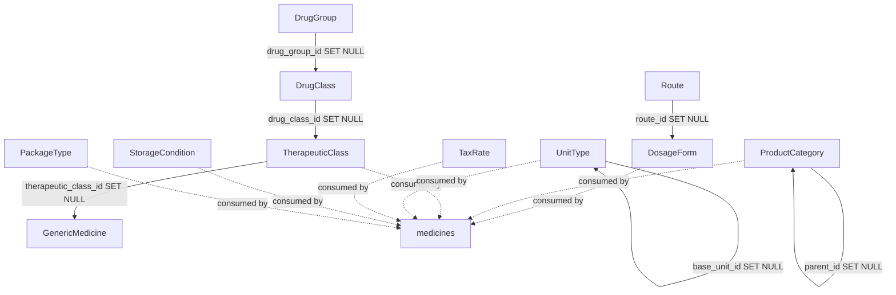

# MasterData Implementation Contract (Phase 01 — Architecture & Contract Freeze)

**Status:** Contract decisions remain authoritative; the current working tree now includes the
service, handler, routes, API registration, and OpenAPI source/bundled spec. The phase descriptions
below preserve the original implementation history unless superseded by this amendment.
**Phase 02 amendment (2026-10-02):** C-02 and C-07 are now **decided** and Phase 02 has been
implemented. See §26 "Phase 02 Outcome" for what changed and what was deliberately left alone.
**Phase 03 amendment (2026-10-02):** DTO and validation layer implemented; two defects in the
existing codebase were found and are recorded in §27.3. See §27 "Phase 03 Outcome".
**Phase 04 amendment (2026-10-02):** Repository layer implemented and verified against a live
PostgreSQL instance. **C-11 is resolved** (§20). Two of the three schema facts Phase 04 was
initially written against were wrong and are recorded in §28.2. See §28 "Phase 04 Outcome".
**Phase 04 post-review amendment (2026-10-02):** nine review findings fixed. Notably `?q=` was a
sequential scan despite 000020's indexes (C-07 was not actually closed — §29.2), pagination could
return the wrong page (§29.1), and the repository layer was restructured so behaviour exists once
(§29.3). See §29.
**Implementation audit amendment:** Phases 05–08 have since been implemented in the current
working tree: MasterData CRUD services/handlers/routes are registered in the API composition root,
and `/master` paths and schemas are present in the split and served OpenAPI specs. This does not
close the contract's explicitly unresolved business decisions. CI now provisions a dedicated
MasterData PostgreSQL test database and runs the DSN-gated tests; local DB-backed verification
still depends on access to a disposable database. The OpenAPI lint passes with 31 warnings on the
bundled contract, while oapi-codegen generation/drift remains to be run. The Makefile and OpenAPI
workflow now pass the bundled spec explicitly and check both generated outputs. Statements below
describing the pre-implementation repository state and original phase sequence are historical
snapshots.
**Applies to:** `backend/internal/modules/masterdata`
**Repository state inspected:** `main` @ `5463f07` (working tree clean)
**Inspection date:** 2026-10-02

> This document records what the **existing repository** actually does, and freezes the
> decisions Phase 02–10 must follow. Where the repository does not support a decision, the
> item is marked **UNRESOLVED** rather than invented.
>
> **Scope discipline (Phase 01):** no MasterData CRUD, DTO, repository, service, handler, routes,
> test or migration was created in Phase 01. See §23 Conflict C-01 for the pre-existing files that
> predate that phase. Phase 02 subsequently added migration `000020_masterdata_integrity` and
> edited `masterdata/model.go` — nothing else. Phase 03 added `dto.go`, `validation.go`,
> `mapping.go` and `dto_test.go`, plus four additive cases in the shared validator's
> `humanMessage`. Phase 04 added `repository.go`, eleven `repository_<resource>.go` files and
> three test files; it touched no migration, no seed file and no shared platform package.

---

## 1. Purpose

MasterData is the bounded reference vocabulary the rest of the ERP selects from. This contract
exists because the module's defining property — **it is central, not tenant-owned** — runs
directly against the repository's otherwise uniform "every resource is org-scoped" grain, and
because eleven near-identical resources create a real risk of eleven divergent implementations.

It freezes:

- the module boundary and the eleven in-scope resources;
- the tenancy semantics of a central resource inside a tenant-bound middleware stack;
- the authorization surface, including where the `SUPER_ADMIN` write restriction lives;
- the layer responsibilities (repository / service / handler) so business rules stay out of SQL;
- the API, error, pagination, delete/lifecycle, cache and OpenAPI contracts Phase 02–10 inherit.

---

## 2. Existing Architecture Summary

All statements below are read from source, not assumed. Evidence is `path:line`.

### 2.1 Layered module shape (uniform across completed modules)

Every completed domain module — `organization`, `branch`, `warehouse`, `user`, `auth`, `rbac` —
is the same seven files with the same responsibilities:

| File | Responsibility | Reference implementation |
|---|---|---|
| `model.go` | Row structs embedding `common.BaseModel`; `db` + `json` tags | `warehouse/model.go:21` |
| `dto.go` | Request/query DTOs with `validate:` and `form:` tags | `warehouse/dto.go:13` |
| `repository.go` | Explicit SQL only; returns raw driver errors | `warehouse/repository.go:18` |
| `service.go` | Business rules, transaction ownership, error mapping | `warehouse/service.go:19` |
| `handler.go` | Bind → service → render; no logic | `warehouse/handler.go:32` |
| `routes.go` | `RegisterRoutes(rg, mw)` + middleware chain | `warehouse/routes.go:24` |
| `*_test.go` | Pure unit tests, no database | `warehouse/warehouse_test.go:15` |

ADR 0009 declares this layout as the project contract, including MasterData specifically
(`docs/adr/0009-Folder-Structure.md:85-95`).

**Composition root.** Modules are supplied as `[]router.ModuleRegistrar` and mounted by
`router/v1.go:32` under `/api/v1`. The router never imports module packages. `MasterData` is
**not currently in that slice** (`cmd/api/main.go:267-274` mounts only organization, branch,
warehouse, rbac, auth, user).

### 2.2 Repository conventions

- Explicit SQL strings as `const q` inside each method. **No query builder, no ORM, no generic
  CRUD helper exists anywhere in the repository** (`warehouse/repository.go:64,76,96,109,154`).
- A package-level column-order constant plus a `scanXxx(pgx.Row)` helper shared by every
  SELECT and `INSERT/UPDATE ... RETURNING` (`warehouse/repository.go:29-42`).
- Transaction awareness is via `r.db.FromCtx(ctx)` for writes and `r.db.ReadFromCtx(ctx)` for
  reads — never a stored `*pgxpool.Pool` captured at construction
  (`internal/platform/db/pgx.go:40-54`).
- Dynamic predicates are built by appending to a `where []string` + `args []any` slice and
  joining with `AND`; placeholder numbers are derived from `len(args)` so no counter can drift
  (`warehouse/repository.go:155-173`).
- `ORDER BY` is built through an **allow-list map** and `pagination.ParseSort`, with a
  deterministic default and an `id ASC` tie-breaker. A non-allow-listed sort falls back rather
  than being interpolated — this is the project's SQL-injection defence for `sort=`
  (`warehouse/repository.go:130-135,214-228`; injection test at `warehouse_test.go:92`).
- Row locking for read-modify-write is a dedicated `FindByIDForUpdate` using
  `... FOR UPDATE` on the primary (`warehouse/repository.go:85-91`).
- Tenant scoping is **explicit in every method signature** — `FindByID(ctx, orgID, id)`. There
  is no ambient tenant filter. (`warehouse/repository.go:76`)

### 2.3 Service conventions

- The service is **the only layer that maps driver errors to `*errs.AppError`**
  (`warehouse/service.go:18`). Two named helpers recur: `mapReadErr` (`ErrNoRows → NotFound`,
  else `DatabaseError`) and `mapWriteErr` (adds `IsUniqueVilation → AlreadyExists`)
  (`warehouse/service.go:216-235`).
- Tenant id comes from the context, never the body: `orgID := appctx.OrgID(ctx)`
  (`warehouse/service.go:40`).
- Business validation lives here, not in SQL: branch-ownership guard
  (`warehouse/service.go:55-61`), single-main invariant (`:72-76`), PATCH emptiness short-circuit
  (`:128-130`), immutability enforced by *DTO shape* not by a runtime check (`:29-35`).
- `applyPatch(model, req)` copies non-nil fields; a set pointer overwrites, nil leaves
  untouched (`warehouse/service.go:197-213`). Free-text columns take `""` to blank, never NULL.
- Service-level `SUPER_ADMIN` authorization precedent exists: `authorizeScope` in
  `organization/service.go:132-140`, returning `NotFound` (not `Forbidden`) on cross-tenant
  access so existence is never confirmed.

### 2.4 Handler conventions

Handlers are four lines of flow: `httpx.BindJSON/BindQuery` → `h.svc.X(c.Request.Context(), …)`
→ `httpx.Created/OK/List/NoContent` or `httpx.Error` (`warehouse/handler.go:32-135`).
Path UUIDs are parsed locally and a malformed id yields **400 `VALIDATION_ERROR`, never 404**
(`warehouse/handler.go:141-147`).

### 2.5 Route + middleware conventions

`mw.Protected(module, action)` is `Auth → IdleSession → Tenant → RBAC`; reads add
`mw.RateLimit("auth_read")` outermost, writes add `mw.Idempotency(), mw.Audit()` innermost
(`middleware/deps.go:168-175`; `warehouse/routes.go:24-40`).

> **Rate-limit policy names are `auth_read` / `auth_write`** (`config/config.yaml:145-146`,
> `warehouse/routes.go:26,30`) — **not** `rate_auth_read` / `rate_auth_write` as `API.md` §3.2
> and §7.7 spell them. See §8.3 and Conflict C-05.

### 2.6 Errors

`errs.AppError{Code, Message, Details, Meta, Cause}` with a non-serializing `Cause`
(`errors/errors.go:16-22`). Factories: `Validation`, `NotFound`, `AlreadyExists`, `Conflict`,
`Forbidden`, `DatabaseError`, `Internal`. Introspection: `errs.Has(err, code)`, `errs.CodeOf`.
`mapper.go:111-124` **panics at init** if any `Code` lacks an HTTP mapping — adding a code is a
two-file change. Postgres triage helpers already exist: `IsUniqueVilation` (sic — typo is in the
API), `IsForeignKeyViolation`, `IsCheckViolation`, `ConstraintName` (`platform/db/postgres.go:201-230`).

### 2.7 Response envelope

Single shape, `pkg/response.Envelope{success, data, pagination, error, meta}` with
`meta{request_id, timestamp, version}` (`pkg/response/response.go:19-32`). Helpers `OK`/`Created`
(200/201), `NoContent` (204), `List` (200 + `X-Total-Count`/`X-Page`/`X-Limit`/`Link`
headers). Handlers never touch `pkg/response` directly — they use `httpx`
(`internal/common/httpx/httpx.go:51-63`).

### 2.8 Pagination & filtering

- Offset only for MasterData's use case. `pagination.Offset{page,limit,sort}`;
  `DefaultLimit=20`, `MaxLimit=100`, `MaxSortFields=5` (`pkg/pagination/pagination.go:17-23`).
  Cursors exist but are for hot append-only histories.
- `pagination.Filter` parses `q`, `status`, `from`, `to`, `branch_id`, `include_deleted`,
  `fields` and captures everything else in `Extras` for per-endpoint whitelisting
  (`pkg/pagination/filter.go:26-91`). `MaxQueryLen=200`.
- Query DTOs embed `pagination.Offset` and declare typed `form:` fields with **pointers** so
  "absent" is distinguishable from explicit `false`/`0` (`warehouse/dto.go:46-52`).

### 2.9 Validation

`platform/validator` wraps go-playground; `httpx.BindJSON`/`BindQuery` run struct validation and
convert `FieldErrors` into `errs.FieldError` details (`httpx.go:22-34,105-120`).
`RegisterStructValidation` is available for cross-field rules (`validator.go:159`).
Custom rules: `not_blank`, `iso_currency`, `phone_bd`, `nid`, `batch_no`, `strength`, `iana_tz`.

### 2.10 Transactions

`db.WithTx` (ReadCommitted, ReadWrite, 30s timeout) is the default
(`platform/db/transaction.go:24-34`). Variants: `WithTxReadOnly`, `WithTxSerialization`
(3 retries on `40001`), `WithTxOptions`. **Nested calls become SAVEPOINTs**
(`transaction.go:32-38,132-159`). Repositories never open transactions themselves; the service
owns the boundary.

### 2.11 OpenAPI — contract-first, but handlers are hand-written

The pipeline is real and enforced (`Makefile:oapi-*`):

```
api/openapi/**/*.yaml  (split source of truth)
   ├─ make oapi-check    → scripts/openapi/validate.py  (fast $ref gate, CI)
   ├─ make oapi-lint     → Redocly, config/redocly.yaml
   ├─ make oapi-bundle   → build/openapi.bundled.yaml  (+ api/scalar/openapi.yaml for /api-docs)
   ├─ make oapi-generate → oapi-codegen → internal/api/gen/v1/api.gen.go  (GENERATED)
   ├─ make oapi-drift    → regenerate to temp dir + diff  (CI gate)
   └─ make oapi-diff     → oasdiff, fail-on ERR (breaking-change detection)
```

**However:** `internal/api/server/strict.go` is behind `//go:build oapigen` and its only
operation is commented out (`strict.go:57-73`). The strict server is **reference scaffolding, not
wired**. All served endpoints are hand-written Gin handlers. There are no Swagger annotations
anywhere. The contract-first pipeline governs the **spec**; it does not generate MasterData's
handler types.

At the original inspection, `api/openapi/openapi.yaml` declared 7 tags and no `/master` path.

### 2.12 Redis

`platform/redis` exposes a thin typed client (`Get/Set/SetNX/Del/HSet/Scan`) and hand-built key
constructors under prefix `mc` (`redis/keys.go:8`). **There is no cache abstraction, no
cache-aside helper, and no get-or-populate helper anywhere.** The only catalog key is
`MedicineCatalogKey` → `mc:cat:med:%s` (`redis/keys.go:95`); RBAC has its own versioned cache.
There is **no MasterData key**.

### 2.13 Testing

Unit tests only, pure functions, no database or HTTP harness
(`warehouse/warehouse_test.go`). `tests/integration/` and `tests/mocks/` exist but every file is
an empty `package` stub — **there is no working testcontainers harness** even though
`testcontainers.go` is named as if there were. Lint is relaxed for `_test.go`
(`.golangci.yml:216-224`).

### 2.14 Lint constraints that shape the design

From `.golangci.yml`: `lll: 140` chars, `funlen: 120 lines / 60 statements`, `gocyclo: 15`,
`gocognit: 20`, `nestif: 5`, **`dupl: threshold: 150`**, `nakedret: max-func-lines: 30`.
`revive` enforces `package-comments` and `exported`.

> `dupl` at threshold 150 is the single most consequential constraint for this module: eleven
> resources with hand-written near-identical repository/service/handler code **will** trip it.
> See Decision D-12.

---

## 3. MasterData Boundary

```
MasterData = central reference / configuration data
            NOT branch-owned
            NOT organization-owned
            NOT transactional (in the ERP sense: it holds no stock,
                                no money, and no document state)
```

Three independent sources agree:

1. **Schema** — `migrations/000005_master_data.up.sql` contains **zero** occurrences of
   `organization_id`, `branch_id` or `warehouse_id` across all 15 tables. Every other domain
   table in the repository is org-scoped.
2. **ADR 0009** — `docs/adr/0009-Folder-Structure.md:91` describes masterdata's `service.go` as
   *"central-only writes, cached reads"*.
3. **API** — `docs/api/API.md:392` *"Central (not branch-scoped). Writes restricted to
   `SUPER_ADMIN`."*

**"Not transactional" is a scope statement, not a coding rule.** It means MasterData is not a
transactional *domain*. It does **not** license skipping `db.WithTx` where a single logical
operation needs more than one statement (e.g. re-parenting a category, the two-pass seeder).
See §14.

---

## 4. Resources (in scope — exactly eleven)

| # | Resource | Table | Path slug | Self-reference |
|---|---|---|---|---|
| 1 | ProductCategory | `product_categories` | `product-categories` | `parent_id → product_categories` |
| 2 | DosageForm | `dosage_forms` | `dosage-forms` | — |
| 3 | Route | `routes` | `routes` | — |
| 4 | PackageType | `package_types` | `package-types` | — |
| 5 | UnitType | `unit_types` | `unit-types` | `base_unit_id → unit_types` |
| 6 | StorageCondition | `storage_conditions` | `storage-conditions` | — |
| 7 | TaxRate | `tax_rates` | `tax-rates` | — |
| 8 | DrugGroup | `drug_groups` | `drug-groups` | — |
| 9 | DrugClass | `drug_classes` | `drug-classes` | `drug_group_id → drug_groups` |
| 10 | TherapeuticClass | `therapeutic_classes` | `therapeutic-classes` | `drug_class_id → drug_classes` |
| 11 | GenericMedicine | `generic_medicines` | `generic-medicines` | `therapeutic_class_id → therapeutic_classes` |

Every table already exists with the exact columns implied by the model structs, including
`NUMERIC(15,6)` conversion_factor, `NUMERIC(5,2)` temperatures, `NUMERIC(6,3)` rate_percent,
per-table `set_updated_at()` triggers, partial `UNIQUE(code) WHERE deleted_at IS NULL` indexes,
and GIN trigram indexes on `manufacturers`/`brands`/`suppliers`/`generic_medicines` `.name`
(`migrations/000005_master_data.up.sql`).

**Note on slug:** `API.md:396` says `/master/product-categories`; ADR 0009:93 says
`/master/categories`. See Conflict **C-04**.

---

## 5. Explicitly Out of Scope: Manufacturer, Brand, Supplier

Per instruction §16 these are **not** MasterData API resources. Repository evidence **supports**
that boundary, and Phase 02 confirmed it by evidence that Phase 01 had not yet gathered:

| Entity | Table lives in | Own module dir | Own RBAC module | API section | Verdict |
|---|---|---|---|---|---|
| **Brand** | `000005_master_data.up.sql:123` | `internal/modules/brand/` (empty stub) | `constants.ModuleBrands` | `API.md` §7.8 `/brands` | **Out** — unambiguous |
| **Supplier** | `000005_master_data.up.sql:140` | `internal/modules/supplier/` (empty stub) | `constants.ModuleSuppliers` | `API.md` §7.10 `/suppliers` | **Out** — unambiguous |
| **Manufacturer** | `000005_master_data.up.sql:103` | *no module dir* | `constants.ModuleManufacturers` | `API.md` §7.9 `/manufacturers` | **Out** — resolved in Phase 02, see below |

**Resolved in Phase 02 (C-02).** The ownership question is answered by the tables themselves:
all three are **load-bearing for other modules**, so they cannot be MasterData resources in any
sense, and `Manufacturer` cannot fold into `brand/` without breaking them.

| Inbound FK | Declaration |
|---|---|
| `medicines.brand_id` `UUID NOT NULL … ON DELETE RESTRICT` | `000006_medicine_brand_supplier.up.sql:10` |
| `medicines.manufacturer_id … ON DELETE SET NULL` | `000006_medicine_brand_supplier.up.sql:14` |
| `inventory_batches.supplier_id … ON DELETE SET NULL` | `000007_inventory_batch.up.sql:11` |
| `purchases.supplier_id UUID NOT NULL … ON DELETE RESTRICT` | `000008_purchase.up.sql:8` |
| `brands.manufacturer_id UUID NOT NULL … ON DELETE RESTRICT` | `000005_master_data.up.sql:127` |

Phase 02 therefore took the narrow reading, which is also the only one that is consistent with
`API.md` §7.7's list of `/master` endpoints (it omits all three):

- **The three tables stay.** They were created by `000005` and are referenced by `000006`,
  `000007` and `000008`. Dropping them is impossible without cascading into four other modules,
  and `000005` is applied history that must not be rewritten.
- **The three Go structs leave `masterdata`.** `Manufacturer`, `Brand` and `Supplier` were deleted
  from `masterdata/model.go`; the package now holds exactly the eleven in-scope resources. No Go
  code referenced them (verified by repo-wide grep), so nothing broke.
- **No Manufacturer module is created.** `internal/modules/manufacturer/` is still a separate piece
  of work, and `brand/` / `supplier/` remain empty stubs. `constants.ModuleBrands`,
  `ModuleManufacturers` and `ModuleSuppliers` are untouched — they are RBAC surface, not a claim
  that `masterdata` owns the tables.

ADR 0009:86-88 listing `Manufacturer` inside `masterdata/model.go` is therefore **defective**, the
same way `API.md` is defective on rate-limit policy names (C-05). Where ADR 0009 and the applied
schema disagree, the schema wins.

**Consequence for this phase:** MasterData's eleven routes must not expose
`/master/manufacturers`, `/master/brands` or `/master/suppliers`, and MasterData's service must
not own their tables, even though the migration file groups them under a "master_data" heading.
Migration file grouping is not module ownership.

---

## 6. Dependency Graph



### 6.1 Intra-module creation order

Reference rows must exist before dependents, so the seed and any bulk import must run in this
order: `routes` → `dosage_forms`; `unit_types` (self-referencing, two-pass) → rest;
`product_categories` (self-referencing, two-pass) → rest; `drug_groups` → `drug_classes` →
`therapeutic_classes` → `generic_medicines`; `tax_rates`, `storage_conditions`,
`package_types` independent.

### 6.2 Downstream consumers (why these FKs are RESTRICT)

`migrations/000006_medicine_brand_supplier.up.sql` holds **`ON DELETE RESTRICT`** on:

- `medicines.brand_id → brands(id)` `:10`
- `medicines.category_id → product_categories(id)` `:11`

and `migrations/000008_purchase.up.sql:8` on `purchases.supplier_id → suppliers(id)`.

`migrations/000006` holds `ON DELETE SET NULL` on `medicines.generic_medicine_id`,
`dosage_form_id`, `route_id`, `manufacturer_id`, `storage_condition_id`,
`medicine_variants.package_type_id`, `medicine_variants.sales_unit_id`, `tax_rate_id`;
`000007_inventory_batch.up.sql:11` sets `suppliers` to SET NULL from inventory.

**Implication — ProductCategory is the only in-scope resource with a hard `RESTRICT` from
transactional data.** Because the project soft-deletes (§19), a RESTRICT violation should never
fire through the API. It is nonetheless the one resource where the service must actively check
"still referenced" before deactivation, and where a **hard delete must be considered
unavailable entirely** rather than merely discouraged.

---

## 7. Authorization Contract

### 7.1 The RBAC engine is native, not Casbin

`go.mod` contains **no casbin dependency**. `rbac/casbin.go` is a legacy filename; the engine is
a hand-written `Enforcer` with a Casbin-*shaped* API (`Enforce(ctx, sub, dom, obj, act)`,
`keyMatch`) reimplemented in-repo (`rbac/casbin.go:236-243,394-402`).

`Enforce` is **domain-scoped** (`rbac/casbin.go:236-243`):

```go
roles := snap.activeRoles(ctx, sub, dom)     // dom = appctx.OrgID(ctx).String()
for role := range roles {
    for _, g := range snap.policy[role] {
        if (g.dom == dom || g.dom == "*") && keyMatch(obj, g.obj) && (g.act == act || g.act == "*") {
            return true, nil
        }
    }
}
```

System roles (`roles.organization_id IS NULL`) are loaded as domain `"*"`
(`rbac/repository.go:LoadPolicies` — `COALESCE(r.organization_id::text, '*')`) and therefore
grant in **every** organization domain.

**There is no `SUPER_ADMIN` special case in `Enforce`.** `SUPER_ADMIN` passes because the seed
grants it every module × every action (`rbac/seed.go:135`). Before the first `Load` the enforcer
returns `errNotLoaded` and **fails closed** (`rbac/module.go:26-29`).

### 7.2 MasterData permissions

Permission string format is `module:action`, module `masterdata`
(`constants.go:64 ModuleMasterData`), actions `create|view|update|delete`
(`constants.go:90-93`).

**These four permission rows already exist.** `rbac/seed.go:60-66` seeds the full
`AllModules × AllActions` cross-product, and `AllModules` includes `ModuleMasterData` while
`AllActions` includes all four. **Phase 02–10 must not add a permissions migration for
MasterData.** No new RBAC seeding is required for these to authorize.

### 7.3 Where the `SUPER_ADMIN` write restriction lives

**Requirement:** MasterData writes restricted to `SUPER_ADMIN`.

**Conflict (C-03).** The current seed matrix does not express this:
`rbac/seed.go:139` grants `ADMIN` `allModuleSpecsExcept(ModuleOrganizations)`, and
`AllModules` contains `ModuleMasterData` — so **an `ADMIN` currently holds
`masterdata:create|update|delete`**. `APP/SUPER_ADMIN` is the only role whose matrix is
indiscriminate, not the only one with masterdata grants.

Two ways to close the gap:

| Option | Mechanism | Cost | Phase-01 verdict |
|---|---|---|---|
| **(a) Seed matrix** | Remove `ModuleMasterData` from ADMIN's spec in `rbac/seed.go:139` | Edits a **completed module**; changes the default grant for every future tenant; needs a role/permission migration if persisted grants exist | Out of Phase 01 scope. Cleaner long term, but it is a deliberate RBAC policy change, not a MasterData concern. |
| **(b) Service guard** | `appctx.IsSuperAdmin(ctx)` check in the service write path | Self-contained; precedent exists at `organization/service.go:132-140`; returns 403 `FORBIDDEN` | **RECOMMENDED for Phase 02–10** |

**FROZEN:** the restriction is enforced in the **masterdata service layer** (option b), using
`appctx.IsSuperAdmin` and `errs.Forbidden`. It is **not** a second authorization mechanism —
it is a service-level refinement of the same `Principal` the RBAC middleware already verified.
The route still requires `masterdata:<action>`, so RBAC answers "may this caller ever?" and the
service answers "is this caller a `SUPER_ADMIN`?", mirroring the existing `authorizeScope`
pattern. Option (a) is recorded as a **recommended follow-up outside this module's scope**.

Rationale for not choosing (a): `rbac` is a completed module, §24 forbids modifying it, and a
seed-matrix change is silent and global — every tenant re-seeded would silently lose an admin
capability with no code review trail at the call site.

### 7.4 TaxRate additional authorization

**Requirement:** TaxRate has additional requirements `rate_auth_read` / `rate_auth_write`.

**Finding: these are not permissions.** They are **rate-limit policy names** misattributed to
an authorization table:

- `API.md:146-147` lists `rate_auth_read` / `rate_auth_write` under **§3.2 Rate-Limit Policies**,
  not §7 permissions.
- `API.md:408` ("Rates: reads `rate_auth_read`, writes `rate_auth_write`") is in the *Rates:*
  line of §7.7, which the surrounding sentence confirms is about rate limits.
- The **code's actual policy names are `auth_read` / `auth_write`**
  (`config/config.yaml:145-146`; used as `mw.RateLimit("auth_read")` at
  `warehouse/routes.go:26,30`).
- There is no module named `rate_auth`, and `constants.AllModules`/`AllActions` contain no such
  token, so `rate_auth_read` **cannot** be a `module:action` permission.

**FROZEN (D-08):** TaxRate uses the same `masterdata:*` permissions and the same
`auth_read` / `auth_write` rate-limit policies as every other resource. **No special-cased
TaxRate authorization is introduced.** `rate_auth_read`/`rate_auth_write` are recorded as a
documentation naming defect in `API.md`; correcting `API.md` is out of Phase 01 scope, so the
contract carries the resolution rather than the doc edit.

If the intent behind §7.7 was in fact that **TaxRate deserves stricter treatment than other
masterdata** (a financially meaningful configuration), the supported mechanism already exists
and needs no new architecture: the `SUPER_ADMIN` service guard of §7.3 applies to all writes,
and the specific `auth_read` policy of `config.yaml:144` (60/min) versus `auth_read` (300/min) is
a one-line config change. **Marked UNRESOLVED — confirm intent before Phase 07.**

---

## 8. Tenant Contract

### 8.1 How tenancy actually works

`Tenant()` is the second link of `Protected()` (`middleware/deps.go:168-175`):

- It reads `appctx.CurrentPrincipal(ctx)` and **fails closed** if absent
  (`middleware/tenant.go:19-26`).
- **Organization is not selectable.** There is no organization header; `OrgID` comes from the
  JWT. `tenant.go:166-180` states the invariant plainly: *"As long as every query filters by
  `appctx.OrgID`, cross-tenant access is structurally impossible."*
- Only **branch** is selectable, via `X-Branch-ID` / `X-Branch-IDs`, intersected with the
  principal's JWT-baked subset (`tenant.go:92-134`).

So the tenancy layer is **org-binding + branch-narrowing**. It never adds a row filter by
itself — filtering happens in the repository's `WHERE` clause, which is why every completed
repository method takes `orgID` as a parameter.

### 8.2 How central MasterData interacts — the frozen answer

**D-01 (FROZEN):** MasterData tables have **no** `organization_id`, **no** `branch_id`, **no**
`warehouse_id`. MasterData repository methods therefore take **no tenant parameter**.

```text
Central resource + tenant middleware, resolved:

  Tenant()   →  runs normally. OrgID/branch scope land on the context.
                For MasterData they are simply not consumed. No error.
  RBAC       →  runs normally. Authorization is still PER-ORGANIZATION:
                Enforce(dom = caller's OrgID). See the consequence below.
  Repository →  no org predicate. Rows are global.
  Service    →  uses appctx.IsSuperAdmin for writes (§7.3). Does NOT use OrgID.
```

**Branch scope is not consulted.** There is no `BranchScope`/`enforceBranchScope` equivalent in
MasterData, because a central reference has no branch dimension. A branch-bound `CASHIER` with
`masterdata:view` reads the same global catalogue as `SUPER_ADMIN` — that is the intended
consequence of centrality, not a leak.

**The unresolved consequence (C-06).** RBAC authorization is org-domain-scoped while the data
is global. A caller in organization *A* holding `masterdata:update` passes `Enforce` in domain
*A* and then mutates a row that organization *B* also reads. There is **no existing mechanism**
in this repository for "authorize against a global/system scope", and inventing one would be
redesigning RBAC — forbidden by §24. The §7.3 `SUPER_ADMIN` service guard is what actually
contains the blast radius, and it is the reason option (b) is recommended over (a): it is a
*global* gate, whereas a permission grant is inherently per-org.

**Documented consequence:** a tenant-scoped role grant on `masterdata:*` is a **global** write
capability. Any future grant of these permissions to a non-`SUPER_ADMIN` role must be treated as
a platform-level decision. The `organization` module is the closest existing precedent for a
resource that is itself the tenant root and is guarded by a service-level `IsSuperAdmin` check.

**Central writes and the seed are two different things.** The seeder runs at boot
(`cmd/seed`, and rbac's in-module seeder run from `cmd/api/main.go`) with no HTTP principal, so
`appctx.OrgID` is `uuid.Nil` there. MasterData seeding must not route through the §7.3 guard; it
runs on a direct repository/DDL path. See §14.3.

---

## 9. API Contract

### 9.1 Prefix and shape

All eleven resources mount under `/api/v1/master` (group `"/master"`), one explicit
`gin.RouterGroup` per resource slug, following `warehouse/routes.go:35-40`:

```text
POST   /api/v1/master/{resource}
GET    /api/v1/master/{resource}
GET    /api/v1/master/{resource}/:id
PATCH  /api/v1/master/{resource}/:id
DELETE /api/v1/master/{resource}/:id
```

No `PUT` — the supplied contract is POST/GET/GET-by-id/PATCH/DELETE only. (`branch` also mounts
`PUT` at `branch/routes.go:51`; that is branch's own choice and is not inherited here.)

**Path-parameter naming:** `:id` at every `/{resource}/:id` position. `/master` is a new prefix
with no competing wildcard, so this is safe, and it satisfies the Gin radix-tree constraint
documented at `branch/routes.go:16-23` / `warehouse/routes.go:16-23`. A future
`/master/{resource}/:id/children` **must** also use `:id`.

### 9.2 Wildcard vs explicit groups

`BUSINESS_MODULE_PLAN.MD.md:289-293` proposes a *single* `GET /master/{allowed-kind}` route with
an allow-list. **D-02 (FROZEN): reject that; use eleven explicit groups.** Evidence: all three
completed domain modules register explicit `rg.Group("/<plural>")` groups
(`warehouse/routes.go:35`, `branch/routes.go:35`, `organization/routes.go`). A wildcard route
with a runtime allow-list also inverts the project's security posture — it would require
`path-http-verbs`/OpenAPI gymnastics and replace compile-time route registration with a
string switch, for no benefit at eleven resources. (The plan document is a *recommendation
input*, not the repository's convention; §2 "Existing repository is the source of truth".)

### 9.3 Status codes and bodies

| Operation | Success | Body helper | Notes |
|---|---|---|---|
| Create | 201 | `httpx.Created` | `Location` header **not** set (no precedent in `warehouse`) |
| List | 200 | `httpx.List(items, meta)` | emits `X-Total-Count`, `X-Page`, `X-Limit` |
| Get | 200 | `httpx.OK` | |
| Update | 200 | `httpx.OK` | |
| Delete | 204 | `httpx.NoContent` | body empty |

Envelope from `pkg/response.Envelope`. This matches `API.md` §5 and Appendix C exactly — no new
envelope.

---

## 10. Filtering & Pagination Contract

```text
GET /api/v1/master/{resource}?page=&limit=&sort=&q=&is_active=&parent_id=
```

| Parameter | Handling | Source of truth |
|---|---|---|
| `page`, `limit` | embedded `pagination.Offset`; `Normalize()` clamps to `[1,100]`, default 20 | `pagination.go:28-50` |
| `sort` | `?sort=-name,code`; `-` prefix = DESC; allow-list per resource; `id ASC` tie-breaker; **disallowed field falls back to the resource default, never interpolated** | `warehouse/repository.go:214-228` |
| `q` | free-text over `code` and `name`; truncated to `pagination.MaxQueryLen` (200) | `pagination/filter.go:50-53` |
| `is_active` | `*bool` so absent ≠ `false` | `warehouse/dto.go:50` |
| `parent_id` | `*uuid.UUID`; **absent means "no filter"**, present-and-null is not distinguishable — an empty value is treated as absent | `pagination/filter.go:60-65`, `uuidx.ParsePointer` |
| `include_deleted` | parsed by `pagination.Filter` but **SUPER_ADMIN-only per `API.md:173`; not adopted** — see below | `pagination/filter.go:66-67` |

`q` is a **required** part of the contract (`API.md:410`: `?is_active=&q=&parent_id=`) but has
**no infrastructure behind it on 10 of the 11 tables.** `000005_master_data.up.sql` creates GIN
trigram indexes only on `manufacturers`, `brands`, `suppliers`, `generic_medicines`
(`.name`). The other ten tables have no trigram index, so a trigram `LIKE` is a sequential scan.

**UNRESOLVED (C-07) — decide before Phase 04.** Options, in preference order:

1. **Add trigram indexes** for the ten tables in a new `000020_*.up.sql` (with a matching
   `.down.sql`), keeping the seed conventions of `000005`. Cost: a migration, which Phase 02
   owns. This is the only option that makes `?q=` perform at scale and it matches how
   `000005` already indexes the four tables that need it.
2. **Bound `q` to `code` and `name` with `ILIKE`** and document that these eleven catalogues are
   small (tens to low thousands of rows), so a scan is acceptable. Honest but degrades silently
   as the catalogue grows.
3. **Reject `q` on tables without a trigram index.** Contract-inconsistent with `API.md:410`;
   not recommended.

`include_deleted` is **not** adopted. Every completed repository hard-filters
`deleted_at IS NULL` (`warehouse/repository.go:79`) and none exposes it, despite
`API.md:173` advertising it. Adopting it for MasterData alone would make soft-deleted global
reference rows visible to a single module. **FROZEN: `deleted_at IS NULL` always.**

---

## 11. Validation Contract

Validation is transport-shape only in the DTO (`validate:` tags), enforced by
`httpx.BindJSON`/`BindQuery`; **cross-row and cross-field business rules are service-layer**
(§2.3).

### 11.1 Confirmed by existing schema (FROZEN)

| Rule | Basis |
|---|---|
| `code` required, non-blank, length-bounded | `VARCHAR(40)` — `000005:4`; `not_blank` rule available |
| `code` unique among non-deleted | `UNIQUE INDEX ... (code) WHERE deleted_at IS NULL` — all 15 tables |
| `name` required, non-blank | `VARCHAR(120..200)` per table |
| `parent_id`/`route_id`/`base_unit_id`/`drug_group_id`/`drug_class_id`/`therapeutic_class_id` must reference an existing, non-deleted row | FKs `000005:6,36,64,182,197,213` |
| `parent_id` ≠ self | **Corrected in Phase 02.** This is expressible as a row-level check: `parent_id IS DISTINCT FROM id`. Phase 01 wrongly recorded it as "not expressible as a row-level `CHECK`". Now `ck_product_categories_parent_not_self` (`000020`). The service-layer rejection in Phase 06 stays — it returns 409 instead of 500. |
| `base_unit_id` ≠ self | **Added in Phase 02** as `ck_unit_types_base_unit_not_self` (`000020`), same reasoning. |
| `conversion_factor` positive when present | `NUMERIC(15,6)` nullable, `000005:65`. **UNRESOLVED (D-14)** — see below |
| `min_temp_celsius <= max_temp_celsius` | **Now both layers.** `000020` adds `ck_storage_conditions_temp_range` as the backstop for non-handler writes; Phase 03 still keeps the `RegisterStructValidation` rule (`validator.go:159`) so the caller gets a 400 rather than a database error. Either end may be NULL. |
| `rate_percent` within range | `NUMERIC(6,3) NOT NULL` allows `-999.999`. **UNRESOLVED — see D-14** |
| Unknown body fields | `httpx.BindJSON` uses `ShouldBindJSON` — **Gin's default binder does *not* reject unknown fields**, so mass-assignment into unmapped fields is structurally impossible (there is no destination for them) but a typo'd field is silently ignored. **FROZEN: accept the existing behaviour; do not enable `EnableDecoderDisallowUnknownFields` for one module.** |

### 11.2 Marked UNRESOLVED — do not invent

| Rule | Status | Why |
|---|---|---|
| `code` normalization (trim? uppercase? strip spaces?) | **UNRESOLVED** | No completed module normalizes a code. The `batch_no` regex comment says *"normalize to uppercase at the service layer if a canonical form is needed"* (`validator/custom_rules.go:30-33`) — an intent, not a decision. Also **UNRESOLVED: is `code` immutable after creation?** `warehouse` makes `code` immutable (`warehouse/dto.go:24-35`) and its test asserts it (`warehouse_test.go:59-68`); there is no counter-example either way. |
| `conversion_factor` bounds | **UNRESOLVED** | `unit_types.yaml:25` carries the comment *"default; overridden per medicine"* — so factors are defaults, not invariants. Whether a **base** unit may carry a factor, and whether a factor may be `0` or negative, is not established anywhere. |
| `rate_percent` bounds and sign | **UNRESOLVED** | A refund/credit tax line is plausibly negative, but no ledger or tax code exists yet. `tax_rates` is a *rate catalogue*, not a line amount. No repository evidence either way. |
| Exactly one `is_default` tax rate | **UNRESOLVED** | `is_default BOOLEAN NOT NULL DEFAULT FALSE` with **no** unique constraint (`000005:96`). The seeder I wrote in an earlier phase sets one default, but nothing in the schema or code enforces single-default. The plan's §3 "valid interval / prevent overlapping applicable rules" (`BUSINESS_MODULE_PLAN.MD.md:275`) implies effective-dated rules that **do not exist in this schema at all** — see C-08. |
| `sort_order` uniqueness / contiguity | **UNRESOLVED** | `categories.yaml:126-128` uses 999 as a "MISC" sentinel, implying gaps are expected. No constraint. |
| Cycle prevention beyond direct self-reference | **UNRESOLVED** | `product_categories` and `unit_types` are self-referencing and can form multi-node cycles. The plan says "cycle prevention in service" (`BUSINESS_MODULE_PLAN.MD.md:273,299`) but defines no depth or traversal policy. **FROZEN: direct self-reference is now DB-enforced by `000020`; multi-node cycle detection is deferred to Phase 06 with an explicit decision.** |

---

## 12. Repository Contract

Layering rule (from the plan, §9 of this document and the code): **business rules must not leak
into repositories.** The repository may express *relational* integrity (join predicates, FK
existence) and *query-shape* concerns (sorting, pagination). It may not decide whether a
category move is legal.

**D-11 (FROZEN) — generic helper + typed wrappers.** Eleven hand-written repositories will trip
`dupl` at threshold 150 (§2.14) and, independently, will drift. ADR 0009:90 anticipates this:
masterdata's `repository.go` is specified as *"generic + typed queries per master table"*. So:

- A **small, unexported generic CRUD core** in `repository.go` — column list, scan function,
  `Insert`/`FindByID`/`FindByIDForUpdate`/`Update`/`SoftDelete`/`List`/`buildOrderBy` — parameterised
  over a per-resource descriptor (table name, column order, allowed sort columns, default order).
  Model it on the existing `warehouse` implementation, generalized; do **not** build a framework
  and do **not** add reflection.
- **Typed per-resource wrappers** returning that resource's concrete struct, so callers and
  future modules get compile-time safety. `dupl` measures duplication in the wrappers, not the
  core; thin wrappers stay well under threshold.
- Because MasterData is central, **no method takes `orgID`/`branchID`.** `FindByID(ctx, id)`,
  not `FindByID(ctx, orgID, id)`.
- Reads use `db.ReadFromCtx`; writes and `FOR UPDATE` use `db.FromCtx`
  (`platform/db/pgx.go:40-54`).
- Sort allow-lists are per-resource and **exclude** `deleted_at`. Default order is a single shared
  `code ASC, id ASC` for all eleven, following `warehouse/repository.go:217`; Phase 04 resolved
  this in §28.4. *(An earlier draft of this section said the default order would be "chosen per
  resource" and cross-referenced D-13, which is about transactions and does not define one —
  corrected.)*
- Soft delete: `UPDATE … SET deleted_at = now() WHERE id = $1 AND deleted_at IS NULL`,
  returning `RowsAffected() > 0` (`warehouse/repository.go:109-117`).

**D-12 (FROZEN) — reference-resolution reads are repository concerns.** "Does a `Route` with this
id exist and is it not deleted?" is a query, so it belongs in the repository
(`warehouse/repository.go:49-59 BranchBelongsToOrg` is the exact precedent). "May this caller
set this `parent_id`?" is a rule, so it belongs in the service.

*Phase 04 note:* D-12 itself was not implemented in Phase 04. The eight `Is<Resource>Referenced`
probes were (they are the D-19 check, and they have callers), but the plain "does this parent
exist?" reads have no caller until Phase 05 writes the create/patch rules. Adding eleven
`Exists<Resource>` methods now would be eleven unused methods. Phase 05 adds them, typed, never
with a caller-supplied table name.

---

## 13. Service Contract

- Owns the transaction boundary: `s.db.WithTx` around any multi-statement operation.
- Owns the `SUPER_ADMIN` write guard (§7.3). Reads have **no** guard beyond RBAC.
- Owns error mapping: `mapReadErr` / `mapWriteErr` equivalents (§2.3), extended with
  `db.IsForeignKeyViolation` → 409 for a referenced row.
- Owns self-reference rejection and the deferred cycle check (§11.2).
- Owns `applyPatch` semantics: nil leaves unchanged, set pointer overwrites.
- **Must not** reference `appctx.OrgID` or `appctx.BranchScope` (D-01).
- Empty `PATCH` degrades to a read, matching `warehouse/service.go:128-130`.
- Must not import `gin`, `net/http`, `*pgxpool.Pool`, or Redis.

---

## 14. Handler Contract

Thin, per `warehouse/handler.go`. Responsibilities and nothing else:

1. `httpx.BindJSON` / `httpx.BindQuery` with the injected `*validator.Validator`.
2. Parse `:id` via the local `parseIDParam` helper — **400, not 404**, on a malformed UUID
   (`warehouse/handler.go:141-147`).
3. Call `h.svc.X(c.Request.Context(), …)`.
4. Render via `httpx.Created` / `OK` / `List` / `NoContent`, or `httpx.Error(c, h.log, err)`.

Must not contain validation logic beyond struct tags, error mapping, or SQL knowledge.
`New(database, validator, log) *Handler` assembles repository → service → handler
(`warehouse/handler.go:25-29`) and `Handler.RegisterRoutes` satisfies
`router.ModuleRegistrar` (`router/router.go`, consumed at `router/v1.go:33`).

---

## 15. Transaction Contract

**D-13 (FROZEN):** MasterData is not a transactional domain (§3), but it still uses
`db.WithTx` wherever one logical operation is more than one statement. Concretely:

| Operation | Transaction? | Reason |
|---|---|---|
| Single `INSERT` create | **No** | One statement; wrapping adds a savepoint round-trip for nothing |
| Single `UPDATE` patch | **Yes** if it read-modify-writes (`FindByIDForUpdate` → patch → `Update`), matching `warehouse/service.go:133-147` | Prevent lost updates |
| Re-parent a `ProductCategory` | **Yes** | Validate new parent, then update |
| Promote/clear a default `TaxRate` | **Yes** if the single-default rule is adopted | Multi-statement invariant |
| Delete with a reference check | **Yes** | Check-then-act must not race |

Options are `db.WithTx` (default RC/RW, 30s) or `WithTxSerialization` only where a real
write-skew exists (`transaction.go:24-34,44-53`). **No `WithTxSerializable` by default** — the
plan agrees ("No routine serializable transactions",
`BUSINESS_MODULE_PLAN.MD.md:315`).

### 15.1 Audit interaction

`mw.Audit()` is a **post-handler** middleware: it calls `c.Next()` first, then records
(`middleware/audit.go:79-107`). By the time it runs, the service's transaction has committed.
**Audit cannot roll back a MasterData write, and a MasterData write does not wait on audit.**

### 15.2 Outbox

No outbox table, writer, or worker exists in the repository. `constants.TaskOutboxPublish` is
declared (`constants.go:222`) but nothing implements it. **MasterData does not publish events in
any phase** — the plan marks `ReferenceChanged.v1` optional
(`BUSINESS_MODULE_PLAN.MD.md:323`). **UNRESOLVED: not built.**

---

## 16. Audit Contract

The repository has **exactly one** audit mechanism, and it is technical, not business.

**What exists:**

- `mw.Audit()` — mounted innermost on **mutation routes only** (`isMutation` check,
  `audit.go:66-70`; wired at `warehouse/routes.go:32`). One `AuditEntry` per state-changing
  request.
- `PostgresAuditSink.Record` (`platform/audit/sink.go:46-81`) → `INSERT INTO audit_logs`.
  Production wiring is a fanout to Postgres + Loki (`cmd/api/main.go:257`).
- `audit_logs` is range-partitioned on `created_at` with a `DEFAULT` partition, append-only via
  a `prevent_write()` trigger, and indexes on `organization_id`, `user_id`, `module`,
  `(entity_type, entity_id)`, `outcome`.

**What does not exist — and this matters for the distinction the phase asked for:**

| Category | Status |
|---|---|
| **Technical/request audit** — request received, authn/authz result, HTTP outcome, latency, error code | **Implemented** by `mw.Audit()` |
| **Business/change audit** — "product category created", "deactivated", "re-parented", with before/after state | **Not implemented anywhere** |

`audit_logs` *has* `entity_type`, `entity_id`, `before_data`, `after_data` columns, but
`PostgresAuditSink.Record` **never populates them** — it writes only method/route/path/module/
action into `details` (`audit/sink.go:50-56`). The project convention is therefore
**technical audit only**. The plan's distinction is correct and the repo confirms it: middleware
audit "does **not** prove that a multi-module transaction committed"
(`BUSINESS_MODULE_PLAN.MD.md:544`).

**FROZEN (D-15):** MasterData gets audit by mounting `mw.Audit()` on its write routes. That is
the whole contract. Business/change audit is **out of scope for every phase of this module** —
building it would mean creating a `business_audit_events` table, an append port, and a new
transaction interaction that no completed module has. It belongs to the `audit` module's own
phase, not MasterData's.

Three practical consequences, all favourable:

1. `audit_logs.organization_id` is **nullable** (`000011`/audit migration), so a central
   resource's audit row is legal whether or not a tenant applies. The middleware will still
   populate the caller's org (it reads the context), which is *correct and desirable* — it
   records **who** made the change, not **whose data** it was.
2. `module` and `action` are `NOT NULL` and are populated by the RBAC middleware from the
   `Protected(module, action)` arguments (`rbac.go:15-18` → `audit.go:95-96`). Because MasterData
   routes use `mw.Protected("masterdata", action)`, every entry is automatically
   `module="masterdata"` with a correct `action` and a `403 FORBIDDEN` on a `SUPER_ADMIN` write
   rejection is recorded with `error_code="FORBIDDEN"`. **No audit-specific code is needed.**
3. Request bodies are captured and redacted by `maskBody` (`audit.go:120-137`). Note
   `auditSensitiveExact` includes `"code"` (`audit.go:24`) — **a MasterData `code` field will be
   redacted as `***REDACTED***` in the audit `request_body`.** That is a false positive for
   reference data. It is a shared-middleware constant and changing it affects every module, so
   **Phase 01 does not change it.** Recorded as **C-09 (informational)** — if it matters, it is
   a global audit-middleware decision, not a MasterData one.

---

## 17. Cache Contract

**D-16 (FROZEN): PostgreSQL is the sole authority. Redis is an optimization only, and no cache is
built in this phase.**

Facts established:

- `platform/redis` has **no cache abstraction and no cache-aside helper** (§2.12). Key strings
  are hand-built constructors in `redis/keys.go` under prefix `mc`.
- ADR 0009:91 says masterdata's service has *"cached reads"*, but **no such read exists**.
- `redis.Client` fails at construction if Redis is unreachable (`redis/client.go:41-44`), so
  Redis is a **boot-time dependency** in this deployment, not a soft optional.
- The RBAC cache (the only mature example) is versioned by an authorization epoch so invalidation
  is implicit (`redis/keys.go:82-84`). There is no equivalent versioning primitive for
  reference data.

**UNRESOLVED (C-10), for Phase 09:** a MasterData cache has no established pattern to follow, and
the invalidation problem for a *global* catalogue is real — a write in org A must invalidate
caches for every org. The RBAC per-org generation counter does not apply. Candidate approaches
(generation counter on a `system`-scope row, `DEL` on write, or short TTL as the only invalidation
mechanism) are all plausible and none is evidenced. **Phase 09 must decide and record this before
writing cache code.** Phase 02–08 must read through PostgreSQL only.

---

## 18. Error Contract

Reuse `internal/errors` exclusively. No parallel framework. No new `Code` values are needed for
the eleven CRUD resources — every failure maps to an existing code:

| Condition | Code | HTTP | Factory |
|---|---|---|---|
| Body/query/path validation | `VALIDATION_ERROR` | 400 | `errs.Validation` |
| Malformed `:id` | `VALIDATION_ERROR` | 400 | `errs.Validation(...).WithCause` |
| Missing/deleted row | `NOT_FOUND` | 404 | `errs.NotFound("<resource>")` |
| Duplicate `code` | `ALREADY_EXISTS` | 409 | `errs.AlreadyExists("<resource> code")` |
| Row still referenced | `CONFLICT` | 409 | `errs.Conflict` |
| Non-`SUPER_ADMIN` write | `FORBIDDEN` | 403 | `errs.Forbidden` |
| Self-reference / rule violation | `BUSINESS_RULE_VIOLATION` | 422 | `errs.Business` |
| Anything else from the driver | `DATABASE_ERROR` | 500 | `errs.DatabaseError` |

**Notes.**

- `mapper.go:111-124` panics at init if a `Code` lacks a status mapping. **Adding a `Code` is a
  two-file change and must be justified; the eleven CRUD resources need none.**
- 5xx bodies are a fixed generic string; the cause is logged, never serialized
  (`httpx.go:86-90`). MasterData must never leak SQL text.
- `ALREADY_EXISTS` is `Code = "ALREADY_EXISTS"` but maps to HTTP 409; `API.md` §6 lists only
  `CONFLICT` for 409. **Cosmetic doc drift; the code is authoritative** (per
  `docs/README.md:41-42`). Not a MasterData concern.
- Postgres triage: `db.IsUniqueVilation` (23505), `db.IsForeignKeyViolation` (23503),
  `db.IsCheckViolation` (23514), `db.ConstraintName` (`postgres.go:201-230`).
  **MasterData's `mapWriteErr` must handle all three**, because a `RESTRICT` FK from
  `medicines.category_id` (§6.2) surfaces as 23503, not 23505.

---

## 19. OpenAPI Contract

**D-17 (FROZEN): contract-first YAML. No Swagger annotations. No second doc system.**

Required Phase 07/08 work, using the existing pipeline:

1. `api/openapi/paths/masterdata.yaml` — eleven path groups, modelled on
   `api/openapi/paths/warehouses.yaml` (operationId `masterdata.<resource>.<verb>`, `tags:
   [masterdata]`, `$ref`s to shared parameters/responses).
2. `api/openapi/components/schemas/masterdata.yaml` — request/response schemas, modelled on
   `components/schemas/warehouse.yaml`.
3. `api/openapi/openapi.yaml` — add a `masterdata` tag and the eleven `$ref` path entries.
4. `make oapi-check` → `oapi-lint` → `oapi-bundle` → `oapi-generate` → `oapi-drift`.

Lint rules that will bite (`config/redocly.yaml`): `no-invalid-parameter-examples: error`,
`path-parameters-defined: error`, `path-http-verbs: error`, `spec: error`,
`operation-id-naming: warn`, `no-unused-components: warn`. `operation-2xx-response` is **off**
(so a 204-only DELETE is valid).

> **Do not hand-edit `internal/api/gen/v1/api.gen.go`.** It is generated; the drift gate will
> fail CI. Re-run `make oapi-generate`.
>
> **Do not wire the strict server for MasterData.** `internal/api/server/strict.go` is
> `//go:build oapigen` with its only operation commented out (`strict.go:57-73`). Every served
> endpoint in this repository is a hand-written Gin handler. MasterData follows that. Using the
> strict server for one module would be introducing a second request-binding path.

`oasdiff` (`config/oasdiff.yaml`) fails CI on `ERR` only; adding eleven new resources is purely
additive and will not trip it.

---

## 20. Delete / Lifecycle Contract

**D-18 (FROZEN): soft delete only. `DELETE` sets `deleted_at = now()` and returns 204. There is
no hard delete anywhere in this module, ever.**

Evidence this is the project convention, not an assumption: `common.BaseModel.DeletedAt`;
`warehouse/repository.go:109-117 SoftDelete`; every read filters `deleted_at IS NULL`; partial
unique indexes (`WHERE deleted_at IS NULL`) exist on all 15 tables precisely so a code becomes
reusable after deletion; `httpx.NoContent` documented as *"used by soft-delete endpoints"*
(`httpx.go:57`); `API.md:60` `DELETE` = soft-delete.

**Deactivation is a distinct, non-destructive state.** Every in-scope resource has
`is_active BOOLEAN NOT NULL DEFAULT TRUE`. The two are not interchangeable:

- `is_active = false` → row still exists, still resolvable, still referenced. **This is the
  correct response to "a medicine still points at this route".**
- `deleted_at` set → row gone from all reads, `code` reusable. Correct only for genuinely
  unreferenced rows.

**Referenced-row behavior.**

| Resource | Hard `RESTRICT` inbound? | Contract |
|---|---|---|
| ProductCategory | **Yes** — `medicines.category_id` (000006:11) | `DELETE` checks live medicines and live child categories and refuses with 409 while referenced; recommend deactivation. |
| Route | No — `medicines.route_id` and `dosage_forms.route_id` are `SET NULL` | `DELETE` is refused while a live medicine or dosage form references it; recommend deactivation |
| DosageForm, UnitType, StorageCondition, TaxRate, PackageType, DrugGroup, DrugClass, TherapeuticClass, GenericMedicine | No — inbound FKs are `SET NULL` | `DELETE` is permitted only when no live medicine or MasterData child relationship would be orphaned |

Because soft delete never fires a FK constraint, the RESTRICT above is only reachable through a
hard delete, which is unavailable. So the ProductCategory case is a **policy** decision, not a
constraint. The cheapest policy consistent with `API.md:292` ("Archive, never remove used
semantics") is:

> **FROZEN (D-19): `DELETE` on any in-scope resource performs a soft delete. The service first
> checks whether the row is still referenced by any live downstream row or live MasterData child;
> if so it returns 409 `CONFLICT` with a message directing the caller to
> `PATCH {is_active:false}` instead. `is_active=false` always succeeds.**

**RESOLVED (C-11) — Phase 04 confirmed the columns from the migrations.** The reference check is a
single `SELECT EXISTS`, but **not** against four tables. Only `medicines` references the eleven
MasterData tables; `medicine_variants`, `inventory_batches` and `purchases` reference **none** of
them (they reference `brands`/`suppliers`/`manufacturers`, which are out of scope per §5). Every
reference is declared in `000006_medicine_brand_supplier.up.sql:9-31`:

| Resource | `medicines` column | `ON DELETE` |
|---|---|---|
| `product_categories` | `category_id` **NOT NULL** | `RESTRICT` |
| `generic_medicines` | `generic_medicine_id` | `SET NULL` |
| `dosage_forms` | `dosage_form_id` | `SET NULL` |
| `routes` | `route_id` | `SET NULL` |
| `storage_conditions` | `storage_condition_id` | `SET NULL` |
| `package_types` | `package_type_id` | `SET NULL` |
| `unit_types` | `sales_unit_id` | `SET NULL` |
| `tax_rates` | `tax_rate_id` | `SET NULL` |
| `drug_groups` | **none** | — |
| `drug_classes` | **none** | — |
| `therapeutic_classes` | **none** | — |

Three consequences, all now binding:

1. **The check is required, not belt-and-braces.** Every delete here is *soft*, and a foreign key
   cannot observe `deleted_at`. `medicines.category_id` being `ON DELETE RESTRICT` protects only
   against a hard delete, so nothing at the database layer stops a category being soft-deleted
   underneath stocked medicines.
2. **Eight resources have a medicine probe, and parent relationships need separate probes.**
   The three taxonomy rows have nothing to be referenced *by* `medicines`; they do have children
   (`drug_classes` → `therapeutic_classes` → `generic_medicines`). Other live MasterData child
   relationships are `dosage_forms.route_id`, `product_categories.parent_id` and
   `unit_types.base_unit_id`. `ON DELETE SET NULL` does not run for a soft delete, so all these
   child relationships must be checked separately.
3. **The probe filters `deleted_at IS NULL` on the referencing side**, so a soft-deleted medicine
   stops counting as a reference and the resource becomes deletable.

Implemented as `Repository.Is<Resource>Referenced`, one per resource referenced by medicines,
each passing a literal column name to the shared `referencedByMedicine` helper. Hierarchy and
parent-child probes use `referencedByChild`; the route→dosage-form probe is also required because
soft deletion does not fire its `ON DELETE SET NULL` FK. Verified against a live database
(`TestIntegrationReferenceProbes`); the route-child and concurrent-reference regression tests are
DSN-gated by `MASTERDATA_TEST_DSN`.

---

## 21. Decision Table

| Area | Existing convention | MasterData decision | Evidence | Status |
|---|---|---|---|---|
| IDs | `google/uuid` in modules; `platform/uuid` wrapper for infra | `github.com/google/uuid` directly; DB-side `gen_random_uuid()` | `warehouse/model.go:8`; `000005:3` | FROZEN |
| BaseModel | Embed `common.BaseModel` (4 fields) | Embed `common.BaseModel`. **Not** `AuditColumns` — no `created_by`/`updated_by` columns exist | `common/model_base.go:13,24`; `000005` | FROZEN |
| Timestamps | DB defaults + `set_updated_at()` trigger | Never set in Go | `000001:10-17`; `000005:16-17` | FROZEN |
| Soft delete | `deleted_at`, partial unique indexes | Always soft; 204; no hard delete path | `warehouse/repository.go:109` | FROZEN |
| Tenant scope | Every method takes `orgID`; `Tenant()` binds org, narrows branch | **No tenant column, no tenant parameter** — central | `000005` (0 org/branch cols); ADR 0009:91; `API.md:392` | FROZEN |
| Branch scope | `BranchScope` + `enforceBranchScope` | **Not used** — central resource has no branch dimension | `warehouse/service.go:250` | FROZEN |
| RBAC module/action | `module:action`, module `masterdata` | `masterdata:create\|view\|update\|delete`; **already seeded**, no migration | `constants.go:64,90-93`; `rbac/seed.go:60-66` | FROZEN |
| SUPER_ADMIN write gate | No name bypass in `Enforce`; ADMIN also holds masterdata | **Service-layer `appctx.IsSuperAdmin` guard → 403** | `rbac/seed.go:139`; `casbin.go:236`; precedent `organization/service.go:132` | FROZEN (seed-matrix alternative = follow-up) |
| TaxRate special auth | `rate_auth_read/write` are **rate-limit policy names**, not permissions | Same `masterdata:*` + `auth_read`/`auth_write` as all resources | `config.yaml:145-146`; `API.md:146-147`; `warehouse/routes.go:26` | FROZEN |
| Audit | `mw.Audit()` on mutations → `audit_logs`; technical only | Mount it on write routes; nothing more | `audit.go:65`; `audit/sink.go:46` | FROZEN |
| Business/change audit | Not implemented anywhere | Out of scope for this module | `audit/sink.go:50-56` (no entity/before/after) | FROZEN (deferred) |
| Repository | Explicit SQL, typed, `FromCtx`/`ReadFromCtx` | Generic CRUD core + typed wrappers, **no tenant param** | `warehouse/repository.go`; ADR 0009:90 | FROZEN |
| Service | Owns tx + error mapping + rules | Same; plus the SUPER_ADMIN guard | `warehouse/service.go:216` | FROZEN |
| Handler | bind → svc → httpx | Same, incl. 400-on-bad-UUID | `warehouse/handler.go:141` | FROZEN |
| Transactions | `db.WithTx` RC/RW 30s; nested = savepoint | Wrap only multi-statement ops; no serializable by default | `transaction.go:24-38` | FROZEN |
| Responses | `pkg/response.Envelope` via `httpx` | Unchanged; 200/201/204 | `response.go:19`; `httpx.go:51` | FROZEN |
| Errors | `errs.AppError` + existing codes | No new `Code`; add 23503 handling | `mapper.go:111`; `postgres.go:201` | FROZEN |
| Pagination | Offset, 20/100, allow-list sort + `id` tie-break | Offset only | `pagination.go:17-23`; `warehouse/repository.go:214` | FROZEN |
| `?q=` | Trigram in API.md; index on 4 of 15 tables | GIN trigram on `.name` for all 11 | `000005:120,137,162,221`; `000020` | FROZEN (indexed in `000020`) |
| OpenAPI | Split YAML → lint → bundle → codegen → drift; hand-written handlers | Add paths+schemas+tag; regenerate; do not wire strict server | `Makefile:oapi-*`; `server/strict.go:1,57` | FROZEN |
| Redis | No cache abstraction; Postgres authoritative | No cache this phase; invalidation undecided (C-10) | `redis/keys.go:8` | FROZEN (cache deferred) |
| Delete | Soft delete; deactivate ≠ delete | Soft delete; referenced → 409 → deactivate | `warehouse/repository.go:109`; `API.md:292` | FROZEN (check details C-11) |
| Events / outbox | No outbox implementation exists | None | `constants.go:222` (declared only) | FROZEN (none) |
| Tests | Unit only, no DB harness | Same for Phase 10 unless a harness is built | `warehouse_test.go`; `tests/integration/*` are empty stubs | FROZEN (harness gap) |
| Resource boundary | 11 resources; brand/supplier own their own | 11 only; the 3 out-of-scope tables belong to other modules | `API.md:396-406`; `constants.go:64-66`; `000006:10,14`; `000007:11`; `000008:8` | FROZEN (C-02 resolved) |

---

## 22. Detected Architectural Conflicts

| ID | Conflict | Evidence | Impact | Recommended decision | Status |
|---|---|---|---|---|---|
| **C-01** | **Phase 01's "do not create these files" rule is already violated on `main`.** `masterdata/model.go` (154 lines, 15 structs) and `masterdata/seed.go` (509 lines) are **committed and pushed** (`577c7e9`, `5463f07`), along with `seed/tax_rates.yaml` and a `-masterdata` flag wired into `cmd/seed/main.go`. | `git log`; `git ls-files` | The module has a models layer and a seeder before the contract exists. The seeder assumes the 11-resource boundary and the 14-table central model. | **Phase 02 disposition:** (a) `model.go` now holds exactly the eleven in-scope structs — `Manufacturer`, `Brand` and `Supplier` were removed per C-02, and no Go code referenced them; (b) `seed.go` is untouched — it seeds 7 catalogues and touches none of the out-of-scope tables, so it is already consistent with the boundary; (c) the `cmd/seed` `-masterdata` flag still duplicates the in-module `Seeder` convention (C-12) and is **deferred to Phase 09**. | **RESOLVED (Phase 02)** |
| **C-02** | **Manufacturer ownership.** ADR 0009:86-88 lists `Manufacturer` in `masterdata/model.go`; `API.md` §7.9 gives it `/manufacturers` with `manufacturers:*`; `constants.go:65` defines `ModuleManufacturers`; there is **no** `internal/modules/manufacturer/` directory, while `brand/` and `supplier/` both exist. | ADR 0009, `API.md`, `constants.go`, module dir listing; `000006:10,14`, `000007:11`, `000008:8` | Determines which package owns the `Manufacturer` struct and its table, and whether `/master/manufacturers` may ever exist. | **Phase 02 decision:** not part of `masterdata`. The three tables stay (four inbound FKs across `000005`–`000008` depend on them); the three Go structs were removed from `masterdata/model.go`. ADR 0009:86-88 is defective. See §5. | **RESOLVED (Phase 02)** |
| **C-03** | **`SUPER_ADMIN`-only writes are not expressible in the current seed.** `rbac/seed.go:139` grants ADMIN `allModuleSpecsExcept(ModuleOrganizations)`, which includes `ModuleMasterData`. | `rbac/seed.go:139`; `constants.go:121` | Without a fix, any `ADMIN` in any tenant can mutate global reference data. | Service-layer `appctx.IsSuperAdmin` guard (§7.3 option b). Do **not** edit `rbac/seed.go` (completed module, §24). Record the seed-matrix change as a follow-up. | FROZEN (service guard) |
| **C-04** | **Resource slug.** `API.md:396` = `/master/product-categories`; ADR 0009:93 = `/master/categories`; table = `product_categories`. | `API.md`, ADR 0009, `000005:2` | An OpenAPI/handler path that later changes is a breaking change `oasdiff` will flag. | Use **`product-categories`** — it agrees with both the table name and the more recent, more specific API contract. | FROZEN |
| **C-05** | **Rate-limit policy names.** `API.md` says `rate_auth_read`/`rate_auth_write`; code and config use `auth_read`/`auth_write`. | `API.md:146-147,408`; `config.yaml:145-146`; `warehouse/routes.go:26` | Cosmetic if followed blindly (unknown policy ⇒ `rateLimit` finds no config and effectively no limit). | Use `auth_read`/`auth_write`. `API.md` is the defective document. | FROZEN |
| **C-06** | **Central data, per-org authorization.** `Enforce` is domain-scoped on the caller's org; masterdata rows are global. | `casbin.go:236-243`; `rbac/repository.go LoadPolicies` `COALESCE(...,'*')` | A per-org grant on `masterdata:update` is a **global** capability. There is no "system scope" concept to authorize against. | Accept and document (§8.2). The `SUPER_ADMIN` service guard is the containment. Do not invent a system-scope domain — that is an RBAC redesign. | FROZEN (documented) |
| **C-07** | **`?q=` is contracted but unindexed on 10 of 11 tables.** | `API.md:68,410`; `000005:120,137,162,221` (4 trigram indexes only) | Sequential scan per search; grows worse with catalogue size. | **Phase 02 decision:** option 1. `000020_masterdata_integrity` adds GIN trigram indexes on `.name` for the ten unindexed tables. Verified: a `Bitmap Index Scan on ix_tax_rates_name` on a 300k-row catalogue, and the index path returns exactly the same rows as a forced seq scan. Note the index is *not* used on a small catalogue — that is correct planner behaviour, not a defect. | **RESOLVED (Phase 02)** |
| **C-08** | **Tax model mismatch.** The plan specifies `tax_categories` + effective-dated `tax_rule_versions` with overlap prevention; the schema has a flat `tax_rates` with `rate_percent` + `is_default` and no uniqueness on the default. | `BUSINESS_MODULE_PLAN.MD.md:274-275,293`; `000005:89-101` | Historical documents cannot pin an applied tax version; "one default" is unenforced. | Implement to the **schema** (`tax_rates`), not the plan. Do not add effective-dating in this phase. `is_default` uniqueness is **UNRESOLVED**. | FROZEN (schema wins) |
| **C-09** | **Audit redacts every `code` field.** `auditSensitiveExact` contains `"code"`. | `audit.go:22-25` | MasterData's `code` appears as `***REDACTED***` in `audit_logs.request_body`. | Change the shared constant only as a global audit decision. Not a MasterData change. Phase 01 does not touch it. | **UNRESOLVED (informational)** |
| **C-10** | **No cache pattern to inherit, and global-cache invalidation is unsolved.** | `redis/keys.go:8-114`; ADR 0009:91 | A reference-data cache has no versioning primitive and a global write must invalidate every org's entry. | No cache in Phase 02–08. Decide the invalidation strategy in Phase 09 before writing any cache code. | **UNRESOLVED** |
| **C-11** | **The referenced-row check spans unimplemented modules.** | `000006:9-31`; `medicines` is an empty stub | The D-19 409-on-referenced rule needed exact column names from tables whose modules do not exist. | **RESOLVED in Phase 04** — only `medicines` references the eleven tables, via eight columns; `medicine_variants`/`inventory_batches`/`purchases` reference none of them. See §20. | RESOLVED |
| **C-12** | **Two seed conventions coexist.** `cmd/seed` reads `seed/*.yaml` and writes SQL directly with no transaction/advisory lock; `rbac` has an in-module `Seeder` using `db.WithTx` + advisory lock, invoked from `cmd/api/main.go`. The pre-existing `masterdata/seed.go` uses the **rbac** style but is invoked from **cmd/seed**. | `cmd/seed/main.go:78-146`; `rbac/seed.go:52-96`; `masterdata/seed.go` (pre-existing) | Inconsistent placement means a boot-time seed and a CLI seed can race. | FROZEN for now: the existing wiring compiles and is idempotent via partial unique indexes. Record the dual-convention cleanup as a follow-up; do not restructure seeding in MasterData's phase. | FROZEN (defer) |
| **C-13** | **No integration-test harness exists.** `tests/integration/*.go` including `testcontainers.go` are empty `package` stubs. | file listing; `go vet ./...` passes because empty files compile | "Phase 10 — Production Hardening & Tests" cannot mean DB-backed tests without first building the harness. | Phase 10 MasterData tests = unit tests in the `warehouse_test.go` style. Building a shared integration harness is separate work. | FROZEN (scope note) |
| **C-14** | **`common` helpers are dead code.** `BaseModel.IsDeleted`, `AuditColumns`, `JSONMap`, `Money` are declared and referenced nowhere. | `common/model_base.go:21,24,30,52`; repo-wide grep | Temptation to "use the framework" that has no proven behaviour. | Use `BaseModel` (real) and ignore the rest. Do not delete them (§24: no unrelated cleanup). | FROZEN |

---

## 23. Original Implementation Sequence (Historical)

This was the original implementation sequence and is superseded by the implementation audit
amendment above. At the time it was written, Phases 02–10 were **not authorized to begin** until the items marked
UNRESOLVED that gate them are decided (C-02 gates 02; C-07 gates 04; C-11 gates 04; C-10 gates
09).

| Phase | Work | Gated on |
|---|---|---|
| **01** | **Architecture & contract freeze** — this document | — |
| **02** | Database & models — reconcile `model.go` against the 11-resource boundary (C-02), add trigram indexes for `?q=` (C-07) in a new `000020` migration — **DONE 2026-10-02, see §26** | C-02, C-07 — both resolved |
| **03** | DTO & validation — request/query DTOs, `validate:` tags, `min<=max` struct rule — **DONE 2026-10-02, see §27** | — |
| **04** | Repository layer — shared CRUD core + 11 typed wrappers, sort allow-lists, the D-19 referenced-row check (C-11). Note §27.3: `*uuid.UUID` `form:` tags do not bind in gin — **DONE 2026-10-02, see §28** | C-11 — resolved |
| **05** | Service layer — business rules, `SUPER_ADMIN` guard, error mapping incl. 23503, transaction ownership | — |
| **06** | Security & authorization — finalize the permission surface, self-reference rejection (now backed by the `000020` checks), deferred multi-node cycle detection | — |
| **07** | Handler & API layer — 11 thin handlers, DTO↔response mapping, OpenAPI `paths/` + `components/schemas/` | — |
| **08** | Routes, middleware & audit — 11 groups under `/master`, `auth_read`/`auth_write`, `Idempotency`+`Audit` on writes, register in `cmd/api/main.go:267`, `make oapi-*` | — |
| **09** | Seed, cache & integration — reconcile the pre-existing seeder (C-12); decide and implement cache invalidation (C-10) | C-10 |
| **10** | Production hardening & tests — unit tests per `warehouse_test.go`; no integration harness assumed (C-13) | C-13 |

Still blocking a later phase: **C-10** (gates 09 — cache invalidation strategy for a global
catalogue). **C-11** no longer blocks anything: it was resolved in Phase 04 (§20).

---

## 24. Architecture Checklist

```text
[x] Existing module architecture inspected (organization, branch, warehouse, user, rbac, auth)
[x] BaseModel inspected
[x] UUID strategy confirmed
[x] PostgreSQL conventions confirmed (pool, migrations, naming, triggers, partial indexes)
[x] Tenant architecture inspected
[x] Central MasterData semantics defined
[x] RBAC conventions inspected (native Enforcer, not Casbin)
[x] MasterData permissions defined
[x] SUPER_ADMIN write restriction defined
[x] TaxRate special permissions defined (resolved as rate-limit naming, not permissions)
[x] Audit architecture inspected (technical only; business audit absent)
[x] Repository pattern inspected
[x] Service pattern inspected
[x] Handler pattern inspected
[x] API response contract confirmed
[x] Error contract confirmed
[x] OpenAPI architecture inspected (contract-first; strict server unwired)
[x] Redis/cache architecture inspected
[x] Transaction architecture inspected
[x] MasterData resource boundary frozen (11 resources)
[x] Manufacturer/Brand/Supplier scope explicitly addressed (2 out, 1 UNRESOLVED)
[x] Dependency graph documented
[x] Filtering/pagination contract documented
[x] Delete/lifecycle behavior documented
[x] Architectural conflicts documented (C-01 … C-14)
[x] Future implementation phases defined
[x] No new implementation performed in this phase
```

---

## 25. Validation Performed

Read-only, non-mutating checks available in the repository:

| Check | Result |
|---|---|
| `go build ./...` | pass |
| `go vet ./...` (includes `_test.go`) | pass |
| `gofmt -l` on touched files | clean (no files touched in this phase) |
| `git status` | clean — this phase added exactly one new documentation file (plus a one-line index entry) |
| OpenAPI `$ref` gate (`scripts/openapi/validate.py`) | not run — no YAML changed in this phase |
| `make oapi-lint` / `oapi-generate` / `oapi-drift` | not run — require Redocly/oapi-codegen toolchain; no spec changed |
| Database / migration execution | **not performed** — no live database was contacted. All migration claims in this document are read from the `.sql` files, not from a running schema. |
| Test suite | not run — no code changed |

**Unverified by execution:** every statement about `migrations/000005_master_data.up.sql` is a
static reading of the SQL. Whether the migrations have actually been applied to a live database
in any environment is **not** established by this inspection.

> **Superseded in part by Phase 02.** §26.5 records a successful `000001`–`000020` apply, rollback
> and round trip against a real PostgreSQL 18.1 cluster. What remains unverified is whether *any
> deployed environment* has run the migrations — that is still an operational fact this repository
> cannot establish.

---

## 26. Phase 02 Outcome (2026-10-02)

### 26.1 What changed

| File | Change |
|---|---|
| `migrations/000020_masterdata_integrity.up.sql` | **new** — 3 CHECK constraints + 12 indexes |
| `migrations/000020_masterdata_integrity.down.sql` | **new** — exact reverse |
| `internal/modules/masterdata/model.go` | removed `Manufacturer`, `Brand`, `Supplier`; added a scope note |
| `docs/adr/MASTERDATA_IMPLEMENTATION_CONTRACT.md` | this amendment |

Nothing else was touched. No DTO, repository, service, handler, route, seed, RBAC, OpenAPI or Redis
file was created or modified, and **no applied migration (`000001`–`000019`) was rewritten**.

### 26.2 Constraints added

| Constraint | Rule | Why |
|---|---|---|
| `ck_product_categories_parent_not_self` | `parent_id IS DISTINCT FROM id` | a category may not parent itself |
| `ck_unit_types_base_unit_not_self` | `base_unit_id IS DISTINCT FROM id` | a unit may not be its own base unit |
| `ck_storage_conditions_temp_range` | either end NULL, or `min <= max` | a storage band may not be inverted |

Multi-node cycles are **not** covered — they are not row-level facts and stay a Phase 06 concern.

### 26.3 Indexes added

- Foreign keys from `000005` that had no index on the referencing column:
  `ix_dosage_forms_route`, `ix_unit_types_base_unit`.
- GIN trigram on `.name` for the ten tables `000005` left unindexed: `product_categories`,
  `dosage_forms`, `routes`, `package_types`, `unit_types`, `storage_conditions`, `tax_rates`,
  `drug_groups`, `drug_classes`, `therapeutic_classes`. `generic_medicines` already had
  `ix_generic_medicines_name` and was skipped.

### 26.4 Deliberately not constrained

Still **UNRESOLVED**, unchanged from §11.2, and deliberately left to a human decision because each
needs a business rule the repository does not contain:

- `unit_types.conversion_factor` bounds (`seed/unit_types.yaml:25` calls it a per-medicine default).
- `tax_rates.rate_percent` bounds (C-08).
- exactly one `is_default` tax rate (C-08).
- `product_categories.sort_order` uniqueness (the `999` sentinel in `seed/categories.yaml:128`
  implies gaps are expected).
- case-insensitive `code` uniqueness (`000005`'s partial unique indexes are case-sensitive, and
  nothing states that `Tab` and `tab` must collide).

### 26.5 Validation performed

Applied against a **throwaway PostgreSQL 18.1 cluster** created with `initdb` — the dev database was
never contacted.

| Check | Result |
|---|---|
| `000001`–`000019` baseline | all 19 applied clean |
| `000020` up | applied clean |
| 3 constraints present | yes, verified in `pg_constraint` |
| 3 violation cases rejected | yes, each by the named constraint |
| 7 legitimate cases accepted | yes — NULL either end, `min == max`, negative valid band, NULL self-references |
| 12 indexes created | yes |
| `?q=` uses the trigram index | `Bitmap Index Scan on ix_tax_rates_name` at 300k rows |
| index correctness | index path returned 111 rows, forced seq scan returned 111 |
| `000020` down | applied clean; 0 leftover constraints, 0 leftover indexes |
| up → down → up round trip | clean |
| `manufacturers`/`brands`/`suppliers` | untouched, still present after rollback |
| `go build ./...`, `go vet ./...` | pass |
| `go test ./internal/modules/masterdata/...` | pass (package has no tests yet — stub only) |

**Caveat worth carrying forward:** on a *small* catalogue the planner correctly ignores the GIN
trigram index and sequential-scans, because the index is larger than the table. The index is an
insurance policy against growth, not a speed-up at seed scale. Phase 04 should not write a test
that asserts the index is used.

`golangci-lint` is not installed in this environment, so `make lint` was not run.


---

## 27. Phase 03 Outcome (2026-10-02)

### 27.1 Files

| File | Change |
|---|---|
| `internal/modules/masterdata/dto.go` | **new** - 11 Create + 11 Update + 11 Response DTOs, `ListMasterDataQuery` |
| `internal/modules/masterdata/validation.go` | **new** - reusable rules, sort allow-lists, numeric representability, `Limits` |
| `internal/modules/masterdata/mapping.go` | **new** - Model -> Response converters |
| `internal/modules/masterdata/dto_test.go` | **new** - the DTO/validation test matrix |
| `internal/platform/validator/validator.go` | **modified** - four additive `humanMessage` cases |

`repository.go`, `service.go`, `handler.go` and `routes.go` remain the empty stubs they
already were. No OpenAPI, RBAC, audit, Redis or seed file was touched.

### 27.2 Decisions taken

| Decision | Choice | Rationale |
|---|---|---|
| Response DTOs | Separate `<Resource>Response` types, mapped explicitly | Phase 03 instruction §5/§25. **This deviates from the six completed modules**, which return the model itself and use a compact `ListItem` for lists. A model returned directly carries `db:` tags into the transport layer and would silently publish any column added later. |
| `code` on PATCH | Absent from every Update DTO | Matches `warehouse/dto.go:29-35`. Renaming a code would orphan rows referencing it by code. |
| `IsActive` on create | `*bool` + `omitempty` | Matches warehouse exactly. Omitted -> schema default TRUE. |
| PATCH nullability | Every update field is a pointer | `false`/`0`/`""` stay distinguishable from omitted. See 27.5 for the one gap this does not close. |
| List pagination | `pagination.Offset` embedded | `?page=`, `?limit=`, `?sort=`; defaults 1/20; cap 100. No `page_size` parameter exists in this project. |
| Sorting | `ResolveSort` over `pagination.ParseSort` with a per-resource allow-list | Disallowed input collapses to an empty field list so Phase 04 falls back to its default ORDER BY. `id` is never client-sortable. |
| `q` normalization | Trim + truncate to 200 only; **case is preserved** | Matches `pagination/filter.go:50-53`. Phase 02 indexes `.name` with a GIN trigram operator, which serves `ILIKE`, so matching is case-insensitive in the database and folding case here would disagree with the value echoed back. |
| Tax sign | `gte=0` | Owner-directed in the Phase 03 instruction. Supersedes the earlier UNRESOLVED marker. |
| Tax maximum | `Limits.MaxRatePercent`, **no default** | Contract §11.2 and Phase 02 §26.4 both record it UNRESOLVED and no config key defines one. Hard-coding 100 was explicitly refused. |
| `conversion_factor > 0` | **NOT enforced** | Contract §11.2 keeps the bounds UNRESOLVED and `seed/unit_types.yaml:25` calls the column a per-medicine default. See 27.4. |
| Numeric representability | Enforced against `NUMERIC(p,s)` from 000005 | Schema-derived, not invented: it prevents a 22003 overflow surfacing as a 500. |
| Nil-UUID references | Rejected | `00000000-...` parses cleanly and could only ever fail later as a 500 FK violation. Uses `uuidx.IsNil`. |
| Self-reference | Request method, needs the path id | `000020` is authoritative; the method gives Phase 05/06 a 400 instead of a 500. |

### 27.3 Two defects found in the existing codebase

Neither was introduced by this phase; both are reported rather than fixed, because they belong to
completed modules.

1. **gin cannot bind `*uuid.UUID` from a query string.** `uuid.UUID` is `[16]byte`, an array
   kind, which gin's form binder has no case for. It fails with `is not valid value for uuid.UUID`.
   `ListWarehousesQuery.BranchID *uuid.UUID form:"branch_id"` (warehouse/dto.go:49) is therefore
   unreachable - `GET /warehouses?branch_id=...` returns 400 today. MasterData works around it
   with a raw `ParentID string` plus `ParentUUID()` using `uuidx.ParsePointer`, which is the
   mechanism `pagination/filter.go:60-65` already uses.

2. **`go-playground/validator` allows only ONE struct-level rule per type.** Struct-level
   validators are stored in a single `map[reflect.Type]StructLevelFunc`, so a second registration
   for the same type silently REPLACES the first with no error. This bit during development:
   registering the nil-UUID rule over the temperature and tax rules made those three rules silently
   dead. `RegisterValidations` now registers exactly one rule per type and the comment says why.

### 27.4 Still unresolved - carried into Phase 05/06

- **`conversion_factor` bounds.** The Phase 03 instruction §15 asked for `> 0` but also said to
  determine the answer from Phase 01/02 and not to invent it if unresolved - and it is unresolved.
  Not enforced. One tag (`validate:"omitempty,gt=0"`) closes it the moment the owner decides.
- **Tax maximum.** No configuration source exists. `Limits.MaxRatePercent` is the seam; the value
  and a config key are still owed.
- **Clearing a nullable field over PATCH.** A single-pointer field cannot distinguish
  `{"parent_id": null}` from `{}`. This is inherited from warehouse's convention, not introduced
  here, and it means `parent_id`/`route_id`/`description` cannot be cleared through PATCH as
  written. Needs an explicit API decision in Phase 05.
- **NUMERIC scale rounding.** A value with more decimals than the column scale is rounded by
  PostgreSQL rather than rejected. Not enforced at the DTO, deliberately: enforcing it would reject
  input the database accepts.
- **C-11** still gates Phase 04; **C-10** still gates Phase 09.

### 27.5 Validation ownership

| Layer | Owns |
|---|---|
| DTO (`validate:` tags + struct-level rules) | required, length, whitespace, UUID syntax, `gte=0`, `NUMERIC(p,s)` representability, min<=max when both are present, nil-UUID, sort syntax, self-reference on update |
| Service (Phase 05/06) | referenced row exists; referenced row not soft-deleted; merged PATCH still valid; multi-node cycles; "exactly one default tax rate"; is_default switching inside a transaction; SUPER_ADMIN guard |
| PostgreSQL | FK existence, `NOT NULL`, `UNIQUE`, the two self-reference CHECKs, the temperature CHECK, soft-delete filter |

**FK existence is not checkable in the DTO layer and is deliberately not attempted.** No validator
performs a database, cache or network call.

### 27.6 Validation performed

| Check | Result |
|---|---|
| `go build ./...` | pass |
| `go vet ./...` | pass |
| `go test ./internal/modules/masterdata/...` | pass |
| `go test ./...` | pass except a pre-existing failure in `internal/platform/telemetry` (`TestMetricsHandlerAuth`) |
| Pre-existing failure confirmed | reproduced on a stashed, clean tree - not caused by this phase |
| `handler.go`/`service.go`/`repository.go`/`routes.go` | still 23-byte stubs, untouched |

Test coverage includes: empty/whitespace/oversized code and name, per-table name limits, malformed
UUID rejection for all six reference fields, nil-UUID rejection, PATCH omitted-vs-zero for
`is_active`/`sort_order`/`rate_percent`/`conversion_factor`, self-reference for category and
unit, temperature min/max ordering including equal, negative and one-sided bands, tax sign and
configured-maximum boundaries, NaN/Inf rejection, query defaults/boundaries/invalid values,
sort-injection rejection, and a 25-iteration determinism check.

`golangci-lint` is still not installed, so `make lint` was not run.

---

## 28. Phase 04 Outcome (2026-10-02)

### 28.1 Files

Added, all inside `internal/modules/masterdata`:

| File | Contents |
|---|---|
| `repository.go` | `Repository`, `NewRepository`, `tableSpec`, `ListFilter`, `buildWhere`, `buildOrderBy`, `pageBounds`, `getRow`, `softDelete`, `referencedByMedicine`, `eachPage`, `likePattern`, `normalizeQ` |
| `repository_<resource>.go` × 11 | Per-resource column constant, `tableSpec`, `scan<Resource>`, `Create/Get/GetForUpdate/List/Update/SoftDelete<Resource>`, and `Is<Resource>Referenced` on the eight referenced resources |
| `repository_schema_test.go` | Migration-parsing and scan-order tests, no database needed |
| `repository_test.go` | WHERE/ORDER BY/pagination/`?q=` mechanics, no database needed |
| `repository_integration_test.go` | Round trips, NUMERIC precision, constraints, transactions, D-19 probes; skipped unless `MASTERDATA_TEST_DSN` is set |

No migration, seed file, handler, route, DTO or shared platform file was touched. `repository.go`
previously contained only the `package masterdata` line.

### 28.2 Two schema facts Phase 04 was initially written against were WRONG

Phase 04 began from a written summary of the schema rather than the migrations. Two resources in
that summary were wrong, and both would have compiled and failed only against a live database:

| Resource | Summary said | `000005` actually says |
|---|---|---|
| `storage_conditions` | `description`, `is_refrigerated` | `min_temp_celsius NUMERIC(5,2)`, `max_temp_celsius NUMERIC(5,2)`, `description` — no `is_refrigerated` |
| `tax_rates.rate_percent` | `NUMERIC(5,2)` | `NUMERIC(6,3)` (matches `validation.go:75-76`) |

Also corrected: `therapeutic_classes` references `drug_class_id`, not `drug_group_id` directly.

`repository_schema_test.go` now **parses `000005` and `000006` and asserts against them**, so this
class of error fails a test instead of reaching a database. That test then immediately caught six
mis-transcribed timestamp positions in my own scan-order fixtures.

### 28.3 Method surface

Per resource: `Create<Resource>`, `Get<Resource>`, `Get<Resource>ForUpdate`,
`List<Resource>s`, `Update<Resource>`, `SoftDelete<Resource>`, and — on the eight referenced
resources only — `Is<Resource>Referenced`.

`List<Resource>s` returns `([]<Resource>, int64, error)`: a slice of model **values**, plus the
total count. It deliberately returns models rather than a projection, because Phase 03 defines only
full `<Resource>Response` types and no list-item DTO, and every response includes `description`
anyway, so a projection would save nothing while inventing eleven new API types.

### 28.4 Decisions taken

| Decision | Choice | Reason |
|---|---|---|
| **Shared core shape** | A non-generic `tableSpec` struct of constants, *not* Go generics | D-11 asked for a descriptor-parameterised core. `tableSpec` is that descriptor, but keeping the per-resource `scan<Resource>` in its own file means a column-order mistake is a visibly wrong scan rather than something a type parameter could hide. No reflection, no framework. |
| **Default order** | One shared `code ASC, id ASC` for all eleven | No document specifies a per-resource order, so all eleven follow `warehouse/repository.go:217`. `product_categories.sort_order` is sortable but not the default — `seed/categories.yaml` uses 999 as a "Miscellaneous" sentinel. The trailing `id` makes pagination stable when the sort key ties. |
| **`?parent_id=` scope** | Only `product_categories`, `drug_classes`, `therapeutic_classes` | `ListMasterDataQuery` (dto.go:492-495) documents `parent_id` as applying to "the three self-referencing hierarchies" and being ignored elsewhere. Honouring it literally means `dosage_forms.route_id`, `unit_types.base_unit_id` and `generic_medicines.therapeutic_class_id` are indexed but **not filterable**. Adding a filter on them would be inventing query syntax the contract does not define. |
| **`?q=` implementation** | `(name ILIKE $n ESCAPE '\' OR code ILIKE $n ESCAPE '\')` | `?q=` is contracted as case-insensitive over code and name. `likePattern` escapes `%`, `_` and `\` so a client term cannot inject a wildcard; without that, a one-character term matches a large fraction of the catalogue and forces a past the trigram index into a sequential scan. |
| **Pagination clamping** | `pageBounds` re-clamps limit and offset | Phase 03 already normalises the DTO, but `LIMIT -1` is invalid SQL and an unbounded limit reaches `make()` as a capacity. The repository must be safe when reached from a path that skips the DTO. |
| **Empty result** | Empty **non-nil** slice, `total = 0`, and the page `SELECT` is skipped entirely | Callers JSON-encode the slice; a nil one emits `null`. Matches `warehouse/repository.go:180`. |
| **Errors** | Returned raw and unwrapped | The service maps `db.ErrNoRows` → 404, `db.IsUniqueVilation` → 409, `db.IsCheckViolation`/`db.IsForeignKeyViolation` → 409, per §13. |
| **Transactions** | `FromCtx`/`ReadFromCtx` only; this package never begins one | Every method is automatically transaction-participating (verified by `TestIntegrationTransactionsAreParticipating`). |
| **D-12 reference reads** | Deferred to Phase 05 | No caller until the create/patch rules exist; eleven unused methods now would be dead code. See the note in §12. |

### 28.5 A trap for Phase 05: `Create` writes `is_active` unconditionally

`Create<Resource>` inserts **every** non-generated column, including `is_active`, from the model.
The Create DTO's `IsActive *bool` therefore does **not** get the database default — an unresolved
`nil` becomes `false`, because that is the zero value of the model's `bool`.

This was caught during integration testing (a seed row created without `IsActive` stored as
inactive). Phase 05 **must** resolve the DTO before calling Create:

- `IsActive`: `boolOr(req.IsActive, true)` — `boolOr` already exists at `seed.go`.
- `SortOrder`: no helper exists; Phase 05 adds the `*int` equivalent of `boolOr`, or inlines
  `if req.SortOrder == nil { sortOrder = 0 }`.

The numeric columns differ: `tax_rates.rate_percent` is `NOT NULL` with no default and is required
by the DTO, so it must always be resolved; `conversion_factor` is nullable with no default, so
`nil` → `nil` is correct there.

### 28.6 Unresolved items unchanged

Nothing in this phase resolved or altered `conversion_factor` bounds, `rate_percent` bounds, the
"exactly one `is_default`" rule, `sort_order` uniqueness, or case-insensitive `code` uniqueness.
They remain UNRESOLVED in §11.2 and are still owned by whoever decides them. The repository stores
whatever it is handed in each case, and `tax_rates.is_default` accepts more than one `true` row
because that is what the schema permits today.

One gap is now recorded rather than fixed: **the root filter has no HTTP parameter.**
`ListFilter.ParentIsNull` exists so a root list can be answered without inventing query syntax,
but `ListMasterDataQuery` has no field for it. Phase 05/07 must either expose one or drop the
field.

### 28.7 Validation performed

- `go build ./...`, `go vet ./...` — clean.
- `go test ./internal/modules/masterdata/...` — passes **with and without** a database, so the
  suite is green on a machine with no PostgreSQL.
- Verified against **PostgreSQL 18.1** on a throwaway database with all 20 migrations applied
  (75 tables):
  - create→read round trip for all eleven resources;
  - `NUMERIC → float64` at the three NUMERIC columns, including `conversion_factor`
    `0/1/1.5/2.5/12.345678/1000/999999.999999`, `rate_percent` up to `999.999`, temperatures from
    `-273.15` to `999.99`, and `NULL` staying `NULL`;
  - update writes every mutable column, leaves `id` and `code` alone, and fires `set_updated_at`;
  - soft delete hides the row, releases its code via the partial unique index, and reports
    `false` on a second delete; `is_active=false` behaves differently and keeps the code taken;
  - list filtering, total counts, paging across 25 rows without gaps or repeats, short last page,
    page past the end, oversized limit clamped, sort by a resource-specific column, disallowed
    sort falling back;
  - `?q=` on name and code, metacharacters literal;
  - parent and root filters;
  - constraint errors mapping to `IsUniqueVilation` / `IsCheckViolation` /
    `IsForeignKeyViolation` / `ErrNoRows`;
  - `FOR UPDATE` inside a transaction, and writes rolling back with it;
  - all eight D-19 probes flipping true→false when the referencing medicine is soft-deleted.
- Pre-existing, unrelated: `internal/platform/telemetry` `TestMetricsHandlerAuth` fails
  (`expected 200 when no token configured, got 401`). That package was not touched by this phase.
- `golangci-lint` is still not installed, so `make lint` was not run.

---

## 29. Phase 04 Post-Review Corrections (2026-10-02)

A review of the Phase 02–04 working tree raised nine issues; all nine are fixed. Three of them
invalidated claims made earlier in this document, which are corrected here.

### 29.1 Pagination: LIMIT and OFFSET could disagree (correctness bug)

`pageBounds` clamped `LIMIT` to `MaxLimit` but delegated `OFFSET` to
`pagination.Offset.OffsetSQL()`, which multiplies by the caller's **raw** limit
(`pkg/pagination/pagination.go:53-62` clamps upward only). `Offset{Page: 10, Limit: 100000}`
therefore produced `LIMIT 100 OFFSET 900000` — page 9000, not page 10.

Both halves are now derived from the clamped limit. §28.4's claim that "pageBounds re-clamps limit
and offset" is true only after this fix. The existing test missed it because the oversized-limit
case used `Page: 1`, where the offset is zero either way.

### 29.2 `?q=` was a sequential scan despite 000020's indexes (C-07 not actually closed)

§10 (line 602) claims that adding trigram indexes "is the only option that makes `?q=` perform at
scale". That was **false as built**. `buildWhere` emits `(name ILIKE $1 OR code ILIKE $1)`; an `OR`
becomes a `BitmapOr` only when both arms are indexable, and 000020 indexed `name` only. The `code`
arm therefore left the predicate with no index plan.

`000020` now adds `USING gin (code gin_trgm_ops)` for all eleven tables (the `name` indexes remain),
and the down migration drops them. Measured on 200k rows of `routes` with a selective 5-character
term:

| Plan | Buffers | Time |
|---|---|---|
| With `ix_routes_code` — `BitmapOr` over `ix_routes_name` + `ix_routes_code` | 14 | 0.068 ms |
| Without it (the previous state) — `Parallel Seq Scan` | 2576 | 81 ms |

Two caveats recorded so this is not over-claimed. First, `pg_trgm` requires **at least three
consecutive non-wildcard characters**, so a one- or two-character term cannot use the index at all
and falls back to a scan; short terms are a known `?q=` limitation, not something this migration
fixes. Second, a term matching a large fraction of rows (e.g. 12.5% of `routes`) is still scanned
in preference to a bitmap, because that is genuinely cheaper. The index changes the cost of
*selective* searches, which is what the trigram index was ever for.

`TestSearchColumnsAreTrigramIndexed` now asserts every one of the eleven tables has a trigram index
on both `name` and `code`, so a future migration that drops one fails a test.

### 29.3 Repository layer restructured: behaviour now exists once

`dupl -t 150` (the configured threshold) reported **four new whole-file clone groups** across six of
the eleven per-resource repositories, so `make lint` failed. D-11 had predicted this while wrongly
assuming "thin wrappers stay well under threshold" — `dupl` compares across files, so two isomorphic
resources clone regardless of size, which was verified by re-running it after the files were
shrunk.

SQL construction has moved out of the eleven files and into `repository.go`, which now owns
`createRow`, `getRow`, `listRows`, `updateRow`, `softDelete` and `referencedByMedicine` as generic
functions over a per-resource `tableSpec` (`insertCols`, `updateCols`) plus a scan callback and a
values accessor. Each resource file now declares only its column list, spec, values accessor, scan
function and one-line typed wrappers. This is the descriptor-parameterised core D-11 asked for.

**Residual duplication is intentional type glue**, and `dupl` is excluded for
`internal/modules/masterdata/repository_*.go` in `.golangci.yml` with that justification. The shared
core `repository.go` is deliberately *not* excluded. The drift risk `dupl` was proxying for is now
asserted directly by three tests: `TestUpdateColumnsAreInsertColumnsWithoutCode`,
`TestWriteColumnsAreRealAndGeneratedAreNot` and `TestValuesAccessorsMatchColumnLists`.

Note `golangci-lint` is still not installed, so the exclusion has **not** been exercised by the real
linter — only by `dupl` directly. That should be confirmed on a machine that has it.

### 29.4 Reads now go to the reader pool

`getRow` used `db.FromCtx` unconditionally, so all eleven `Get<Resource>` reads targeted the writer
pool, contradicting D-11's "Reads use `db.ReadFromCtx`" and differing from the warehouse precedent.
`eachPage` already used `ReadFromCtx`, so `List` and `Get` disagreed. Non-locking reads now use
`ReadFromCtx`; only locking reads are forced onto the primary. There is no behaviour change today
(`read_replica.enabled: false`), but the split starts working the moment a replica is configured.

### 29.5 Schema-length constants now have a real drift guard

`TestSchemaLimitConstants` compared each constant to the literal it was defined as, so it could
never fail, and `dto.go`'s doc comment claimed the `max=` tags were checked against those
constants — they were not. The tautological test is deleted and replaced by
`TestSchemaLimitConstantsMatchMigration`, which parses the `VARCHAR(n)` widths out of `000005` and
asserts the constants against them. `dto.go`'s comment now points at the test that exists.

### 29.6 Smaller corrections

- `ListFilter.ParentIsNull` still has no HTTP parameter and its `buildWhere` branch is unreachable
  outside tests. Rather than invent query syntax (§18 forbids it, and there is no handler layer
  yet), the field is kept as a recorded capability with a comment pointing at this section.
  **Phase 05/07 must either expose a parameter or delete the field.**
- The integration harness no longer prints `MASTERDATA_TEST_DSN` in a failure message, which leaked
  the password into test output and CI logs.
- `dto.go` referenced a non-existent symbol `ValidUnitTypeNumbers`; it now points at
  `FitsConversionFactor`.

### 29.7 Validation after the corrections

- `go build ./...`, `go vet ./...` clean; `go test ./internal/modules/masterdata/...` passes with and
  without a database.
- Verified against PostgreSQL 18.1 on a throwaway database with all 20 migrations applied:
  - all eleven tables carry a trigram index on both `name` and `code`;
  - the `?q=` plan is a `BitmapOr` with the indexes and a `Parallel Seq Scan` without them (the
    table above);
  - the full integration suite passes against the restructured write path, covering create/get/
    update/soft-delete round trips, NUMERIC precision, constraint errors, transactions and the D-19
    probes;
  - `000020` down → up round trip: trigram indexes 30 → 9 → 30, the three constraints dropped to 0
    and restored, with no errors.