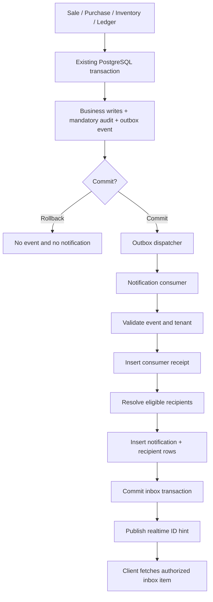

# Pharmaciano ERP — Notification Module Contract

**File:** `NOTIFICATION_CONTRACT.md`  
**Module:** `internal/modules/notification`  
**API:** `/api/v1`  
**Architecture:** Go modular monolith · Gin · PostgreSQL · Redis · existing worker infrastructure · OpenAPI 3.1 contract-first

> Designed against the supplied Astra architecture source `answer_in_markdown.md`, especially its common transaction/outbox rules and dedicated Notification module section. This is an implementation contract, not a claim that every proposed interface/table already exists. Inspect the repository and reuse its exact contracts before coding.

---

## 1. Executive decision

Notification provides a **durable, tenant-isolated in-app inbox** and asynchronous event-to-inbox processing. It consumes committed domain events; it does not participate in the business transaction that created them.

The module must never become a dependency for completing a sale, receiving a purchase, adjusting stock, posting a journal, recording a return, or reconciling payments.

### 1.1 Guarantees

1. Business truth commits first. Sale, Purchase, Inventory, and Ledger write their own records and commit required writes atomically in the originating PostgreSQL transaction.
2. Notification intent is durable. The source transaction inserts its outbox event in the same transaction as the business writes.
3. Event processing is at-least-once with idempotent inbox effects. Duplicate events cannot create duplicate logical recipient entries.
4. PostgreSQL is the authoritative inbox. Redis Pub/Sub, SSE, or WebSocket is only a low-latency hint; missed frames are recovered through the inbox API.
5. Every inbox operation is scoped to the authenticated organization and recipient. Branch scope is checked independently.
6. Notification never mutates stock balances, movements, batches, adjustments, purchase/sale documents, payments, or journals.
7. The system is near-real-time and asynchronous, not exactly-once or guaranteed instant push.
8. Initial scope is in-app only. Email/SMS/push require a separately approved privacy, consent, provider, and operational contract.

### 1.2 Non-goals

- No email, SMS, WhatsApp, browser push, or mobile push in the initial release.
- No marketing campaign engine or generic workflow engine.
- No notification-triggered stock mutation, automatic purchase, approval, or ledger posting.
- No direct writes to another module's tables.
- No exactly-once claim across processes or sockets.
- No Redis-only inbox, event receipt, idempotency, or durable job state.
- No arbitrary user-supplied WebSocket room, tenant ID, recipient ID, or action URL.

---

## 2. Astra architecture alignment

The supplied Astra file establishes these Notification decisions:

- Organization/user-owned inbox with branch-aware content.
- Durable in-app messages first; external channels only if explicitly needed.
- Domain modules communicate through events, not synchronous checkout calls.
- Notification content, recipient/read state, delivery, delivery attempts, template versions, and preferences are distinct concepts.
- PostgreSQL owns durable notification data.
- Event receipt and inbox creation are atomic.
- Provider sends happen outside database transactions.
- Workers claim bounded work with row leases / `SKIP LOCKED`.
- Redis Pub/Sub may support cross-instance realtime fan-out, but missed messages are recovered from PostgreSQL.
- Duplicate-event receipts prevent duplicate inbox entries.
- Broadcast fan-out is chunked; never create a million recipients in one transaction.

### 2.1 Existing foundation to reuse

| Concern | Required integration |
|---|---|
| HTTP | Existing versioned Gin router and module registrar conventions |
| Authentication | Existing JWT/session middleware and authenticated principal |
| Tenant context | Existing organization context; never trust organization ID from request JSON |
| Branch access | Existing branch-scope resolver and authorization rules |
| Authorization | Existing RBAC evaluator; explicit permissions, not role-name comparisons |
| Rate limiting | Existing `rate_auth_read`, `rate_auth_write`, `rate_broadcast` policies if present |
| Idempotency | Existing request middleware plus durable PostgreSQL uniqueness |
| Audit | Existing Audit middleware and transactional audit append where policy requires it |
| Database | Existing `db.WithTx`, `FromCtx`, `ReadFromCtx` or actual current abstractions |
| Errors | Existing error package and error-code taxonomy |
| Pagination | Existing `pkg/pagination` conventions |
| UUID/time/JSON | Existing shared UUID, time, and JSON types |
| Workers | Existing worker/Asynq composition and retry conventions |
| Observability | Existing structured logger, metrics, request/correlation IDs, tracing |
| OpenAPI | Existing OpenAPI 3.1 YAML and validation/generation pipeline; no Swagger annotations |
| Configuration | Existing typed config and secret handling |

Do not create a second auth mechanism, RBAC engine, transaction manager, generic event bus, repository framework, or worker framework for this module.

---

## 3. Domain ownership and scope

### 3.1 Ownership matrix

| Data | Owner | Notification responsibility |
|---|---|---|
| Sale, payment, return | Sale | Consume committed events and render safe summaries |
| Purchase, supplier invoice/payment | Purchase | Consume committed events |
| Stock, batch, movement, adjustment, transfer | Inventory | Consume committed events |
| Journal and journal lines | Ledger | Consume committed events |
| User identity and membership | User/Auth/Organization | Resolve eligible recipients |
| Branch hierarchy and access | Branch/RBAC | Resolve audience and re-check linked resource access |
| Notification content/inbox/read/dismiss | Notification | Sole writer |
| Business audit | Audit | Retain security/business evidence under Audit ownership |
| Live connection/fan-out | Existing realtime adapter, if present | Publish notification IDs only |
| Job execution | Existing worker platform | Execute retryable delivery work |

### 3.2 Tenant and recipient rules

- Every persisted notification has exactly one `organization_id`.
- A recipient must be a valid user/member of that organization.
- `branch_id` is context, not authorization. Validate branch ownership and current user scope.
- A notification row with `user_id = NULL` must never mean “visible to everyone.” Use explicit recipient rows.
- Organization-wide notifications still require a recipient row for each eligible user.
- A branch-scoped user sees only notifications for branches within current effective scope, plus explicitly organization-wide messages for which they are eligible.
- A user losing organization membership or branch access must not retain access to linked business resources through an old notification.
- Historical notification content may remain under retention policy, but access is re-evaluated at read time.
- System/global operational alerts are not tenant messages unless mapped to a specific tenant-safe notification.

### 3.3 Broadcast audience semantics

Supported scopes from the supplied API: `org`, `branch`, `role`, `user`.

- `org`: active eligible users in the caller's organization.
- `branch`: eligible users with active access to the target branch.
- `role`: eligible organization users currently assigned the target role under existing RBAC.
- `user`: one eligible user in the caller's organization.

`target_id` is interpreted only for the selected scope; it is never proof of authority. Validate target ownership and membership through existing service ports. Recommended behavior: snapshot eligible IDs at broadcast creation into durable fan-out batches, then revalidate active membership/branch access before each insertion. This prevents an old broadcast silently expanding after a role change while still suppressing revoked users.

---

## 4. Lifecycle and delivery semantics

### 4.1 End-to-end flow



### 4.2 What is instant and what is asynchronous?

| Operation | Execution | Contract |
|---|---|---|
| Business writes + outbox insert | Synchronous source transaction | Atomic together |
| Outbox dispatch | Async worker | After commit; subject to worker health |
| Inbox materialization | Async consumer | Near-real-time, durable after commit |
| Inbox/unread API | Synchronous HTTP read | PostgreSQL is authoritative |
| Read/dismiss | Synchronous HTTP write | Durable when response succeeds |
| SSE/WebSocket hint | Best-effort async | Low latency when connected, not guaranteed |
| Reconnect/recovery | HTTP inbox fetch | Recovers missed frames |
| Expiry cleanup | Background job | Eventual; expired rows hidden immediately by query |
| Broadcast | Async chunked fan-out | `202 Accepted` with broadcast ID/status |

Do not promise “instant delivery.” Healthy deployments may materialize within seconds, but the contract is asynchronous.

### 4.3 Delivery guarantee

Use **at-least-once processing with idempotent persistence**:

- Outbox dispatcher and queue may deliver an event more than once.
- Consumer receipt uniqueness prevents repeated processing for the same consumer/event.
- Receipt insertion and inbox creation happen in one PostgreSQL transaction.
- If that transaction rolls back, neither receipt nor inbox rows persist.
- If commit succeeds but queue acknowledgement is lost, redelivery sees the receipt and safely acknowledges.
- Realtime frames may be duplicated or lost; clients deduplicate by notification ID and refetch from PostgreSQL.

Never call this exactly-once delivery.

---

## 5. Domain model

| Entity | Purpose | Lifecycle |
|---|---|---|
| Notification | Immutable notification content and event provenance | Created once; retained/expired |
| NotificationRecipient | One user's inbox membership and read/dismiss state | Mutable timestamps |
| NotificationEventReceipt | Durable consumer deduplication | Immutable |
| Broadcast | Authorized broadcast request and audience definition | Pending → processing → completed/partial/failed/cancelled |
| BroadcastBatch | Durable fan-out cursor/chunk state | Retryable, leased |
| NotificationPreference | User/category/channel preference | Mutable, versioned |
| CategoryPolicy | System-owned category semantics and mandatory/optional behavior | Versioned configuration |
| Delivery / DeliveryAttempt | Future external channel state/evidence | Not required for in-app MVP |
| TemplateVersion | Future approved template schema/version | Not required for code-owned MVP categories |

A notification is the content/event record; recipient rows represent inbox membership. One notification can have many recipients. This separation is required for per-user unread count, read, dismissal, privacy, and branch authorization.

### 5.1 Controlled category taxonomy

Use a registered allow-list, not arbitrary strings. Examples:

- `inventory.low_stock`
- `inventory.expiry_soon`
- `inventory.adjustment_posted`
- `inventory.transfer_pending`
- `purchase.approval_needed`
- `purchase.receipt_posted`
- `purchase.payment_due`
- `sale.refund_completed`
- `sale.voided`
- `ledger.period_closed`
- `report.ready`
- `report.failed`
- `system.security_notice`
- `system.broadcast`

These are examples, not claims that all producers already emit them. Register each category with owner, event version, default priority, preference policy, recipient resolver, expiry policy, and allowed data schema before enabling it.

Priority: `low`, `normal`, `high`, `critical`. Priority changes presentation only; it never bypasses authorization or privacy rules.

---

## 6. Database contract

The following is a **conceptual schema**. Before migrations, inspect BaseModel, existing tenant keys, migration sequence/state, outbox/job tables, and naming conventions. Never reuse an applied migration version.

### 6.1 `notifications`

| Column | Type | Rules |
|---|---|---|
| `id` | UUID | PK |
| `organization_id` | UUID | NOT NULL; tenant owner |
| `branch_id` | UUID NULL | Optional context; validate organization ownership |
| `event_id` | UUID NULL | Source outbox event ID |
| `source_module` | TEXT | Controlled module identifier |
| `source_event_type` | TEXT | Versioned event type |
| `source_aggregate_type` | TEXT | Bounded identifier |
| `source_aggregate_id` | UUID NULL | Opaque source ID |
| `source_aggregate_version` | BIGINT NULL | Positive when supplied |
| `type` | TEXT | Registered category |
| `priority` | TEXT | `low/normal/high/critical` |
| `title` | TEXT | Bounded plain text; no HTML |
| `message` | TEXT | Bounded plain text; no HTML |
| `data` | JSONB | Allow-listed, bounded, schema-validated metadata |
| `action_url` | TEXT NULL | Internal relative route only |
| `created_by_user_id` | UUID NULL | Manual broadcast actor; null for system event |
| `content_version` | INTEGER | Positive renderer/schema version |
| `created_at` | TIMESTAMPTZ | UTC |
| `expires_at` | TIMESTAMPTZ NULL | Must be after creation |

Constraints and indexes:

- PK on `id`; tenant-safe composite references where supported.
- `CHECK` constraints for priority and bounded text lengths.
- `CHECK (expires_at IS NULL OR expires_at > created_at)`.
- Index `(organization_id, created_at DESC, id DESC)`.
- Index `(organization_id, branch_id, created_at DESC, id DESC)` when branch filtering is common.
- Unique source-event/category identity where one source event should materialize one notification per category.
- Do not index arbitrary JSONB fields without measured query need.
- Avoid cascading deletes from user, branch, or source aggregate into historical content.

### 6.2 `notification_recipients`

| Column | Type | Rules |
|---|---|---|
| `id` | UUID | PK if consistent with project convention |
| `organization_id` | UUID | NOT NULL |
| `notification_id` | UUID | NOT NULL |
| `user_id` | UUID | NOT NULL |
| `read_at` | TIMESTAMPTZ NULL | Read state |
| `dismissed_at` | TIMESTAMPTZ NULL | Inbox dismissal state |
| `created_at` | TIMESTAMPTZ | Recipient insertion time |

Constraints/indexes:

- Unique `(organization_id, notification_id, user_id)`.
- Tenant-safe FK to notification using composite key where possible.
- FK/validated reference to the existing organization membership/user identity model.
- Index `(organization_id, user_id, created_at DESC, notification_id DESC)`.
- Partial unread index on `(organization_id, user_id, created_at DESC, notification_id DESC)` where `read_at IS NULL AND dismissed_at IS NULL`.
- `read_at` and `dismissed_at` are independent. Dismissal does not imply read unless product semantics explicitly choose that behavior.

### 6.3 `notification_event_receipts`

| Column | Type | Rules |
|---|---|---|
| `organization_id` | UUID | NOT NULL |
| `consumer_name` | TEXT | Stable consumer identity |
| `event_id` | UUID | Source event ID |
| `event_type` | TEXT | Versioned type |
| `processed_at` | TIMESTAMPTZ | UTC |
| `result` | TEXT | `created`, `suppressed`, `ignored` |
| `notification_id` | UUID NULL | Created notification |
| `payload_hash` | BYTEA/TEXT | Hash of canonical validated payload |

Unique key: `(organization_id, consumer_name, event_id)`. This is durable deduplication authority; Redis locks are not a substitute. Receipt retention must cover the maximum replay/redelivery window.

### 6.4 Broadcast persistence

`notification_broadcasts` should store:

- ID, organization, creator, scope, target ID;
- title, message, priority, validated action URL;
- status, requested/started/finished timestamps;
- audience/inserted/suppressed/failed counts;
- durable idempotency key/command identity and normalized request hash;
- safe failure code and timestamps.

`notification_broadcast_batches` should store:

- ID, organization, broadcast ID, batch number/cursor;
- status, lease owner, lease expiry, monotonic lease generation;
- attempt count, next attempt time, last safe error class;
- timestamps.

Enforce unique `(organization_id, broadcast_id, batch_number)`. Recipient uniqueness makes each chunk retry-safe. Never persist executable SQL filters or arbitrary query fragments as an audience definition.

### 6.5 Preferences and category policy

Preference dimensions: organization, user, category/purpose, channel (`in_app` initially), enabled, updated time, version. A category registry defines mandatory vs configurable behavior. Security notices cannot be disabled by a user preference. Preference changes cannot alter the policy of a system-owned category.

### 6.6 Retention and partitioning

Start with ordinary indexed tables. Do not partition prematurely. If volume later justifies partitioning, design uniqueness, foreign keys, retention, and maintenance together; ensure event deduplication remains enforceable across partitions. Expired messages are hidden immediately by query predicates even if physical cleanup is delayed. Never delete unread critical security notices under an arbitrary short TTL.

---

## 7. Event and producer contract

### 7.1 Event envelope

Consume the existing platform event envelope; do not create a parallel envelope. The logical fields required are:

```json
{
  "event_id": "uuid",
  "event_type": "inventory.low_stock.v1",
  "occurred_at": "2026-11-21T10:00:00Z",
  "organization_id": "uuid",
  "branch_id": "uuid-or-null",
  "aggregate": { "type": "inventory_item", "id": "uuid", "version": 12 },
  "actor_user_id": "uuid-or-null",
  "correlation_id": "uuid-or-string",
  "causation_id": "uuid-or-string",
  "schema_version": 1,
  "data": {}
}
```

Illustrative only. Use the exact field names/types of the existing event envelope after inspection.

### 7.2 Producer rules

- Insert outbox event using the same transaction/context as business writes.
- Never call Notification synchronously from checkout/receipt/adjustment services.
- Never send WebSocket frames directly from domain services.
- Emit committed facts only, never speculative pre-commit state.
- Include stable event ID, organization, branch, aggregate version, event version, correlation/causation IDs.
- Include minimal identifiers and safe facts, not full ORM models or sensitive documents.
- If the event is mandatory for an enabled business capability, outbox insert failure rolls back the source transaction.
- Notification consumer failure never rolls back already committed source transactions.

### 7.3 Inventory and Purchase correctness

Notifications about stock must be based on committed Inventory facts:

- `StockReceived` only after receipt, stock balance, batch/cost layer, applicable ledger posting, and audit evidence have committed atomically under the originating workflow.
- `StockConsumed` only after sale/issue transaction commits stock movement and financial facts.
- `StockAdjusted` only after adjustment approval/posting, movement, balance update, valuation/ledger treatment where applicable, and audit evidence commit.
- `TransferDispatched` and `TransferReceived` are separate facts; dispatch is not completion.
- `ReservationExpired` originates from Inventory's durable expiry transition.
- Low-stock/expiry alerts are derived alerts; they do not mutate stock or purchase documents.
- Deduplicate low-stock alerts by a stable alert episode key (organization + warehouse + item + policy revision + alert episode), not every polling scan.
- Expiry notices reveal only the minimum batch/item reference to authorized recipients; no prescription/patient data.
- Purchase approval notice is not approval. Clicking it does not approve a purchase.

### 7.4 Ledger correctness

- Consume `JournalPosted`, `JournalReversed`, and period-state events only after Ledger commits.
- Link to a journal/document only if the recipient currently has the relevant read permission and scope.
- Do not include full journal lines, account balances, supplier bank data, or payment credentials in payloads.
- Notification failure never reverses, delays, or duplicates a journal.
- Read/dismiss state is not a financial event and must not write Ledger.
- Notification workers never create ledger entries.

---

## 8. Recipient resolution

Define narrow typed interfaces at the Notification application boundary for organization membership, branch access, role membership, user eligibility, and source-resource authorization metadata. These are responsibilities, not prescribed existing interface names. Use actual existing ports; avoid direct cross-module table reads.

Resolution sequence:

1. Validate event schema/version, tenant, category registration, and source module allow-list.
2. Resolve category recipient policy.
3. Resolve eligible users within event organization and branch context.
4. Apply category-specific preference rules.
5. Exclude inactive, suspended, deleted, or revoked users.
6. Deduplicate recipient IDs.
7. Insert recipients in bounded chunks.
8. Revalidate eligibility for delayed broadcasts.
9. Persist suppression reason/counts without exposing private membership details to ordinary users.

Producer-supplied recipient IDs are candidates, not authority. Validate organization membership and category eligibility. Security-critical notices use a server-owned resolver.

---

## 9. API contract

All paths are relative to `/api/v1`. The supplied route table is the baseline; preserve actual Gin route naming and OpenAPI conventions after repository inspection.

### 9.1 Required endpoints

| Method & Path | Rate | Permission | Description |
|---|---|---|---|
| `GET /notifications` | `rate_auth_read` | `notifications:view` | Current user's inbox |
| `GET /notifications/unread-count` | `rate_auth_read` | `notifications:view` | Current user's unread count |
| `POST /notifications/{id}/read` | `rate_auth_write` | `notifications:read` | Mark own item read |
| `POST /notifications/read-all` | `rate_auth_write` | `notifications:read` | Mark eligible own items read |
| `DELETE /notifications/{id}` | `rate_auth_write` | `notifications:dismiss` | Dismiss own item |
| `POST /notifications/broadcast` | `rate_broadcast` | `notifications:broadcast` | Create async broadcast |
| `GET /notifications/broadcasts` | `rate_auth_read` | `notifications:view` plus broadcast-manager scope | View authorized broadcasts |

`GET /notifications/broadcasts` must not imply every inbox viewer can inspect all organization broadcasts. Apply creator/scope filtering or a dedicated existing permission. Do not silently broaden `notifications:view`.

### 9.2 Inbox filters

Support `is_read=true|false`, `type`, `priority`, `from`, `to` (exclusive upper bound), `limit`, and `cursor`.

- Default order: `created_at DESC, id DESC`.
- Cursor is bound to principal, organization, effective branch scope, filters, and sort.
- Do not accept `organization_id` or `user_id` as selectors.
- If branch filtering is exposed, validate against current scope and intersect with server-derived authorization.

### 9.3 Read semantics

`POST /notifications/{id}/read`:
- Match organization from auth context, notification ID, and current user ID.
- Never accept target `user_id`.
- Repeated calls are idempotent; set `read_at = COALESCE(read_at, now())`.
- Return privacy-preserving not-found for IDs outside the user's inbox.

`POST /notifications/read-all`:
- Update only current user's eligible, non-dismissed, unexpired rows in current organization/scope.
- Use indexed predicates and bounded batches for large inboxes.
- Return affected count and server timestamp.
- Repeated calls are safe.

`DELETE /notifications/{id}`:
- Soft-dismiss only the current user's recipient row.
- Never delete shared content or another recipient's row.
- Idempotent for already dismissed rows.
- Does not imply read unless explicitly documented.

### 9.4 Broadcast request

The supplied body vocabulary is:

```json
{
  "scope": "org",
  "target_id": null,
  "title": "Scheduled maintenance",
  "message": "The inventory service will be unavailable during the approved window.",
  "priority": "normal",
  "action_url": "/settings/system"
}
```

Validation:
- `scope` allow-list: `org`, `branch`, `role`, `user`.
- `target_id` required for branch/role/user; null for org.
- Bounded title/message, plain text only.
- Priority allow-list; `critical` requires explicit policy.
- Action URL must be an allow-listed internal relative route. Reject absolute URLs, protocol-relative URLs, `javascript:`, `data:`, backslashes, control characters, encoded traversal, and unknown route prefixes.
- Caller needs `notifications:broadcast` and scope-specific authority.
- Body cannot specify organization ID, arbitrary recipients, raw HTML, template code, or SQL filters.
- Require durable idempotency.
- Return `202 Accepted` with broadcast ID/status URL; do not fan out synchronously.

### 9.5 Optional endpoints

Only add if required and supported by current API conventions:
- `GET /notifications/broadcasts/{id}` — scoped status/counts.
- `POST /notifications/broadcasts/{id}/cancel` — cancel unprocessed batches; existing inbox rows remain.
- `GET/PUT /notifications/preferences` — self-service preferences, if included in MVP.
- `GET /notifications/stream` — SSE/WebSocket only after realtime security/deployment review.

Do not add template management in the initial release unless tenant customization is a real requirement. Prefer a code-owned category registry.

---

## 10. Authorization and role access

### 10.1 Permission matrix

| Capability | Permission | Guidance |
|---|---|---|
| View own inbox/unread | `notifications:view` | Active organization members |
| Mark own item/all read | `notifications:read` | Current user only |
| Dismiss own item | `notifications:dismiss` | Current user only |
| Create broadcast | `notifications:broadcast` | Explicitly authorized admins/managers |
| View broadcasts | Existing broadcast-management permission or restricted `notifications:broadcast` | Creator/authorized manager scope |
| Manage categories/templates | `notifications:manage-templates` | Only if feature enabled; privileged administrators |
| Manage another user's inbox | Not exposed in MVP | No blanket admin impersonation |

### 10.2 Role guidance

Do not hardcode `SUPER_ADMIN`, `Manager`, or `Salesman` checks in service code. Use existing RBAC policy and assignments.

Possible seed policy, subject to actual RBAC model:
- `SUPER_ADMIN`: own inbox; broadcast within authorized organization scope if granted.
- `Manager`: own inbox; broadcast only if explicitly granted and branch/org scope permits.
- `Salesman`: own inbox; no broadcast by default.

The supplied permission strings use colon notation. Confirm whether repository policy uses colon, dot, or another convention before adding seeds. Do not create duplicate permission namespaces.

### 10.3 Enforcement points

- Router: authentication, rate limit, baseline RBAC, request audit, idempotency for broadcast.
- Service: re-check organization context, recipient ownership, branch scope, category policy, and action permission.
- Repository: mandatory tenant/user predicates.
- Realtime handshake: authenticated principal only; server-derived channel.
- Destination API: independently authorizes linked resource. Notification link is not a capability token.
- Broadcast worker: revalidates recipient eligibility and scope before insertion.
- Broadcast inspection: authorized organization/branch/creator filters.

### 10.4 Anti-enumeration

A caller must not learn whether a UUID belongs to another organization/user. Return consistent not-found or the project's equivalent. Do not reveal recipient lists, hidden broadcast audiences, or private user details to ordinary inbox users.

---

## 11. Middleware and request pipeline

Expected pipeline, adapted to actual foundation:

1. Request ID / trace context.
2. Recovery and security headers.
3. Rate limiter.
4. Authentication.
5. Tenant/organization context.
6. Branch scope context where applicable.
7. RBAC permission enforcement.
8. Idempotency middleware for broadcast.
9. Audit middleware for security-sensitive mutations/broadcasts.
10. Handler DTO binding/validation.
11. Service authorization and business rules.
12. Repository with tenant/recipient predicates.

Follow the existing middleware order. Do not register duplicates at router and module levels. Service authorization is required for internal worker calls too.

### 11.1 Audit

Record broadcast request, actor, audience scope, correlation/request ID, cancellation, category/template policy changes (if enabled), suspicious authorization failures, and repeated invalid action URL attempts. Avoid auditing every read receipt unless policy requires it; excessive audit writes create a hot path. Audit metadata must not include full messages, sensitive payloads, tokens, or secrets.

---

## 12. Transaction boundaries and idempotency

### 12.1 Source business transaction

A purchase receipt/sale/adjustment workflow owns its transaction:

```text
BEGIN
  validate and lock source aggregate
  write source-module state
  call Inventory transactional port when stock changes
  call Ledger transactional port when accounting facts post
  append mandatory business audit evidence
  append domain outbox event(s)
COMMIT
```

Notification is not called inside this transaction. Only the outbox event is appended. Stock, financial truth, required audit, and outbox facts remain atomic under the existing transaction contract.

### 12.2 Consumer transaction

```text
BEGIN
  INSERT notification_event_receipts(...)
    ON CONFLICT DO NOTHING
  if duplicate:
    COMMIT and acknowledge event
  validate tenant/category/schema and resolve eligible recipients
  INSERT notification content (deduplicated by source identity)
  INSERT recipient rows in bounded batch
  UPDATE receipt with result and notification_id
COMMIT
acknowledge queue message
publish realtime hint after commit
```

Do not hold a database transaction open during remote/network recipient resolution. Resolve/validate first where safe, then use a short transaction and revalidate volatile membership where required. Large fan-out uses durable batches, not one giant transaction.

### 12.3 Idempotency layers

| Layer | Mechanism | Purpose |
|---|---|---|
| HTTP broadcast | Existing middleware + durable DB command record | Safe client retry |
| Outbox | Stable `event_id` | Stable source identity |
| Consumer | Unique `(org, consumer, event_id)` | Duplicate event protection |
| Notification | Unique source-event/category identity | Duplicate content protection |
| Recipient | Unique `(org, notification, user)` | Duplicate inbox protection |
| Broadcast batch | Unique batch and recipient identity | Retry-safe fan-out |
| Realtime | Client dedupe by notification ID | Avoid duplicate UI display |

Redis-backed request replay is an optimization only. PostgreSQL uniqueness is the durable correctness boundary.

### 12.4 Idempotency conflict behavior

- Same key + same normalized request hash: return original broadcast ID/status.
- Same key + different hash: idempotency conflict.
- In-progress command: return stable in-progress response.
- Expired Redis entry must not permit a second broadcast while durable command identity exists.

### 12.5 Locking and isolation

- Use short PostgreSQL transactions; `READ COMMITTED` by default.
- Use `INSERT ... ON CONFLICT` for receipts/recipients.
- Use `FOR UPDATE SKIP LOCKED` for worker batch claims.
- Use monotonic lease generation/fencing so stale workers cannot finalize newer work.
- Never lock Inventory or Ledger rows from Notification.
- Never acquire source-module locks during notification processing.
- Establish deterministic lock ordering for Notification-owned rows.
- No network provider, socket publish, or long recipient enumeration while holding row locks.

---

## 13. Worker and job architecture

Use the existing worker binary and queue conventions. Notification may add task handlers but must not introduce a new queue framework.

Required logical jobs:
1. Domain event consumer.
2. Broadcast fan-out in bounded chunks.
3. Realtime fan-out of committed notification IDs, if enabled.
4. Expiry cleanup under retention policy.
5. Stale-job reconciliation for expired leases and pending durable work.

External provider delivery is out of initial scope.

### 13.1 Claim algorithm

Use existing Asynq/job conventions where present, but durable ownership is represented in PostgreSQL. Conceptual claim SQL:

```sql
WITH candidates AS (
    SELECT id
    FROM notification_broadcast_batches
    WHERE status IN ('pending', 'retry')
      AND next_attempt_at <= now()
      AND (lease_until IS NULL OR lease_until < now())
    ORDER BY next_attempt_at, id
    FOR UPDATE SKIP LOCKED
    LIMIT $1
)
UPDATE notification_broadcast_batches b
SET status = 'processing',
    lease_owner = $2,
    lease_until = now() + $3::interval,
    lease_generation = lease_generation + 1,
    attempt_count = attempt_count + 1,
    updated_at = now()
FROM candidates c
WHERE b.id = c.id
RETURNING b.*;
```

Illustrative only; adapt to existing schema/helpers. Final updates must include ID, lease owner, and exact lease generation.

### 13.2 Retry policy

- Transient database/queue errors: bounded exponential backoff with jitter.
- Permanent schema, authorization, invalid category, malformed event: no infinite retry; quarantine/dead-letter per existing conventions.
- Store safe error class/code, not raw sensitive payload.
- Acknowledge only after durable consumer outcome commits.
- Alert on backlog, oldest event age, poison events, and repeated failures.

### 13.3 Queue is not source of truth

If Redis/Asynq loses a task, outbox reconciliation rediscovers unprocessed events; broadcast rows reveal unfinished batches; lease expiry allows reclaim; recipient uniqueness prevents duplicates. Never delete the only durable record after enqueueing a Redis task.

### 13.4 Fan-out chunking

- Configurable conservative batch size, tuned through load tests.
- Keyset/cursor pagination over stable recipient IDs; never load all users into memory.
- Commit each bounded chunk independently.
- Persist progress/counters after each chunk.
- Revalidate revoked memberships before insertion.
- Apply per-organization concurrency limits/fairness.
- Cancel only unprocessed batches; already inserted inbox entries remain durable.

---

## 14. Real-time delivery

### 14.1 Rollout

**Phase 1:** durable inbox + polling.  
**Phase 2:** optional SSE or WebSocket ID hints after auth, origin, scaling, and deployment behavior are verified.

Realtime must not be required for module correctness.

### 14.2 Client behavior

- Fetch initial inbox/unread count over authenticated HTTP.
- Subscribe to authenticated server-derived channel if realtime is enabled.
- Receive only minimal envelope, e.g. `{notification_id, event: "notification.created"}`.
- Fetch detail through normal authorized API.
- On reconnect, fetch using durable cursor; socket is not history.
- Deduplicate by notification ID.
- Back off reconnects and respect server limits.
- Refresh unread count after read/dismiss/reconnect.

### 14.3 Server fan-out security

- Derive channel from authenticated principal and organization context.
- Never accept arbitrary room/user/org/branch subscription from client.
- Redis Pub/Sub may fan out IDs across instances; Pub/Sub loss is acceptable.
- Do not publish message bodies or sensitive metadata to broad Redis channels.
- Apply connection caps, heartbeat, idle timeout, origin allow-list, per-user connection limits.
- Cookie auth requires strict origin/CSRF protection. Bearer tokens must not be long-lived in query strings or logs.
- Graceful shutdown closes connections; clients reconnect to another instance.

### 14.4 Polling fallback

Polling `GET /notifications` and `/unread-count` is fully supported. Client interval should be reasonable, jittered, and paused/background-aware. Server rate limits remain authoritative.

---

## 15. Security contract

| Threat | Required control |
|---|---|
| Cross-tenant UUID guessing | Tenant + recipient predicates; privacy-preserving not-found |
| Recipient injection | Server resolver and membership validation |
| Cross-branch disclosure | Effective branch scope and linked-resource authorization |
| Broadcast abuse | Dedicated permission, strict rate limit, audience cap/policy, audit |
| Malicious action URL | Internal relative route allow-list; reject external/protocol-relative schemes |
| XSS | Plain text; frontend escapes; never render raw HTML |
| Template injection | No arbitrary template execution; registered variables/schema only |
| JSON payload overexposure | Allow-listed minimal fields and schema validation |
| Sensitive prescription/customer data | No patient/prescription details in previews or realtime payloads |
| Stale privilege | Reauthorize at notification open and linked-resource API |
| WebSocket room hijack | Authenticated principal-derived channel |
| Queue poisoning | Schema/version allow-list, bounded payload, quarantine |
| Log leakage | Redact bodies, data, tokens, secrets |
| Denial of service | Rate limits, bounded pages, broadcast caps, chunking, tenant quotas |
| IDOR | Recipient ownership check on every operation |
| Retention abuse | Protected cleanup policy; preserve required audit/critical notices |
| Insider misuse | Audit broadcasts/policy changes; least-privilege DB roles |

### 15.1 Content rules

- `title` and `message` are plain text.
- No HTML/Markdown rendering from untrusted producers in MVP.
- Future rich text requires reviewed sanitizer and strict component allow-list.
- `data` is validated against registered category schema and size limit.
- Store only identifiers and safe display values required by inbox.
- Never include passwords, JWTs, refresh tokens, API keys, session IDs, full payment details, bank credentials, prescription content, patient notes, or medical history.
- No secrets in action URLs/query strings.

### 15.2 Action URL policy

Prefer server-generated route identifiers or allow-listed internal paths. Destination API independently authenticates and checks tenant, branch, and resource permission. A notification link is not a capability token.

### 15.3 Database security

- Notification repository methods require `organization_id`; recipient methods also require `user_id`.
- Use composite tenant FKs where existing schema supports them.
- Add PostgreSQL RLS only if it is already consistently part of project security architecture; partial RLS can create false assurance.
- Worker DB role gets only Notification-owned table permissions and approved read ports.
- Notification worker has no write access to Inventory, Purchase, Sale, or Ledger tables.
- Runtime DB roles do not receive migration privileges.

---

## 16. Performance and capacity

### 16.1 Hot paths

Inbox list, unread count, mark read, read-all, notification/recipient insertion, broadcast fan-out, realtime publish.

### 16.2 Query rules

- Always filter tenant and recipient before sorting.
- Use cursor/keyset pagination for growing inboxes.
- Use indexed partial predicates for unread rows.
- Count only the current user's indexed recipient rows; never count all organization notifications.
- Avoid N+1 source lookups; use safe snapshots or bounded batch reads through typed ports.
- Do not join all source modules on inbox list.
- Reauthorize linked resource on navigation.
- Do not query Redis for authoritative unread count.
- Bound list limits and response sizes.

### 16.3 Cache policy

- PostgreSQL is authoritative.
- Redis may cache short-lived unread-count hints only if invalidation is reliable and stale display is acceptable; otherwise query PostgreSQL.
- Cache key includes organization and user.
- Cache failures fall back to PostgreSQL.
- Never cache response across users/tenants.
- Redis Pub/Sub is ephemeral fan-out only.

### 16.4 Backpressure/fairness

- Per-tenant broadcast limits and recipient caps.
- Bounded worker concurrency per queue and tenant.
- Keep broadcast fan-out from starving low-stock/security alerts.
- Priority scheduling must not create unbounded starvation.
- Monitor DB pool pressure and worker saturation.

Do not invent fixed capacity or latency guarantees. Establish baselines using representative tenant/inbox sizes and concurrent broadcasts; set budgets from measured k6 or existing load-test results.

---

## 17. Observability and operations

### 17.1 Structured log fields

Use existing logger/trace context: request/trace/correlation IDs, organization ID where permitted, notification/event/broadcast/batch IDs, consumer, event type/schema version, attempt, lease generation, worker, recipient/suppression counts, duration, outcome, safe error code.

Never log full message bodies, arbitrary JSON data, tokens, or recipient lists.

### 17.2 Metrics

Recommended metrics using existing naming conventions:
- consumed events by type/outcome;
- duplicate event receipts;
- notifications and recipient insertions;
- event-to-inbox latency;
- outbox oldest-unprocessed age;
- broadcast queue depth and oldest pending batch age;
- retries, lease expirations, dead-letter count;
- realtime publish failures and connections, if enabled;
- inbox/unread query latency;
- throttling/broadcast rejection;
- cleanup count, DB errors, worker saturation.

Avoid high-cardinality metric labels such as user ID, notification ID, or arbitrary organization ID. Put identifiers in logs/traces.

### 17.3 Alerts and health

Alert on sustained outbox/consumer lag, growing broadcast age, poison events, lease churn, DB insert failures, unusual broadcast volume, and realtime failure if enabled. Realtime outage is not loss of durable notification if inbox processing works.

- Liveness: process running.
- Readiness: required DB/worker dependencies usable for that process role.
- Worker health: last successful claim/consume and queue lag.
- API readiness must not depend on optional Pub/Sub if polling remains available.
- Health endpoints reveal no tenant data or secrets.

---

## 18. Error handling

Use the existing error package; extend only where needed. Expected categories include invalid filter/category/priority, not found/not owned, forbidden broadcast scope, invalid target, idempotency conflict, broadcast terminal state, unsupported event schema, revoked membership, lost worker lease, rate limit, and temporary dependency failure.

Map SQL/internal failures to stable safe API errors. Never expose raw SQL, table names, stack traces, queue payloads, or secrets.

---

## 19. Testing contract

### 19.1 Unit tests

Category registry, priority policy, recipient resolver, action URL allow-list, event schema/version, preference/mandatory policy, payload redaction/size, cursor binding.

### 19.2 Repository/database integration

Tenant isolation; recipient ownership; unique event receipt; duplicate notification/recipient insertion; read/dismiss idempotency; bounded read-all; branch visibility; FK/deletion behavior; unread/list query plans; rollback leaves no partial receipt/content/recipient state.

### 19.3 Worker tests

Duplicate event; crash after DB commit before queue ack; lease expiry/reclaim; stale worker fencing; transient DB retry; poison event; broadcast chunk retry; revoked user during broadcast; cancellation; restart with durable pending work.

### 19.4 Security tests

Cross-tenant UUID enumeration; user A cannot read/dismiss user B; branch A cannot see branch B; unauthorized broadcast; forged recipient ID; external/protocol-relative URL rejection; XSS escaped; oversized payload rejection; sensitive field redaction; arbitrary socket room rejected; rate/broadcast cap enforced.

### 19.5 Cross-module consistency tests (mandatory)

1. Sale rollback → no outbox event and no notification.
2. Sale commit with stock movement and Ledger posting → all source facts commit together; notification appears only after event consumption.
3. Purchase receipt rollback → no notification and no partial stock/batch/ledger mutation.
4. Purchase receipt commit → one logical notification per event/category/recipient despite duplicate delivery.
5. Inventory adjustment rollback → no notification.
6. Inventory adjustment commit → notification references committed adjustment ID/version only.
7. Ledger posting failure → source workflow rolls back according to its contract; no posted event is consumed.
8. Notification worker outage → committed stock, sale, purchase, and ledger remain correct; notification is delayed, not lost.
9. Duplicate consumer event → no duplicate inbox rows.
10. Notification DB outage → source transactions are unaffected after commit; durable outbox remains pending/retryable.

---

## 20. Failure-mode matrix

| Failure | Expected result |
|---|---|
| Source business transaction rolls back | Outbox absent; no notification |
| Source commits, dispatcher unavailable | Business state committed; event waits durably |
| Redis unavailable | Durable processing continues through configured outbox/worker; realtime may degrade |
| Notification DB transaction fails | Consumer does not ack; retry/reconciliation later |
| Duplicate event | Receipt uniqueness prevents duplicate inbox effect |
| Recipient resolver unavailable | Retry/quarantine by error class; never broad fallback |
| Membership revoked | Suppress recipient or deny linked resource on access |
| Broadcast worker crashes | Lease expires; another worker resumes idempotently |
| Stale worker resumes | Fencing generation prevents stale finalization |
| WebSocket publish fails | Inbox remains durable; polling/reconnect recovers |
| Large broadcast | Chunked fan-out; no giant transaction |
| Markup in content | Render as escaped plain text |
| Linked resource permission revoked | Destination API denies access |
| Cleanup fails | Rows remain; operational modules unaffected |
| Notification deployment/worker fails | Source modules continue if mandatory outbox insert is available; backlog is observable |

If outbox insertion is mandatory for an enabled business event, failure to insert it rolls back the source transaction. The Notification consumer itself is never part of that transaction.

---

## 21. Suggested package structure

Adapt to existing module conventions; do not duplicate platform abstractions.

```text
internal/modules/notification/
├── model.go
├── dto.go
├── mapper.go
├── repository.go
├── service.go
├── handler.go
├── routes.go
├── event_consumer.go
├── recipient_resolver.go
├── broadcast_service.go       # if separation improves clarity
├── worker.go                  # handlers using existing worker platform
├── policy.go                  # category/priority/action policy
└── tests/
    ├── service_test.go
    ├── repository_integration_test.go
    ├── consumer_test.go
    ├── broadcast_test.go
    └── security_test.go
```

Possible migrations: notification content/recipient inbox; event receipts; broadcast/batch state; optional preferences only if MVP includes them. Do not create another outbox or generic jobs table if platform already provides the required durable facilities. Broadcast batch state is still needed for resumable fan-out.

---

## 22. OpenAPI and DTO requirements

- OpenAPI 3.1 YAML remains source of truth; use existing strict Gin generation/validation flow.
- No Swagger annotations.
- DTOs are separate from persistence models; never serialize DB model directly.
- Request DTOs do not accept organization/user ownership fields.
- Response DTO exposes only safe fields: ID, type, priority, title, message, safe data, safe action URL, branch ID only if needed/authorized, created/expiry/read/dismiss timestamps.
- Never expose raw event payload, provider payload, internal lease state, receipt rows, or other recipients.
- RFC3339 UTC timestamps; existing pagination/error envelope.
- Document `202 Accepted` and asynchronous broadcast status.
- Document rate policy and permission per operation.

---

## 23. Implementation phases

### Phase 0 — Verify repository contracts

1. Pin implementation base commit.
2. Inspect Notification scaffold, BaseModel, JSONMap, UUID, pagination, auth principal, org/branch context, RBAC, rate policies, Audit middleware, DB transaction helpers, outbox, worker/Asynq tasks, logger/metrics/tracing, and OpenAPI conventions.
3. Inspect migration versions and applied migration state.
4. Confirm exact event envelope and producer event names in Inventory, Purchase, Sale, Ledger.
5. Confirm user membership and role-resolution service ports.
6. Produce a gap report; do not invent interfaces.

### Phase 1 — Durable in-app inbox

1. Finalize tenant/recipient schema.
2. Implement inbox list and unread count.
3. Implement read, read-all, dismiss.
4. Add DTO validation, pagination, permissions, tenant/recipient predicates.
5. Add indexes and integration tests.
6. No WebSocket or external channel yet.

### Phase 2 — Event consumer

1. Reuse transactional outbox and worker infrastructure.
2. Implement event validation and category registry.
3. Add durable consumer receipts.
4. Resolve eligible recipients through existing ports.
5. Create notification/recipient rows atomically.
6. Add retry, duplicate, poison-event, and recovery tests.
7. Integrate producers one at a time, including Inventory/Purchase/Sale/Ledger events only after their event contracts are verified.

### Phase 3 — Broadcast

1. Add durable broadcast request and batch state.
2. Add permission/scope validation.
3. Add idempotency and request-hash conflict behavior.
4. Add chunked fan-out, lease fencing, cancellation, audit.
5. Load-test realistic audience sizes and tenant fairness.

### Phase 4 — Optional realtime

1. Evaluate deployment and connection support.
2. Choose SSE/WebSocket based on actual frontend/infrastructure.
3. Authenticate handshake and derive server-side subscription identity.
4. Publish notification IDs only.
5. Add reconnect/polling fallback and cross-instance fan-out.
6. Security-test origin, token, room isolation, and connection limits.

### Phase 5 — External channels (separate approval)

Only after explicit scope revision: provider abstraction, credentials, consent/preferences, template versioning/approval, delivery attempts, signed callback verification/replay protection, provider idempotency and unknown-outcome reconciliation, privacy/retention, quotas, and runbooks. The original project scope excluded SMS/email; do not add them implicitly.

---

## 24. Acceptance criteria

- [ ] Existing auth, tenant, branch, RBAC, rate limit, audit, error, pagination, DB, worker, and observability contracts reused.
- [ ] Client-supplied organization/user IDs cannot expand inbox visibility.
- [ ] Every inbox read/write is scoped to authenticated recipient.
- [ ] Broadcast audience and target ownership validated server-side.
- [ ] Durable event receipt uniqueness prevents duplicate logical notifications.
- [ ] Notification content and recipient insertion are atomic.
- [ ] Source outbox event commits atomically with business changes.
- [ ] Notification worker failure cannot corrupt/block committed stock, batch, movement, adjustment, sale, purchase, or ledger facts.
- [ ] Notification writes no Inventory/Purchase/Sale/Ledger tables.
- [ ] No notification from uncommitted/rolled-back event.
- [ ] Realtime is optional and recoverable from PostgreSQL inbox.
- [ ] Redis is not durable inbox or correctness boundary.
- [ ] Broadcast fan-out is chunked, resumable, idempotent, and fenced.
- [ ] Action URLs are internal and allow-listed.
- [ ] Content is escaped plain text; sensitive prescription/patient/payment/credential data excluded.
- [ ] Metrics/logs avoid high-cardinality IDs and sensitive payloads.
- [ ] Retention cannot delete required audit or active critical notices.
- [ ] Cross-module rollback/commit and duplicate-event tests pass.
- [ ] OpenAPI validation and route tests pass.
- [ ] Migrations pass on clean and upgraded databases.
- [ ] Load tests establish measured inbox/unread/broadcast baselines.

---

## 25. Decisions to freeze before implementation

| Decision | Recommended default | Verify |
|---|---|---|
| Initial channels | In-app only | Project scope; external channels excluded |
| Realtime | Polling first; optional SSE/WebSocket | Frontend/deployment support |
| Recipient model | Separate notification and recipient rows | Existing schema conventions |
| Broadcast fan-out | Durable chunked batches | Worker/task model |
| Event deduplication | PostgreSQL consumer receipt | Existing outbox identity |
| Inbox pagination | Cursor/keyset | Existing `pkg/pagination` |
| Broadcast visibility | Creator + authorized admin scope | Current RBAC |
| Preferences | Optional MVP; mandatory notices cannot be disabled | Product policy |
| Templates | Code-owned category registry initially | Tenant customization requirement |
| Retention | Policy-driven | Legal/business requirements |
| Realtime transport | Not required initially | Deployment topology |
| External providers | Out of scope | Explicit future approval |

---

## 26. Final invariants

1. Notification is a downstream side-effect consumer, never an operational source of truth.
2. Inventory owns stock balances, movements, batches, reservations, adjustments, and transfers.
3. Purchase owns purchase documents and receipt/payment orchestration.
4. Sale owns sale documents and checkout/return orchestration.
5. Ledger owns posted journals and financial balances.
6. The originating workflow commits required stock, accounting, audit, and outbox facts atomically through the existing transaction contract.
7. Notification consumes only committed, versioned events.
8. Notification creation and recipient membership are durable and idempotent.
9. A notification never authorizes access to the resource it links to.
10. Missing live push is recoverable from the durable inbox.
11. Redis and workers improve latency/throughput; PostgreSQL constraints and transactions protect correctness.
12. Notification outage may delay messages but must never change pharmacy operational correctness.

**Production principle:** make the business operation correct first, record its event atomically, and let Notification deliver a durable, authorized message afterward.
