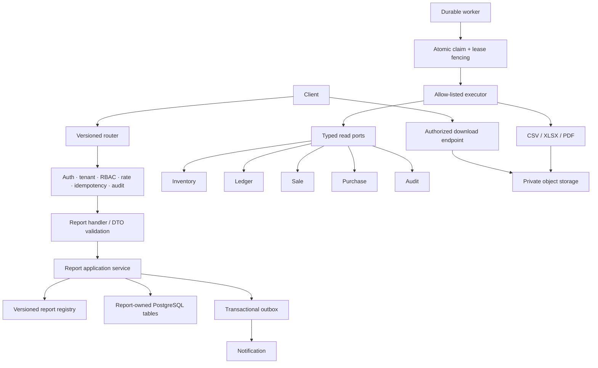

# Pharmaciano ERP — REPORT Module Contract

**File:** `REPORT_CONTRACT.md`  
**Module:** `internal/modules/report`  
**API base:** `/api/v1`  
**Status:** Proposed implementation contract; the Report module is not implemented.  
**Repository baseline:** Checked against the repository's current code, seeds, OpenAPI tree and migrations. Recheck these before implementation because they evolve independently.  
**Stack:** Go modular monolith, Gin, PostgreSQL, Redis/Asynq, transactional outbox and the existing storage abstraction. Production-grade private object storage is not currently available.

> **Readiness summary:** This file is a design contract, not evidence that Reports is production-ready. The Report module's Go files and `internal/jobs/handlers/report_task.go` are package-only stubs. There are no Report tables/migrations, mounted Report routes, Report OpenAPI paths, or Report worker implementation. The permission catalog and default roles already include `reports:view`, `reports:export` and `reports:schedule`; they do not define the finer-grained permissions described later in this proposal. Migration `000014` does not create Report tables. The current migration head is `000028_transactional_outbox`. The existing storage driver is local disk; the `s3` driver is explicitly unimplemented. Therefore the Report module is **not ready to expose or enable** until the blockers and release gates below are met.

### Repository facts and blockers

| Area | Verified repository state | Required correction before production |
|---|---|---|
| Report module/API | `internal/modules/report/*.go` are package-only stubs; no Report module is registered. | Implement, test and explicitly mount the module; keep it unmounted until its contracts and gates pass. |
| Worker | `internal/jobs/handlers/report_task.go` is a package-only stub. `cmd/worker` currently registers the outbox publisher task only; `outbox.enabled` is false in default, dev and Docker config. | Implement/register the Report event/task, define retry/recovery behavior, and explicitly enable/configure outbox+worker in the target environment before accepting jobs. |
| Schema | 28 migrations currently exist; no Report-owned tables are present. | Add a new additive migration after the current head; never edit/reuse an applied migration. |
| Existing `000014` views | Creates legacy `view_stock_summary`, `view_daily_sales` and `view_purchase_outstandings`; these are not stable Report contracts. In particular, they are not the normalized inventory/ledger contract introduced by later migrations. | Do not use these views as official report sources without an owning-module contract, scope review and reconciliation evidence. |
| Analytics | Analytics service/repository code exists, but routes explicitly remain gated on projection schema, event contracts, consumers and reconciliation. | Do not assume Analytics projections or routes are available to Report. Agree on and gate any projection-backed definitions separately. |
| Authorization | Native permissions use `module:action`. `reports:view`, `reports:export`, `reports:schedule` exist and seeded roles grant some of them. | Reuse the native names and seed any additional least-privilege actions/role assignments. Do not use three-part strings such as `reports:financial:view`. |
| Storage | `platform/storage` currently implements local storage; S3 returns `ErrDriverNotEnabled`. `Store.URL` for local storage is an app path, not a signed URL. | A production Report artifact store must be private, durable, encrypted, bounded and configured for recovery/cleanup. Do not claim signed-URL semantics unless a driver implements them. |
| Configuration | `reports.default_page_size`, `reports.max_export_rows` and `reports.timezone` appear in the legacy settings catalog, which says these entries remain deprecated pending verified runtime consumers. | Do not treat these settings as active policy. Define typed, validated settings/configuration and an owner, default, bounds and rollout before consuming them. |
| API documentation | `docs/api/API.md` lists provisional Report routes, but `api/openapi/openapi.yaml` has no Report paths/tag. | Treat this contract and the old API table as proposals until the split OpenAPI source is updated, bundled, validated and generated. |
| Build plan | `docs/BUILD-SEQUENCE.md` associates Report with `000014_indexes_and_views`; that migration only adds the legacy views/indexes described above and is not Report schema. | Reconcile the build plan when implementation is scheduled; add Report's own migration after the actual deployed migration head. |

The package-only files are scaffolding, not partial behavior. No report definition, permission name, worker task type, setting, storage capability or source-query contract should be inferred from a stub or a legacy view.

---

## 1. Purpose and governing principles

Report produces reproducible, authorized report artifacts from owning-domain read contracts. It owns report definitions/versions, jobs, schedules, artifact metadata, execution provenance and delivery authorization.

It does **not** own sales, purchases, stock, batches, movements, journals, customers, suppliers or audit events.

### 1.1 Non-negotiable invariants

1. Reports are read-only. Report code must never mutate business-domain records.
2. Ledger owns financial truth; Inventory owns stock truth.
3. Source data is accessed through typed read ports or explicitly approved read-only views. No cross-module table writes.
4. Authorization is checked at request, execution, status, download and every scheduled run.
5. A requested branch/warehouse is a selector, not authorization. Intersect it with the principal's current effective scope.
6. A schedule does not preserve privileges. Reauthorize its owner and source permissions on every run.
7. PostgreSQL is authoritative for jobs, schedules, artifact metadata and provenance. Redis/Asynq is a recoverable delivery transport/acceleration path; its outage may delay work but must not lose accepted jobs or become the job-state authority.
8. Expect at-least-once worker delivery. Durable uniqueness, idempotency and lease fencing make retries safe.
9. Do not hold a long business transaction during report extraction/rendering.
10. Bound date range, rows, execution time, memory, file size, concurrency and schedule frequency.
11. Artifacts are private, immutable, integrity-checked, expiring and reauthorized at download.
12. No arbitrary SQL, table/column names, joins, templates or expressions from clients.
13. Report failures may delay reports; they must never roll back or delay a sale, receipt, stock adjustment or ledger posting.
14. If source interfaces cannot prove the required semantics, block the report or disclose weaker consistency. Never fabricate certainty.

### 1.2 Out of scope

- Analytics warehouse/projections or dashboard metric ownership.
- Backup/restore and operational recovery artifacts.
- Ledger posting, inventory adjustment, stock reservation or purchase/sale mutations.
- Generic user-defined SQL/report builder.
- User-uploaded document management.

---

## 2. Fit with the repository architecture

The repository is a modular monolith with module-owned repositories, shared transaction-aware database access, existing middleware, PostgreSQL, Redis/Asynq, a transactional outbox and a storage abstraction. Preserve these boundaries. There is no separate “Astra” architecture document in the reviewed tree; this contract must follow the actual code and ADRs. Do not introduce a parallel transaction manager, authorization framework, scheduler framework or job-state store.

### 2.1 Dependency map

| Report depends on | Required contract |
|---|---|
| Auth / Principal / native RBAC | `appctx.Principal`, trusted organization and branch scope, native `module:action` authorization |
| Organization / Branch / Warehouse | Tenant ownership; resolve warehouse-to-branch ownership using an owner-provided contract |
| Sale / Purchase | Source-approved read contracts for finalized documents and linked returns, reversals, receipts and payments; availability/semantics must be verified |
| Inventory | Normalized balance, movement, batch identity and reservation schema exists in later migrations; an approved stable Report read contract and valuation contract must still be agreed |
| Ledger | Normalized posted-journal/period schema exists; an approved reusable statement/read contract and reconciliation tests must still be agreed |
| Customer / Supplier / Medicine / MasterData | Explicit allow-listed labels and historical snapshots; do not assume fields are safe or tenant-independent |
| Audit | Existing Audit module/read API and audit permissions; define a narrow Report read port rather than querying audit storage directly |
| Settings | Settings schema exists; verify the runtime consumer and active typed values for timezone, currency and retention before relying on them |
| `platform/db`, `pkg`, `common`, `errors` | Reuse current database/transaction, pagination, UUID, context, error, response and observability helpers |
| `internal/jobs`, Asynq and outbox | Existing infrastructure to extend; verify event registration and worker composition. Outbox/Asynq do not replace Report job state, idempotency or lease fencing |
| `platform/storage` | Existing abstraction with local driver only; production private object storage is a release blocker |

Report may notify through the existing notification/outbox path. It must not import source repositories or create circular module imports. Report defines narrow required interfaces; source modules/composition wiring supply implementations. If a necessary interface is absent, agree and implement it with the owning module before exposing the affected report.

### 2.2 Explicit readiness decisions

1. Keep Report routes unmounted and the Report task unregistered until the core workflow, private artifact storage, authz, migration, API contract and operational controls are implemented and tested.
2. The Report-owned PostgreSQL tables are authoritative for job state and artifact metadata. The outbox durably publishes events and Asynq delivers work at least once; duplicate delivery is expected.
3. Use one job lifecycle implementation. Extend the existing worker/outbox path where appropriate; add PostgreSQL claim/recovery only if the chosen Asynq/outbox flow cannot provide required durable claiming/fencing. Document the concrete choice before implementation.
4. Read business data through explicit read ports. A table being present in a migration, or a view being available, is not permission to query it from Report or proof of its meaning.
5. No broad “all reports” release: each definition is enabled independently only after its owning source, permission, correctness and capacity gates pass.

### 2.3 Conceptual architecture



This diagram does not imply shared repositories or cross-module table ownership.

---

## 3. Report catalogue and versioned registry

Definitions are code-owned, versioned contracts. Database configuration may enable/disable approved definitions or store safe presentation metadata. It must not introduce executable SQL or arbitrary templates.

| Code | Candidate report | Required owner contract | Sensitive access |
|---|---|---|---|
| `sales` | Sales register / summary | Sale read port, or approved Analytics projection with freshness contract | Sales view/export; separately authorize sensitive fields |
| `inventory` | Stock position | Inventory read port over the normalized inventory contract | Inventory view/export; cost capability for valuation |
| `purchase` | Purchase register | Purchase read port | Purchase view/export |
| `sales_returns` | Sales returns | Sale returns read port | Sales-return view/export |
| `low_stock` | Low-stock report | Inventory read port plus an identified, active reorder-policy source | Inventory view/export |
| `expiring` | Batch expiry | Inventory batch/lot read port | Inventory view/export |
| `audit` | Audit activity | Audit module's approved read port | Audit view/export and field allow-list |
| `ledger_pl` | Profit and loss | Ledger-owned statement/read contract over posted facts | Ledger view/export and financial-report capability |
| `ledger_balance_sheet` | Balance sheet | Ledger-owned statement/read contract over posted facts | Ledger view/export and financial-report capability |
| `customer` | Customer register/activity | Customer/Sale read ports | Customer view/export; explicit PII capability for sensitive fields |
| `supplier` | Supplier register/activity | Supplier/Purchase read ports | Supplier view/export |
| `top_products` | Top products by a precisely defined measure | Sale read port or an approved, reconciled Analytics dataset | Sales view/export |

This is a candidate catalogue, not a claim that the source ports, fields, metrics, projections or report routes exist. Do not mark a candidate enabled until its owner documents stable meaning, filters, scope, consistency/freshness, deletion/return behavior and reconciliation. The `view_stock_summary` and `view_daily_sales` views from migration `000014` are not sufficient substitutes.

Each definition declares:
- Stable code, semantic version, title and description.
- Required permissions and data classification.
- Supported formats.
- Strict filter schema, allowed sort/group fields and date range.
- Source read ports and consistency mode.
- Maximum rows, bytes, runtime and output size.
- Field-level masking/redaction rules.
- Renderer/template version.
- Retention class and schedule eligibility.
- Branch/warehouse filter support.
- Whether PII, staff activity, financial or prescription-related data is present.

A changed column meaning, filter interpretation, source query or calculation requires a new definition version. Never mutate a released definition's semantics in place.

---

## 4. Tenant scope and authorization

### 4.1 Ownership

Jobs, schedules, artifacts and provenance are organization-owned. Jobs/schedules additionally record requester/owner. All tenant-owned repository methods require `orgID`. Use tenant-safe composite foreign keys where existing schema permits. Never treat a nullable tenant ID as a global-access bypass.

### 4.2 Scope resolution

1. Read organization identity from the authenticated context (`appctx.OrgID` or exact existing equivalent).
2. Read effective branch scope from the existing Principal/context (`BranchScope` or exact equivalent).
3. Resolve warehouse → branch → organization using the owning module.
4. Validate requested branch/warehouse IDs belong to the active organization.
5. Intersect requested scope with current principal scope.
6. Reject unauthorized scope and an empty scope for a branch-bound principal. Treat organization-wide scope as valid only when explicitly derived from the trusted principal and current authorization; never infer it from a nil/empty branch list alone.
7. Persist the effective scope snapshot and its policy/version evidence.
8. Recompute authorization at execution and download.

A stored scope snapshot is provenance, not a permanent grant.

At execution, derive the owner's current active organization, permissions and branch assignments from authoritative auth/RBAC state (do not trust an old JWT snapshot). Intersect current scope with the originally requested/stored scope; reauthorization may narrow or deny a job, never silently widen it. Apply the same rule to schedules and downloads.

### 4.3 Permissions

Use the project's existing native RBAC representation. Permissions are stored and enforced as the existing two-part `module:action` strings. `reports:view`, `reports:export` and `reports:schedule` are already present in `seed/permissions.yaml`; the default roles already grant some of them. The repository has no current separate financial, cost, audit, PII, cancel or cross-branch Report permission. The following fine-grained actions are proposals and require a seed/role review and tests before use. Confirm new action names against `constants.AllActions` and the RBAC validator; update the shared action catalogue, permission seed and role grants as required. Do not use three-part strings such as `reports:financial:view`.

| Permission | Capability |
|---|---|
| `reports:view` | View permitted Report catalogue, own jobs and own schedules |
| `reports:export` | Request a report, subject to current source/report/field permissions |
| `reports:schedule` | Create and manage permitted recurring schedules |
| `reports:cancel` *(proposed)* | Cancel own jobs, or another user's job only with an explicit manager capability |
| `reports:financial-export` *(proposed)* | Request financial statements; still require `ledger:view`/`ledger:export` as applicable |
| `reports:cost-export` *(proposed)* | Include acquisition cost/valuation fields; still require owning Inventory permission |
| `reports:audit-export` *(proposed)* | Request audit data; still require `audit:view`/`audit:export` |
| `reports:customer-pii-export` *(proposed)* | Include specifically approved sensitive customer fields; still require `customers:view`/`customers:export` |
| `reports:staff-activity-export` *(proposed)* | Include staff/cashier activity; still require an explicit source permission |
| `reports:cross-branch-export` *(proposed)* | Request multiple branches only when the principal's current scope allows them |
| `reports:manage` *(proposed)* | Change organization Report policy/catalog settings, only if a real management API is required |

`reports:view` does not grant access to every report or to another user's jobs. Each registry definition maps to source and field permissions. Enforce source and proposed Report-specific capabilities in application service logic as well as route middleware; `mw.Protected` accepts one native module/action pair. P&L requires `reports:export`, the financial capability and current Ledger permission. Audit requires the audit capability and current Audit permission. Cost fields require the cost capability and current Inventory permission. Update seeded roles by least privilege; do not broaden `SUPER_ADMIN` behavior or assume default role grants are a production policy.

Roles are permission bundles. Do not hard-code `if role == SUPER_ADMIN` instead of calling existing authorization logic. SUPER_ADMIN is not automatically system-wide across tenants. Existing roles include `ADMIN`, `BRANCH_MANAGER`, `ACCOUNTANT`, `PHARMACIST`, `CASHIER`, `WAREHOUSE` and `AUDITOR`; custom role names are also supported. Access is determined by assigned permissions and effective branch scope, not role-name conditionals.

### 4.4 Reauthorization matrix

| Stage | Checks |
|---|---|
| Generate | Active user, tenant, `reports:export`, report/source permissions, format, filters and scope |
| Worker claim | Tenant active, requester/schedule owner active, current permissions and scope; a schedule service identity does not bypass owner authorization |
| Source extraction | Every port receives explicit organization and effective branch/warehouse scope |
| Status | Tenant-scoped lookup; owner access by default; any delegated/manager access must be an explicit capability and audited |
| Download | Current `reports:view`, report/source permissions, scope, artifact/job relationship and expiry |
| Scheduled run | Reauthorize schedule owner, report definition and all source permissions |
| Schedule read/edit/pause/resume/cancel | Owner or explicitly authorized schedule manager; cross-user access is audited |

If permission is revoked after generation, deny subsequent downloads. Optionally revoke the artifact and enqueue deletion under retention policy. Already downloaded copies cannot be recalled; record access in Audit.

### 4.5 Role guidance (not authorization code)

- SUPER_ADMIN: organization-wide access only where explicitly granted.
- BRANCH_MANAGER: branch operational reports by default; cross-branch only with permission.
- CASHIER/PHARMACIST: only explicitly granted operational reports; no ledger, cost, audit or supplier data by default.
- Accountant/auditor: explicit financial/audit permissions and branch scope.
- Schedule owner: own schedules; delegated administration requires explicit permission.

---

## 5. API contract

All paths are relative to `/api/v1`.

| Method & path | Existing rate-policy key | Permission | Contract behavior |
|---|---|---|---|
| `GET /reports/catalog` | `auth_read` | `reports:view` | List only currently enabled definitions and caller-available formats |
| `POST /reports/generate` | `export` | `reports:export` + definition/source/field permissions | Create asynchronous job; require durable request idempotency |
| `GET /reports/jobs` | `auth_read` | `reports:view` | Paginated jobs visible to caller; owner-only by default |
| `GET /reports/jobs/{job_id}` | `auth_read` | `reports:view` + current source access | Read status without storage internals |
| `POST /reports/jobs/{job_id}/cancel` | `auth_write` | `reports:cancel` *(proposed)* + owner check, or explicit manager capability | Cancel queued job or request cooperative cancellation |
| `GET /reports/jobs/{job_id}/download` | `auth_read` | `reports:view` + current source access | Authorize and stream a ready, unexpired artifact |
| `POST /reports/schedule` | `auth_write` | `reports:schedule` + definition/source permissions | Create schedule |
| `GET /reports/scheduled` | `auth_read` | `reports:view` | Paginated owner-visible schedules |
| `GET /reports/scheduled/{id}` | `auth_read` | `reports:view` | Read schedule and latest run metadata |
| `GET /reports/scheduled/{id}/runs` | `auth_read` | `reports:view` | Paginated occurrence/job history for an accessible schedule |
| `PATCH /reports/scheduled/{id}` | `auth_write` | `reports:schedule` | Update allowed recurrence/filters using optimistic concurrency |
| `DELETE /reports/scheduled/{id}` | `auth_write` | `reports:schedule` | Idempotently cancel/deactivate schedule |

These are proposed route shapes. Keep the existing `POST /reports/generate` path in [API.md](../api/API.md) compatible unless a reviewed API change approves otherwise. In current config, `export` is a rate-limit policy key (5 requests/hour per user in the default file); it is not the literal middleware name `rate_export`. Treat that default as an initial ceiling, then define and validate suitable per-user/per-organization quotas. `auth_read` and `auth_write` are also policy keys, not guarantees that a rate policy is configured identically in every environment.

### 5.1 Generate request

```json
{
  "type": "inventory",
  "filters": {
    "from": "2026-01-01",
    "to": "2026-02-01",
    "branch_ids": ["uuid"],
    "warehouse_ids": ["uuid"]
  },
  "format": "csv"
}
```

Rules:
- `type` must exist in the registry; `format` must be supported by that definition.
- Initial implementation should enable CSV only. Enable XLSX/PDF per-definition only after renderer review and corresponding security/load tests pass.
- Validate strict DTO shape, dates, bounds, grouping, sorting and filter operators.
- Date/timestamp ranges use `[from, to)` (inclusive start, exclusive end).
- Server derives organization and requester. Never trust body-supplied tenant/actor identity.
- Branch/warehouse filters are selectors only and are intersected with current authorization.
- Return `202 Accepted` with `job_id`, status URL and accepted timestamp. Never wait for rendering in the HTTP request.
- Use server-generated `job_id` and a stable `Location`/status URL. Document whether duplicate idempotent requests replay the original `202` response.
- Reject unknown JSON fields and enforce explicit request-byte, filter-count, date-range, row, output-byte, execution-time and per-user/per-organization concurrency limits. Record chosen bounds in validated configuration and API docs; do not copy legacy settings as active controls.

### 5.2 Job status DTO

Expose safe fields only: job ID, report code/version, format, state, created/queued/started/completed timestamps, safe requester display metadata if permitted, coarse progress, row count/size on success, expiry, safe failure code/message, download availability and source `data_as_of`/watermark where supported.

Never expose storage keys, signed URLs, SQL, stack traces, worker hostnames, bucket names or raw source errors.

Recommended lifecycle:

```text
queued -> running -> succeeded
                 -> retry_wait -> queued (when backoff expires)
                 -> failed
                 -> cancel_requested -> cancelled
queued / retry_wait -> cancelled
expired running lease -> retry_wait or failed (atomic recovery + attempt accounting)
```

`succeeded`, `failed` and `cancelled` are terminal. Do not transition a live `running` job directly to `queued`; first fence the old attempt, account for it, and record a retry decision. The repository's API overview currently says `success`; update it and generated OpenAPI to the selected canonical state before release, or explicitly map a compatibility state in the response.

### 5.3 Schedule request

Include report code, filters, format, IANA timezone, allow-listed recurrence rule, and optional display name. Store the immutable recurrence/filter snapshot with an optimistic-concurrency version. Delivery is initially an in-app notification/report inbox. External email requires a separately approved provider and recipient policy. Client cannot choose a service actor or arbitrary recipient.

### 5.4 Download

1. Authenticate and load job/artifact using tenant-scoped repository methods.
2. Reauthorize current source permissions and effective scope.
3. Verify job succeeded, artifact available, unexpired and belongs to the job/tenant; verify object integrity using a provider-verified checksum or a bounded verify-before-serve strategy. Do not treat metadata alone as proof that stored bytes still match.
4. Record the authorization/issuance attempt through the approved Audit path. Define whether audit persistence is mandatory; for protected financial/audit exports, do not silently serve when the required audit write cannot be recorded.
5. Proxy-stream through the application by default. Only issue a short-lived exact-object signed URL if a production object-store adapter supports it and policy accepts that revocation is delayed until URL expiry.
6. Set safe `Content-Disposition`, correct MIME type, `Cache-Control: private, no-store`, `X-Content-Type-Options: nosniff`.

If a future object-store driver supports signed URLs, treat them as bearer capabilities until expiry: keep expiry short, never log/persist them, and prefer proxy streaming where immediate revocation is important. Do not claim signed-URL support from the current `Store.URL` interface alone.
With proxy streaming, distinguish authorized/started/completed/aborted transfers in audit without logging file contents. A signed-URL issuance audit is not proof that the object was downloaded.

---

## 6. Data correctness: Inventory, Purchase, Sale and Ledger

### 6.1 Authoritative source matrix

| Report data | Authority | Forbidden shortcut |
|---|---|---|
| Sales totals/register | Sale | Reconstruct from cash drawer or ledger descriptions |
| Sales returns | Sale | Subtract arbitrary negative lines without return linkage |
| Purchase | Purchase | Treat PO value as receipt, invoice or payment |
| Stock on hand | Inventory balance/read contract | Sum an arbitrary movement window or Redis cache |
| Stock movement | Inventory movements | Infer solely from sale/purchase documents |
| Batch quantity/expiry | Inventory batch/lot state | Infer from medicine master data |
| Adjustments/transfers | Inventory facts | Edit balances or hide corrections |
| Inventory valuation | Inventory valuation/cost contract | Current selling price × stock quantity |
| P&L / balance sheet | Posted Ledger facts | Sales dashboard less estimated cost |
| Audit | Audit read port | Dump arbitrary audit JSON |

### 6.2 Inventory — required source contract

The Inventory module remains the sole authority for stock state. Report must not create or persist a competing balance.

The read contract must expose, as applicable:
- Organization, branch, warehouse, medicine/variant and batch identity.
- Base-unit quantity and source conversion metadata.
- Available, reserved, quarantined, damaged, expired, in-transit and other supported buckets separately.
- Balance version, `as_of` timestamp or source watermark.
- Movement ID/type, source document, posted timestamp, effective business date, signed quantity/unit, batch, source/destination warehouse, actor and reversal linkage.
- Batch expiry, received date, status, recall/hold state and authorized supplier/receipt reference.
- Adjustment reason, approval state, count reference and immutable evidence.
- Transfer dispatch/receipt states and in-transit quantity.
- Valuation method, cost-layer identity and currency when permitted.

Migration `000026_inventory_core` adds normalized batch identities, balances, condition buckets, immutable movements and reservations. That schema does not by itself provide a Report snapshot token or an owner-approved read interface. Map its actual conditions and quantity semantics with Inventory before implementing this candidate; do not assume there are separate columns for every quantity bucket listed above.

Required semantics:

1. Stock-on-hand comes from Inventory's authoritative balance/read contract, not Report-side re-aggregation.
2. Movement reports read immutable movements and show reversals/corrections as distinct linked facts.
3. Distinguish physical quantity changes from reservations/availability changes.
4. Transfers are not net organization-wide stock increases/decreases. Show dispatch, in-transit and receipt according to Inventory state.
5. Purchase order is not stock. Count a receipt only when Inventory confirms the committed receipt movement.
6. Draft/voided sale is not stock-out. Count consumption only when Sale/Inventory confirms the committed movement.
7. Returned goods are not automatically sellable. Preserve quarantine/damaged/inspection disposition.
8. Expiry uses batch-level expiry and current batch quantity, never medicine master data.
9. Low-stock compares the explicitly named quantity measure with the approved reorder policy.
10. Adjustments remain visible with reason/approval; never rewrite history.
11. Negative quantities are flagged, not silently clamped to zero.
12. If balances and movements cannot share a consistent cutoff, disclose the limitation or fail. Never claim a point-in-time snapshot without proof.

### 6.3 Inventory snapshot and reconciliation

Preferred consistency modes:

1. Bounded repeatable-read snapshot on PostgreSQL primary for short, measured reports.
2. Inventory-owned snapshot/read service returning a stable token/watermark for paginated export.
3. Versioned Inventory/Analytics snapshot with explicit `as_of` and reconciliation guarantees.

Do not hold one transaction open for a multi-hour export. If no stable snapshot exists, label `consistency_mode=best_effort`, expose cutoff/watermark and warnings. Do not use best-effort for official financial statements.

Inventory-owned reconciliation should verify:
- Balance quantity equals the source-defined opening plus posted movement effects and applicable reservation rules.
- Batch totals reconcile to warehouse/medicine balances under base-unit rules.
- In-transit quantity reconciles to dispatched-not-received transfers.
- Reversals are linked and not double-counted.
- Adjustment approval matches posted movement.
- Cost-layer quantities reconcile under the selected valuation method.

Report may display mismatch status and alert; it must never repair Inventory.

### 6.4 Ledger — required source contract

- Official financial statements read posted journals only.
- Use Ledger account classification, fiscal period, branch dimensions, currency, posting/effective date and reversal state.
- Reversals are new linked posted facts; never delete/mutate posted lines.
- Balance sheet is an as-of report; P&L is a period report. Define cutoff semantics separately.
- Use Ledger debit/credit and normal-balance conventions; do not infer signs from account names.
- Respect closed periods.
- Never add unlike currencies. Use only Ledger-approved conversion/reporting currency data.
- Do not infer COGS from current stock cost or sale price.
- Do not create journals, call ledger posting commands or modify account balances.
- If Ledger has no stable read port, block financial report implementation rather than guessing tables.

### 6.5 Sale and Purchase semantics

Sale reports include only source-defined finalized states. Returns, refunds, voids and reversals must follow immutable Sale state transitions; do not double-subtract a return already linked to a financial reversal.

Purchase reports distinguish purchase order, partial receipt, goods receipt, supplier invoice, credit note/return and payment. They are separate facts. A PO is not automatically an expense, receipt, payable or payment.

### 6.6 Transaction boundary protection

Report never participates in Sale/Purchase/Inventory/Ledger write transactions. Verify each source workflow's actual transaction/outbox guarantees with its owner; this document does not assert that every business workflow is already implemented or atomic. Report reads only committed facts through owner-approved contracts. Report queue or renderer failure must not roll back or delay checkout, receipt, stock adjustment, transfer or ledger posting.

---

## 7. Time, currency, units and provenance

### 7.1 Time

- Persist timestamps as UTC `timestamptz`.
- Resolve organization business timezone from an active, validated organization setting using an IANA name (e.g. `Asia/Dhaka`). The app-level `Asia/Dhaka` config value is not proof of an organization-specific setting; legacy `reports.timezone` is deprecated until its runtime consumer is verified.
- Interpret date-only filters in business timezone, then convert to UTC boundaries.
- Use `[from, to)` for ranges.
- Record requested timezone, resolved UTC boundaries, requested/queued/started/completed times and source `as_of`.
- Explicitly identify transaction timestamp, posting timestamp, effective date or receipt date used by each definition.
- Reject invalid/unknown timezone identifiers and ambiguous schedule inputs; never silently fall back to UTC or a process-local timezone.

### 7.2 Money and quantities

- Use exact decimal values; never convert financial amounts to binary float.
- Never sum unlike currencies without approved conversion.
- Record currency code/precision and rounding policy.
- Current normalized Ledger migration stores BDT in integer minor units; preserve that contract and do not assume multi-currency Ledger support merely because a Report DTO has a currency field.
- Use Inventory/MasterData canonical base-unit contract.
- Do not sum unlike units without valid conversion.
- Historical documents use transaction-time unit/conversion snapshots, not today's mutable master data.
- Do not independently recalculate tax, discount, margin, COGS or payable when the owning module records authoritative values.

### 7.3 Immutable provenance

Each completed run records:
- Report code/definition version and renderer/template version.
- Normalized request hash and filters.
- Organization, requester, authorized scope snapshot and policy version where available.
- Requested timezone and resolved date boundaries.
- Source domains and source watermark/snapshot token per source.
- `data_as_of` and consistency mode.
- Start/end timestamps, row count, file size, SHA-256 checksum and MIME type.
- Warnings, omissions and completeness status.
- Attempt number and correlation/trace ID.
- Expiry and retention class.

Provenance is immutable after success. A corrected report is a new job/artifact, never an in-place overwrite.

---

## 8. PostgreSQL data model

Logical schema only. Before migration, inspect existing `BaseModel`, UUID policy, migration version, soft-delete semantics, naming and indexes. Use existing common model only if semantics match.

### 8.1 `report_jobs`

Suggested fields:

- `id uuid PK`, `organization_id uuid NOT NULL`, `requested_by uuid NOT NULL`
- `report_code text NOT NULL`, `definition_version int NOT NULL`, `format text NOT NULL`
- `normalized_filters jsonb NOT NULL`, `filters_hash bytea NOT NULL`
- `scope_snapshot jsonb NOT NULL`, `scope_hash bytea NOT NULL`
- `status text NOT NULL`, `priority smallint NOT NULL DEFAULT 0`, `available_at timestamptz NOT NULL`
- `request_hash bytea NOT NULL`
- `attempt_count int NOT NULL DEFAULT 0`, `max_attempts int NOT NULL`
- `queued_at`, `started_at?`, `completed_at?`, `cancel_requested_at?`
- `lease_owner?`, `lease_until?`, `lease_generation bigint NOT NULL DEFAULT 0`, `heartbeat_at?`
- `failure_code?`, `failure_message_safe?`
- `created_at`, `updated_at`, `version bigint`

Constraints/indexes:
- Allowed lifecycle status `CHECK`; nonnegative attempts and lease generation; lease fields must be consistent with `running`/`cancel_requested`.
- `UNIQUE(organization_id,id)` for tenant-safe references.
- Durable idempotency belongs in a dedicated `report_idempotency` table (or an equally explicit record), not only the job row. Use a unique `(organization_id, requested_by, key_hash)` identity, request hash, job reference, creation/expiry and retained-tombstone semantics. Define the retry-key retention period; do not allow job cleanup to make an unexpired key silently create a second job.
- List index `(organization_id, requested_by, created_at DESC, id DESC)`.
- Partial queue claim index `(priority DESC, available_at, id) WHERE status IN ('queued','retry_wait')`.
- Partial recovery index `(lease_until) WHERE status='running'`.

Do not persist raw idempotency keys, unbounded failure strings, arbitrary SQL, or client-supplied identity. Bound failure codes/messages and keep stack traces in access-controlled logs only.
Keep filters strictly bounded and do not persist free text or sensitive filter values unless the definition requires them and the values are encrypted/access-controlled. Hashes of low-entropy values are not anonymization. Use a server-keyed HMAC for client idempotency keys; rotate/version the HMAC key without making live key identities ambiguous.

### 8.2 `report_artifacts`

- `id uuid PK`, `organization_id`, `job_id`, `format`
- `storage_provider`, opaque `storage_object_key`
- `mime_type`, `file_name_safe`, `size_bytes`, `checksum_sha256`
- `encryption_key_ref?` (reference only; never key material)
- `status` (`staging`, `available`, `revoked`, `deleting`, `deleted`, `corrupt`, `expired`)
- `created_at`, `expires_at`, `deleted_at?`
- `UNIQUE(organization_id,job_id,format)` and tenant-safe composite FK.
- `CHECK(size_bytes >= 0)`.
- Expiry index `(organization_id,expires_at) WHERE status='available'`.

Never store public URLs or user-controlled object paths.

### 8.3 `report_schedules`

- `id`, `organization_id`, `owner_user_id`
- `report_code`, `definition_version`, `format`
- `normalized_filters`, `scope_snapshot`
- `timezone`, `recurrence_spec`, `next_run_at`
- `last_run_at?`, `last_job_id?`
- `status` (`active`, `paused`, `cancelled`, `permission_revoked`, `invalid`)
- `consecutive_failures`, `created_at`, `updated_at`, `version`

Indexes: due partial index `(next_run_at,id) WHERE status='active'`; owner list index `(organization_id,owner_user_id,created_at DESC)`.

### 8.4 `report_run_provenance`

- `id`, `organization_id`, `job_id`
- `definition_version`, `renderer_version`
- `normalized_request_hash`, `scope_snapshot`, `source_watermarks`
- `data_as_of?`, `consistency_mode`, `timezone`
- `resolved_from?`, `resolved_to?`
- `row_count`, `warning_codes`, `completeness`
- `checksum_sha256`, `generated_at`
- `UNIQUE(organization_id,job_id)`; immutable after insert.

### 8.5 `report_job_attempts` (required)

Append one record per execution attempt: tenant/job IDs, attempt number, lease generation, task/correlation ID, worker identity (non-sensitive), started/ended timestamps, outcome class, safe error code and bounded retry delay. Enforce unique `(organization_id,job_id,attempt_number)` and tenant-safe job FK. Do not store stack traces, host secrets or exported rows. This history supports recovery, retry diagnosis and audit without overwriting prior failures.

### 8.6 `report_schedule_runs` (required)

Per-occurrence record with `schedule_id`, `organization_id`, intended local occurrence, resolved `scheduled_for_utc`, `job_id`, state and created time. Unique `(organization_id,schedule_id,scheduled_for_utc)` prevents duplicate schedule firing after retry/crash.

### 8.7 Idempotency and database invariants

Use a dedicated `report_idempotency` record for asynchronous generation. Enforce one key identity per tenant/requester in PostgreSQL so concurrent API instances cannot create duplicate jobs, and retain a tombstone for the full documented replay window even if the associated job is archived.

Suggested `report_idempotency` fields: `organization_id`, `requested_by`, `key_hmac`, `hmac_key_version`, `request_hash`, `job_id`, `created_at`, `expires_at` and optional tombstone/cleanup metadata. Add a unique constraint on `(organization_id,requested_by,key_hmac)` and a tenant-safe job FK. Do not retain response bodies when `job_id` is sufficient to recreate the accepted response.

- Every tenant-owned row has non-null organization ID.
- Artifact/provenance rows are tenant-safely linked to jobs.
- Successful job has a verified artifact; failed/cancelled jobs cannot expose one.
- Request definition/normalized filters are immutable after enqueue.
- Lease generation increases on every claim/reclaim; only current generation can finalize.
- Schedule occurrence has durable unique identity.
- Do not cascade-delete artifact metadata before private object deletion is recorded.
- Current migration head is `000028`; create the next unused migration pair (normally `000029_*` after confirming the deployed database's actual version). Never reuse an applied migration version or modify released migrations.
- Deploy additive schema and compatible code before enabling workers/routes.
- Test empty DB and production-like upgrade. Avoid destructive rollout migrations.

---

## 9. Idempotency, workers and retries

### 9.1 Durable request idempotency

The existing `mw.Idempotency()` middleware is optional when no key is sent and deliberately proceeds without deduplication if Redis is unavailable. It is request/response replay protection, not the Report business-correctness boundary. Report generation must require its own durable PostgreSQL idempotency record.

For `POST /reports/generate`:

1. Require the existing `Idempotency-Key` header and validate it with repository length/format conventions.
2. Store only the server-keyed HMAC and key version; never persist the raw client key.
3. Normalize request and calculate deterministic request hash.
4. In one short DB transaction insert/retrieve idempotency identity.
5. Same key + same request hash returns the original job/accepted response during the documented retention window.
6. Same key + different request hash returns conflict.
7. Insert job, idempotency record and outbox event in the same transaction.
8. Commit before returning `202`.

The unique constraint resolves concurrent duplicate submissions. Redis middleware may additionally replay the HTTP response, but failure/eviction must not create another Report job. Do not rely on middleware alone or silently accept missing keys.

### 9.2 Atomic worker claim and fencing

Use the existing outbox/Asynq worker path for durable event publication and task delivery where it meets these requirements. The repository has an outbox dispatcher and Asynq server, but Report task registration/handling is a stub. Asynq delivery is at least once; PostgreSQL job state remains authoritative. Do not add a second queue/lease subsystem by default.

- The request transaction inserts the queued job and its outbox event atomically.
- The task payload contains only the minimum identifiers (for example job ID and event/correlation ID), not filters, PII or exported data.
- On delivery, claim the job with a conditional PostgreSQL state transition. If parallel workers require a row-lock claim, use `FOR UPDATE SKIP LOCKED` inside a short transaction.
- Increment attempt count and monotonic `lease_generation` on every valid claim/reclaim.
- Set owner, lease expiry, heartbeat, running state and first-start timestamp.
- Commit claim before extraction/rendering.
- Heartbeat with conditional update matching job ID, owner and generation.
- Every checkpoint, cancellation acknowledgement, artifact publication and finalize verifies that the same lease generation still owns the job.
- Stale worker cannot overwrite a newer worker's result.

`SKIP LOCKED` is appropriate for worker claims, not for selecting stock batches or deciding FEFO allocation.

If existing worker/outbox guarantees cannot provide recovery, implement the smallest missing Report-owned claim mechanism and document why; do not claim that Asynq itself fences stale workers.

### 9.3 Retry and cancellation

Retry only classified transient DB/network/storage errors and worker interruptions. Do not retry invalid filters, unsupported formats, permission revocation, deterministic rendering errors or tenant mismatch indefinitely. Use bounded exponential backoff with jitter and max attempts; persist `available_at` and `retry_wait` durably. Store sanitized failure code/message, never stack trace. Clarify how Asynq retries/dead-letter handling interact with Report job attempts so broker retries cannot bypass job-level limits.

Queued job cancellation is atomic. Running job sets `cancel_requested_at`; worker checks between pages/chunks and before artifact publication. Cancellation is cooperative. Cancelled jobs cannot publish available artifacts; clean temporary output.

### 9.4 Resource isolation

Separate bounded concurrency for financial exports, large operational exports, small interactive reports, schedules and cleanup. Use dedicated/bounded worker DB connections or strict pool budgets. Report must not starve checkout, inventory, purchase, ledger or auth pools.

The existing `internal/jobs/scheduler.go` and Report task handler are stubs. Do not treat schedules, queue partitioning, Report worker concurrency or cleanup tasks as already operational.

---

## 10. Transaction and consistency strategy

Report's transactions are metadata transactions only.

### 10.1 Enqueue transaction

One short transaction:
1. Validate tenant, actor, permission, definition, filters and effective scope.
2. Normalize request and resolve durable idempotency identity.
3. Insert `report_jobs` in `queued` plus the idempotency record.
4. Append the Report-requested outbox event and required audit evidence in the same transaction.
5. Commit.

No source rows are locked for update. No stock/ledger records are mutated.

### 10.2 Execution lifecycle

1. Receive the outbox/Asynq task and claim the referenced job in a short transaction; acknowledge/complete delivery only according to the existing worker's retry contract.
2. Reauthorize current requester/owner and scope.
3. Obtain bounded snapshot or source watermark.
4. Read source data using stable keyset pagination.
5. Stream rows into private temporary output.
6. Create non-downloadable staging metadata under the current lease and upload the artifact to private storage.
7. Verify stored checksum and size.
8. In a short finalization transaction, verify lease generation, transition the staging artifact to available, insert provenance, mark the job succeeded, and append the required audit/outbox event.
9. Commit.

If upload succeeds but finalization fails, the object remains private and inaccessible. Reconcile through an explicit staging/object ledger or clean it up; do not assume `Store.Put` is idempotent or returns a deterministic key. Never expose an object merely because its key is known.

### 10.3 Isolation choice

- `READ COMMITTED`: simple bounded reports where slight cross-query drift is disclosed.
- `REPEATABLE READ`: bounded multi-query report requiring one consistent snapshot.
- Source-owned snapshot/watermark: preferred for long exports.
- `SERIALIZABLE`: only for a demonstrated requirement with retry handling.

Long repeatable-read transactions retain old row versions and can harm vacuum. Never use one for a multi-hour export.

### 10.4 Why Ledger/Inventory consistency cannot be broken by Report

Report never calls `Ledger.Post`, `Inventory.Adjust`, `Inventory.Consume`, `Inventory.Receive` or equivalent mutation APIs. It never opens a transaction shared with Sale/Purchase/Inventory/Ledger. It reads committed source facts through read-only ports. Require each source owner to identify which document, stock, ledger, audit and outbox writes are atomic in the actual implementation; do not infer atomicity from this design contract. Report failures cannot partially commit or roll back source workflows.

---

## 11. Output formats, printing and metadata

| Format | Use | Safety requirements |
|---|---|---|
| CSV | Large flat data/interoperability | UTF-8, stable headers, quoting and formula-injection defense |
| XLSX | Business users, sheets and formatting | Streaming writer, typed cells, no macros/external links |
| PDF | Fixed-layout printable report | Server-owned template, safe fonts, no remote resources |

Enable only maintained, reviewed renderers.

### 11.1 Report header/footer

Where applicable include:
- Organization display name and report title.
- Report code/version.
- Period or as-of time and business timezone.
- Branch/warehouse scope.
- Generated-at timestamp.
- Generated-by display name/identifier according to privacy policy.
- Report/job reference ID.
- Page number/total pages for PDF.
- Currency and unit conventions.
- Data cutoff/freshness and warnings.
- Confidentiality classification.

Do not expose internal UUIDs or staff PII unnecessarily. Use a human-readable report reference.

### 11.2 CSV formula injection

Neutralize untrusted strings beginning (including after whitespace/control characters) with spreadsheet formula triggers such as `=`, `+`, `-`, `@`, tab or carriage return. Apply to customer, medicine, supplier, notes and imported reference fields. Keep typed numeric columns numeric. Test Unicode whitespace, controls, delimiters and quotes.

### 11.3 XLSX

- Explicit cell types; untrusted text always string cells.
- No macros, DDE, external links, embedded objects or external connections.
- Formula cells only server-authored from fixed templates.
- Bound rows, columns, cells and memory.
- No hidden sensitive sheets, metadata leakage or untrusted formula cells.

### 11.4 PDF

- Fixed server templates; escape all data.
- No arbitrary user HTML.
- Disable renderer network access and remote assets.
- Restrict local file access to temporary directory.
- Enforce render timeout, page count, memory and output size.
- Sanitize filename and metadata.

### 11.5 Printing

Server generates a print-ready PDF or spreadsheet; physical printing is a client action. PDF should use defined page size/orientation, margins, repeated table headers and page numbering. Large datasets should use CSV/XLSX rather than a huge PDF.

---

## 12. Private storage and artifact lifecycle

- Current `platform/storage` supports local disk; `s3` is explicitly unimplemented. Local `Store.URL` returns an application path, not a signed URL. Production release is blocked until a supported private object store is deployed or an explicitly approved private-storage design is implemented and operationally backed up.
- Private bucket/container only; public access blocked at account and bucket level.
- Opaque server-generated object keys; never derive path from user input.
- Encryption at rest and TLS in transit.
- Least-privilege credentials: worker write, download read, cleanup delete.
- Secret manager/KMS reference only; never store key material in DB/settings/logs.
- Checksum and byte size recorded and verified.
- The current local driver returns SHA-256 from a metadata sidecar; that value alone does not verify the object bytes on `Get`. A production adapter must validate object integrity on write/read or the Report download path must verify bytes before exposing them.
- Enforce application-level no-overwrite with unique server-generated object keys. If provider-level object lock/versioning is required, verify that the chosen provider and lifecycle configuration actually enforce it; the current storage abstraction does not promise immutable writes.
- Define storage availability, backup/replication, region/data-residency, key rotation, restore and deletion verification. Rehearse restoring DB metadata and corresponding artifacts together.
- No public URL in DB or API.

Persist a non-downloadable `staging` metadata row before or as upload begins, then transition it to `available` only in the same DB transaction that verifies the current lease and marks the job `succeeded`. Every other path remains inaccessible and is cleaned/reconciled.

Artifact lifecycle:

```text
staging -> available -> expired -> deleting -> deleted
                    -> revoked -> deleting -> deleted
                    -> corrupt -> quarantined/deleting
```

Job execution state and artifact lifecycle are separate. A succeeded job can later have an expired/revoked artifact.

| Failure | Behavior |
|---|---|
| Render fails | Mark failed/retry by error class; remove temp output |
| Upload fails | Retry transiently; no available artifact row |
| Upload succeeds, DB finalization fails | Private orphan; reconcile/cleanup |
| Notification fails | Job remains succeeded; notification retries separately |
| Permission revoked | Deny download; optionally revoke artifact |
| Object missing/checksum mismatch | Mark corrupt, deny download and alert |
| Cleanup delete fails | Retain metadata in deleting state and retry |

Use safe server-generated filename such as `pharmaciano_inventory_2026-01-01_to_2026-02-01_<short-job-ref>.xlsx`. Sanitize display names and prevent CR/LF injection. Never use raw filters as paths.

---

## 13. Scheduling

- Scheduling is not currently implemented: `internal/jobs/scheduler.go` is a stub. Integrate with a single scheduler in the existing worker composition; do not make every API process independently enqueue recurring runs.
- Scheduler claims due occurrences transactionally with `FOR UPDATE SKIP LOCKED`.
- Insert unique schedule occurrence and report job in the same transaction.
- `report_schedule_runs` and unique `(organization_id,schedule_id,scheduled_for_utc)` are required to prevent duplicate firing. Persist the intended local occurrence and resolved UTC instant to make DST decisions auditable.
- Store IANA timezone and allow-listed recurrence format.
- Use a small, explicit recurrence grammar (for example daily/weekly/monthly at a local time), not arbitrary user-provided cron or RRULE expressions. Define policy for nonexistent DST times and repeated times; test both.
- Define downtime policy: skip, latest missed occurrence, or bounded catch-up. Never enqueue unbounded backlog.
- Enforce per-org/user schedule quotas and minimum recurrence interval.
- Each scheduled run uses the same authorization, source-read, worker and artifact pipeline as interactive requests.
- Reauthorize owner, definition, scope and source permissions every run.
- Disabled owner or revoked access pauses/denies the schedule; never execute silently as superuser.
- Ownership transfer requires explicit permission and audit.
- Apply retention and report-disable policy to future runs and existing artifacts as defined.

---

## 14. Audit, provenance and notifications

Use existing Audit append/read ports; do not create a second generic audit system.

Audit at least:
- Generation requested (type/version/format, filter hash, effective scope, requester).
- Started, retried, completed, failed and cancelled.
- Schedule created/updated/paused/resumed/cancelled/transferred.
- Download authorized/started/completed/aborted/denied for proxy streaming; for signed URLs record issuance, not an unobservable download completion.
- Artifact revoked/expired/deleted/corrupt.
- Permission/scope revalidation failure.
- Administrative access to another user's report.

Do not put full PII filters, exported rows, secrets or signed URLs in logs/audit. Store safe metadata and hashes.

Persist who requested and how:
- `interactive_api`
- `scheduled`
- `administrative_replay` only if explicitly supported

For schedules record schedule owner plus scheduler service identity. For admin replay require dedicated permission, reason, correlation ID and audit. Never trust client `requested_by`.

On finalization append `ReportReady` or `ReportFailed` to outbox in the same transaction as job state, using the existing outbox schema/producer contract after verifying its aggregate/version requirements. Notification is retryable and not artifact authority. Payload contains safe job ID/status only, never report contents or signed URL. Do not silently drop mandatory audit evidence if the current Audit sink is not wired or is best-effort; agree a durable audit path and outage policy.

---

## 15. Security threat model

| Threat | Control |
|---|---|
| Cross-tenant leakage | Mandatory org predicates, composite FKs, scoped ports, tenant tests |
| Branch/warehouse escalation | Resolve current scope and ownership; intersect filters; reauthorize |
| IDOR/job enumeration | Tenant-scoped lookup and owner/delegated policy; non-disclosing not-found |
| Stale schedule privilege | Reauthorize every occurrence |
| Stale download privilege | Reauthorize every download |
| Financial/cost leakage | Separate financial/cost permissions |
| Audit exposure | Separate audit permission and field allow-list |
| PII over-export | Classification, masking, minimization, retention |
| CSV/XLSX formula injection | Escaping and typed cells with adversarial tests |
| PDF SSRF | Network-disabled renderer, fixed templates |
| Path traversal | Opaque keys, safe filenames |
| Public artifact access | Private storage, short exact-object URL or proxy |
| Signed URL leakage | Never log/store; short expiry |
| SQL injection | Typed DTO, parameterized queries, allow-listed operators |
| Resource exhaustion | Rate, quota, range, row, byte, time and concurrency limits |
| Worker replay | Durable idempotency, schedule uniqueness and lease fencing |
| Stale worker finalize | Monotonic lease generation on every state mutation |
| Credential compromise | Secret manager, least privilege, rotation |
| Artifact tampering | SHA-256 and immutable/versioned object policy |
| Insider exfiltration | Permission separation and export/download audit |
| Log leakage | Structured redaction; no row contents/secrets/URLs |
| Retention violation | Policy expiry, cleanup verification and audit |

### 15.1 Data minimization

- Export only necessary columns.
- Mask customer phone/email/address unless explicitly authorized and required.
- Never export passwords, tokens, API keys, secret settings, payment credentials or session data.
- Prescription/patient-related data is excluded by default; any inclusion requires explicit domain/legal review.
- Audit report uses an explicit safe field allow-list; never dump arbitrary audit payload JSON.

### 15.2 Download headers

Use safe content type/disposition, `X-Content-Type-Options: nosniff`, `Cache-Control: private, no-store`, and appropriate CSP only for any preview route. Do not render HTML reports in the app origin unless sandboxed.

---

## 16. Performance and efficiency

- Keyset/cursor pagination for large exports with stable unique tie-breaker.
- Stream source rows into renderer; never load entire report into memory.
- Bounded batches, context cancellation and statement timeout.
- Avoid N+1 lookups; source ports support bulk enrichment or safe labels.
- Avoid expensive exact count solely for progress.
- Select only needed columns; no `SELECT *`.
- Index based on measured query plans and realistic volumes.
- No long locks or unrestricted primary concurrency.
- Define maximum Report worker DB connection budget.
- Use replica only when lag/consistency is acceptable and freshness is disclosed. Financial reports must use approved authoritative path.
- Per-organization concurrency and quotas.
- Critical checkout/stock/purchase/ledger/auth pools must not be starved.
- Before GA, define measurable queue-latency, completion, failure, freshness, cleanup and restore objectives from representative load tests; do not invent numeric limits without workload/capacity evidence.

Optional metadata/status cache keys include organization, user/scope, report definition version, normalized filter hash and source watermark. Reauthorize before serving cached results. Cache is never proof of permission or artifact authority.

### 16.1 Metrics

- Queue depth and oldest queued age.
- Queue wait and execution duration by report code/format.
- Success/failure/retry/cancellation.
- Rows/bytes produced.
- Source query latency/timeouts.
- Lease expiry/reclaim count.
- Storage upload/download/delete latency and failures.
- Orphan artifact count/age.
- Permission denial and quota rejection.
- Worker DB pool use/wait.
- Source freshness/watermark lag.

Avoid high-cardinality metric labels (org/user/job IDs, arbitrary filters); use protected structured logs/traces instead.

---

## 17. Observability and errors

Reuse existing structured logger, tracing, metrics, correlation IDs, health/readiness and error response helpers.

Suggested spans:
- `report.request.validate`
- `report.job.enqueue`
- `report.job.claim`
- `report.authorization.recheck`
- `report.source.<domain>.read`
- `report.render.<format>`
- `report.artifact.upload`
- `report.job.finalize`
- `report.download.authorize`
- `report.artifact.stream`
- `report.schedule.dispatch`
- `report.artifact.cleanup`

Sanitize trace attributes. Never include PII or signed URLs.

Proposed error categories (verify existing `errors` package before adding):
- `REPORT_TYPE_UNSUPPORTED`
- `REPORT_FORMAT_UNSUPPORTED`
- `REPORT_FILTER_INVALID`
- `REPORT_RANGE_EXCEEDED`
- `REPORT_SCOPE_FORBIDDEN`
- `REPORT_PERMISSION_REVOKED`
- `REPORT_JOB_NOT_FOUND`
- `REPORT_JOB_NOT_READY`
- `REPORT_JOB_CANCELLED`
- `REPORT_JOB_FAILED`
- `REPORT_ARTIFACT_EXPIRED`
- `REPORT_ARTIFACT_REVOKED`
- `REPORT_ARTIFACT_CORRUPT`
- `REPORT_QUOTA_EXCEEDED`
- `REPORT_SOURCE_UNAVAILABLE`
- `REPORT_SNAPSHOT_UNAVAILABLE`

For idempotency reuse the existing `IDEMPOTENCY_KEY_CONFLICT` code (`errs.CodeIdempotencyConflict`); do not introduce a Report-specific duplicate. Verify every other proposed category against `internal/errors` before adding codes. Map raw DB/storage errors to safe client errors; raw details remain internal.

Liveness checks process health. Readiness checks required dependencies. Queue backlog is a separate operational signal and should not automatically make all API routes unready.

---

## 18. Retention and privacy lifecycle

- Define retention classes separately for operational exports, financial reports, audit exports and temporary artifacts.
- Default to short-lived downloadable exports; financial/audit retention requires explicit policy approval.
- Enforce expiry at download even if cleanup is delayed.
- Cleanup marks `deleting`, deletes exact object, then marks `deleted`.
- Failed deletion remains visible and retryable; never claim deletion prematurely.
- Legal hold overrides ordinary cleanup where required.
- Artifact deletion does not delete source records.
- User deactivation does not automatically delete organization-owned report history.
- Never store exported rows in job metadata or logs.

---

## 19. Testing contract

### Unit
- Registry/version pinning; filter normalization/hash stability.
- Date/timezone boundaries; currency and quantity formatting without float.
- CSV formula escaping; XLSX cell typing; filename/content disposition.
- Recurrence calculation including timezone transitions.
- State transition validation.

### Repository/integration
- Tenant predicates and composite FKs.
- Same idempotency key/same request returns same job.
- Same key/different request conflicts.
- Concurrent duplicate enqueue creates one job.
- Claim, heartbeat, lease expiry and fencing with multiple workers.
- Stale worker cannot finalize after reclaim.
- Artifact/provenance finalization atomicity.
- Upload success/DB failure orphan cleanup.
- Schedule occurrence uniqueness under concurrent schedulers.
- Cleanup retry and expiry enforcement.

### Inventory correctness
- PO and receipt not double-counted.
- Partial receipt represented correctly.
- Sale stock-out only after committed consumption.
- Return disposition retained.
- Batch expiry/quantity reconcile.
- Adjustment reason/approval retained.
- Transfers do not inflate organization-wide stock.
- In-transit quantity correct.
- Reversals linked and not double-counted.
- Historical unit conversion correct.
- Balance and movement cutoff/watermark consistent.

### Ledger correctness
- Draft/unposted journals excluded from official statements.
- Reversal correctly linked/signed once.
- P&L period vs balance-sheet as-of boundaries correct.
- Fiscal close and posting/effective date rules respected.
- Multi-currency totals never mixed.
- Branch consolidation follows Ledger dimensions.
- Totals reconcile to Ledger's authoritative calculation.

### Sale/Purchase
- Voids/cancellations follow source semantics.
- Returns/refunds/credit notes not double-subtracted.
- Orders, receipts, invoices and payments remain distinct.

### Security/resilience/load
- Cross-tenant/status/download denial.
- Branch/warehouse scope escalation denial.
- Permission revoked between enqueue/execution blocks generation.
- Permission revoked after generation blocks download.
- Schedule owner loses access; run is paused/denied.
- Schedule downtime, DST gaps/folds, duplicate dispatch and bounded catch-up policy.
- Financial/cost/audit permissions independently enforced.
- PII masking and formula/renderer security.
- No signed URL/storage key in API/log.
- Large exports remain within memory/DB budgets.
- Redis, DB, storage outage and worker crash recovery.
- Lease reclaim publishes at most one visible artifact.
- Cancellation stops at safe checkpoints.
- Report load does not starve operational pools.

Golden fixtures must be reviewed against owning-module semantics. P&L/balance sheet reconcile to Ledger; stock reconciles to Inventory. Do not derive expected values from Report implementation itself.

---

## 20. Proposed package structure

Adapt to exact repository conventions; this is a proposal, not a command to create every file.

```text
internal/modules/report/
├── module.go
├── routes.go
├── handler.go
├── dto.go
├── model.go
├── mapper.go
├── service.go
├── repository.go
├── registry.go
├── ports.go
├── scope.go
├── executor.go
├── renderer/
│   ├── renderer.go
│   ├── csv.go
│   ├── xlsx.go
│   └── pdf.go
└── provenance.go
```

This is a conceptual minimum, not a required file list. Keep the Report task in `internal/jobs/handlers/report_task.go`, scheduler integration in the shared worker infrastructure and object-store implementation in the existing `internal/platform/storage` boundary. Source adapters belong with owning modules or composition wiring, not hidden cross-module SQL inside Report. Prefer the repository's existing constructor/handler/module patterns; do not create every file as a prerequisite.

---

## 21. OpenAPI and documentation

- The current split OpenAPI source has no Report paths or tag; [API.md](../api/API.md) lists older proposed routes/status names. Add the approved contract to `api/openapi/openapi.yaml`, `paths/` and schemas before implementation is considered API-complete.
- Preserve contract-first generation/validation, Redocly and oapi-codegen conventions.
- No Swagger annotations.
- Run the repository's `make oapi-check`, lint/bundle/generation/drift checks as required by the changed contract; do not edit generated code by hand.
- Document 202 response, polling, terminal states, idempotency, rate policies, filters, max ranges and error codes.
- Document permissions per report type.
- Document generated time, data cutoff, timezone, definition version and warnings.
- Document supported formats and schedule behavior.
- Never expose storage references in API docs/responses.

---

## 22. Implementation sequence and release gates

### Phase 0 — Mandatory discovery

Before code:
1. Record the reviewed commit and deployed migration state; repository head alone does not establish production schema state.
2. Inspect native RBAC, Principal, `OrgID`, `BranchScope`, permission seeds and middleware order.
3. Inspect `platform/db` transaction/read APIs and primary/replica selection.
4. Inspect `pkg` pagination, UUID, response helpers and `errors`.
5. Inspect Redis idempotency middleware and durable domain idempotency patterns.
6. Inspect worker/outbox/job infrastructure, event registration, task retry semantics and lease/recovery guarantees. Report scheduler/task files are stubs.
7. Inspect Audit append/read, Settings timezone/retention and storage abstractions.
8. Inspect Inventory balances, movements, batches, adjustments, transfers and valuation.
9. Inspect Sale/Purchase finalized, reversal, return, receipt and payment states.
10. Inspect Ledger posted journal, reversal, fiscal period, account classification and balance read contracts.
11. Inspect observability and worker deployment entrypoints.
12. Confirm deployed migration state, then inspect current migration head (`000028` in the reviewed tree) and naming conventions.
13. Confirm `reports:view`, `reports:export`, `reports:schedule` seeds/role grants and add only justified two-part permissions.
14. Confirm `export`/`auth_read`/`auth_write` rate-limit policy keys and introduce bounded Report quotas/config with validated defaults.
15. Select and operationally validate private artifact storage; current S3 support is not implemented.
16. Agree MVP formats, retention/legal hold, schedule behavior, source definitions, ownership visibility and report-by-report rollout gates.

**Gate:** No source table names, permission constants, worker names, transaction APIs or DTO helpers may be invented. Missing source read ports are blockers to be agreed with owning modules.

### Phase 1 — Safe core

Registry and one approved definition; additive job/idempotency/artifact/provenance schema; tenant-scoped repository; authorization; durable idempotency; generate/list/status/cancel APIs; fenced at-least-once worker; CSV first; operational private storage; authorized download; audit and orphan cleanup. Keep schedules, XLSX/PDF and unsupported source families disabled until their gates pass.

**Gate:** Tenant/branch, owner visibility, duplicate request, worker crash/recovery, cancellation, audit outage and artifact privacy/recovery tests pass. Production private storage and OpenAPI parity are required.

### Phase 2 — Operational reports

Inventory position/movements/batches/expiry/low-stock, sales, returns, purchase, customer/supplier/top products.

**Gate:** Inventory and Sale/Purchase golden reconciliation passes.

### Phase 3 — Financial and audit

P&L, balance sheet, audit activity, cost/valuation under separate permissions; XLSX/PDF only after renderer review.

**Gate:** Ledger reconciliation, fiscal/reversal and PII/audit security tests pass.

### Phase 4 — Scheduling and hardening

Scheduler dedupe/timezone, notifications, retention, quotas, load tests, alerts and runbooks.

**Gate:** Multi-worker scheduler, permission revocation, orphan cleanup and recovery drills pass.

---

## 23. Acceptance criteria

- [ ] Existing router, middleware, Principal, RBAC, rate policies, error helpers and observability reused.
- [ ] Report task/outbox handlers are registered and enabled in the target environment; accepted jobs remain durable through broker outage and recovery.
- [ ] Report routes and definition enablement are independently gated; unsupported source semantics never leak through a generic report endpoint.
- [ ] Report writes no business-domain tables.
- [ ] Every report type has versioned definition and authoritative source contract.
- [ ] Tenant and branch/warehouse scope enforced at request, execution, status and download.
- [ ] Source and sensitive-field permissions independently enforced.
- [ ] Durable idempotency survives Redis loss and concurrent duplicate requests.
- [ ] Worker claim, heartbeat, fencing, retry and cancellation tested.
- [ ] PostgreSQL is durable job/artifact metadata authority; Redis is non-authoritative.
- [ ] Inventory balances/movements/batches/adjustments/transfers reconcile with Inventory.
- [ ] Financial reports reconcile with posted Ledger facts.
- [ ] Report never calls Ledger or Inventory mutation APIs.
- [ ] No long-lived transaction for unbounded export.
- [ ] Streaming output with bounded memory, rows, bytes and execution time.
- [ ] CSV/XLSX/PDF controls tested.
- [ ] Storage private, immutable, encrypted, checksum-verified and retention-managed.
- [ ] Download reauthorized and audited; signed URLs short-lived and not logged.
- [ ] Schedules deduplicated and reauthorized every run.
- [ ] Orphan cleanup and failure paths tested.
- [ ] OpenAPI, rate policies and error mappings complete.
- [ ] Migration upgrade/rollback policy, API backward compatibility and worker deployment ordering are tested/documented.
- [ ] `go test ./...`, `go vet ./...`, build, and the required OpenAPI pipeline pass before release.
- [ ] Load tests show no unacceptable impact on checkout, inventory, purchase, ledger or auth.

---

## 24. Decisions to confirm before implementation

Do not guess:
1. Exact native RBAC permission naming and seed conventions.
2. Existing durable worker/outbox/lease implementation.
3. Object storage provider, encryption/KMS and signed URL support.
4. Organization timezone/currency source and settings versioning.
5. Inventory quantity buckets, base-unit conversion and valuation method.
6. Inventory stable snapshot/watermark availability.
7. Ledger official P&L/balance-sheet read contract and account classification.
8. Sale/Purchase finalized, reversal, return, receipt and payment states.
9. Audit fields legally approved for export.
10. Artifact retention by classification and legal hold.
11. Date/row/size/concurrency/schedule limits based on measured capacity.
12. PDF requirement for first release versus CSV/XLSX first.
13. In-app-only versus external scheduled delivery.
14. Whether users may view other users' reports and delegated permission rules.
15. Whether customer contact, staff performance or prescription-related data may be included.

Record approved decisions in ADR/settings contracts before implementation.

---

## 25. Final invariants

1. Report is a read-only consumer of source-domain facts.
2. Ledger owns financial truth; Inventory owns stock truth.
3. Sale/Purchase/Inventory workflows own business transaction boundaries.
4. Stock balances, movements, batches, adjustments and transfers are never reconstructed from incomplete Report-side guesses.
5. Posted ledger facts are immutable; corrections are reversals/new facts as Ledger defines.
6. Report generation is asynchronous and isolated from operational write paths.
7. PostgreSQL is durable truth for jobs, schedules, artifact metadata and provenance.
8. Redis/Asynq may deliver work, but PostgreSQL/outbox recovery remains authoritative; Redis is never sole idempotency or job-state authority.
9. Every artifact is tenant-scoped, private, immutable, expiring and reauthorized at download.
10. Every run records who requested it, how it was requested, authorized scope, definition version, data cutoff and artifact integrity.
11. A failed/delayed report never changes business data or compromises Ledger/Inventory consistency.
12. If source contracts cannot prove report semantics, block or explicitly disclose weaker consistency; never fabricate certainty.

**End of `REPORT_CONTRACT.md`**
